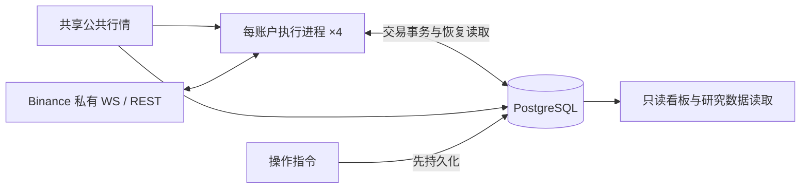

# 系统契约与架构重构

状态：用户已确认完整设计；业务决策 Q1–Q9 与工程方案是后续实施契约，不代表已实现。文档清理已完成；当前任务仅整理测试与必要测试配置，不实施业务代码重构。日期：2026-10-12。代码基线：`84a75112`。本文是唯一维护文档，其他跟踪的 Markdown 文档已退役。测试仅在本次授权范围内迁移；不删除业务代码、部署配置或历史数据。规则修改只更新本文，阶段结果通过 Git 提交与测试输出记录，不另建报告。

## 1. 范围与已确认决策

|决定|契约及取舍|
|---|---|
|Q1：行为不变|保持信号、参数、准入、批次归属和退出时机；重构不顺带选参。|
|Q2：实盘为主|四账户实盘、公共行情、只读看板和必要运维保留；研究只保留数据接口，不扩展实盘执行生命周期。|
|Q3：局部隔离|未知提交按账户、标的、持仓方向隔离，禁止该范围增加风险；其他健康范围继续运行，退出仍验证可信可减数量与订单责任。|
|Q4：旧历史只读|旧记录保留可查，不要求新引擎精确重演全部旧决策；活动持仓、未知订单、未完成结算与必要去重依据必须接续。|
|Q5：每账户一个进程|账户同步与交易执行合并，接受共同重启的代价；四账户互相隔离，公共行情、PostgreSQL、看板共享。|
|Q6：有限核验|启动、重连、未知结果和事实差异定向查证；正常低频核验当前订单与持仓，无差异不全量重建。|
|Q7：必要持久化|命令、真实成交、预留、活动批次与可恢复当前状态持久化；派生视图留内存，观察与诊断有界，不永久复制全部内部步骤。|
|Q8：无遗留责任切换|逐账户停新入场，由旧引擎按原规则完成交易责任后切换；不要求带仓在线迁移，但新引擎必须能带仓重启。|
|Q9：未知转低频|快速查证预算耗尽后告警、保持隔离与责任，转低频查询；新证据及时处理，不把查不到当拒单。|

保留 Binance USD-M、PostgreSQL 和现有行情接口，不新增 Redis、Kafka、通用 EventBus、交易框架或统一大状态枚举。工程细节按本文契约选择最小实现，不将每个私有方法变成用户决策。

## 2. 业务语言与行为基线

**实盘账户**：独立承担交易结果与风险额度的账户；不同账户实际持仓不要求相等。
**持仓范围**：账户、标的与持仓方向确定的责任范围；隔离一个范围不等于暂停整个账户。
**开仓订单**：一次独立委托，部分成交仍属于同一订单。
**持仓批次**：按既有归属规则共同承担退出责任的真实成交集合。
**退出责任**：需要确认、撤销或结算原退出订单，并对可信剩余数量执行原退出规则的业务义务。
**未知提交**：不能确认交易所是否接受订单的结果；不是拒单或零成交。
**核验**：取得交易所证据并与本地事实比较；不等于重建或改写持仓。
**研究数据接口**：提供行情与交易证据读取，不拥有实盘执行决定权。

业务基线冻结于实施前的当前可运行版本与每账户完整实效配置，使用测试夹具记录，不在本文复制易过时的参数值。仓库回退参数与服务器覆盖值可能不同；slots 与每批开仓订单上限不是同一参数。配置来源为 `deploy/live-runtime.yaml`、合并 Compose、角色环境及 PostgreSQL 风险配置，比较完整展开结果而非只看哈希。

必须保持：部分成交按订单身份计入场次数；同批追加按真实数量加权成本，最新开仓推进时间锚点；退出提交封闭原批次，后续开仓按既有规则归入新批次；迟到旧成交不改写新锚点。正式 15m 收盘独立触发退出，跳过最新开仓所在 K 线。宽限限价关联原批次和首次截止时间，重试不重置截止；到期确认撤单及原订单责任后只退出真实剩余量。旧批预留在聚合仓位上仍有效，不能忽略。停入场、开始定时平仓和恢复准入是独立边界。

## 3. 目标执行拓扑与职责



目标核心常驻拓扑：公共行情、PostgreSQL、只读看板、四个账户执行进程。研究读取/导出按需运行，不作为实盘启动依赖；必要持续行情采集由共享行情承担，必须验证研究所需数据仍可获取。迁移与维护任务不计为核心常驻模块。现有服务名可保留，不能为了命名统一制造兼容层。

|模块|唯一职责|对外接口内容|
|---|---|---|
|策略|行情计算、业务意图|输出入场/退出意图，不修改执行账本。|
|账户执行引擎|命令、成交、批次、预留、版本与恢复结论的裁决|接收业务意图、外部事实、时间触发与持久操作；返回已提交结果、失效或待证据原因。|
|交易所适配器|协议、凭证、REST/WS 与明确响应分类|发送、接收、按身份查询；不自行判断批次已平。|
|持久化适配器|明确事务、CAS、唯一约束和作用域读取|保存准备、事实及当前责任；不维护第二套业务状态。|
|查询与运维|读取事实、展示原因、提交明确操作|只读展示不裁决交易；操作先入库，由执行引擎消费。|

调度与核验是引擎内部职责，不另造全局 Manager。一个事实裁决入口不等于巨型类：协议解析、纯计算及 SQL 可以拆分，调用方不用拼装内部 head、checkpoint 和恢复标记。删除层前证明其不变式有明确归属；只转发且增加调用知识的层移除，不把复杂性摊到调用方。

每账户直接接收私有事件，退役本账户 AccountEventHub 中转及独立同步写入者；合并时保留 read/trade 凭证角色，不自动回退通用密钥，两个角色不需要提现权限。共享行情 Hub 的连续性与有界缓冲保留。正式收盘、宽限时钟、私有事件接收、订单网络请求必须独立免阻塞；使用有限任务与队列，不要求全局同步串行。每账户只有一个有效派发者；切换不得双跑旧新写入者。

## 4. 权威事实、事务与内存

交易所决定是否接单与实际成交；PostgreSQL 保存已接受的证据和本地交易责任；内存是作用域内可重建的工作集。账户快照用于核验，不凭快照差额合成订单成交或批次成本。

|数据|内存|持久化及转移时点|
|---|---|---|
|行情/指标|有界窗口、最新可执行报价|研究所需数据按既有接口保留；观察值不替代交易证据。|
|命令|活跃请求、调度、查询任务|POST 前原子记录稳定身份、请求摘要、准备状态及预留；记录发送阶段，崩溃后不能假定未发送。|
|真实订单/成交|当前水位与近期去重索引|按订单身份及真实 trade ID 唯一归账；事务内更新数量、批次、预留及当前版本。|
|活动状态|当前批次、退出边界、风险占用|可恢复记录包含订单归属、成本、时间锚点、未完成结算与原截止；事务成功后发布。|
|核验状态|有限待查 key、原因、预算与退避|跨重启责任来自持久命令与当前状态；保留已验证覆盖及身份所需依据，不复制所有核验步骤。|
|诊断|有界队列与计数|最小订单/决策原因摘要及运行日志；大份内部快照不默认写入。|
|历史|热索引有限，冷记录按需查询|已结束历史只读；永久或等价摘要保留迟到输入校验，不能 TTL 到期失忆。|

采用最少必要事务：准备命令与预留；接纳订单/成交并结算；持久化操作。尽量复用既有表、迁移与唯一约束，不平行建立第二套权威。相同身份相同请求幂等，相同身份不同载荷冲突。数据库提交失败不发布，成功后局部发布；CAS 冲突读新状态或结束失效意图，不覆盖更新版本。事务候选只复制受影响范围，跨 key 约束使用明确数据库原子检查。

活动状态应能直接加载，加真实证据与定向核验接续，不依赖全量历史 journal 重演。旧读接口仅供历史查询；新写入退出重复内部 journal/checkpoint/policy 快照前，先证明活动恢复、引用与去重契约完整。准备与派发可以共享命令记录，但不同持久化义务不能仅因都叫 outbox 就合并。

应用互斥锁不等待网络、数据库、退避、上下文、遥测或文件 I/O；数据库事务锁不跨 HTTP。网络等待不占同 key 的退出派发通道，恢复有预算和公平调度。创建资源的装配者负责失败、取消和关闭释放。

## 5. 状态与异常结束条件

正交状态是权威事实的派生视图：命令 PREPARED/SENDING/WORKING/UNKNOWN/TERMINAL；持仓 FLAT/OPEN；事实 READY/PENDING/CONFLICT；门控 ACTIVE/EXIT_ONLY/HALTED。不要额外维护组合枚举或可写状态副本。订单终态不等于持仓归零，也不等于结算完成。

有效终态不可逆，迟到 ACK、UNKNOWN、失败补偿不复活订单、pending、预留或派发记录；真实迟到成交可以补账，重复终态可以完成结算缺口，不重复计量。身份与数值校验在终态接纳前仍执行。超时、TTL、查不到和列表缺席不是终态证明。

|分类|条件|动作及结束|
|---|---|---|
|忽略|已验证重复且没有新事实或结算缺口|幂等无操作，不恢复。|
|放弃机会|入场候选失效，确认未发送且无未知提交|结束候选，不自动刷新；已准备责任幂等结清，不改写同身份既有终态。|
|定向查证|可能已发送，或撤单/成交结果未知|原身份查询，不重发；快速预算耗尽后隔离告警转低频。|
|隔离恢复|事实矛盾、覆盖缺口或持久化故障|限制受影响风险，取得证据后补账/重建；原因可见，禁止吞掉或伪装正常。|

正常投影版本竞争不是事实冲突。退出候选可重新按可信剩余量评估，但不能丢掉原退出义务或重复发送未知命令。部分成交撤单保留真实成交，只释放有证明的未成交预留。Hedge 业务 reduce_only 与 WS R 解耦：BOTH 保持一致校验；LONG/SHORT 按 side+positionSide 判定，合法关闭 R=false 可接受，请求不带 reduceOnly，其他身份与数量校验不削弱。

## 6. 核验与健康

启动先加载活动责任，再核验账户当前委托、持仓与相关成交；事实不全只隔离相应范围。重连校验私有流缺口，不能仅连接成功就准入。正常核验只取得当前订单/持仓快照，有差异才查相关订单和真实成交，不每轮重建。

一个 key 同时最多一项核验，按实质证据版本合并；普通时间戳刷新不重置退避或预算。无进展终止本轮快速查询，保留低频任务及隔离，新相关证据允许提前唤醒。每次执行前复核截止和证据，不能仅在 request 入口做检查。核验与低频间隔、快速查询次数及超时为有限配置，先沿用现有有效值并用测试固定，实施时在启动摘要中输出实际值；调整须有请求预算和差异发现时间依据，禁止无限重试。

当前可信度来自最新持久状态、真实证据与最新核验覆盖，而非旧恢复 checkpoint 的年龄。历史完整对象不阻塞当前健康，未解决历史责任仍属活动范围。冲突不能通过降低告警或放宽新鲜度消除。

健康分别显示进程存活、数据连续性、事实可信度、入场能力、退出能力；输出隔离范围、原因、未确认年龄、核验进展及下次时间。监控不反向改写交易事实。队列必须有界，最老等待时间按当前队首计算；交易事实溢出明确标记缺口并查证，观察通道可覆盖旧值，不能静默丢交易证据。

## 7. 实施任务与退出条件

所有目标尚未验收；开始时记录 HEAD、现有差异和业务夹具。逐任务完成必要测试后继续，不按提交名称认定完成。

|任务|入口及变化范围|退出条件|
|---|---|---|
|T1：固定行为与可靠性|现有 domain/execution、orders/coordinator、live_rollout 及相关测试；核验已有修复|补偿不拒绝已终态命令、原失败不被二次异常覆盖；退避执行前校验；修正当前 coverage 读取与队列年龄；行为夹具冻结，完整链路回归通过。|
|T2：事实与事务收敛|ExecutionBook/现有持久化适配器，活动状态加载与历史只读|命令、成交、预留、批次各有唯一裁决路径；活动恢复不扫全历史；关闭重复写入前完成崩溃点验证；不能破坏旧引擎正在使用的表与协议。|
|T3：账户进程合并|execution_account 接收、live_rollout 装配、CLI、Compose及部署脚本|每账户同步+执行一个进程；read/trade 角色仍明确；事实接收与退出免网络阻塞；旧新不双跑；四账户配置和研究数据接口保持可用。|
|T4：删层与运维验收|移除重复恢复入口、中转Hub、纯代理及已退役功能；查询与告警只读|不存在两套事实权威；模块退出清单以提交记录；同负载测量查询量、延迟、内存和写入成本；切换/回退在 fake exchange 与测试库验证。|

不删已有迁移，不直接截断历史表，不添加生产自动裁剪；新旧阶段须使用兼容新增结构或明确停止旧写入者的离线切换。下游 Agent 修改接口时更新调用方和测试，不用静默 fallback 保持表面通过。单文档之外不增 glossary、ADR、审计或阶段总结。

## 8. 验收矩阵

|场景|必须证明|
|---|---|
|相同冻结行情、成交和时间输入|新旧信号、准入、批次、退出触发与数量一致；不同内部排程不产生重复订单。|
|WS 终态先于 REST ACK；重复和低累计量|身份正确的终态不被混合时钟丢弃；状态和水位不回退；真实成交/释放仅一次。|
|命令终态后投影冲突及失败补偿|真实账本、测试 PostgreSQL、调用方及 supervisor 完整链不因可恢复补偿退出；真正数据库故障仍可见。|
|数量10成交3后撤单、终态后迟到成交|实际持仓3、未成交7有证明才释放；迟到真实成交补记，退出责任不遗漏。|
|POST超时或调用方取消，GET挂起；同key退出|只POST一次，UNKNOWN及预留保留；经过证明的退出可派发，网络不持应用锁。|
|快查询预算耗尽，同证据连续账户事件|不绕过退避、不热循环；转低频；相关新事实及时处理，其他key公平运行。|
|候选过期/正常版本变化且未发送|POST=0、不自动追逐信号、不启动无关恢复，未发送责任结清。|
|同数量两退出竞争、CAS/commit失败|不超预留；失败无发布；成功版本单调；跨key候选不污染其他状态。|
|准备后/发送后/事实提交后/发布前逐点崩溃|重启正确区分未发送与未知，恢复命令、批次、成本、原截止和去重，不合成事实。|
|新覆盖与状态更新而旧checkpoint未变|当前证明仍能使用最新合法覆盖；缺覆盖仍待证据，真实冲突仍隔离。|
|Hedge及BOTH，队列溢出/关闭，行情与私有断线|协议负例仍拒绝；交易缺口可恢复；最老时间准确；关闭不挂死；缺口不凭连接成功清除。|
|停入场→原规则退出→无遗留→切换与回退|不提前平仓、不遗弃未知订单、不双跑；兼容性检查失败停止操作而非清库。|

异步交错用 Event/屏障，等待有界，不靠 sleep 竞争；Decimal 计量。单测之外，事务、恢复和迁移使用独立测试数据库及 fake exchange；禁止实盘库与真实交易权限。每任务输出测试命令、结果、未覆盖项；删除/跳过失败断言不能算通过。性能按同负载基线，不承诺未测量百分比。

### 8.1 验收对应关系

`tests/acceptance/` 为本次新增的目标架构验收，`pytest tests/acceptance -q` 运行（67 项；当前 60 通过、7 预期失败）；其余为既有回归，命令见第9节。新增验收按业务接口断言，允许在旧实现上失败；未覆盖与不可执行项在 Codex 审核前不得记为通过。“通过”只表示该用例声明的契约片段已满足，不等于整行验收完成。

|场景|代表性验收|状态|
|---|---|---|
|行为不变（信号/准入/批次/退出）|`tests/fixtures/b2_anonymized_timeline.py`＋`tests/unit/execution/test_b2_timeline_contract.py`、`test_position_batches.py`、`tests/e2e/test_golden_path_lifecycle.py`|既有，通过|
|WS 终态先于 ACK、重复、低累计量、错误身份|`test_execution_facts_acceptance.py`（混合时钟终态、重复终态、低累计量不回退转查证、错误身份拒绝）|新增，通过|
|终态后投影冲突及失败补偿|`test_failure_compensation_chain.py`（补偿不拒绝终态命令、原失败不被二次异常覆盖、命令被门控以便重驱动）；真实事务见 `tests/integration/persistence/test_authority_book_transactions.py`。完整链见未覆盖|部分通过，完整链未覆盖|
|部分成交撤单、终态后迟到成交|`test_execution_facts_acceptance.py`（含真实 PostgreSQL 重启后 3 已成交/7 才释放）；`tests/unit/execution/test_terminal_settlement.py`|新增，通过|
|POST超时/取消、GET挂起、查不到、同key退出|`test_execution_facts_acceptance.py`；`tests/e2e/test_order_execution_fake_exchange.py`、`tests/unit/live_rollout/test_lock_free_execution.py`|新增，通过|
|同证据连续事件、退避、预算耗尽转低频|`test_backoff_deadline.py`（同证据不新增尝试、到期恰好一次）；`test_recovery_budget_low_frequency.py`（预算耗尽保留责任、worker 在低频截止前不重复花费、无差异核验不重查已确认订单）|退避预期失败；预算与无差异核验通过|
|候选过期/未发送版本变化|`test_execution_facts_acceptance.py`（过期候选零 POST、引擎拒绝路径的预留结清幂等）；`tests/unit/live_rollout/test_entry_control.py`。入口自动结清：不可执行|新增，通过＋部分不可执行|
|同数量退出竞争、CAS/commit失败、跨key隔离|`test_execution_facts_acceptance.py`（含真实 PostgreSQL commit 失败不发布、版本单调）；`tests/unit/execution_account/orders/test_reservation_integrity.py`|新增，通过|
|带仓重启与逐步真实进程崩溃|`test_process_crash_recovery.py`（真实子进程 `os._exit` 于准备后/发送后/事实提交后/发布前，父进程仅按 PostgreSQL 恢复：未发送 vs 未知、预留、批次、加权成本、去重、不合成、不重发）；`test_exit_and_safety_acceptance.py::test_restart_with_open_position_keeps_batches_and_grace_deadline`；`tests/integration/persistence/test_execution_book_epoch_adoption.py`、`tests/unit/execution/test_headless_command_recovery.py`|新增，通过|
|旧checkpoint＋完整后缀＋最新合法覆盖|`test_suffix_coverage_proof.py::test_newer_legal_coverage_proves_an_old_checkpoint_with_complete_suffix`（真实 PostgreSQL；缺覆盖对照仍未知）|新增，预期失败|
|Hedge/BOTH 协议负例|`test_exit_and_safety_acceptance.py`（R=false 合法关闭、请求不带 reduceOnly、身份与数量负例）；`test_hedge_reduce_only_plan_that_would_increase_exposure_is_refused`|新增，预期失败（自相矛盾的 reduce_only 计划仍被 POST）|
|队列溢出/关闭、最老时间|`test_exit_and_safety_acceptance.py`（溢出计数并转恢复、关闭不挂死）；`test_observation_queue_age.py`（溢出计数转恢复、关闭有界不丢事实、排空清零）。最老时间见未覆盖|部分通过，最老时间未覆盖|
|行情/私有断线不凭重连准入|`test_exit_and_safety_acceptance.py`（重连不足以恢复准入、私有缺口不因重连清除）|新增，通过|
|停入场→退出→无遗留→切换与回退|`test_exit_and_safety_acceptance.py`（停入场/定时平仓/恢复准入互相独立、单次零仓不证明责任结束、不兼容状态停止恢复而非清库）；切换与回退的“不双跑/有序切换”尚无接口|部分不可执行|
|四账户隔离、唯一有效写入者、单进程装配、冻结参数|`tests/smoke/test_server_deployment_manifest.py`（read/trade 隔离、显式实盘开关、冻结参数）；`test_topology_and_persistence.py`（每账户至多一个有效写入者租约＝通过；每账户单进程同时持有同步与执行角色＝预期失败，当前每账户 2 进程）|部分通过，单进程装配预期失败|

未覆盖（本轮无有效可执行验收，不得记为通过）：

- **执行器级补偿原子性**：exchange 结果已返回但事实提交失败时，引擎会记录原始投影冲突并门控恢复；但经公开入口复现时失败的 UNKNOWN 转换不在同一事务内记录自身失败（`OutboxEntry.last_error` 为空），无法证明“失败补偿在同一事务内记录”。需在持久层暴露事务内的补偿失败记录或返回可读结论。
- **入口自动结清未发送责任**：现无生产入口在提交前拒绝已准备命令，只能验证引擎拒绝路径的幂等结清。
- **队列最老等待时间**：无法在不替换共享 `time.monotonic` 的前提下隔离被测组件时钟；替换会同时驱动 asyncio 超时，冻结时钟后 `wait_for` 无法按真实时间退出。需要被测组件可注入单调时钟（构造参数或模块级已注入的 `time` 代理）后才能写出有界且正确的验收。
- **完整补偿链（可恢复补偿不导致退出）**：需真实 PostgreSQL＋持续消费的生产调用方＋真实 supervisor，并验证可恢复异常后 worker 继续处理下一事件。现有用例只覆盖补偿路径、门控与原失败不被覆盖；未设 supervisor 用例，因为把一次性函数注册为常驻账户任务只会让 supervisor 正确报告“关键任务意外停止”，不构成补偿证据。

已闭环（本轮新增）：逐步真实进程崩溃恢复（`test_process_crash_recovery.py`，真实子进程 `os._exit`）；未知查询预算耗尽转低频与无差异核验不重建（`test_recovery_budget_low_frequency.py`）；四账户唯一有效写入者租约与必要证据重启可恢复（`test_topology_and_persistence.py`）。

不可执行与桥接需求（交 Codex 审核）：切换/回退缺少每账户单一有效写入者与有序切换的控制面。最小契约：输入 `{environment, account_label, desired_writer_id, schema/format_version}`，输出 `{allowed, blockers[]}`，blockers 枚举未平仓位、活动/未解决订单、未知提交、未完成预留与结算；并需在首次写入前获取持久派发所有权令牌。所有权或格式不兼容失败时中止切换且不改动既有持久状态。现有接口只能表达停入场（`LiveEntryControlGate`/`DRAINING`）和单仓位不兼容格式拒绝（`restore`），无法观测两个写入者是否同时生效。

## 9. 开发、切换与必要运维

本文命令以现有仓库工具为入口，目标新拓扑尚未实现；修改 CLI/Compose 后同步更新本节，不复制旧服务名作为新设计要求。执行任何命令先检查目标版本的 --help 与环境，密钥不放 Git、文档、日志或看板。

本地开发：`.venv/bin/python -m pip install -e ".[dev]"`；`docker compose up -d postgres`；独立本地数据库上执行 `.venv/bin/alembic upgrade head`。测试库连接与安全规则见 `tests/conftest.py`，不能指向生产。

```bash
rtk proxy .venv/bin/python -m pytest tests/unit tests/smoke tests/e2e -q
rtk proxy .venv/bin/python -m pytest tests/integration -q
rtk proxy node --test tests/frontend/*.test.mjs
rtk proxy .venv/bin/ruff check src tests
```

部分网络测试需显式 opt-in；报告跳过项，不能记通过。研究源码/数据可能在 Git 忽略的 `local_optimization/`、`server_exports/` 与 data 中，不能靠 Git 恢复；数据接口改动不删除这些目录。历史结果和退役 CLI 不作为当前验收。

部署入口为 `deploy/ops/update_server.sh`；基础配置 `compose.server.yaml`，账户 overlay `compose.live.accounts.yaml`，环境 `.env.server`/`.env.live` 权限0600。合并Compose只操作明确账户服务，禁止单文件 --remove-orphans 或不加服务名意外启用全实盘。迁移前核对版本、schema及旧写入者，代码回退不自动回退数据库。源文件 `deploy/ops/`、`--help` 与目标机器 unit 是操作细节权威，不复制全部安装脚本。

切换顺序：持久停入场→旧引擎按原规则退出→核验零仓、无活动挂单、无未知提交、无未完成预留/结算→停止该账户旧同步与执行→部署新进程→核验凭证、参数、账户事实与能力→按操作指令恢复入场。订单状态、DB责任与交易所快照共同核对；单次零仓不证明责任结束。等待期间有仓不能停退出通道。停入场不是紧急平仓；只有明确操作才 request-flatten，接受指令不代表已平。

回退先停入场并检查新格式兼容及当前交易责任，不能将带仓新状态交给不兼容旧版本。备份包含数据库与归档完整root/manifest；同机压缩归档不是异机备份。维护先dry-run，保护活动引用、未知订单、成交身份、累计水位及未结算责任；旧timer按现场unit核验，不自动启用裁剪。普通VACUUM复用页，不等于文件缩小；实盘期间不执行VACUUM FULL，不关闭fsync/full_page_writes。

保留轻量主机告警与必要账户心跳；通知配置在受控env，监控失败不改变交易结果。查看 `journalctl -u cml-ops-monitor.service`、容器日志、`/api/health/operational`、`/api/readiness` 与 `/api/risk-execution`，容器healthy不证明交易正确。存储增长须连续采样，不用存量冒充增速；CPU、内存、队列和恢复原因按时间窗口记录。

当前授权范围为测试整理、必要测试配置及本文同步更新；不得实施业务代码重构、自动提交、推送、部署、改生产参数、停止实盘或删数据。本文 T1–T4 是后续开发依据，执行须有新的任务授权。后续上线需用户明确授权；部署后至少连续观察24小时，并覆盖自然订单、正式收盘及宽限截止，未覆盖交易样本明确报告。


## 10. 测试迁移规则

测试入口沿用策略意图、账本结果、交易所协议、持久化事务及运行/操作接口，不为目标架构尚不存在的接口编造 Mock。允许内部测试作为诊断补充，但不能用私有字段布局、文件名或导入链规定模块必须继续拆分。

|分类|现有覆盖与迁移要求|
|---|---|
|contract|代表性策略信号、批次、终态/结算、提交发布、pending、日程、协议、订单协调、操作授权、真实事务及 fake exchange；重构必须保持业务断言，按新接口接线而非删除。|
|transition|账户/操作 Hub、账户 Channel、入场期望接线及旧检查点装配；当前实现仍使用，默认继续运行。T2/T3 引入替代接口并证明同等连续性、恢复与资源释放后才能退役。|
|其他|市场与研究数据接口、历史查询、维护保护及看板等测试照常运行；未标记不等于无用或可删除。|

标记仅用于选择与审查，不新增默认排除、跳过或 xfail。`pytest -m contract` 是代表性契约集合，不是全部验收；`pytest -m transition` 是过渡接口集合。完整测试仍执行第9节命令。

本次测试整理移除：旧文档措辞检查、旧细粒度导入图、私有发布辅助方法位置/返回形状检查、锁获取者文件白名单、看板查询文件归属检查。包的文档入口改由实际构建元数据验证；部署验证角色隔离、唯一派发者、显式实盘开关和冻结参数，不再要求旧双进程列表或内部checkpoint调度常量。只读客户端权限和领域不依赖外部适配器的约束仍保留。

旧历史只读不意味着删除数据库兼容、归档哈希与恢复保护测试；研究不常驻不意味着删除行情/数据完整性测试。现有全部测试通过不证明目标单进程、精简持久化或已知T1问题已实现；这些仍需按第8节新增真实交错与集成验收。


删除与替代覆盖：旧发布辅助方法测试由 `test_committed_command_publication.py` 的已提交结果竞争场景，以及 `test_authority_book_transactions.py` 的事务失败不发布和重启恢复覆盖；旧文档确认文字由 `apps/live_rollout/test_main.py` 的真实CLI确认测试和 `test_commands.py` 的紧急平仓授权保护覆盖；旧包间导入禁令退役，但操作授权测试保留为 `test_operator_command_authorization.py`。锁获取文件白名单删除，无I/O临界区检查与 `test_lock_free_execution.py` 并发/慢网络行为保留。

事实证明的 Mock 不允许 coverage 超出 checkpoint.event_cut；旧成功场景改为合法覆盖内事实与较新发布时间。它只验证发布时间不等于事实切口，不能替代T1“旧checkpoint＋新后缀＋最新合法覆盖”的完整验收；该已知缺口仍待实现并补真实持久化测试，不用非法夹具制造通过。
