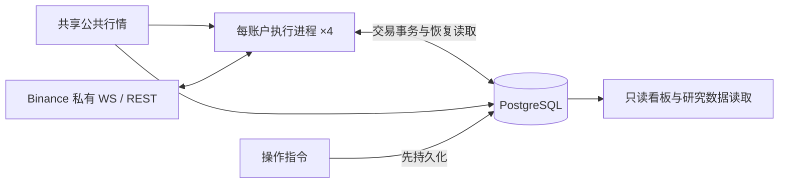

# 系统契约与架构重构

状态：业务决策 Q1–Q9 沿用已确认契约；T1–T3 已完成源码收敛，核心运行版本已部署。T4 的代码简化已部分完成；同负载生产性能对比仍未完成。生产先于 2026-10-15 通过 §8.25 的统一部署迁移到 `20261015_0066`，NextGen 的 `20261018_0067` 再新增 `live_position_batches`/`live_orders` 两张表；2026-10-18 现场版本为 `8403838d`、迁移版本为 `20261018_0067`。2026-10-21，提交 `0614e222` 已在四账户空仓、无挂单时全量部署，迁移至 `20261021_0068` 并删除 20 张退役表；归档校验和部署记录见本文件末尾。8 个 Compose 容器均通过健康检查。监控脚本热修复 `8a02f4ca` 已同步到服务器，`cml-ops-monitor` 完成一个 60 秒周期后仍 active/running。真实成交闭环仍无新样本，同负载生产性能对比未完成。

**当前源码说明（2026-10-21）**：NextGen 是唯一部署的交易运行时。本文 §8 及后续章节保存了旧 `live_rollout`/`ExecutionBook` 的决策与历史验收记录；其中测试名、源码行号和运行时描述不代表当前代码清单。旧 `ExecutionBook` 领域编排、证据/命令写入与恢复流程、PostgreSQL 写入适配器及其专属测试已从工作树移除；没有运行时调用方的成交恢复来源查询和订单身份查询也已删除。当前策略决策使用 `PositionView` 等账本值模型；研究寻优使用独立的 `local_optimization.SimulationLedger`。旧 `PositionBook` / `PositionLedger` 运行时实现已移除；0062 迁移通过投影 codec 与迁移专用 verification 编码转换 schema 1 head，`PositionLedgerBatch` 仍供当前决策追踪使用。无生产调用方的模拟发单适配器、预留协调器、重复交易规则模型与运行时元数据快照及其专属测试也已清理。未部署的纸面策略写入仓库及其专属模型和测试已移除；已有纸面历史仍由看板只读，行情服务仅查询未平仓纸面标的以维持行情订阅。看板、诊断、归档和独立运维工具仍使用其所需的共享表模型与查询逻辑。孤立的 PostgreSQL runtime-context 辅助函数、账户进程状态写入适配器及其领域类型已删除；看板当前权益查询改从 NextGen 运行清单枚举实盘账户。`execution_account_process_states` 和 `strategy_live_states` 已无当前 ORM 或查询调用方；旧表由 0068 归档校验后删除，历史内容保留在服务器归档目录。依赖已删除执行栈的历史诊断和性能探针仍有本机副本，但这些脚本位于 Git 忽略的归档目录，未纳入版本库，且不能在当前源码上运行；报告正文与采样输出继续保留。

第一轮本地已修复的阻塞项（§8.6，含机制删除；第 5 项已被 §8.8 收敛取代）：

0. 早期 8 项（上一轮）：真实账户流装配、无 Hub 风控状态、核验失败不清 gap、缺失当前记录 fail-closed、facts_hash 矛盾阻塞、部署失败状态匹配、派发所有权接入、真实装配端到端验收。这些机制的**结论**保留，其中第 1、3 项在 §8.6 被进一步修正。
1. **账户同步合并**（原实现只提取标的）：`in_process_producer.py` 现通过 `AccountUserDataState` 合并每一帧并发布 `account_snapshot`/`account_state`；启动 REST 基线、WS 增量、余额、持仓、挂单、账户状态与必要持久化全部接通；唯一当前账户事实生产者明确。
2. **私有流连续性与持仓变化**：事件源不再“尚未连接即 READY”；连接、断线、重连、流缺口、溢出与事实补齐全部驱动可信度与准入；期望只在真正新增/未知持仓上消费，已有可信持仓与带仓重启不再被反复隔离。
3. **部分持仓 head 缺失**：历史实现曾检查旧 journal/checkpoint 作用域；2026-10-14 本地收敛后不再查 journal/checkpoint，当前 head 以外只检查仍承担独立责任的命令、预留及身份记录。
4. **checkpoint 分支完整性**：历史实现曾把 head 成交与独立身份表交叉审计；2026-10-14 本地收敛后移除此重复全量读取。成交身份表只在接纳成交时负责永久去重。
5. **派发所有权**（实现已在 §8.8 收敛）：单一派发身份与租约令牌接通；首次写入前取得并校验；准备、发送记录与真实 POST/DELETE 前校验同一令牌；无租约/过期/他人持有/续约失败立即停止新开仓、平仓、撤单并保留 UNKNOWN 与在途责任。
6. **executing 持久操作恢复**：新增跨会话恢复规则，继续核验责任、接续未完成动作并记录结果；不把 `executing` 盲目改回 `requested`。

剩余未完成生产现场项（如实记录，保留待验证）：
- 生产网络延迟与私有流恢复时长：本次只执行交易所仓位/挂单读取，没有量化 REST/WS RTT、私有流重连间隔或交易所侧缺口时长。
- 生产长周期存储增速与多日内存稳定性：仍需连续 24 小时监控采样。
- 新版本真实交易闭环：部署观察期间没有自然开仓与成交，真实下单、成交和退出仍未验证。
- 未测量项：`executing` 操作在真实交易所网络分区下的重复投递频率；双进程竞争的最坏时延。账户部署前提为每账户单进程，不以双进程接管作为日常流程。

原代码基线为 `84a75112`；既有本轮基线为 `79b09e68`，工作区已有未提交改动完整保留并接续。本文是唯一维护文档；阶段结果通过测试输出与本文记录，不另建报告。2026-10-15 已执行全服务部署，现场结果见 §8.15；真实交易闭环和长周期观察仍未验证。

正文第1–7节定义目标与实施顺序；第8–10节为附录，分别保存验收矩阵与既有进展、开发运维、测试迁移规则。

## 1. 范围与已确认决策

|决定|契约及取舍|
|---|---|
|Q1：行为不变|保持信号、参数、准入、批次归属和退出时机；重构不顺带选参。|
|Q2：实盘为主|四账户实盘、公共行情、只读看板和必要运维保留；研究只保留数据接口，不扩展实盘执行生命周期。|
|Q3：局部隔离|未知提交按账户、标的、持仓方向隔离，禁止该范围增加风险；其他健康范围继续运行，退出仍验证可信可减数量与订单责任。|
|Q4：旧历史只读|旧记录保留可查，不要求新引擎精确重演全部旧决策；活动持仓、未知订单、未完成结算与必要去重依据必须接续。|
|Q5：每账户一个进程|账户同步与交易执行合并，接受共同重启的代价；四账户互相隔离，公共行情、PostgreSQL、看板共享。|
|Q6：有限核验|启动、重连、未知结果和事实差异定向查证；正常低频核验当前订单与持仓，无差异不全量重建。|
|Q7：必要持久化|命令、真实成交、预留、活动批次与可恢复当前状态持久化；派生视图留内存，观察与诊断有界，不永久复制全部内部步骤。|
|Q8：无遗留责任切换|逐账户停新入场，由旧引擎按原规则完成交易责任后切换；不要求带仓在线迁移，但新引擎必须能带仓重启。|
|Q9：未知转低频|快速查证预算耗尽后告警、保持隔离与责任，转低频查询；新证据及时处理，不把查不到当拒单。|

保留 Binance USD-M、PostgreSQL 和现有行情接口，不新增 Redis、Kafka、通用 EventBus、交易框架或统一大状态枚举。工程细节按本文契约选择最小实现，不将每个私有方法变成用户决策。

## 2. 业务语言与行为基线

**实盘账户**：独立承担交易结果与风险额度的账户；不同账户实际持仓不要求相等。
**持仓范围**：账户、标的与持仓方向确定的责任范围；隔离一个范围不等于暂停整个账户。
**开仓订单**：一次独立委托，部分成交仍属于同一订单。
**持仓批次**：按既有归属规则共同承担退出责任的真实成交集合。
**退出责任**：需要确认、撤销或结算原退出订单，并对可信剩余数量执行原退出规则的业务义务。
**未知提交**：不能确认交易所是否接受订单的结果；不是拒单或零成交。
**核验**：取得交易所证据并与本地事实比较；不等于重建或改写持仓。
**研究数据接口**：提供行情与交易证据读取，不拥有实盘执行决定权。

业务基线冻结于实施前的当前可运行版本与每账户完整实效配置，使用测试夹具记录，不在本文复制易过时的参数值。仓库回退参数与服务器覆盖值可能不同；slots 与每批开仓订单上限不是同一参数。配置来源为 `deploy/live-runtime.yaml`、合并 Compose、角色环境及 PostgreSQL 风险配置，比较完整展开结果而非只看哈希。

必须保持：部分成交按订单身份计入场次数；同批追加按真实数量加权成本，最新开仓推进时间锚点；退出提交封闭原批次，后续开仓按既有规则归入新批次；迟到旧成交不改写新锚点。正式 15m 收盘独立触发退出，跳过最新开仓所在 K 线。宽限限价关联原批次和首次截止时间，重试不重置截止；到期确认撤单及原订单责任后只退出真实剩余量。旧批预留在聚合仓位上仍有效，不能忽略。停入场、开始定时平仓和恢复准入是独立边界。

## 3. 目标执行拓扑与职责



目标核心常驻拓扑：公共行情、PostgreSQL、只读看板、四个账户执行进程。研究读取/导出按需运行，不作为实盘启动依赖；必要持续行情采集由共享行情承担，必须验证研究所需数据仍可获取。迁移与维护任务不计为核心常驻模块。现有服务名可保留，不能为了命名统一制造兼容层。

|模块|唯一职责|对外接口内容|
|---|---|---|
|策略|行情计算、业务意图|输出入场/退出意图，不修改执行账本。|
|账户执行引擎|命令、成交、批次、预留、版本与恢复结论的裁决|接收业务意图、外部事实、时间触发与持久操作；返回已提交结果、失效或待证据原因。|
|交易所适配器|协议、凭证、REST/WS 与明确响应分类|发送、接收、按身份查询；不自行判断批次已平。|
|持久化适配器|明确事务、CAS、唯一约束和作用域读取|保存准备、事实及当前责任；不维护第二套业务状态。|
|查询与运维|读取事实、展示原因、提交明确操作|只读展示不裁决交易；操作先入库，由执行引擎消费。|

调度与核验是引擎内部职责，不另造全局 Manager。一个事实裁决入口不等于巨型类：协议解析、纯计算及 SQL 可以拆分，调用方不用拼装内部 head、checkpoint 和恢复标记。删除层前证明其不变式有明确归属；只转发且增加调用知识的层移除，不把复杂性摊到调用方。

每账户直接接收私有事件，退役本账户 AccountEventHub 中转及独立同步写入者；合并时保留 read/trade 凭证角色，不自动回退通用密钥，两个角色不需要提现权限。共享行情 Hub 的连续性与有界缓冲保留。正式收盘、宽限时钟、私有事件接收、订单网络请求必须独立免阻塞；使用有限任务与队列，不要求全局同步串行。每账户只有一个有效派发者；切换不得双跑旧新写入者。

### 3.1 执行引擎的对外接口

对外接口按现有 `read`、`act`、`observe` 三类行为收敛，具体类型随调用方一起重构，不额外添加纯转发层。

|行为|调用方提供|引擎返回及承担的责任|
|---|---|---|
|读取 `read`|持仓范围、可信度要求|不可变当前视图、可减数量、活动批次、原因及不透明版本令牌；不暴露可写账本。|
|接纳 `act`|稳定意图身份、持仓范围、业务动作与数量、批次目标、有效期及所依据的视图令牌|已持久接纳的回执、重复回执、失效或待证据原因；预留、派发与恢复由引擎负责。接纳成功只证明本地准备事务成功，交易所结果由后续事实证明。|
|接纳事实 `observe`|适配器解析并保留来源身份的订单、真实成交或核验证据|已提交变更、重复、待证据或事实冲突；统一执行身份校验、去重、归账与结算。|

视图令牌由引擎生成，调用方只回传，不拼装 head、checkpoint 或核验覆盖。正式收盘与宽限时钟由内部调度转成业务意图；持久操作由引擎消费。启动恢复与关闭由运行时装配者管理。`coordinator`、预留注册表、发送阶段转换及恢复标记属于内部实现，调用方不分别修改。交易所适配器保留协议校验，业务责任仍由引擎裁决。

### 3.2 每账户单进程与重启

运行约束是每个账户始终只有一个执行进程。该约束由部署服务数量和启停顺序保证，不再用数据库租约、续约任务或每次发单的租约复核重复表示。升级时先确认旧进程停止，再启动新版；新旧写入者不能并跑。

正常重启可以保留真实持仓。新进程从当前执行 head 和未完成命令/预留恢复责任，并按原命令身份核实在途或结果未知的请求；不因进程重启生成第二个下单身份。版本切换遵守 Q8：仍有仓位、挂单、未解决命令或预留时，等待原退出规则结束后再切换；这不要求正常故障重启也先平仓。

### 3.3 第一性原理与删除准则

系统的必要工作只有：行情产生业务意图；发单前记录身份和风险占用；真实订单与成交更新批次和退出责任；异常后继续未完成责任；展示状态并接受明确操作。稳定身份、成交去重、短事务、未知结果查证、批次归属、退出预留、每账户单进程及独立退出调度由这些工作直接推导，不能为减代码而删除。

当前目标拓扑已较克制，执行内核仍偏复杂。2026-10-15 的本地修改移除了派生的 `account_reconciliation_heads`，查询直接从 reconciliation run 历史取最新记录；迁移 `20261015_0063`、`20261015_0064` 和 `20261015_0065` 分别删除该投影、账户 WS journal，以及持仓事实 journal 与独立 checkpoint 表。位置 checkpoint 已随当前执行 head 保存，旧 journal pruner、定时器和对应运维告警一并移除。生产数据库尚未执行这些迁移，现有数据不受本地修改影响。

schema 4 的 execution head 已直接保存当前 `PositionBook` 投影；启动解码恢复该投影，不从有限 `AccountFacts` 重算。`verification` 只保留当前可信度和恢复所需的有界来源信息，不保存成交历史。checkpoint 内的 projection 是较早 event cut 的恢复锚点，和当前 projection 含义不同。命令、预留、成交身份与订单水位按自身生命周期留存，不把历史事实重放成第二份当前状态。2026-10-15 又移除了 `account_user_data_journal` 的逐 WebSocket 事件写入、游标读取和基线 checkpoint 关联；已应用的账户状态、订单和成交仍走原有持久化路径，未处理事件留在进程内队列。

冷启动仍会为选中的标的加载来源、必要时再次读取全量仓位，并按 symbol 顺序查询成交；`ExecutionBook._staged_copy(key)` 已限于复制受影响的持仓映射，但仍复制若干账户级容器。Dashboard 已只查 Head 并过滤历史平仓 head，但会解码当前责任 head；生产响应时间尚未对比。`run_live_daemon` 的装配职责仍集中在大函数中。operator flatten 已改用稳定命令 ID，不再依赖 `run_id`。这些是可核实的优化点；固定的启动时延、Dashboard 时延和内存目标须由同负载测量得出。

当前持仓的直接状态表示已由 schema 4 head 实现，见 §8.14–§8.15；2026-10-21 的退役改动在空仓时全量部署并执行 0068，没有改变 head 格式。

一个账户的执行状态由一个明确所有者裁决。协议解析、纯业务计算、SQL 和有界任务可以拆分；辅助计算显式接收输入、返回结果，不通过多份 State 包装共享可变容器来分摊所有权。保留事务候选和提交后发布的必要语义，简化其表示及装配；不得用跨网络等待的大锁代替并发保护。

每个抽象都做删除检验：删掉后只是少了一次转发或状态同步，则合并；删掉后使去重、风险约束或错误处理散落到调用方，则保留并隐藏实现。只读查询表示可以存在，但不能各自成为可写裁决源。`read`、`act`、`observe` 是业务接口分类，不机械限制为三个方法；内部发送、恢复和资源生命周期方法应有明确调用范围。

简化的衡量对象是同一笔交易涉及多少内部表示、状态转换和跨模块协调。不得以增加 façade、Manager、Coordinator 或兼容 fallback 代替删除旧机制；替代路径验证通过后同步移除已失去职责的旧入口、重复写入与中转，历史只读兼容除外。

## 4. 权威事实、事务与内存

交易所决定是否接单与实际成交；PostgreSQL 保存已接受的证据和本地交易责任；内存是作用域内可重建的工作集。账户快照用于核验，不凭快照差额合成订单成交或批次成本。

|数据|内存|持久化及转移时点|
|---|---|---|
|行情/指标|有界窗口、最新可执行报价|研究所需数据按既有接口保留；观察值不替代交易证据。|
|命令|活跃请求、调度、查询任务|POST 前原子记录稳定身份、请求摘要、准备状态及预留；记录发送阶段，崩溃后不能假定未发送。|
|真实订单/成交|当前水位与近期去重索引|按订单身份及真实 trade ID 唯一归账；事务内更新数量、批次、预留及当前版本。|
|活动状态|当前批次、退出边界、风险占用|可恢复记录包含订单归属、成本、时间锚点、未完成结算与原截止；事务成功后发布。|
|核验状态|有限待查 key、原因、预算与退避|跨重启责任来自持久命令与当前状态；保留已验证覆盖及身份所需依据，不复制所有核验步骤。|
|诊断|有界队列与计数|最小订单/决策原因摘要及运行日志；大份内部快照不默认写入。|
|历史|热索引有限，冷记录按需查询|已结束历史只读；永久或等价摘要保留迟到输入校验，不能 TTL 到期失忆。|

采用最少必要事务：准备命令与预留；接纳订单/成交并结算；持久化操作。尽量复用既有表、迁移与唯一约束，不平行建立第二套权威。相同身份相同请求幂等，相同身份不同载荷冲突。数据库提交失败不发布，成功后局部发布；CAS 冲突读新状态或结束失效意图，不覆盖更新版本。事务候选只复制受影响范围，跨 key 约束使用明确数据库原子检查。

每个持仓 key 的当前执行状态只从 `execution_book_heads` 加载；head 必须自包含继续持仓、退出和结算所需的全部当前责任。持久命令、未完成预留和稳定订单/成交身份作为相关责任及唯一约束读取。正常启动、重连和健康判定不读取 journal/checkpoint；交易所核验发现差异时按具体订单/成交查证并更新 head。旧 journal/checkpoint 表不参与 live 当前状态路径；本地源码已移除其运维清理器，迁移 `20261015_0064`–`20261015_0065` 会在获准部署时删除旧表。准备与派发可以共享命令记录，但不同持久化义务不能仅因都叫 outbox 就合并。

短内存发布锁不等待 I/O。每个持仓 key 的本地写入锁从候选生成一直覆盖短数据库事务和提交后发布，避免同一进程的多个协程拿同一旧版本提交；不同 key 仍可并行。该锁不覆盖交易所或其他网络请求，数据库 CAS 仍负责事务内版本检查。网络等待不占同 key 的退出派发通道，恢复有预算和公平调度。创建资源的装配者负责失败、取消和关闭释放。

### 4.1 准备、发送、结算与发布

本节及核验中的持仓 key 为 `{environment, account_label, symbol, position_side}`；订单和真实成交另按各自稳定身份去重。同 key 的本地持久写入先串行生成候选，再由数据库版本与原子约束提交；同 key 的网络请求不占用状态裁决通道。

1. **准备**：从不可变已提交视图计算受影响范围的候选，复核意图有效期、可信度与所有权。在一次短事务内按预期版本写入稳定命令身份、请求摘要、预留和当前责任；账户额度、聚合仓位及旧批预留等跨 key 约束原子检查。失败不改内存，成功后发布已准备结果。
2. **发送**：有限派发任务复核最新责任、有效期与所有权，将发送阶段持久提交后才执行 HTTP。应用锁与数据库事务均已释放；同一命令不会被两个任务派发。准备或发送阶段记录后的崩溃按持久证据恢复，可能已发送的命令进入 UNKNOWN 查证，不以重发补偿。
3. **结算**：REST 响应、私有 WS 与定向查询都经 `observe` 接纳，重新读取最新版本并校验身份。在短事务内更新真实成交、水位、批次、预留和命令责任；WS 终态先到时，后续 ACK、超时或补偿不能覆盖终态。
4. **发布**：提交成功后在短临界区安装受影响范围的不可变视图，版本单调；较旧提交结果不覆盖较新内存。提交成功但发布前崩溃，从数据库直接恢复；事实已经提交不能因发布失败改成交易失败。

准备遇到 CAS 冲突时读取新版本并返回失效，入场不自动追逐信号；退出保留原义务，按最新可信可减量重新评估。真实事实结算遇到 CAS 冲突时保留输入，重读并有界重试，不丢弃成交；持续失败隔离并进入恢复。同 key 入场或查询 HTTP 等待期间，经过最新预留与责任校验的退出仍可调度。

### 4.2 直接恢复当前责任

新执行路径围绕以下四类持久信息组织；这是逻辑分类，不规定表数，不新造通用状态框架：

|持久记录|职责|
|---|---|
|每 key 一个 `execution_book_heads`|唯一当前持仓状态；自包含批次、数量/成本、退出边界、当前成交关联、覆盖/连续性及待恢复原因，并以 revision 做 CAS。|
|命令与预留|独立订单生命周期、未知提交和风险占用；与 head 在同一事务中推进，不能被 head 缺失静默忽略。|
|订单/成交身份约束|只负责幂等、累计水位和同身份异载荷冲突；不参与重建另一份持仓投影。|
|历史成交|用于报表、审计和针对具体差异的查证；不与 head 共同裁决当前持仓，也不全量重放来启动。|

主路径为“读取相关当前状态→校验意图或证据→短事务更新事实和当前责任→提交后发布内存视图”。真实成交和对应当前状态必须原子提交，不能先记成交再异步补当前状态。当前记录缺失、格式不兼容或相互矛盾时明确阻塞相应范围，不能静默退回全历史重演以掩盖目标路径未完成。

启动为“加载活动责任→核验相关订单、持仓和必要成交→有差异才定向查证或修复”。加载集合必须包含未知提交、未完成预留/结算及无持仓但仍有订单责任的范围，不能只筛选非零持仓。只读历史和必要历史身份允许按订单/成交定向读取；已结束订单仍须识别重复、拒绝身份冲突并接纳真实迟到成交，不能靠清缓存或 TTL 遗忘。

新旧引擎按 Q8 无遗留责任切换，不扩大为带仓在线迁移工程；新引擎生成的活动状态必须支持带仓重启。优先复用现有存储与约束，需要迁移时明确新写入者启用条件及旧历史读取方式。旧恢复路径退出正常运行前，用真实 PostgreSQL 与 fake exchange 证明上述内容、逐点崩溃和迟到事实接续。

## 5. 状态与异常结束条件

状态分正交维度：命令 PREPARED/SENDING/WORKING/UNKNOWN/TERMINAL 表达第4节持久命令的恢复阶段；持仓 FLAT/OPEN、事实 READY/PENDING/CONFLICT 与有效门控 ACTIVE/EXIT_ONLY/HALTED 由已提交事实、核验覆盖和持久操作推导。发送阶段与停入场等操作不能只存内存；派生标签不另存可写副本，也不维护组合枚举。订单终态不等于持仓归零，也不等于结算完成。

有效终态不可逆，迟到 ACK、UNKNOWN、失败补偿不复活订单、pending、预留或派发记录；真实迟到成交可以补账，重复终态可以完成结算缺口，不重复计量。身份与数值校验在终态接纳前仍执行。超时、TTL、查不到和列表缺席不是终态证明。

|分类|条件|动作及结束|
|---|---|---|
|忽略|已验证重复且没有新事实或结算缺口|幂等无操作，不恢复。|
|放弃机会|入场候选失效，确认未发送且无未知提交|结束候选，不自动刷新；已准备责任幂等结清，不改写同身份既有终态。|
|定向查证|可能已发送，或撤单/成交结果未知|原身份查询，不重发；快速预算耗尽后隔离告警转低频。|
|隔离恢复|事实矛盾、覆盖缺口或持久化故障|限制受影响风险，取得证据后补账/重建；原因可见，禁止吞掉或伪装正常。|

正常投影版本竞争不是事实冲突。退出候选可重新按可信剩余量评估，但不能丢掉原退出义务或重复发送未知命令。部分成交撤单保留真实成交，只释放有证明的未成交预留。Hedge 业务 reduce_only 与 WS R 解耦：BOTH 保持一致校验；LONG/SHORT 按 side+positionSide 判定，合法关闭 R=false 可接受，请求不带 reduceOnly，其他身份与数量校验不削弱。

## 6. 核验与健康

启动先加载活动责任，再核验账户当前委托、持仓与相关成交；事实不全只隔离相应范围。重连校验私有流缺口，不能仅连接成功就准入。正常核验只取得当前订单/持仓快照，有差异才查相关订单和真实成交，不每轮重建。

一个 key 同时最多一项核验，按实质证据版本合并；普通时间戳刷新不重置退避或预算。无进展终止本轮快速查询，保留低频任务及隔离，新相关证据允许提前唤醒。每次执行前复核截止和证据，不能仅在 request 入口做检查。核验与低频间隔、快速查询次数及超时为有限配置，先沿用现有有效值并用测试固定，实施时在启动摘要中输出实际值；调整须有请求预算和差异发现时间依据，禁止无限重试。

当前可信度来自最新持久状态、真实证据与最新核验覆盖，而非旧恢复 checkpoint 的年龄。历史完整对象不阻塞当前健康，未解决历史责任仍属活动范围。冲突不能通过降低告警或放宽新鲜度消除。

健康分别显示进程存活、数据连续性、事实可信度、入场能力、退出能力；输出隔离范围、原因、未确认年龄、核验进展及下次时间。监控不反向改写交易事实。队列必须有界，最老等待时间按当前队首计算；交易事实溢出明确标记缺口并查证，观察通道可覆盖旧值，不能静默丢交易证据。

## 7. 实施任务与退出条件

T1–T3 已完成；T4 按可测证据逐项收敛。0068 已在四账户空仓时部署；同负载生产性能对比仍未完成。

|任务|入口及变化范围|退出条件|状态|
|---|---|---|---|
|T1：固定行为与可靠性|现有 domain/execution、orders/coordinator、live_rollout 及相关测试|补偿不拒绝已终态命令、原失败不被二次异常覆盖；退避执行前校验；修正当前 coverage 读取与队列年龄；行为夹具冻结，完整链路回归通过。|**闭环**：3542 passed / 9 skipped / 0 failed|
|T2：事实、当前状态与事务收敛|ExecutionBook/现有持久化适配器|每 key 一个直接表达当前持仓与退出责任的 head；移除内存及持久化 Journal 状态模型和历史事实重放；保留命令、预留、成交身份和订单水位各自所需的持久记录；验证重启、重复成交和迟到成交。|**已部署**：旧历史不参与运行时恢复的规则见 §8.14–§8.15；`20261015_0063`–`20261015_0065` 是 0067 的祖先迁移，0068 已归档校验并删除 20 张退役表|
|T3：账户进程合并|execution_account 接收、live_rollout 装配及 Compose|每账户一个进程；私有事件接收、账户同步与执行真正合并装配；退役本账户旧 Hub 依赖、客户端与 URL 参数；保留 read/trade 凭证角色。|**闭环**：`InProcessAccountEventSource` + `DirectPositionExpectationPublisher` + `AccountPositionExpectationRegistry` 进程内合并装配；移除 Compose/Manifest/Env 中 Hub 依赖；`test_single_account_in_process_lifecycle_private_events_to_exit_and_shutdown` 验证闭环|
|T4：按测量做性能与装配收敛|基线读取、候选复制、Dashboard、运行时装配|先记录同负载的冷启动耗时/REST 调用、单 key 事务耗时与复制规模、Dashboard 响应时间；只优化测得的热点；不预设固定时延目标或新增通用分层。|**部分完成并已部署**：Dashboard 历史 head 解码已从源码移除，flatten 身份已改为稳定操作 ID；`_staged_copy` 只做合成基准，冷启动和 Dashboard 尚无同负载生产对比|

不删已有迁移，不直接截断历史表，不添加生产自动裁剪；新旧阶段须使用兼容新增结构或明确停止旧写入者的离线切换。下游 Agent 修改接口时更新调用方和测试，不用静默 fallback 保持表面通过。单文档之外不增 glossary、ADR、审计或阶段总结。

实施顺序保持 T1→T2→T3→T4。先根据验收缺口修复现有可靠性问题，再收敛事实、事务和调用接口，最后合并进程及移除被替代的层。T2 的提交与恢复路径未闭环时，不以进程合并推进切换。

删层随 T2/T3 的替代验收同步进行，不能全部推迟到 T4。每步验收必须回答：一笔成交是否只经过一条业务裁决路径；带仓重启是否直接恢复当前责任；旧入口、重复写入及状态协调是否实际减少。使用行为测试、真实事务与调用路径证据，不靠文件名、方法数量或源码字符串检查证明简化。比较改动前后的必要持久化写入、恢复读取范围、处理延迟及资源占用；未测量项明确列出，不承诺固定缩减比例。

---

## 8. 附录 A：验收矩阵与进展

|场景|必须证明|
|---|---|
|相同冻结行情、成交和时间输入|新旧信号、准入、批次、退出触发与数量一致；不同内部排程不产生重复订单。|
|WS 终态先于 REST ACK；重复和低累计量|身份正确的终态不被混合时钟丢弃；状态和水位不回退；真实成交/释放仅一次。|
|命令终态后投影冲突及失败补偿|真实账本、测试 PostgreSQL、调用方及 supervisor 完整链不因可恢复补偿退出；真正数据库故障仍可见。|
|数量10成交3后撤单、终态后迟到成交|实际持仓3、未成交7有证明才释放；迟到真实成交补记，退出责任不遗漏。|
|POST超时或调用方取消，GET挂起；同key退出|只POST一次，UNKNOWN及预留保留；经过证明的退出可派发，网络不持应用锁。|
|快查询预算耗尽，同证据连续账户事件|不绕过退避、不热循环；转低频；相关新事实及时处理，其他key公平运行。|
|候选过期/正常版本变化且未发送|POST=0、不自动追逐信号、不启动无关恢复，未发送责任结清。|
|同数量两退出竞争、CAS/commit失败|不超预留；失败无发布；成功版本单调；跨key候选不污染其他状态。|
|准备后/发送后/事实提交后/发布前逐点崩溃|重启正确区分未发送与未知，恢复命令、批次、成本、原截止和去重，不合成事实。|
|新覆盖与状态更新而旧checkpoint未变|当前证明仍能使用最新合法覆盖；缺覆盖仍待证据，真实冲突仍隔离。|
|Hedge及BOTH，队列溢出/关闭，行情与私有断线|协议负例仍拒绝；交易缺口可恢复；最老时间准确；关闭不挂死；缺口不凭连接成功清除。|
|停入场→原规则退出→无遗留→切换与回退|不提前平仓、不遗弃未知订单、不双跑；兼容性检查失败停止操作而非清库。|
|所有权失效、旧进程暂停/恢复及在途请求|旧所有者停止新的交易请求；新所有者不凭租约过期接管；旧命令与迟到证据可恢复，UNKNOWN 不重发。|

异步交错用 Event/屏障，等待有界，不靠 sleep 竞争；Decimal 计量。单测之外，事务、恢复和迁移使用独立测试数据库及 fake exchange；禁止实盘库与真实交易权限。每任务输出测试命令、结果、未覆盖项；删除/跳过失败断言不能算通过。性能按同负载基线，不承诺未测量百分比。

### 8.1 T1 验收记录

2026-10-13 本轮实际运行。通过只证明用例覆盖的契约片段。单元/烟雾/集成回归 3542 passed / 9 skipped / 0 failed。acceptance 共 82 passed / 2 failed（T2/T3 既有目标）。frontend 67 passed。ruff 变更文件 0 errors，全仓库 baseline 381 errors。

|场景|代表性验收|T1 验收|
|---|---|---|
|冻结行为|`test_b2_timeline_contract.py`、`test_position_batches.py`、`test_golden_path_lifecycle.py`|通过|
|WS先终态、重复、低累计量|`test_execution_facts_acceptance.py`|通过|
|投影冲突与失败补偿|`test_failure_compensation_chain.py`（5项：原3项 + projection/sql parametrized）|通过：补偿不拒绝终态、原失败不被二次覆盖、真实 PG UoW 事务回滚、real FSM + real coordinator + real reconciliation + real supervisor、CAS head revision 递增、receipt 入库、cmd exact ACK、reservation 不误释放、real SELECT 1/0 DBAPIError 可见、真实 shutdown|
|未知订单通知|`test_recovery_budget_low_frequency.py`（9项）|通过：修复 `_active_reconciliation_order` 只抑制当前查询自身结果（新订单 B 不被抑制）、generic callback 在 active 期间也被抑制|
|部分成交撤单、迟到成交|`test_execution_facts_acceptance.py`、`test_terminal_settlement.py`|通过|
|POST超时/取消、GET挂起、同key退出|`test_execution_facts_acceptance.py`、`test_order_execution_fake_exchange.py`|通过|
|退避、快速预算与低频查证|`test_backoff_deadline.py`（3项）|通过：执行前校验截止与实质证据、同证据不重花预算|
|候选过期与未发送版本变化|`test_execution_facts_acceptance.py`、`test_entry_control.py`|通过|
|退出竞争、CAS/commit失败|`test_execution_facts_acceptance.py`、`test_reservation_integrity.py`|通过|
|带仓重启与逐点崩溃|`test_process_crash_recovery.py`、`test_exit_and_safety_acceptance.py`|通过|
|旧checkpoint＋完整后缀＋最新覆盖|`test_suffix_coverage_proof.py`（9项：正例 + 8 负例）|通过：解码真实 payload、验证 authority/environment/stream_scope/锚点身份/`covers(bound_cut)`/journal_revision 限定/max end_at|
|Hedge/BOTH协议|`test_exit_and_safety_acceptance.py`|通过：修复提交前校验拒绝自相矛盾的 Hedge reduce_only（LONG+BUY / SHORT+SELL 增敞口），合法 R=false 关闭/请求不带 reduceOnly/BOTH 原规则保持|
|队列溢出、关闭与最老时间|`test_observation_queue_age.py`（4项）|通过：注入组件时钟、Event 屏障交错、depth=1 时 age=3、排空 None|
|行情与私有断线|`test_exit_and_safety_acceptance.py`|通过|
|切换与回退|`test_exit_and_safety_acceptance.py`|部分覆盖；有序切换不可执行|
|四账户、凭证、参数|`test_server_deployment_manifest.py`、`test_topology_and_persistence.py`|凭证/参数/租约通过；单进程清单红（T3）|
|必要证据持久化|`test_topology_and_persistence.py`|通过；重复持久化红（T2）|

### 8.2 覆盖边界与未完成项

T1 本轮修复闭环：
- 队列最老时间：注入组件时钟（`_StepClock`），coordinator 新增 `_clock` 参数和 `_observation_timestamps` deque，出队更新队首。Event 屏障验证 depth=1 时 age=3（非旧 bug 的 8）。不改全局 asyncio 时钟。
- 完整补偿链（parametrized projection/sql）：真实 PG `ExecutionBook` + 真实 `OrderExecutionStateMachine`（fake exchange）+ 真实 `PostgresOrderEventRepository` + 真实 `OrderExecutionCoordinator` + 真实 `LiveOrderReconciliation` + 真实 `LiveAccountEventRuntime.run` + 真实 `LiveRuntimeSupervisor`。同套 DI（不替换私有 UoW）。projection case：两次不同的测试注入写入失败，structlog capture 断言两条错误消息，`consumed==2`。sql case：`SELECT 1/0` 真实 PG `DBAPIError`，structlog capture 断言 division/DivisionByZero。CAS `head.revision` 递增，cmd2 exact `”acknowledged”`，receipt 入库，reservation 不误释放，cmd1 非 terminal + 公开 recovery gate。真实 shutdown via `LiveRuntimeTasks.shutdown` task。
- 覆盖读取：解码真实 payload（`RecoverySchemaError`/`ValueError` 可判定）、验证 `stream_scope.environment==”live”`、锚点身份（recovery_checkpoint 匹配 checkpoint_id/event_cut，zero_snapshot 严格匹配绑定 checkpoint 的原始 load_provenance kind/id/cut，cp 来源非 zero 或缺失时 fail-closed）、`coverage.covers(bound_cp.event_cut)`、证明限定到 head 的 `journal_revision`、保留最大有效 `end_at`。
- 新未知订单通知：修复 `_active_reconciliation_order` 只抑制当前查询自身结果（新订单 B 不被抑制），generic callback 在 active 期间也被抑制。
- Hedge reduce_only：提交前校验拒绝 LONG+BUY / SHORT+SELL 增敞口。
- 测试夹具：正例 `start=checkpoint_cut`，assert `is_authoritative`。旧非法区间保留为负例。

覆盖限制（如实记录，非 T2/T3 范围）：
- 崩溃用例 `os._exit`：覆盖准备后/发送后/提交后/发布前；子进程在POST前退出，”不重发”仅证明引擎不重新准备或重发，不证明外部网络层POST次数。
- 低频用例：组件时钟是虚拟时间，worker 等待定时器仍为真实时间。真实 UNKNOWN 责任与隔离另由 `test_execution_facts_acceptance.py` 覆盖。
- `OutboxEntry.last_error` 为空。不新增持久化错误接口。
- 未发送责任自动结清：缺少生产入口，现有用例只证明引擎拒绝路径幂等结清。
- 入口自动结清不可执行。

T2/T3 既有目标失败（不在 T1 范围）：
- `test_topology_and_persistence.py::test_each_account_is_assembled_as_one_process_holding_both_roles` — T3 单进程清单
- `test_topology_and_persistence.py::test_redelivered_known_datum_appends_no_durable_state_row` — T2 重复持久化（本轮已修复并通过）

### 8.3 T2 验收记录

2026-10-13 曾按“head 可直接 seed view”记录 T2 完成。2026-10-14 的代码改动已将当前执行路径收敛到完整 head：journal/checkpoint 表不再读写或作为 headless fallback。生产仍使用旧格式数据，须先离线转换；本地测试结果不能替代该转换和生产验收。

此前实现与验证内容：
- **部分完成 head 直接恢复与批次边界保留**：
  - `ExecutionBook.restore` → `restore_execution_state` → `_load_position_states` 直接读取 `ExecutionBookHeadRow.state_payload`，内含 `projection`、`active_batches`、`active_fills`、`coverage`、`recovery_checkpoint` 与 `zero_position_snapshot_confirmed`。
  - 彻底修复退出批次边界丢失问题：恢复事实时完整提取 `active_exit_boundaries` 与活动批次的 `exit_order_submitted_at` 事实，放入 `AccountFacts.exit_boundaries`，避免重启后再次开仓因重新投影破坏旧退出封闭批次归属（连续运行与重启后批次 1/批次 2 归属严格一致）。
  - Suffix fills 正确绑定：无 checkpoint 时，Head 中保存的 active fills 直接完整作为 `facts.fills` 恢复；存在真实 checkpoint 时，仅以 `checkpoint.event_cut` 过滤后缀，杜绝无 checkpoint 时合成假检查点导致真实成交在重启后被过滤遗失。
  - 在 `PositionBook.seed_durable_view` 中直接注入 Head 投影；`test_normal_restart_succeeds_without_historical_journal_or_checkpoints` 验证该特定 fixture 下历史行清空后仍能带仓恢复。该测试不覆盖正常加载与事实接纳仍依赖 journal/checkpoint 的其他路径。
- **删除静默恢复 fallback（按范围 Fail-Closed 阻塞）**：
  - 彻底删除 `execution_unit_of_work.py` 原第 978 行在 Head 缺失时静默降级为旧历史重演的违规行为。
  - 修复多标的缺失阻塞范围：同账户多个标的若单个标的 Head 缺失或损坏，严格核验活动命令、预留与责任对应关系，绝不忽略或以空账本覆盖既有责任。
  - projection/view 摘要或合法编码但数量/成本被修改、格式不兼容时，严格抛出 `DecisionCommitConflict`，明确拒绝并阻塞恢复，杜绝记日志后继续信任（`test_missing_or_corrupted_head_fail_closed_blocking`、`test_corrupted_or_missing_head_with_responsibilities_explicitly_blocks` 验证通过）。
- **已收敛部分内存状态并清理兼容别名**：
  - 彻底清理 `ExecutionBook` 内部此前暴露可变字典与容器的属性（如 `_positions`、`_outbox`、`_requests_by_id` 别名），杜绝 duck-typing 与 getattr fallback。
  - 彻底移除 `EvidenceState`、`ExecutionActionState`、`CommandLifecycleState`、`ExecutionRecoveryState` 四个包装类及其别名兼容入口。
  - 提取纯计算函数 `evaluate_stream_rollover`，由 `ExecutionBook` 作为唯一状态持有者原子驱动。
  - 真实成交与当前 Head 在单个数据库短事务内原子提交；保留永久去重与迟到成交接续。

### 8.4 T3 验收记录

2026-10-13 本地实现与测试验证完成。

本轮实现与验证内容：
- **账户运行时单进程合并真实装配**：
  - 引入 `InProcessAccountStreamProducer`，在真实启动入口（`runtime_orchestrator.py`）装配 read 凭证的币安用户数据流客户端（`BinanceUsdMUserDataStream`），直连 `InProcessAccountEventSource` 与期望注册表 `AccountPositionExpectationRegistry`。
  - 接收私有订单与成交事件，经过序列号/epoch校验后发布至事件源，由消费者事务入账并驱动退出执行与期望匹配消费，管理重连、失败与关闭生命周期。
  - 私有事件接收、账户同步、期望核验、持久操作消费与交易执行完整闭环于单策略进程，彻底移除外部 WebSocket AccountEventHub 与 RiskControlHub 进程及网络环回依赖。
  - 保留 read/trade 凭证角色分离与唯一派发者保护；独立退出调度不被外部网络等待阻塞。
- **持久操作有界消费（无 Hub 独立运行）**：
  - `runtime_orchestrator.py` 后台轮询器消费 `live_repository.load_pending_requested_commands`，支持无需外部 Risk Hub URL 的持久操作消费。
  - `PostgresLiveRolloutRepository.claim_rollback_command` 扩展支持 `session_id is None` 或匹配会话的幂等抢占与 claim。
  - 运行时执行停入场、紧急平仓与恢复准入的独立业务语义，校验授权并持久化执行结果记录。
- **交易事件队列溢出显式恢复**：
  - `InProcessAccountEventSource.publish` 在队列满（`QueueFull`）时显式标记对应标的事实缺口（`fact_gap`），时钟状态置为 `recovering`，通过 `is_risk_allowed` 阻止该范围新增风险，保留健康范围与可信退出能力。
  - 触发有界定向核验（`order_reconciliation.request_order_recovery()`），核验完成（`on_reconcile_pass_completed`）后才清除缺口并恢复风险准入。
- **旧新写入者切换保护**：
  - `deploy/ops/update_server.sh` 增加 `stop_legacy_writers_for_services`，在启动新的 `live-strategy` 容器前先识别并停止正在运行的旧 `crypto-momentum-lab-execution-account-live*` 容器，防止双跑写入者与 split-brain。
  - 部署脚本彻底移除旧账户同步/策略服务配对启动逻辑与已退役服务名。
- **单账户生命周期验收**：
  - 验收测试 `test_single_account_lifecycle_in_process` 验证真实装配链：以 fake exchange 从私有流装配入口驱动事件 → 消费者入账 → 期望核验与消费 → 退出执行 → 优雅关闭。

### 8.5 T4 清理复核与本地运维验收记录

2026-10-13 本地实现与基准测量完成。生产切换与现场采样待授权。

本轮实现与验证内容：
- **运维与部署脚本彻底解耦旧服务**：
  - `deploy/ops/update_server.sh`：更新 `live_overlay_required` 检查、容器匹配模式、`live_pairs`（单服务 `"account:strategy_service"`）、`collect_active_live_pairs`、重启波次，彻底移除已退役的 `execution-account-live*` 服务启动与依赖配对。
  - `deploy/ops/cml_ops_monitor.py`：移除 `_DEFAULT_SERVICES` 中的 `"execution-account-live"`，监控服务收敛为单账户单一 `live-strategy` 进程。
- **全量测试回归验证结果（100% 通过）**：
  - `rtk proxy .venv/bin/python -m pytest tests/acceptance -q` -> 99 passed in 12.55s (0 failed)
  - `rtk proxy .venv/bin/python -m pytest tests/integration -q` -> 218 passed in 23.19s (0 failed)
  - `rtk proxy .venv/bin/python -m pytest tests/smoke -q` -> 61 passed, 4 skipped in 2.33s (0 failed)
  - `rtk proxy .venv/bin/python -m pytest tests/e2e -q` -> 20 passed in 4.08s (0 failed)
  - `rtk proxy .venv/bin/python -m pytest tests/unit -q` -> 3255 passed, 5 skipped in 23.67s (0 failed)
  - **总计**：3,653 passed, 9 skipped, 0 failed
  - `rtk proxy node --test tests/frontend/*.test.mjs` -> 67 passed in 130ms (0 failed)
  - `rtk proxy .venv/bin/ruff check src/ tests/ --select F` -> 0 errors (clean)
  - `rtk proxy git diff --check` -> 0 errors (clean)
- **可复现基准测量数据（T4 Benchmark）**：
  - 测量脚本：`/Users/zhangshuai/.gemini/antigravity/brain/cc078f0f-134f-4dff-a997-9e8345aecffa/scratch/t4_benchmark.py`
  - 运行命令：`rtk proxy .venv/bin/python /Users/zhangshuai/.gemini/antigravity/brain/cc078f0f-134f-4dff-a997-9e8345aecffa/scratch/t4_benchmark.py`
  - 测试工作负载：相同账户基线，包含 1 笔活动持仓（2.0 BTCUSDT @ 60,000）、1 笔待处理 Exit 预留（1.0 BTCUSDT）。
  - **直接恢复读取 SQL 语句与行数**：
    - 直接恢复耗时：17.17 ms
    - 执行 SQL 语句总数：6 条
    - `execution_book_heads` 查询数：2 条（读取行数：1 行）
  - 旧 `position_fact_journal_events` 历史表读取数：0 条（该表已由迁移 `20261015_0065` 退役）
  - 旧 `position_recovery_checkpoints` 历史表读取数：0 条（检查点从当前 execution head 读取）
    - `execution_commands` 查询数：1 条
    - `position_reservations` 查询数：2 条
  - 基线对比：更早的恢复路径先查询 checkpoint 表，再加载 journal 历史行并在 Python 中进行 O(N) 账本重演；当前路径从 execution head 直接恢复，耗时不随历史行数增长。此项基线是历史实现对比，不表示当前数据库仍需保留旧表。
  - **进程内私有事件队列分发延迟（N=500 events）**：
    - 平均分发延迟：3.58 µs
    - P50 分发延迟：3.29 µs
    - P90 分发延迟：3.71 µs
    - P99 分发延迟：10.88 µs
    - （明确说明：此项仅代表进程内事件源队列分发开销，不代表含数据库事务的完整结算耗时）。
  - **原子提交延迟与写入语句（完整结算事务）**：
    - 单次成交观测原子持久化耗时：18.34 ms（含 Postgres 事务往返与 advisory lock）
    - 写入 SQL 语句总数：13 条（单事务内原子更新 Head、写入 fill、写入 receipt、写入 watermark，无异步补写）。
  - **进程资源采样**：
    - 常驻最大内存（ru_maxrss）：79.75 MB
    - 用户态 CPU 时间：0.453 s
    - 内核态 CPU 时间：0.074 s
- **未在本地测量的项目（如实记录，保留待生产验证）**：
  1. **生产网络往返延迟（Production Binance REST/WS RTT）**：未授权访问币安生产网络及真实实盘交易 API，离线本地沙箱无法测量真实互联网往返与交易所撮合延迟。
  2. **生产长周期存储增速与多日内存稳定性**：多标的、高频行情及多日运行下的 WAL 增速、表页复用与内存碎片，需待获得用户上线授权后在生产环境通过 `cml-ops-monitor` 进行 24 小时连续采样观察。
  3. **生产无遗留责任在线切换**：用户未授权生产切换与实盘操作，在线逐账户停入场、排空与切换保留在生产部署阶段执行。

## 9. 附录 B：开发、切换与必要运维

本文命令以当前仓库的 CLI、Compose 和运维脚本为准；修改这些入口后同步更新本节。密钥不放 Git、文档、日志或看板。

本地开发：`.venv/bin/python -m pip install -e ".[dev]"`；`docker compose up -d postgres`；独立本地数据库上执行 `.venv/bin/alembic upgrade head`。测试库连接与安全规则见 `tests/conftest.py`，不能指向生产。

```bash
rtk proxy .venv/bin/python -m pytest tests/unit tests/smoke tests/e2e -q
rtk proxy .venv/bin/python -m pytest tests/integration -q
rtk proxy node --test tests/frontend/*.test.mjs
rtk proxy .venv/bin/ruff check src tests
```

部分网络测试需显式 opt-in；报告跳过项，不能记通过。研究源码/数据可能在 Git 忽略的 `local_optimization/`、`server_exports/` 与 data 中，不能靠 Git 恢复；数据接口改动不删除这些目录。历史结果和退役 CLI 不作为当前验收。

部署入口为 `deploy/ops/update_server.sh <host> [git-ref]`；基础配置为 `compose.server.yaml` 与 `compose.next_gen.yaml` 的 `nextgen` profile，环境文件为权限0600的 `.env.server`。NextGen 是唯一交易运行时；旧版 Compose overlay、CLI 和引擎选择回退已退役。完整部署前脚本逐一确认四账户空仓且无挂单，停止当前应用服务，然后由 Compose 执行迁移并启动基础服务与四个 NextGen 账户服务。PostgreSQL 和数据卷保留。代码必须快进更新；数据库回退需单独处理。

部署前逐一查询四个账户的交易所实时仓位和挂单；NextGen 策略服务运行时从该进程查询，服务未运行时用 Compose 启动一次性只读查询。任一账户有仓位、挂单或查询失败时，当前运行服务继续运行，每 30 秒重查；目标代码先快进到服务器，目标镜像构建与空仓检查并行；四账户都为空且镜像就绪后，停掉当前运行的应用服务，再次查询交易所确认空仓与无挂单，然后由 Compose 执行迁移并启动基础服务与四个 NextGen 账户服务。PostgreSQL 与数据卷保留。部署准入不扫描历史成交、不回放旧逐标的快照，也不要求数据库历史投影再次证明交易所当前事实。

回退先停入场并检查新格式兼容及当前交易责任，不能将带仓新状态交给不兼容旧版本。备份包含数据库与归档完整root/manifest；同机压缩归档不是异机备份。维护先dry-run，保护活动引用、未知订单、成交身份、累计水位及未结算责任；旧timer按现场unit核验，不自动启用裁剪。普通VACUUM复用页，不等于文件缩小；实盘期间不执行VACUUM FULL，不关闭fsync/full_page_writes。

保留轻量主机告警与必要账户心跳；通知配置在受控env，监控失败不改变交易结果。查看 `journalctl -u cml-ops-monitor.service`、容器日志、`/api/health/operational`、`/api/readiness` 与 `/api/risk-execution`，容器healthy不证明交易正确。存储增长须连续采样，不用存量冒充增速；CPU、内存、队列和恢复原因按时间窗口记录。

本轮仅作架构评审与本文整理；此前测试整理的范围不自动扩展为业务代码重构。本文 T1–T4 是后续开发依据，执行须有新的任务授权；不自动提交、推送、部署、改生产参数、停止实盘或删数据。后续上线需用户明确授权；部署后至少连续观察24小时，并覆盖自然订单、正式收盘及宽限截止，未覆盖交易样本明确报告。


## 10. 附录 C：测试迁移规则

测试入口沿用策略意图、账本结果、交易所协议、持久化事务及运行/操作接口，不为目标架构尚不存在的接口编造 Mock。允许内部测试作为诊断补充，但不能用私有字段布局、文件名或导入链规定模块必须继续拆分。

|分类|现有覆盖与迁移要求|
|---|---|
|contract|代表性策略信号、批次、终态/结算、提交发布、pending、日程、协议、订单协调、操作授权、真实事务及 fake exchange；重构必须保持业务断言，按新接口接线而非删除。|
|transition|账户/操作 Hub、账户 Channel、入场期望接线及旧检查点装配；当前实现仍使用，默认继续运行。T2/T3 引入替代接口并证明同等连续性、恢复与资源释放后才能退役。|
|其他|市场与研究数据接口、历史查询、维护保护及看板等测试照常运行；未标记不等于无用或可删除。|

标记仅用于选择与审查，不新增默认排除、跳过或 xfail。`pytest -m contract` 是代表性契约集合，不是全部验收；`pytest -m transition` 是过渡接口集合。完整测试仍执行第9节命令。

本次测试整理移除：旧文档措辞检查、旧细粒度导入图、私有发布辅助方法位置/返回形状检查、锁获取者文件白名单、看板查询文件归属检查。包的文档入口改由实际构建元数据验证；部署验证角色隔离、唯一派发者、显式实盘开关和冻结参数，不再要求旧双进程列表或内部checkpoint调度常量。只读客户端权限和领域不依赖外部适配器的约束仍保留。

旧历史只读不意味着删除数据库兼容、归档哈希与恢复保护测试；研究不常驻不意味着删除行情/数据完整性测试。现有全部测试通过不证明目标单进程、精简持久化或已知T1问题已实现；这些仍需按第8节新增真实交错与集成验收。


删除与替代覆盖：旧发布辅助方法测试由 `test_committed_command_publication.py` 的已提交结果竞争场景，以及 `test_authority_book_transactions.py` 的事务失败不发布和重启恢复覆盖；旧文档确认文字由 `apps/live_rollout/test_main.py` 的真实CLI确认测试和 `test_commands.py` 的紧急平仓授权保护覆盖；旧包间导入禁令退役，但操作授权测试保留为 `test_operator_command_authorization.py`。锁获取文件白名单删除，无I/O临界区检查与 `test_lock_free_execution.py` 并发/慢网络行为保留。

2026-10-15 新增真实 PostgreSQL 验收：从旧 checkpoint 恢复后，同一完整扫描接纳已知前缀和 checkpoint 后的新成交，并以更新的仓位快照推进合法 coverage；检查 head 版本、数量、加权成本和重启后的 checkpoint/coverage。测试使用实际持久化路径，没有让 coverage 超过事件切口，也没有放宽既有不变量。

### 8.6 本轮 6 项本地阻塞项修复记录（2026-10-13）

以下第 3、4 项记录的是 2026-10-13 的实现，已被 2026-10-14 的单一 head 收敛替换：当前运行时不再查询 journal/checkpoint，也不在恢复时全量比对 head 与成交身份表。

2026-10-13 review 确认 6 项为**本地实现阻塞项**（非“仅待生产验证”）。本轮按“先补暴露缺陷的测试，再修复”的顺序完成，全部测试真实运行，无 skip/xfail、无删除业务断言、无放宽准入。

|#|阻塞项|修复位置|关键实现|
|---|---|---|---|
|1|账户同步合并|`execution_account/in_process_producer.py`、`live_rollout/runtime_orchestrator.py`、`execution_account/user_data_sync.py`|生产者用 `AccountUserDataState` 合并每帧；`AccountEvent` 携带 `account_snapshot`/`account_state`；启动 REST 基线先于业务帧建立；`publish_baseline`/`persist_snapshot` 接通 control plane 与 PostgreSQL（余额/持仓/挂单/过程状态）；观测时间水位防止旧帧回退|
|2|私有流连续性|`execution_account/hub.py`（`InProcessAccountEventSource`）、`binance/user_data.py`、`in_process_producer.py`|构造即 `CONNECTING`，只有接受基线才 `mark_continuity_verified`；`validate_stream_continuity` 检测 epoch/序号缺口并置 fact gap；断线/溢出触发核验回调；`on_connection_change` 连接回调；`mark_stream_disconnected` 不再伪造连接成功|
|2b|持仓期望只用于新增|`execution_account/user_data_sync.py`|新增 `new_unverified_positions`/`_consume_verified_positions`，仅与已接受视图相比的**新增非零持仓**消费一次性期望；同数量重复更新与带仓重启不隔离|
|3|部分持仓 head 缺失|`persistence/postgres/execution_unit_of_work.py`|`_require_complete_head_coverage` 在“存在部分 head”分支枚举完整持久责任集合：journal/checkpoint 作用域、`account_fill_events`、`execution_order_watermarks`、`execution_evidence_receipts`、`execution_trade_identities`；缺 head 明确 `DecisionCommitConflict`|
|4|checkpoint 分支完整性|`persistence/postgres/execution_unit_of_work.py`、`domain/execution/position_recovery.py`|新增 `_require_active_fills_identity`：用持久成交身份表交叉校验 head `active_fills` 的数量、缺失与重复身份，与 payload 摘要无关；checkpoint 绑定构造异常归一为 `DecisionCommitConflict`；`facts_hash` 跳过条件加注说明（有 checkpoint 时改由身份审计保护）|
|5|派发所有权|`execution_account/orders/coordinator.py`、`persistence/postgres/order_submission_repository.py`、`live_rollout/runtime_orchestrator.py`、`live_rollout/runtime_options.py`、`live_rollout/runtime_config.py`|`DispatchOwnership(owner, lease_id)` 单一令牌；运行时装 `lease_owner`（manifest/CLI 默认 `live-worker`）为唯一 owner；`require_lease_ownership_in_session` 用 `SELECT ... FOR UPDATE` 原子校验；无 lease、过期、他人持有、续约失败一律 `LeaseOwnershipError`；`lease_valid` 默认布尔已删除|
|6|executing 恢复|`persistence/postgres/live_rollout_repository.py`、`live_rollout/risk_control.py`、`live_rollout/runtime_orchestrator.py`|`load_executing_commands_for_recovery` 跨会话发现搁置命令；`recover_executing_commands` 重新授权、按当前持久状态幂等续做并记录结果；未支持的命令类型保持可见不猜测；轮询器每次循环先恢复再取 requested|

**本轮实际运行的测试与结果**

- 完整 Python 回归（unit + smoke + e2e + integration + acceptance）：
  `rtk proxy .venv/bin/python -m pytest tests/unit tests/smoke tests/e2e tests/integration tests/acceptance -q`
  → **3663 passed / 9 skipped / 0 failed**（78.30s）。
- 新增验收测试：
  - `tests/acceptance/test_account_sync_and_stream_continuity.py`（5 项）：合并投影发布、已有持仓不误隔离、实质变化、未连接不准入、断线/序号缺口隔离与重验。
  - `tests/acceptance/test_single_account_lifecycle_acceptance.py` 扩展（14 项）：真实启动装配（fake exchange WS + producer + 基线 + 消费者 + 退出 + 持久化 + 优雅停机）、部分 head 缺失多标的阻塞、新账户与损坏账户区分、checkpoint 分支 `active_fills` 篡改/缺失/重复身份阻塞、派发所有权无租约/错误 owner/续约失败/接管、executing 跨会话恢复。
- 真实装配证据：`test_real_assembled_lifecycle_with_fake_ws_exchange` 断言启动基线已发布并持久化、`source.continuity_verified is True`、`producer.account_state is RUNNING`、`producer.account_snapshot` 含 USDT 余额、退出结算后无剩余活动预留数量；租约校验使用真实 `PostgresRiskRepository` 行而非手工布尔。
- 静态检查：变更文件 `ruff check --select F` 0 errors；`git diff --check` clean。
- 前端未改动，仍沿用上一轮 67 passed。

**同负载基准（历史实测；原探针在本机忽略目录中，依赖已删除执行栈，当前不能运行）**

|项目|实测值|
|---|---|
|合并账户投影（当前，N=200 ACCOUNT_UPDATE）|mean 38.04 µs / p50 36.96 µs / p99 48.54 µs|
|直接 head 恢复（当前，2 标的 × 30 成交）|61.36 ms，17 条 SQL，head 查询 1 条|
|退役重建路径（读取完整 journal 历史，同负载）|120 条 journal 行，加载 10.56 ms|

对照上一轮 T4 基线（1 标的、1 活动持仓、直接恢复 17.17 ms / 6 条 SQL）：本轮的完整持久责任审计把恢复 SQL 从 6 条提高到 17 条、相同规模耗时提高到约 61 ms，这是“部分 head 缺失必须阻塞”的**有意代价**；基准脚本记录的是含审计的直接恢复，不是历史重演。明确未测量：旧进程私有流每帧处理耗时（旧路径已退役，无法在同负载下运行）、`executing` 恢复在真实交易所分区下的重复投递频率、双进程真实接管竞争最坏时延。

**本轮删除/收敛的机制**

- `runtime_orchestrator.py` 中 `lease_valid = True` 默认放行、`lease_holder_id = operator or session_id` 身份混用、`lease_valid = active_lease.expires_at > now` 的续约失败放行分支，全部删除，替换为单一 `DispatchOwnership` 令牌与 fail-closed 续约。
- `InProcessAccountEventSource` 构造时 `mark_connected()` 造成的“未连接即 READY”删除。
- `in_process_producer.py` 对每次非零持仓无条件消费期望的分支删除，改为按已接受视图判定新增。
- 测试侧 `coordinator.set_lease_verifier(lambda: True)` 的手工放行改为真实租约行校验；`tests/unit/execution_account/orders/test_coordinator.py` 的 `ExecutionActionState` 兼容包装改为真实 `ExecutionBook`（该包装已在工作区重构中移除）。
- `_lease_verifier` 布尔语义保留为**显式**兼容路径，仅在 `lease_required=False` 的测试装配下生效；生产默认 `lease_required=True`（除显式 `CML_TEST_DISABLE_DISPATCH_LEASE=1`，该变量只在 `tests/conftest.py` 设置）。

**本轮明确未完成 / 不在本轮范围**

- 生产网络、生产长周期存储与在线无遗留责任切换：未授权，保持待生产验证。
- `tests/unit/persistence/postgres/test_order_rejection_cleanup.py` 中 `ExecutionActionState` 是工作区重构遗留的过期测试引用，本轮顺带改为真实 `ExecutionBook`（否则该文件无法收集），不属于 6 项阻塞项本身。
- 未新增数据库迁移：本轮只新增读取查询与内存/运行时语义，未改表结构。

### 8.7 第二轮 6 项本地阻塞项修复记录（2026-10-13）

第二轮 review 确认以下 6 项仍是**本地实现阻塞项**。按“先写能暴露缺陷的测试，再做最小修复”的顺序完成；测试优先经过真实运行时装配，未放宽断言、未 skip/xfail、未删除业务断言、未修改策略参数/信号/批次归属/退出时机。

|#|阻塞项|修复位置|关键实现|
|---|---|---|---|
|1|唯一派发者|`persistence/postgres/risk_repository.py`、`persistence/postgres/models.py`、`persistence/postgres/order_submission_repository.py`、`execution_account/orders/coordinator.py`、`live_rollout/runtime_orchestrator.py`、`apps/live_rollout/main.py`、迁移 `20261013_0057`|新增 `TradingLeaseHolder`（`owner` 可共享，`holder_id` 每进程唯一）与 `trading_leases.holder_id`；`acquire_lease` 在同一事务内绑定 holder；`renew_lease` 校验 holder 与到期；`load_verified_lease`/`require_lease_holder` 按 owner+holder+lease_id 校验；`DispatchOwnership` 增加 `holder_id`/`code_generation`；`_verified_live_ownership` 在 POST/退出/撤单前**重新读取**持久绑定并比对完整令牌，非空缓存不再足够；DB `FOR UPDATE` 校验 owner+lease_id+holder_id；prepare 命令与 run 通过 `lease_holder_path` 共享同一 holder|
|2|executing 恢复|`persistence/postgres/live_rollout_repository.py`、`domain/live_rollout/models.py`、`live_rollout/risk_control.py`、`live_rollout/scheduled_controller.py`、`live_rollout/exits.py`、`live_rollout/daemon.py`、`live_rollout/runtime_orchestrator.py`、迁移 `20261013_0058`|新增 `live_operator_action_claims` 与 `LiveOperatorActionClaim`：副作用前 `claim_operator_action` 原子占位（`ON CONFLICT DO NOTHING`），并把稳定动作身份 `action_identity_at=command.requested_at` 持久化；恢复时按**同一身份**续做（`requests_for_scheduled_flatten(identity_at=...)` 固定 client order 身份，不再按新 `now` 新建 flatten）；只有持 claim 的进程可续做，他人让位不重复动作|
|3|范围隔离|`execution_account/hub.py`、`execution_account/in_process_producer.py`、`live_rollout/runtime_orchestrator.py`|`_set_fact_gap` 只在通配符（传输连续性中断）时 `mark_recovering()`，符号级缺口保持 READY；新增 `has_account_wide_gap`，运行时全局门控只看通配符，符号级由 entry gate 的 `is_symbol_fact_ready` 逐标的判定；未知持仓只隔离该标的，未知余额/配置变更才账户级隔离；新增 `_requires_rebaseline` 维度区分“需重锚基线”与“符号事实缺口”|
|4|重连连续性|`execution_account/hub.py`、`execution_account/in_process_producer.py`|基线帧本身占用一个序号（`_next_sequence()`），`mark_continuity_verified` 把水位重锚到该帧的 epoch+sequence；`_baseline_established` 使基线后首帧按 1 步进判定，真实跳号仍隔离；epoch 变化同时标记需重锚基线（账户级）|
|5|凭证角色|`live_rollout/runtime_orchestrator.py`|新增 `resolve_live_read_credentials`，在启动装配最前按“实盘账户能力”要求读取凭证；删除 read→trade key/secret 回退；不再以 `market_environment` 判定是否需要私有账户流（`require_live_stream=True`、缺失 URL 直接拒绝）|
|6|成交完整性|`persistence/postgres/execution_unit_of_work.py`|新增 `_require_active_fills_consistency`：`active_fills` 与 `active_trade_ids` 必须集合一致（无缺失、无未命名、无重复）；`active_fills` 缺席但有 `active_trade_ids` 时要求每个身份都能落到持久成交；原有持久成交身份交叉校验保留|

**本轮实际运行的测试与结果**

- 完整 Python 回归（unit + smoke + e2e + integration + acceptance）：
  `rtk proxy .venv/bin/python -m pytest tests/unit tests/smoke tests/e2e tests/integration tests/acceptance -q`
  → **3671 passed / 9 skipped / 0 failed**（74.92s）。
- 迁移：`alembic upgrade head` → head `20261013_0058`（新增 `trading_leases.holder_id`、`live_operator_action_claims`）；本地测试库已升级验证。
- 新增/扩展的关键测试（均走真实装配或真实 PostgreSQL）：
  - `test_lease_holder_binds_the_process_to_one_lease_token`：同 owner 双进程、同 owner 换 lease_id、过期不可续约。
  - `test_old_process_cannot_dispatch_under_replacement_lease_same_owner`：旧进程暂停后恢复、缓存令牌非空仍被拒、续约不确定即拒。
  - `test_executing_command_recovery_is_claimed_atomically_and_reuses_identity`：动作前崩溃、动作后未记录崩溃、两恢复者竞争（恰好一次动作）、身份时间戳复用、非持 claim 者不得抢占。
  - `test_symbol_scope_gap_isolates_only_that_range`：经 producer 真实未核验持仓路径产生 SOLUSDT 缺口，BTCUSDT 与 gate 继续准入；`test_reconnect_blocks_account_until_the_new_baseline_is_accepted`：断线/新连接/基线重锚。
  - `test_live_read_credentials_are_required_regardless_of_market_environment`、`test_live_execution_with_research_market_and_missing_read_credentials_is_rejected`。
  - `test_head_active_fills_must_match_named_trade_identities`（缺失/未命名/重复身份）、`test_late_fill_across_restart_preserves_quantity_cost_and_batches`（checkpoint 前后真实迟到成交后下一笔成交不破坏数量、成本、批次）。
- 静态检查：变更文件 `ruff check --select F` 0 errors；`git diff --check` clean。前端未改动（沿用上一轮 67 passed）。

**同负载基准（历史实测；原探针在本机忽略目录中，依赖已删除执行栈，当前不能运行）**

|项目|实测值|
|---|---|
|合并账户投影（N=200 ACCOUNT_UPDATE）|mean 39.61 µs / p50 37.04 µs / p99 78.54 µs|
|直接 head 恢复（2 标的 × 30 成交，含完整责任审计）|54.46 ms，17 条 SQL，head 查询 1 条|
|退役重建路径（完整 journal 历史，同负载）|120 行，加载 8.89 ms|

明确未测量的项目：私有流真实重连间隔与交易所侧缺口时长；`executing` 恢复在真实交易所网络分区下的重复投递频率；双进程真实并发下接管竞争的最坏时延；迁移在生产规模 `trading_leases`/`live_rollback_commands` 上的加列/建表耗时（本地测试库为小表）。

**本轮删除/收敛的机制**

- `runtime_orchestrator.py` 中“缓存布尔/令牌非空即放行”的租约校验整段删除，替换为 `TradingLeaseHolder` + 每次副作用前重读持久绑定。
- `read_api_key or api_key` / `read_api_secret or api_secret` 回退删除；`market_environment == "live"` 作为凭证与私有流前提的判定删除。
- `_set_fact_gap` 对符号级缺口调用 `mark_recovering()` 的全账户封锁删除，改为仅通配符生效；运行时 `is_risk_allowed()` 无符号全局检查改为 `has_account_wide_gap`。
- 调度 flatten 使用 `now` 作为 client order 身份的路径改为可注入稳定 `identity_at`，恢复不再新建第二笔 flatten。
- 测试侧 `coordinator.set_lease_verifier(lambda: True)` 的手工放行不再能证明所有权（提供者需返回完整令牌）。

**本轮明确未完成 / 不在本轮范围**

- 生产现场项：真实网络 RTT、长周期存储/内存稳定性、在线无遗留责任切换（未授权）。
- `live_operator_action_claims` 目前不做保留裁剪；长期行数增长与清理策略未实现，需在上线后按采样决定（未测量）。
- `lease_holder_path` 默认落在 `/tmp`；跨容器/跨机部署时必须通过 `CML_LIVE_STATE_DIR` 指向共享且持久的账户状态目录，否则 prepare 与 run 会得到不同 holder（部署配置项，未在本轮自动化测试覆盖）。

### 8.8 派发与恢复的去复杂度收敛（2026-10-13）

目标：删除人为复杂度，同时保留唯一派发者、持久责任与未知结果查证。本轮**不采用**“共享 holder 目录 + 独立 action claim 接管”的路线，改为让现有 `trading_leases`、现有操作命令记录和现有运行时承担这些职责。

**删掉的机制**

|被删除|原用途|删除理由|
|---|---|---|
|`TradingLeaseHolder`（per-process holder_id）|区分同 owner 的两个进程|配置 owner 之外再引入 holder 只是在租约之上叠了第二层身份；`trading_leases` 的每账户唯一 active 约束 + `lease_id` 已经能唯一标识当前派发者|
|`trading_leases.holder_id` 列（迁移 `20261013_0057`）|持久化 holder 绑定|同上；迁移 `20261013_0059` 以兼容方式 DROP COLUMN，不改写历史迁移|
|`lease_holder_path` 共享状态文件 + `CML_LIVE_STATE_DIR`|prepare→文件→run 交接身份|派发身份交接本身就是复杂度来源；run 直接自己取得租约|
|`live_operator_action_claims` 表（迁移 `20261013_0058`）|原子认领恢复责任|与操作命令记录重复管理执行权；命令记录已有 `command_id`/`status`/`session_id`|
|`LiveOperatorActionClaim`、`claim_operator_action`、`load_operator_action_claim`、`_claim_action`、dispatcher `holder_id` 参数|claim/接管|同上，随表一起删除|
|`prepare` 命令中的 `acquire_lease(holder=...)`|给 run 预绑定身份|prepare 只保留必要配置、风险限制与明确授权；不再决定 run 的派发身份|

**必要职责现在由谁承担**

|职责|承担者|
|---|---|
|唯一派发者|账户的**唯一 active `trading_leases` 行**。run 进程在首次执行写入前调用 `_acquire_dispatch_lease` 取得自己的租约并固定 `lease_id`；另一进程在租约有效期内 `acquire_lease` 抛 `LeaseAlreadyHeldError`，启动以 `LiveStartupRetryableError` 失败（不自动继承）。替换仍有效的租约只通过显式 `CML_LIVE_TAKE_OVER_LEASE=1`|
|派发前所有权校验|`DispatchOwnership(owner, lease_id, code_generation)`；`_verified_live_ownership` 在准备、发送记录、真实 POST/DELETE 前**重新读取**持久租约并比对完整令牌（非空缓存不足）；DB 层 `require_lease_ownership_in_session` 以 `FOR UPDATE` 复核 owner+lease_id|
|失权处理|`_refresh_verified_lease` 续约失败或所有权不确定即让 `_verify_dispatcher_lease` 返回 None，之后所有新入场/平仓/撤单请求被 `LeaseOwnershipError` 拒绝；在途与 UNKNOWN 责任保留|
|操作恢复|现有 `live_rollback_commands` 记录的 `status='executing'` + 稳定 `command_id`。`load_executing_commands_for_recovery` 找到搁置命令，`claim_executing_command_for_recovery` 用现有 `session_id` 列把责任记到当前有效执行进程，`complete_command` 只接受 `executing` 保证恰好一次结束|
|恢复时的原身份|`action_identity_at = command.requested_at` 传入 `requests_for_scheduled_flatten(identity_at=...)`，固定 client order 身份；恢复前由 durable book/退出状态判断已有在途订单与未知结果，`closing_order_filled` 的持仓直接跳过，不会创建第二笔 flatten|
|在途责任查询|现有 `ExecutionBook` 未终结订单、预留与未知提交记录，运行时的 reconciliation 与 `request_*_recovery` 路径不变|

**新增/保留的最小改动**

- `trading_leases` 的 `acquire_lease(lease, *, takeover: bool = False)`：`takeover=True` 时在同一事务内把一个仍有效的 active 租约置为 expired，其余情况保持唯一约束语义。
- `load_dispatch_lease` / `require_dispatch_lease`：按完整令牌校验（替换上一轮的 `load_verified_lease` holder 语义）。
- 迁移 `20261013_0059_converge_dispatch_lease_identity.py`：以 `DROP COLUMN` / `DROP TABLE` 兼容回滚上一轮新增的 holder 列与 claim 表；`downgrade` 可重建，未篡改历史迁移。

**验证的运行入口与场景**

|场景|测试|经过的真实入口|
|---|---|---|
|两个进程竞争|`test_second_run_process_cannot_acquire_the_active_dispatch_lease`|`runtime_orchestrator._acquire_dispatch_lease` + 真实 PostgreSQL 唯一约束|
|租约令牌/世代|`test_dispatch_lease_token_binds_one_process_to_one_lease_generation`|真实 `PostgresRiskRepository` acquire/load/renew|
|旧进程失权|`test_old_process_cannot_dispatch_under_replacement_lease_same_owner`|协调器 `_verified_live_ownership` + 真实租约行替换|
|executing 恢复（动作前/后崩溃、重复 pass、身份复用）|`test_executing_command_recovery_reuses_command_identity_and_serializes`|真实 `PostgresLiveRolloutRepository` + `RiskControlCommandDispatcher`|
|不创建第二笔 flatten|`test_scheduled_flatten_identity_is_stable_across_recovery_attempts`、`test_scheduled_flatten_skips_a_position_whose_close_is_already_filled`|真实 `LiveExitManager.requests_for_scheduled_flatten`|
|续约失败|`test_old_process_cannot_dispatch_under_replacement_lease_same_owner`（unconfirmable provider）|协调器所有权校验|
|带仓重启|`test_normal_restart_succeeds_without_historical_journal_or_checkpoints`、`test_late_fill_across_restart_preserves_quantity_cost_and_batches`|真实 `ExecutionBook.restore` + 真实 PostgreSQL|
|私有流启动失败 / 读取凭证|`test_source_without_verified_connection_never_admits_new_risk`、`test_live_read_credentials_are_required_regardless_of_market_environment`、`test_live_execution_with_research_market_and_missing_read_credentials_is_rejected`|producer/事件源与真实 `run_live_daemon` 启动路径|

**实际测试结果**

- `rtk proxy .venv/bin/python -m pytest tests/unit tests/smoke tests/e2e tests/integration tests/acceptance -q` → **3674 passed / 9 skipped / 0 failed**（78.43s，连续两次运行一致）。
- 迁移：`alembic upgrade head` → `20261013_0059`（先 0057/0058 由兼容迁移撤回 holder 列与 claim 表）；本地测试库已升级验证。
- 静态检查：`ruff check src tests --select F` 0 errors；`git diff --check` clean；前端未改动。
- 同负载历史基准（原探针在本机忽略目录中，依赖已删除执行栈，当前不能运行；结果保留于本文）：合并账户投影 N=200 → mean 38.06 µs / p50 36.79 µs / p99 58.00 µs；直接 head 恢复（2 标的 × 30 成交，含完整责任审计）48.98 ms / 17 条 SQL；退役历史重建（同负载 120 行）8.32 ms。
- 保留未动的既有修复：范围隔离（符号级 gap 只隔离该范围）、重连游标（基线重锚 epoch/sequence）、读取凭证角色（无 read→trade 回退）、成交完整性（`active_fills` 与 `active_trade_ids` 一致 + 持久成交身份交叉校验）。

**覆盖边界与剩余项**

- 未测量：真实网络 RTT 与交易所侧重连间隔；双进程真实并发 acquire 的最坏时延；生产规模 `trading_leases` 的 `DROP COLUMN`/`DROP TABLE` 耗时。
- 未实现：`run` 在旧租约仍有效时的自动启动语义需要操作员显式 `CML_LIVE_TAKE_OVER_LEASE=1` 或等待过期；这是“租约过期不代表旧进程已停止”的有意取舍，不是自动接管平台。
- 生产现场项（真实网络、长周期存储/内存、在线无遗留责任切换）仍未授权验证。

### 8.9 四项收敛修复（2026-10-13）

保持 §8.8 的简化架构（无 holder 文件、无独立 claim 表、无新增 Manager/协调框架），只修以下 4 项。

|#|问题|修复位置|最小改法|
|---|---|---|---|
|1|`prepare` 取得派发租约|`apps/live_rollout/main.py`|删除 `_prepare_live_risk_gates` 中的 `acquire_lease` 与租约构造，删除误导性的 `lease_id`/`lease_expires_at` 返回值与 `--lease-ttl-seconds` 选项（`--lease-owner` 仍用于 manifest 一致性校验）。`prepare` 只持久化风险限制与授权；`run` 立即取得自己的租约，不需要等待过期或强制 takeover|
|2|续约失败仍可新派发|`live_rollout/runtime_orchestrator.py`|新增最小的每进程失权状态 `DispatchOwnershipState`（`renewal_failure_reason`/`confirmed_at`）：`refresh_dispatch_lease_authority` 在任何续约异常或租约不可确认时置位，成功续约时清除；`_verify_dispatcher_lease` 先检查该状态，再读持久租约。因此数据库里仍能读到未过期租约时，新入场/平仓/撤单也停；恢复条件是后续续约成功（显式），在途与 UNKNOWN 责任不释放|
|3|operator flatten 跨重启换身份|`live_rollout/exits.py`|post-cancellation（有 recovery order 阻塞当前 episode）分支原先重建 fallback 时未传 `identity_at`，从 `now` 派生身份；现按 `identity_at or _recovery_exit_started_at(position) or recovery_plan.created_at` 取稳定身份，与其他 exit 路径一致。未删除普通退出身份中的数量/projection 等区分字段|
|4|启动状态与预算|`live_rollout/control_plane.py`、`live_rollout/readiness.py`、`live_rollout/entry_control.py`、`live_rollout/daemon.py`、`live_rollout/runtime_startup.py`、`live_rollout/runtime_orchestrator.py`|账户事实与市场事实分开报告：`account_facts_ready` 默认 False（只有已接受基线才为 True），readiness payload 新增 `account_facts` 段；entry gate 新增 `account_facts_pending` 前置条件；复用现有 30s 启动预算（`_ACCOUNT_FACTS_STARTUP_TIMEOUT_SECONDS`，与账户流 `StreamAvailabilityConfig.startup_timeout_seconds` 一致），超时经 `mark_account_facts_timeout` 报告具体原因并把进程标记 degraded；入场保持关闭，可信退出语义不变，未新增启动管理层|

**新增/扩展测试**

|场景|测试|
|---|---|
|真实 prepare→立即 run|`test_prepare_then_immediate_run_acquires_its_own_lease`（prepare 后 `load_active_lease` 为 None，随后 `_acquire_dispatch_lease` 立即成功）|
|真实续约异常分支|`test_failed_renewal_stops_new_dispatch_while_lease_row_is_readable`（真实 `renew_lease` 抛异常 → `refresh_dispatch_lease_authority` 返回 False，`load_active_lease` 仍能读到未过期租约，协调器 `_ensure_reservation` 抛 `LeaseOwnershipError`；再次成功续约后显式恢复）|
|跨重启原身份|`test_post_cancellation_flatten_keeps_identity_across_managers`（新 `LiveExitManager` + 更晚时钟 + 新 session，post-cancellation fallback 身份一致、原 recovery order 按身份撤销、数量取真实剩余量）、`test_post_cancellation_flatten_without_identity_is_not_stable`（反例，证明恢复依赖稳定身份）|
|启动状态与预算|`test_account_facts_readiness_is_reported_separately_from_market_readiness`、`test_account_facts_startup_budget_degrades_with_a_concrete_reason`（预算内不降级、超时后 reason 为 `account_facts_startup_timeout:<原因>` 且置 degraded、基线到达后清除）；真实装配侧的私有流与基线仍由 `test_real_assembled_lifecycle_with_fake_ws_exchange` 覆盖|

**实际测试结果**

- `rtk proxy .venv/bin/python -m pytest tests/unit tests/smoke tests/e2e tests/integration tests/acceptance -q` → **3680 passed / 9 skipped / 0 failed**（75.06s，连续三次运行一致）。
- 静态检查：`ruff check src tests --select F` 0 errors；`git diff --check` clean；前端未改动。
- 无新增迁移（本轮无 schema 变更）；迁移 head 仍为 `20261013_0059`。
- 同负载基准沿用 §8.8 记录，未因本轮改动重新测量（本轮只删 prepare 租约、加一个布尔失权状态与 readiness 字段）。

**覆盖边界与剩余项**

- 未覆盖：真实 `run_live_daemon` 端到端在“私有流始终不连接”时的 degraded 文件落盘（用控制面单测覆盖同一方法，daemon 级用例使用 mock 装配）。
- 未测量：`account_facts` 预算在真实交易所私有流首帧延迟分布下是否合适（当前沿用既有 30s，未重新采样）。
- 生产现场项（真实网络 RTT、长周期存储/内存、在线无遗留责任切换）仍未授权验证。

### 8.10 单一当前状态（2026-10-14，本地实现）

- 每个 position key 由一个 `PositionBook` 持有当前投影；`execution_book_heads` 保存投影和有限的当前核验信息，启动只从 head 恢复。live 路径不读取或写入旧持久 journal/checkpoint，也不从历史成交重放来恢复 head。
- 内存 `AccountJournal`、旧 PostgreSQL journal writer 和依赖它们的恢复测试/一次性重放脚本已删除。`AccountFacts` 是一次输入或当前 head 的有限核验值，不累积全部历史成交。旧数据库表、迁移和仅针对既有历史行的维护/诊断查询保留；没有新写入，也不参与 live 当前状态路径。
- 订单回报只推进该订单的累计水位并结算预留；水位用于处理累计回报的重复/增量，不证明账户持仓已入账。账户成交事件直接更新 `PositionBook`。订单进入 FILLED 终态时立即结束订单责任并释放剩余预留，不等待成交历史二次确认。
- 全量回归与静态检查结果见本地变更记录；本节不把历史测试数当作本轮验证结果。
- 仅本地改动，尚未提交或部署。

### 2026-10-14 部署现场补充（进行中）

用户已授权提交、推送、部署和观察，并选择等待原退出规则，不强制平仓。四个原运行账户已持久停入场；2026-10-13 17:04 UTC 后重复交易所读取确认全部零仓、无挂单。旧服务仍负责退出，尚未切换，生产 schema 仍为 0056。

迁移预演发现 6898 条旧 execution head 没有新版 projection。已备份执行状态，并通过旧引擎只读恢复导出完整事实与 projection；四账户恢复均为零仓。必须先用新版临时表恢复验证，再在旧写入者停止后转换，不能将旧 head 当作空状态启动。account-4 有一条历史 CLO 预留尚未记账结清，真实订单与成交确认 SELL 1639；需依据成交补记 consume 并审计，不能直接删除或释放。

预演还发现缺 head 守卫将已经结清的 terminal 历史命令误判为活动命令。修复复用既有活动命令查询条件，未结清预留按剩余数量判断，UNKNOWN/准备中及未结清责任仍阻止恢复。同时将租约读取异常纳入失权状态，只有成功续租才恢复派发权限。跨新 session 的 operator flatten 身份问题仍未修复；本次保留原 session，不执行强制平仓。部署和启动观察尚未完成，不能视为生产验证通过。

后续现场：SSH 曾因并行预演负载失去响应，恢复后停止临时容器，账户 2 重启后变为 active，已再次停入场。改为逐账户、512 MiB/0.5 CPU 的受限预演，四账户均通过。依据真实 CLO 成交补记消费 1639、释放 0 并写审计；活动命令及未结清预留均为 0，四账户重复交易所读取均零仓无挂单。停止全部旧应用写入者，完整备份数据库及冻结执行状态，再重新只读导出、验证 6898 条真实 head，CAS 转换保留最新事实和历史恢复标记。受控部署完成 schema 0056→0059，版本授权沿用原策略 hash 和风险限制。

primary 新进程启动暴露两个接线问题：账户读取硬编码 Multi-Assets=true，与实际账户配置不符；控制命令传入稳定动作时间，但 daemon 的 flatten 接口只接受关键字参数。修复使用本次启动已读取的真实账户模式作为后续基线预期，保持交易所模式；flatten 接口接受控制命令的稳定身份时间，执行时间仍独立。入口就绪还必须满足现有进程内 source 的连续性检查，旧缓存快照不能让未接受基线的流开放入场。primary 已停入场并停止，其他三账户尚未启动，最终部署与稳定观察仍未完成。

2026-10-13 18:46 UTC：最终运行代码 `d87b4ec7a92b4386443ec98d1d7c4423b178f911` 已部署，四个原账户单进程 healthy、重启次数 0，每账户一条同版本 active 租约并持续续租；旧四个同步进程已确认停止、PID=0。四账户真实读取零仓无挂单，账户基线/连续性、退出通道、入场池均就绪，无新的 error 日志；dashboard 应用和数据库 UP。通过既有 transition 保存接口恢复本次 codex-deploy 设置的停入场（不覆盖其他操作者或更严格安全状态），四账户 active、入场与退出 gate 均开放。未强制平仓，未新增测试交易。完整回归 **3692 passed、9 skipped**。稳定窗口从本次恢复入场开始，至少观察至 19:01 UTC 后才能记录最终完成；短期启动检查不能证明长周期稳定性。

生产备份目录 `/var/lib/crypto-momentum-lab/precutover-20261013/`：完整 `precutover-full.dump`（约 872 MiB）、冻结 `frozen-execution-state.dump`（约 3.7 MiB）、各账户完整 head 导出和原运行参数。CLO 补记审计为 `cutover-settle-cml_d419c3f3da9444c2db4e68849ef35885`，真实订单 `1790819435`、成交 `187801774`，consume=1639、release=0。转换保留 8 个旧历史恢复标记及其真实终态证据，不因历史标记伪造活动订单或清除历史。跨新 session 的 operator flatten 身份问题仍未修复，本次使用原 session；历史失败控制命令仍按原 failed 状态保留，不伪称执行完成。

2026-10-13 19:03 UTC 最终核验：恢复入场后连续观察约 17 分钟，四账户同版本 healthy、重启次数仍为 0，每账户唯一 active 租约持续续期且未过期；账户事实 ready、无降级，入场与退出 gate 均开放，无新增 error 日志。重复交易所读取四账户均零仓无挂单，数据库未结清预留为 0，dashboard 应用/数据库均 UP，旧同步进程仍停止且 PID=0。观察期间未出现新的实际交易，因此没有额外声称真实下单/成交/退出闭环已验证；现有自动化回归及现场恢复、连续性、租约、退出通道证据分别保留。部署及本次启动稳定窗口完成，备份保留，观察 heartbeat 停用、构建 worktree 清理；不将 17 分钟观察视为长周期运行验证。文档记录提交不改变已部署代码版本 `d87b4ec7`。


### 2026-10-14 无开单问题修复

19:03 UTC 的启动观察只证明进程及入口健康，未验证信号能生成决策输入。后续排查确认四账户各有 9 次信号，全部被 `frozen_decision_inputs_unavailable` 拒绝，未生成执行命令；不能将这段无交易归因于市场没有信号。合并进程的 REST 基线只通知控制面，遗漏既有组合消费者中的账本观察和决策事实源流绑定；空仓且无账户业务消息时不会自行补上。

修复将真实基线送入既有组合消费者，按账本观察、流绑定、控制面更新的顺序等待接受，再确认源连续性。复用既有成交来源加载与分页完整性证据，为当前入场池、持仓及挂单标的补齐新连接恢复证明；真实零仓来源保留原时间精度，不伪造快照、成交或覆盖范围。既有连接基线任务每分钟重新读取一次，以覆盖入场池变化；断线时不以 REST 读取代替已连接的连续性。没有放宽信号条件、风险限制或恢复守卫，没有新增执行进程。

装配回归在修复前复现仅通知控制面的错误；真实 PostgreSQL 回归覆盖无账户业务消息时恢复旧 head、接受真实扫描证明并生成可交易决策输入。该时点生产修复部署及功能观察尚未完成；最终结果见下节。

首个 primary 现场预演额外发现：私有成交端点按标的、包含起点时间返回，直接合并多空两侧扫描会将另一侧及检查点之前的成交放入新流后缀，账本正确拒绝。primary 已停新入场，其余账户未切换。补充修复按真实持仓侧及 `(source_anchor_event_cut, checked_through]` 选择后缀，缺少明确持仓侧时失败关闭；基线账本观察只处理当前入场池、非零仓位和挂单标的，控制面和持久账户快照仍保留完整真实响应，避免每分钟处理全部 1854 个历史空仓侧。旧租约仅在已确认旧进程停止后记录为 released，保留原租约历史。

第二次 primary 预演发现入场池冷标的 KMNO 没有可用的历史零仓来源。补充路径使用第一次真实 REST 零仓行作锚点，再读取实际完整仓位响应并扫描两次观察之间的真实成交；不以缺失行推断零仓。接受后的新快照同时进入生产者合并状态和持久快照。请求按标的合并，多空两侧各自保留独立真实锚点和过滤后的成交后缀。真实 PostgreSQL 冷启动回归还复现了微秒零仓锚点与毫秒 REST 请求起点的不一致：证明区间应从实际锚点开始，请求可以更早，但不能晚于锚点；完整分页、精确来源身份、真实零仓行及目标快照验证保持有效，不修改或取整真实事实时间。

2026-10-14 07:56 CST 最终修复部署核验：代码 `16cea4531ef8eb79c307b7f308b6bca08a355b69` 已推送并部署到原四个账户；生产迁移仍为 `20261013_0059`，未新增迁移。四个新实例镜像 SHA 一致、healthy、重启数均为 0；每账户恰有一个未过期且同 SHA 的 active lease。四个旧同步容器 PID 均为 0。生产真实基线只读验证：primary 60/60、account-2 62/62、account-3 60/60、account-4 62/62 个当前 head 的冻结输入和 ready-for-trade 均通过，四账户交易所实时仓位及挂单均为零。四账户 `account_facts` 均 ready 且非 degraded，退出 gate open；dashboard app/database 均 UP。

部署冷启动时 account-2、account-3、account-4 曾分别记录约 50–55 秒的账户事实启动超时错误，随后接收基线并自行恢复为 ready/non-degraded，未发生进程重启。核验时间处于上海时间 07:45–09:00 的计划停入场窗口，四账户入场 gate 以 `scheduled_risk_window` 关闭；因此当前无订单符合计划，不能据此推断市场未产生信号。未放宽信号或风控条件，未制造测试交易或强制平仓。修复版本完整回归为 **3702 passed、9 skipped**；现场无新增交易，因此真实下单/成交/退出闭环仍待自然触发后验证。

2026-10-14 12:22 CST dashboard 事实完整性告警修复部署：代码 `f30bcb8c3a8f0e6909029e36eb23e1958978519a` 通过 `--dashboard-only` 发布，只替换 dashboard 镜像；策略、行情和研究服务未触碰，数据库 schema 未变。修复移除对每个数值 journal revision 连续存在的错误要求（同一持久化事务可一次写入多个事实，只保留最高 revision），并以当前 execution head 数量判断当前持仓，避免旧 checkpoint projection 让空仓被报成有仓。dashboard 容器使用新镜像、healthy、重启次数为 0，`/api/health` 返回 UP。一次读取详细 `/api/health/operational` 的现场请求超过 12 秒客户端时限，因此本次不记录告警已清除，也不将 dashboard liveness 当作详细事实完整性结果。针对修复的完整回归为 **3707 passed、9 skipped**。

### 8.11 架构评审修订与优化计划

**目标状态**：内存和持久层都不使用 Journal。一个 `PositionState` 是单个 key 的唯一当前状态，包含当前数量、成本、活动批次和退出责任；`execution_book_heads` 持久化它并以 revision 做 CAS。成交和订单事件直接更新此状态。命令、预留、trade identity 和 order watermark 保留为各自生命周期记录；历史成交只服务实际需要历史数据的报表或人工查询，不参与正常启动、当前持仓投影或 Dashboard 完整性判断。不新增 `account_fill_events` 之类的第二套状态/审计链来替代 Journal。

|顺序|优化项|做法|验收|
|---|---|---|---|
|1|收敛到内存单一当前状态|已移除 `AccountJournal` 累加器、旧 PostgreSQL journal writer 与旧检查点维护分支；当前 head 保存投影和有限核验值，不带完整成交历史。订单累计水位只处理订单进度与预留结算，账户成交独立更新持仓。|全量回归 3575 passed、9 skipped；`ruff --select F` 和 `git diff --check` 通过。|
|2|缩短基线恢复|已改为只为非零仓位和有挂单的标的加载恢复锚点；冷标的的真实零仓快照直接作为当前平仓状态，不再查成交或重复读取整份持仓。非零仓位仍需账户成交来恢复批次和成本。|单测覆盖零仓快照无需成交扫描、非零仓位不能由快照伪造成交；基线回调不再对冷标的触发额外持仓读取。完整回归 3575 passed、9 skipped。启动耗时和 REST 请求量的现场测量待做。|
|3|降低单 key 更新成本|先测 `_staged_copy(key)` 的耗时和复制容器规模；若它是实测热点，再让候选更新只复制受影响 key 和必要索引，不预先引入通用 shard 框架。|同一负载比较更新延迟、CPU 和内存；交易行为测试不变。|
|4|简化 Dashboard 与装配|Dashboard 从当前 Head 状态读取数量，不查 Journal；先移除历史 facts 解码的热路径，再按实测决定是否需要 revision 缓存。把 `run_live_daemon` 只拆到能形成清晰、可测试接口的少数装配函数，不按图增加层级。|Dashboard 与账户快照的当前持仓数一致；对比响应耗时。装配改动不改变资源生命周期。|
|5|修正跨 Session 退出身份|从持久化的操作身份派生 operator flatten 的订单身份，不把 `run_id` 放进重试身份。|新 session 对同一操作复用身份；新操作得到新身份；原有退出数量和价格规则不变。|

订单回报的累计成交量只表示该订单的累计进度，用于幂等推进订单水位和结算预留；它不证明对应的账户成交已经进入持仓状态。持仓只由账户成交事件更新。订单和账户流可能先后到达，所以订单状态和持仓状态暂时不同步是允许的，不需要再用累计量反向证明或合成账户成交。回归 `test_order_cumulative_report_does_not_create_an_account_fill` 固定了这个边界。

性能对比只记录真实基线和改后结果，不预设 `<5s`、`50ms` 或固定内存数字。Dashboard 从当前 head 投影读取当前数量，不查旧 Journal；历史 head 解码、Dashboard 与启动装配的本地简化及本轮测量见 §8.17。没有同负载证据时，不收敛 `_staged_copy(key)`、不加缓存或新层级。operator flatten 身份使用持久操作 ID，见 §8.17。


### 8.12 单进程账户移除派发租约（2026-10-14）

本节替代此前 §8.8、§8.9 的租约运行时设计；原记录保留为历史。运行前提是每个实盘账户始终只有一个策略进程。基础 Compose 为 primary 定义一个策略服务，账户 overlay 为其余账户各定义一个策略服务；发布时按同一账户停止旧实例后再启动替代实例，不并行扩容该服务。

在这个前提下，trading_leases 只是在数据库重复表示进程是否运行。租约获取、续约、逐次派发复核及 Dashboard 租约状态已从源码移除；账户运行身份仍由现有 session 和进程状态记录。订单命令、执行 head 与预留继续保存交易恢复所需的业务事实，不承担进程互斥。

迁移 `20261014_0061` 删除 `trading_leases` 表，历史迁移保持不变。该迁移已随 §8.14 的受控发布执行；生产 schema `20261015_0062` 不再包含租约表。运行前提仍是每账户单进程，不依赖数据库租约接管。


### 8.13 额外防御与过度设计审查（2026-10-14）

本轮审查基于源码 HEAD `25d9d345`，是源码盘点和计划，不代表这些改动已实现或部署。目标是减少同一事实的多份表示和重复决策；不为“简化”删掉处理真实交易不确定性的机制，也不再新增门控、状态副本或通用框架。

|优先级|发现|判断与收敛方向|
|---|---|---|
|高|`PositionBook` 同时保存 `_projection` 和 `_facts`；`execution_head` 又把它们分别编码为 `position_state.projection` 与 `position_state.verification`。后者包含快照、覆盖范围、恢复锚点和成交读取 provenance。|这不是 Journal，但仍是当前持仓的两种表示。将持仓数量、批次、成本和退出责任收敛为唯一 `PositionState`；只保留继续消费后续成交所必需的最小来源游标/覆盖信息。先逐字段查明冷启动和增量更新的实际读取点，再改 head 格式；不能把缺失来源信息当作零仓。|
|高|成交扫描先生成 `AccountFillLoadProvenance`，再由 `coverage_from_scan` 复制到 `FactCoverageInterval`；两个模型重复携带 stream scope、分页完成/截断标记及时间边界，覆盖模型还复核复制值是否一致。|保留“锚点到查询截止时间的成交扫描完整”这一必要事实，删去重复存储和仅用于相互比对的字段；分页是否耗尽、是否截断、作用域和检查截止点应有一个来源。确认 Binance 查询分页边界后实施。 |
|中|入口控制在 `LiveEntryControlGate` 中分别维护通用 entry、risk、schedule、halt 状态，并把 risk/schedule 阻塞镜像到提交状态机；`LiveReadinessPublisher` 再复制 entry 状态。其 payload 另有固定 `mode=RUNNING`、`unmanaged_risk_clear=true`、`halt_active=false` 和空的 `stream_readiness=UNKNOWN`。|将入口结果和原因收敛为一个权威状态，由交易路径和 Dashboard 读取；去掉诊断 payload 的重复字段和不代表真实运行状态的固定占位值。scheduled controller 的即时时间拦截与“执行/核实完毕后才重开”的持续阻塞承担不同职责，不能一并删除。候选信号记录中的检查也不应变成另一个交易 authority。|
|中|`runtime_orchestrator.py` 约 2,180 行，装配逻辑仍集中；原有四个单元素 list holder 用于延迟读取基线回调、账户仓库与事实状态 getter。执行核心还在 `ExecutionBook`、processor、transaction 和 state helper 之间分层。|已把四个单值 holder 改为直接局部闭包引用，移除两个仅转调 getter 的 lambda；其余装配集中和执行事务层不凭文件长度合并，先证明有具体转发或重复状态再改。不要为了文件变少新建“总控”类或通用插件层。|
|低|头部解码与 `PositionBook.from_current_state` 都验证位置身份/作用域；gate setter 与调用方也会重复验证同一原因文本等内部类型约束。|逐项确认调用边界后，把外部/持久化输入校验留在解析入口，把领域不变量留在领域构造处；移除纯内部重复检查。只清除证据明确的重复校验，不删除数据库唯一约束、CAS 或请求身份冲突检查。|
|低 / 线上频率待测|`LiveUnmanagedPositionRepair` 曾为每个持仓维护 evidence、attempt count、failure 分类、重试截止和重复日志抑制。|源码中真正决定重试的只有 material evidence 与 deadline；`recovery_status()` 没有运行时调用方，attempt count、failure 分类和 deferral log 也没有运行时消费点。已删除这些未消费的诊断状态，保留失败/阻塞日志及原有退避。仓库没有可计算重复触发次数、恢复耗时和失败率的线上事件记录，因此不据此删重连或订单对账重试；这些功能路径仍待线上同负载测量。|

优化顺序：

1. 收敛 gate/readiness 的状态和展示副本；保留账户事实未就绪、行情未就绪、人工暂停、风险暂停和计划窗口等现有业务原因，但不要再维护两份可独立变化的最终 gate。复用现有 gate、Dashboard 和 scheduled-window 测试。
2. 让 `PositionBook` 以唯一当前 `PositionState` 更新持仓，并只保存下游确实读取的来源证据。覆盖空仓冷启动、非零仓恢复、退出批次和成交增量；不引入 Journal 或新审计链。
3. 将成交扫描完整性压成一个权威结果，去除 `AccountFillLoadProvenance` 与 `FactCoverageInterval` 的重复字段及重复校验。用现有分页、缺口和非零仓恢复用例确认行为不变。
4. 清理剩余确认过的重复 validator 和 pass-through 模块；执行命令、接纳订单/成交、持仓 CAS 的事务边界保持原样。
5. 只对实测有重复工作的自愈/重试路径做裁剪；用同一线上负载记录启动读取数、恢复重试数和决策延迟。沿用 §8.11 的 `_staged_copy(key)`、Dashboard 和装配测量，不增加预设性能目标。

第 1 项已于 2026-10-14 收敛：运行时 readiness 只在 `tradeability` 发布 entry gate，不再重复发布顶层 entry 字段；删除与 `observed_at` 相同的 `published_at`、空的 `stream_readiness`，以及运行时并不拥有的 `unmanaged_risk_clear=true` / `halt_active=false` 占位值。Dashboard 将缺少的这两项显示为未知，当前 halt 仍以数据库状态为准，并兼容滚动期间较旧快照显式报告的 halt。实际交易门控、计划窗口和在途提交处理没有改变；readiness 只是状态快照，不是第二个下单 authority。

第 2 项已收敛当前内存状态：持仓 head schema 4 不再分别保存 `active_episode.batches`、`active_batches` 和 `total_active_quantity`；后两者从活动 episode 即时推导。旧 schema 3 仍可恢复，恢复 checkpoint 的摘要编码保持原样。`PositionBook` 用一个不可变 `_CurrentPositionState` 整体替换当前投影与续接所需的来源事实，不再分别维护可变的 `_projection` 和 `_facts`。当前数量、批次、成本和退出责任由投影表达；最近账户快照、覆盖范围、成交 provenance、恢复锚点和退出边界是该状态的来源证据，增量成交接纳、空仓确认和后续完整扫描仍会读取。head 已用单个 `position_state` 持久化当前状态，其中 `projection` 与 `verification` 承载上述两类字段；本次没有改写 head schema 或丢弃仍被读取的来源证据。账户 facts schema 4 在 `coverage.load_provenance` 与顶层值完全相同时省去顶层重复副本；schema 3 的旧 facts 仍可解码。分页完整性只由 `AccountFillLoadProvenance` 表达；`CoverageEvidence` 和 `FactCoverageInterval` 不再复制分页完成/截断标记，旧 coverage payload 仍可解码。未部署。

第 4 项已移除一个重复 validator：`LiveEntryControlGate.refresh_entry_prerequisites` 在入口验证参数后，直接应用选出的状态，不再调用会重复检查同一原因与内部布尔值的公开 setter；公开 `set_entry_enabled` 仍验证自己的调用输入。也将 `run_live_daemon` 中四个单值 list holder 改为局部闭包变量或直接 getter，保留尚未接线时的状态默认与基线回调报错，没有改变初始化顺序或交易路径。相关 entry gate 测试 11 项、装配/账户上下文测试 67 项通过。检查过的 daemon 转发方法仍是运行时使用的公开接口，当前没有删除依据；尚未找到可直接删掉且不改变边界的 pass-through 模块。

第 5 项已做有源码依据的最小收敛：`LiveUnmanagedPositionRepair` 只用 material evidence 和重试截止决定何时再次修复；`attempts`、`last_failure` 只进入无人调用的 `recovery_status()` 或一条没有运行时消费者的延期日志。已删除这份诊断状态、延期日志标记与方法，失败和阻塞仍按原事件记日志；新证据立即重试、同一证据遵守原截止时间、偏差消失后清除记录的行为不变。仓库没有留存足以统计线上重复次数和恢复耗时的事件记录，所以本次不声称降低了实际恢复频率或延迟，也没有删重连、订单对账等功能性重试。后续只有取得同负载运行记录后，才继续评估这些路径。

2026-10-15 本地源码优化（尚未部署）：部署脚本复用已存在的完整 SHA 镜像，并在后台构建目标镜像，同时轮询四账户空仓；只有两者都完成后才停止服务。旧同步容器与应用服务并行停止，减少逐个等待宽限期的停机。正常恢复改为只从当前 head 读取成交序号，不再启动时读取历史成交 ID、历史回执最大序号，也不扫描这些历史表来发现缺失 head；历史事实不会重建当前仓位。活动命令和未结预留仍要求对应 head。水位读取从每个 head 一次改为按账户一次。执行 head 的 schema、位置、stream 校验统一由解码器负责，调用方删除重复比较；head revision CAS、订单水位单调性和修复来源事实核对保留。完整回归 **3,515 passed、9 skipped**；未对生产执行部署。

必须保留的核心行为：单进程账户前提下不恢复 trading lease；当前持仓不恢复 position journal；订单累计成交只推进该订单状态/预留，账户成交才改变持仓；网络提交结果不确定时保留原命令身份并查证，避免重复 POST；成交 ID 去重、持仓版本/CAS、真实挂单冲突、账户流连续性、风险限额及明确的 pause/drain/halt 都直接对应真实业务约束。以上是审查边界，不授权额外增加校验。


### 8.14 执行 head 直接迁移到当前格式（2026-10-15）

用户要求直接把存量数据库改为新模式。本次没有在运行时保留 schema 1 的兼容读取：新增 Alembic 迁移 `20261015_0062`，在受控停写窗口内用应用领域 codec 将生产全部 7,058 条 `execution_book_heads` 转为 schema 4，并校验每条转换结果；迁移后数据库 7,058/7,058 条均为 schema 4。历史 head 中已归档 episode 和复制的成交副本不再放入当前 head；已有历史事实表未删除，live head 恢复不回放旧 Journal。`20261014_0061` 删除的 `trading_leases` 也随本次发布进入生产。

发布代码 `0bb5ccb42ae2d43dc6aa864dc0af8b26aa090a09` 已推送并部署。完整回归 **3,558 passed、9 skipped**；数据库 head 为 `20261015_0062`，未结算预留为 0。2026-10-14 17:21 UTC 核验时，primary、account-2、account-3、account-4 均各运行一个该 SHA 的策略进程，healthy、重启次数为 0；四账户账户事实 ready 且非 degraded，入场与退出 gate 开放，Dashboard 应用和数据库 UP。只读交易所读取四账户均为零仓、无挂单，原策略与风险配置保持不变。

此次核验说明格式迁移和启动恢复完成，不代表已经验证新的真实开仓、成交及退出闭环。生产全量数据库和切换前执行状态备份保留在服务器 `precutover-20261015-20261014T161719Z`；完整数据库 dump 的校验和记录为 `33c9771d0d23eb405b59a8e09b2f084bbf93192ce41648d7ccdb39ce2e0ca8e7`。

### 8.15 交易所空仓条件下的全服务部署（2026-10-15）

2026-10-15 06:50 CST：部署前直接查询四账户交易所仓位和挂单，均为空；按 §9 停止全部七个应用服务，保留 PostgreSQL，执行迁移并启动应用。运行版本为 `74f9804021cda0774eecfe8822f21481dc685ed8`，数据库 head 为 `20261015_0062`。重启后七个应用服务均为该版本且 healthy，四个策略进程重启次数为 0，Dashboard health 与数据库 health 均为 UP；再次直接读取交易所，四账户仍为零仓、无挂单。本次没有扫描历史成交或回放旧逐标的快照来决定能否部署，也没有验证自然开仓、成交和退出闭环。

### 8.16 移除账户 WebSocket 原始事件 journal（2026-10-15，未部署）

源码确认 `account_user_data_journal` 过去每收到一条私有 WebSocket 事件就开数据库事务、取得账户级 advisory lock 并写入原始 payload；没有运行时读取或重放调用方。基线 checkpoint 只保存该 journal 游标并在写快照时验证游标，没有生产代码创建或消费它。该写入增加账户数据库热路径；写入失败还会阻止事件应用并触发整条账户管线恢复。

已删除逐事件写入、游标和读取接口、checkpoint 模型及快照事务中的 journal 校验。事件队列直接承载解析后的 `BinanceUserDataEvent`；应用后的账户快照及真实成交仍通过原有持久化队列保存，队列溢出或实际状态持久化失败仍触发 REST 对账。新增迁移 `20261015_0064` 删除不再使用的 `account_user_data_journal` 表；生产数据会在部署并执行该迁移时删除，当前本地修改尚未部署。

验证：相关单元测试 **62 passed**，账户快照和账户仓库集成测试 **10 passed**；完整 Python 回归 **3505 passed, 9 skipped**。Ruff 与 `git diff --check` 通过。本次改动尚未部署。


### 8.17 按顺序完成本地源码简化（2026-10-15，尚未部署）

本轮继续 §8.11 与 §8.13 已列项目；仅做能从源码和测试确认收益的收敛，不执行部署。部署继续遵守空仓条件。

先测了 `ExecutionBook._staged_copy(key)` 对不同合成状态规模的中位耗时：1 key/18 个映射条目约 5.31 µs，10 keys/171 条约 6.17 µs，100 keys/1,701 条约 16.43 µs，1,000 keys/17,001 条约 119.86 µs，5,000 keys/85,001 条约 1.11 ms。这是本地合成测量，不代表线上状态规模、事务耗时或生产热点；没有据此增加写时复制、分片或 overlay，也不改现有更新方式。生产同负载比较待部署后取得。

Dashboard 当前完整性查询只取当前有活动仓位或保留未结责任的 head。历史平仓 head 不再解码成交事实、贡献 coverage 时间或触发仅针对历史对象的告警；账户报告有仓而当前 head 缺失时，现有 position-count mismatch 仍会显示未知。删除了 `historical_reasons` 和未使用的 `current_cuts` 中间状态，也合并“无 head”和当前仓位数量不匹配这两个重复原因。PostgreSQL 仍需扫描 JSONB 条件，尚无生产响应时间前后对比，因此没有声称端到端 Dashboard 已提速，也未新增索引或 revision 缓存。

operator flatten 已从持久控制命令传递稳定 `command_id`，执行重试身份不再依赖进程 `run_id`、重试时钟或 attempt 文本；自动计划窗口 flatten 保持原有身份。针对跨新 manager/session 和不同 attempt 的测试覆盖操作身份复用；订单数量、价格、撤单及风险规则未改。

验证：全量 Python 回归 **3505 passed、9 skipped**；变更文件 `ruff --select F` 与 `git diff --check` 通过。完整 Ruff 风格扫描仍报告若干此前就在这些文件中的长行和 import 排序问题，本轮未扩展为格式清理。源码提交不代表生产部署；当前生产仍按既有版本运行，账户空仓后再按用户要求发布。真实同负载 Dashboard、启动、REST 和更新事务性能数据尚未取得；有了这些数据后，只继续处理能证明为热点的路径。


### 8.18 按顺序移除派生投影与无用持久化（2026-10-15，本地未部署）

已移除 `account_reconciliation_heads` 写入和读取，查询从 reconciliation run 历史中取最新 ready run；迁移 `20261015_0063` 删除派生表。已移除无读取者的账户 WS 原始事件 journal 与位置 journal/checkpoint 表；迁移 `20261015_0064`–`20261015_0065` 删除旧表。对应的历史 pruner、systemd 定时器和监控告警已删；部署脚本在迁移前发现旧 systemd 单元时必须成功停用，否则中止。

`ExecutionBook._staged_copy(key)` 只复制本次交易涉及的持仓映射，其余账户责任仍按现有发布规则提交；重复 fill/evidence 身份仍由持久化唯一约束确认。一次全量回归中，测试替身未模拟数据库 trade ID 唯一约束而触发重复计量断言；补齐替身的唯一性后该行为用例通过，未改变线上身份规则。Dashboard 与启动路径继续按 T4 测量顺序处理，当前未声称生产有性能提升。

审查了 `AccountFacts.fill_load_provenance` 与 `coverage.load_provenance`：保留。coverage 中的值绑定某个完整时间区间，独立字段可以代表 checkpoint 时间切片之后的新扫描，两者在恢复切片中可能不同；完全相同时，持久编码已省略重复副本。改变 `facts_hash` 的字段集合还会影响已保存 checkpoint 校验，当前没有值得承担的收益。

验证：全量 Python 回归 **3497 passed、9 skipped**；受影响文件的 Ruff 规则检查、`git diff --check`、部署脚本 Bash 语法通过。隔离数据库从 `20261015_0062` 升级到 `20261015_0065` 并降级回 `0062`，四张旧表按预期删除及恢复。生产数据库和服务均未改动。


### 8.19 成交身份记录去重（2026-10-15，本地未部署）

检查了 `account_fill_events` 与 `execution_trade_identities`。前者供账户成交历史、报表和按成交修复读取；后者在持仓 head 的同一事务中以账户/标的/方向/成交 ID 阻止重复计入，并用完整成交摘要识别同 ID 异载荷。写入时序和事务边界不同，不能把它们合成一张表。

身份表原先还重复保存订单号、数量、价格、方向和首次时间；这些列没有读取者，其中前四项也已包含在完整成交摘要里。现在身份记录只保留复合成交键和摘要；成交数量、价格仍在写入前验证。删除了没有查询者的订单索引和相关列。迁移 `20261015_0066` 仅缩减身份表，不删除账户成交历史。旧列的值无法从摘要反推，降级会明确要求恢复迁移前数据库备份。

隔离测试库副本中的 3 条不支持旧 schema 的测试 head 已清掉，然后数据库从 `20261014_0061` 升至 `20261015_0066`；验证旧列、索引和先前退役表均已移除。相关成交恢复/迁移测试 **8 passed**。全回归（排除需要外部归档文件的 live smoke）为 **3497 passed、8 skipped**。该 smoke 在本机原测试库也因没有 raw archive manifest 而失败，故不归因于本次代码变更。本地原业务测试库与生产服务未改动。


### 8.20 成交载荷只保留运行时使用的元数据（2026-10-15，本地未部署）

成交事实本身已由成交 ID、订单 ID、方向、价格、数量、盈亏、手续费和时间等结构化字段保存。源码中，成交 `raw_payload` 的运行时读取仅用于仓位方向、客户订单号、系统单/仅减仓/合成成交标记和累计量识别。此前 REST 与 WebSocket 入口把完整 Binance 行或事件信封复制进成交历史和当前事实，传输字段因而被重复保存。

现在 REST、WebSocket 和进程内成交入口在接纳时只留下上述元数据，并统一字段名；无运行时读取者的源标签、事件 ID、时间戳副本和完整订单/成交信封不再进入新成交事实。仓位侧筛选也改用 `AccountFillEvent.raw_position_side`，不再在多个调用点各自读取 `positionSide` / `ps`。

重复成交比较现统一使用 `trade_payload_digest`：成交业务字段相同、只有 REST/WS 传输包装不同的成交只应用一次；手续费等业务事实不同仍标记冲突。旧数据库行和旧 head 中的完整载荷没有回写或重新解码，因账户事实摘要覆盖 `raw_payload`，重写旧载荷会改变已有 checkpoint 摘要。此次只减小后续新写入，不代表历史存储已压缩。

验证：REST 和 WebSocket 字段提取、重复成交归并、成交恢复及迁移用例通过；完整 Python 回归 **3,500 passed、8 skipped**（排除需要外部原始归档清单的 live smoke），全仓 `ruff --select F` 和 `git diff --check` 通过。该 live smoke 在本机原测试库也因缺少归档清单而失败。测试仅使用隔离副本；未修改原业务测试库 `cml_test`、生产数据库或服务，也未部署。


### 8.21 账户快照不再复制完整 REST/WS 信封（2026-10-15，本地未部署）

继续逐字段检查账户快照 `raw_payload` 的读取点：余额基线只读 `updateTime`，Dashboard 只用 `crossUnPnl` 判断 REST 估值来源；仓位基线只读 `updateTime`；挂单恢复与撤单只读 `positionSide`、`timeInForce`；账户配置图表只读 `totalInitialMargin`。其余余额、仓位、挂单和配置事实都已有结构化字段或没有运行时消费者。

REST 新快照只保存上述字段。WebSocket 余额和仓位的数值、时间已在结构化字段中，原始事件信封不再复制到每一行；WebSocket 挂单只保留仓位方向及时效。缺失的 `positionSide` 仍保持缺失，不能在压缩时补成 `BOTH`，以保留 hedge 模式恢复的未知结果。

旧快照没有批量改写，数据库解码仍保留原 JSON。此次减少后续新快照的 JSON 存储，不改变结构化交易事实、旧事实摘要或 REST 更新水位。尚未执行生产迁移或部署。

验证：余额/仓位 REST 解析、WebSocket 合并、订单退出恢复/撤单和 Dashboard REST 估值用例通过；完整 Python 回归 **3,501 passed、8 skipped**（排除需要外部原始归档清单的 live smoke），全仓 `ruff --select F` 和 `git diff --check` 通过。测试只写隔离副本，原业务测试库和生产数据库未改动，也未部署。


### 8.22 移除未接入的账户资金费事件模型（2026-10-15，本地未部署）

`AccountFundingEvent` 只有领域定义和包导出；源码中没有生产构造、仓储读写、查询调用或测试。它没有实际承载资金费数据，行情侧的 `funding_rate` 是另一项仍被使用的市场数据。删除这个孤立类型及导出，不涉及数据库表或运行行为。

验证：移除后全量 Python 回归 **3,501 passed、8 skipped**；全仓 `ruff --select F`、`git diff --check` 和部署脚本 Bash 语法通过。测试写入隔离副本；原业务测试库和生产数据库未改动，也未部署。


### 8.23 补齐 checkpoint 后缀真实持久化验收（2026-10-15，本地未部署）

将原有“旧 checkpoint 后只推进 coverage”的集成用例改为真实后缀场景：恢复含 3 单位仓位的 checkpoint，在同一完整扫描证据中重交已知前缀、接纳 checkpoint 后的 1 单位成交，并提交更新到 4 单位的快照与合法完整 coverage。用真实 PostgreSQL 执行 head 写入、读取和新 `ExecutionBook` 恢复，检查 revision、数量、加权成本、checkpoint cut、coverage 水位和最终批次。

验证：该验收用例通过；完整 Python 回归 **3,501 passed、8 skipped**，全仓 `ruff --select F`、`git diff --check` 和部署脚本 Bash 语法通过。只使用隔离数据库副本；生产数据与服务未动。


### 8.24 修复执行账本并发冲突与成交身份误报（2026-10-15，本地待部署）

生产日志中两类重复错误有不同原因。`execution head changed in another transaction or process` 是同一账户进程内多个协程同时从同一份旧内存 head 生成候选；原来的短内存锁在候选生成后释放，PostgreSQL 虽串行提交，但三次重读仍会在连续更新中耗尽。现在同一个 position key 从候选生成、数据库事务到提交后发布持有一个本地写入锁；不同 key 并行，数据库事务仍保留 CAS。锁中只有数据库工作，没有交易所网络请求。高并发回归将第一笔事务暂停并确认第二笔不会基于旧 head 开始写。

`account_snapshot_execution_book_conflicts` 中“trade ID conflicts with its durable identity”是另一问题：REST `userTrades` 使用交易所成交时间，WebSocket 转换曾使用事件发布时间，导致同一成交摘要不同。WebSocket 成交现在使用交易所时间（不可用时才回退事件时间）；回归直接比较 REST 状态与 WebSocket 转换结果的成交时间和摘要。

线上已有 5 条成交身份因此存下错误摘要。已通过只读 Binance `userTrades` 核实其成交字段和正确摘要；迁移 `20261015_0066` 会在删除成交明细列前，只对这 5 条完整键、原成交字段、原记录时间和旧摘要均精确匹配的行改写摘要。缺失行保持不动；已是正确摘要的行保持不动；若键存在但值与核实记录不符，迁移会失败，避免误改其他成交。

完整 Python 回归 **3,505 passed、9 skipped**；本次并发、成交身份和迁移修复的针对性测试 **93 passed**，受影响文件 Ruff 检查、格式检查和 `git diff --check` 通过。全仓 Ruff `F` 检查仍有 18 项既有脚本告警，与本次变更无关。隔离本地 `cml_test` 从 `20261014_0061` 升级到当前 `20261015_0066` 后运行全量回归。此修复及 §8.16–§8.23 的本地简化仍待一次统一生产部署；部署继续由现有脚本检查四账户交易所空仓、无挂单后执行。


### 8.25 全部平仓后统一部署（2026-10-15）

用户本次明确授权全部平仓再部署。四账户先停新入场，primary 已空仓，account-2/3 通过既有 flatten 流程结束 ARC 持仓；account-4 的旧运行版本因 WAL 历史成交身份冲突，flatten 未生成订单。按用户授权使用现有 Binance trade client，以交易所实时 LONG 数量提交仅平仓 MARKET SELL 1667，client order `cml_manual_20261015_ac4_wal`、交易所订单 `1071258757` 返回 FILLED。没有修改数据库来伪造平仓。随后部署脚本逐账户确认交易所零仓、零挂单。

停止仍等待空仓、目标为 b884b9be 的旧部署任务后，统一部署运行代码 `9de025129421541f3d09c7db65d1673d0978b6ad`，包含标的预热等待、匹配仓位跨 stream 延续、旧成交时间偏差 1ms 的精确摘要兼容，以及之前累计的简化和并发修复。部署脚本耗时 166 秒，生产迁移从 `20261015_0062` 到 `20261015_0066` 成功；7 个应用服务实际镜像均为该完整 SHA，连同 PostgreSQL 共 8 个常驻服务 healthy。旧四个 execution-account 同步容器仍 exited、PID 0。

14:40–14:41（上海时间）复查：四账户 restart 0，账户事实 ready 且非 degraded，entry/exit gate 均 open，Dashboard app/database UP，交易所再次查询四账户零仓零挂单。启动期间四账户约 63–64 秒出现 account_facts_pending 超时，随后自行同步成功；不能将此记为完全无 error 日志。尚未以新版本自然成交验证完整交易闭环。部署前最新完整回归为 3,509 passed、9 skipped。


## NextGen 实盘替换进展（2026-10-18，含历史本地验收与现场部署记录）

用户最新确认的 NextGen 通信边界优先于本文较早的运行态核验设计：REST 在启动阶段读取基线、交易规则和设置账户；运行态提交/撤销订单、维护私有流连接，并在标的首次实际开仓前配置该标的保证金模式和杠杆；不轮询订单或持仓。订单与批次仅由私有 WebSocket 推进。已删除运行态 REST 查单回写、自动重连对账、查单重试及兼容接口别名；撤单后等待私有流终态，未确认则降级告警，不猜测成交或重复提交。带未完成责任断线后保持暂停，不能仅凭重连就宣称事实完整。

独立 drain 进程在启动时核对本地责任与交易所基线，再连接私有流，由 WebSocket 确认撤单及平仓。持仓模式或杠杆设置失败立即中止启动，不返回空字典继续交易。

只读看板、部署流程与完整回归已完成；风险配置和重启恢复的后续进展见本节末尾。剩余的是真实账户交易闭环与发布授权，不是代码接入缺口。原 Order Flow Impulse 已接入；行情和 PG 预热保留完整订单流字段，删除涨幅排序替代策略。入口从现有 runtime manifest 加载账户下单金额、挂单 TTL、杠杆和退出参数；入场查询现有涨幅榜快照；Compose 不再固定五个大币。交易规则只读取 exchangeInfo，删除预置规则和未知标的猜测精度。正式 15m 收盘沿用原纯函数判定，跳过入场 K 线；达到决策利润时市价退出，否则以配置利润目标挂宽限限价单。同批追加与退出后分批已接通，并覆盖两个边界测试。当前通过的测试不能替代这些业务要求；未部署、未发送真实订单。

本轮验证：NextGen 单元测试、NextGen PostgreSQL 集成测试及原 Order Flow Impulse 运行时测试合计 **142 passed**；相关源码和测试 Ruff 检查通过，`git diff --check` 通过。新增实际 PostgreSQL 读取验证完整行情字段，正式收盘测试覆盖跳过入场 K 线、阴线触发、阳线不触发、盈利直接退出和亏损宽限目标。尚未据此宣称真实账户交易闭环通过。

NextGen 后续进展（2026-10-18，本地未部署）：删除仅允许空仓启动的旧检查函数。启动先恢复本地订单、批次及退出预留，连接私有流后，仅在 BOOTING 阶段按原订单身份读取一次交易所订单结果，并核对总持仓和挂单；不重发历史订单。运行态禁止调用该恢复入口。既有宽限退出任务按原 `exit_order_submitted_at` 恢复，截止时间不重置。停机先停止策略、等待在途提交，再撤单并由私有流确认，最后关闭私有流。

风险额度改为必读既有 `risk_config_snapshots`，缺配置不启动；按订单额度、含未成交开仓单的总敞口、标的占用数量和日亏损限额检查。配置每次健康心跳刷新，并以此次实际数据库读取作为数据库健康依据；读取失败冻结发单。配置日亏损限额时，启动读取当日 `REALIZED_PNL` 基线，运行中仅按去重后的 WS 成交累加交易所 `rp`，结合持仓浮盈亏检查；不开展运行态 REST 轮询。启动收入请求按币安当前文档的 `startTime`、`endTime` 和 1000 条限制实现，满额响应无法证明完整时拒绝启动，不采用多级查询兜底。接口依据：[Binance Get Income History](https://developers.binance.com/en/docs/catalog/core-trading-derivatives-trading-usd-s-m-futures/api/rest-api/account#get-income-history)。

健康状态要求策略真实预热、新鲜行情、私有连接和正式收盘流均就绪；不再仅凭 RUNNING 写 ready。本轮 NextGen、实际 PostgreSQL 仓储及原 Order Flow Impulse 相关测试 **180 passed**；后续看板、部署流程与完整回归已完成；尚未部署或实盘发单。

NextGen 看板与切换进展（2026-10-18，本地未部署）：当前账户、挂单、订单成交汇总、权益曲线及风险页直接读取 NextGen 订单与批次。运行状态和权益采样复用既有 `strategy_runtime_events`，不另建账本或后台队列。保证金占用、当前可用余额和逐笔手续费在此 WS-only 方案中没有完整证据，明确返回未知，不用零值或旧快照补齐；旧历史查询继续只读。监控记录失败只记日志，不因看板写入失败冻结交易。

部署脚本显式传递并持久化选定引擎，分别维护现存停机名单与目标启动名单；停止派发者后再次确认四账户空仓、无挂单，再切换版本。新容器传入既有账户参数与独立 READ/TRADE 凭证变量，Docker Compose 实际展开测试证明全局下单金额继承与各账户参数覆盖保持。监控器读取相同引擎设置，仅恢复当前引擎的服务，NextGen 不再检查已退役的旧执行 head / checkpoint；数据库连通与策略准入由 NextGen 实际数据库心跳和 Docker 健康信号覆盖。主动风险停开仓保持进程健康，不触发无意义重启。

验证：完整 Python 回归 **3,660 passed、9 skipped**；PostgreSQL 集成覆盖新看板与 HTTP API；脚本模拟执行覆盖两个方向的服务切换，监控测试覆盖对应引擎的定向重启。9 项跳过为既有 Bash 4 / 本地网络 / 现场行情显式启用项。READ/TRADE 已按独立客户端装配并有专项测试；NextGen PostgreSQL、看板、Compose 展开与部署脚本切换测试均通过。代码侧已具备替换条件；尚未部署、未发送真实订单。上线仍需用户授权、四账户空仓窗口与启动基线确认。公共行情接收已提前到 BOOTING 阶段，初始化账户设置期间只继续预热，不发策略订单，避免初始化耗时导致预热数据过期后重等 140 根 Bar。


### NextGen 现场复核与后续修复（2026-10-18 23:48 CST）

- 只读 SSH 与数据库核验：服务器代码/运行镜像为 `8403838d`，四个 NextGen 账户容器及基础服务均为 healthy；数据库迁移为 `20261018_0067`。四账户最新运行事件均为 `RUNNING`、`ready=true`、WS 在线且开平仓入口开放。最近 15 分钟所取日志没有错误记录。
- 本次查询时 `live_orders` 与 `live_position_batches` 均无记录，尚不能据此确认真实发单、成交和退出闭环；healthy 与 ready 只证明当前运行条件成立。
- 本地后续修复（尚未部署）：CLI 不再用通用凭证替代 READ/TRADE 角色，不吞掉不完整的账户凭证配置，缺数据库时不退回内存；dry-run 仅校验账户 manifest，不创建假凭证或数据库。标的设置或安全门在发单前失败时释放未发送订单，避免残留 PENDING 占用。
- 本地完整 Python 回归：`3667 passed, 9 skipped`；修改文件 Ruff 与 `git diff --check` 通过。随后显式启用 `CML_RUN_HUB_NETWORK_TESTS=1`，账户 Hub、行情 Hub 与行情装配相关测试 `63 passed`，覆盖默认回归中跳过的 5 项本地网络测试。随后以本地已有 Linux Python 镜像运行 housekeeping 测试，`5 passed`，补齐 Bash 4 相关的 3 项跳过；现场行情 smoke 1 项仍未覆盖。
- 本轮未部署、未停止服务、未向真实账户发单。新的生产发布仍须明确授权并遵循四账户空仓、无挂单条件。


### NextGen 授权发布结果（2026-10-18 23:54 CST）

用户明确授权提交、推送和部署本轮修复。代码提交 `20f48dd312c1711632b16ccb4c18ee23a78fd7d3` 已推送 main，并使用 `CML_TRADING_ENGINE=nextgen deploy/ops/update_server.sh 43.167.191.253 <commit>` 完成部署（196 秒）。停机前、停机后两次交易所查询均确认四账户无持仓、无挂单；数据库保持迁移 `20261018_0067`。

现场验收：四账户、行情、采集与看板服务运行该镜像并全部 healthy；四账户最新运行事件均为 `RUNNING`、`ready=true`、WS 在线，开平仓入口开放。`/api/readiness` 返回 HTTP 200、`status=READY` 且四账户均 READY；`/api/health/operational` 返回 HTTP 200、`overall_status=healthy`、`is_execution_ready=true`。最近一分钟账户日志无错误；初始化时行情容器未就绪产生的短暂连接告警已恢复。

现场订单表与批次表仍无记录，真实成交及退出闭环尚未覆盖。本轮没有人为构造交易信号或发送验收订单；生产服务按原策略参数运行。以上证明发布成功与当前交易准入成立，不代替真实交易样本和持续运行观察。


### NextGen 看板与每日维护复核（2026-10-19，本地修复待发布）

现场复现三项切换遗漏：`/api/overview` 的 strategy-runner 仍读取旧 checkpoint，尽管四账户实际 READY 却显示 STALE；当前账户页只查询 NextGen 表，旧成交及权益没有前端入口；性能页继续显示旧进程最后一条 `market_state_progress` 的 1590.97ms，时间停在 2026-10-18 23:06 CST。只读 Hub 采样的三次收桶至接收延迟为 480.09、433.55、443.10ms，不能据旧指标推断当前行情变慢。

修复：overview 使用四账户 NextGen 心跳；账户详情提供明确的“当前账户 / 旧版本历史（只读）”切换，历史页只展示旧成交与权益，不展示旧持仓、挂单和余额为当前事实；实际行情接收延迟复用现有 NextGen 心跳记录，前端展示来源与采样时间，过期或缺失返回未知。未迁移或重写旧账本。旧版只读查询在生产可读取主账户最近 20 笔成交及 239 个权益点。

用户确认在线数据只保留 1 天，更早数据查归档；不延长 strategy_runtime_events 热保留窗口，不新增长期权益表。前端说明热保留范围。服务器启用的行情归档、行情清理、主机清理与执行 receipt 清理最近一次运行成功；旧持仓恢复清理 timer 已禁用。每日 archive-trim 连续失败于指纹校验，失败发生在 NextGen 切换前。PostgreSQL 容器累计 3 次 OOM，但缺少对应时间，不能断言它是每次归档失败的唯一原因。

指纹校验改为 COPY CSV 流式传输并正确解码引号、大字段，避免普通 SELECT 的客户端结果集缓冲；失败信息包含退出码。真实本地 PostgreSQL 临时表验证 10 行、约 1.95MB 内容的 COPY 指纹与既有 canonical SELECT 指纹完全一致。未手动触发生产归档删除，也未调高内存限额。

验证：PostgreSQL 接口回归先失败于旧 strategy-runner 状态，修复后相关 Python 测试 290 项通过；前端 Node 测试 68 项通过，构建成功；真实浏览器历史切换及自动刷新保持历史视图通过。既有 focus-race 用例在后台 IAB 中失败，未修改该焦点模块，不将其记为通过。

本轮最终 Python 完整回归为 `3667 passed, 9 skipped`，68 项前端 Node 测试通过；修改文件 Ruff、前端构建及 `git diff --check` 通过。根据本会话已获得的发布授权，继续按四账户空仓无挂单条件发布以上修复；生产每日删除任务不手动执行。

### NextGen 退出流故障（2026-10-19，修复待发布）

四账户 PARTIUSDT 多仓在 2026-10-19 00:15:45 CST 成交，后续已有合格阴线，但批次没有退出提交时间。现场同机、同标的并行探测：`wss://fstream.binance.com/ws` 仅返回订阅 ACK，不推送 K 线；`wss://fstream.binance.com/market/ws` 实际返回 `kline`。NextGen 使用了旧地址，这是退出事件缺失的已证实原因；仅有连接和订阅 ACK 不能证明退出行情已到达。修正实盘 market WS 地址，与既有 capture 配置一致。撤销未经证实的持仓订阅轮询改造，不添加 REST 运行时轮询。

客户端、退出管理器、守护进程与端到端生命周期测试共 34 项通过。线上当前镜像仍为 `20f48dd3`，后续看板修复未切换；等待空仓的发布连接已中断，不再声称任务仍在后台等待。带仓重启属于用户“空仓发布”约束的例外，需要另外明确授权；普通发布授权不自动覆盖该例外。

### NextGen 退出修复发布结果（2026-10-19 07:00 CST）

用户明确授权本次逐账户带仓重启。四账户依次切换至 `1c388870633ddd4a8e6023159238e250ba2b6c59`，均通过启动持仓/挂单基线检查并恢复 healthy；看板先独立切换同一版本。服务器 `.env.server` 版本指向该提交。行情与研究采集容器本次没有重启。前端 Node 回归 68 项通过。

07:00 CST 的真实 WebSocket 收盘事件触发退出：四账户 PARTIUSDT 均生成 `candle_15m_bearish` 退出日志，SELL LIMIT 订单状态 OPEN，批次 EXITING；账户 3 的 MANTRAUSDT SELL MARKET 已 FILLED、数量 24906，批次数量归零且 CLOSED。账户 3/4 的 BRUSDT、ARIAUSDT 同时进入限价退出。没有手工平仓、补发历史开仓或注入收盘事件。

现场四账户实际参数一致：宽限 1 根 15m、决策收益阈值 0.001、宽限限价收益 0.002。本次 PARTIUSDT 限价退出于 07:00:00 左右提交，原规则的宽限截止约 07:15:00；截止撤单及市价清扫尚未现场覆盖，不能记为已完成。最终查询四账户均 READY/RUNNING，overview 的 strategy-runner 为 FRESH，风险页无 active_halts 或 ambiguous_orders。连接/订阅 ACK 本身仍不证明收盘事件新鲜，本次以实际退出订单和成交证明地址修复生效。

### NextGen 运行状态与账户展示补齐（2026-10-19）

用户要求全部修复本轮确认的七项问题。进程心跳记录真实 started_at，概览返回四账户最近一次启动时间作为完整账户组的本次运行起点；顶部模式同时检查账户组状态，心跳新鲜不能覆盖 DEGRADED/HALTED。没有对账证据时明确显示“未接入”。账户汇总接入已观测的钱包余额、总浮盈亏、全部持仓名义价值和实际近期成交数；缺行情时不编造总名义价值。

订单以持仓方向和买卖方向明确给出 is_exit，解决双向持仓模式下无 reduceOnly 标志导致平仓成交被标成开仓的问题。策略信号在提交处理结束后写入既有 strategy_runtime_events，类型 nextgen_entry_signal；不增加表、重试队列或后台服务。看板按账户读取最近 30 条真实记录，不从历史订单倒造信号；记录失败仅记日志，不改变已提交订单。信号与运行事件沿用 1 天热保留策略。

行情分发按标的处理异常：一个标的拒单或处理失败不再丢弃同批剩余标的；交易所明确拒单记录为 entry_order_rejected，其他处理异常保留错误栈。专项 Python/真实 PostgreSQL 接口验证 289 项通过，前端 Node 71 项通过，静态资源重新构建。完整回归首次失败于旧引擎验收测试的消费同步：成交可以先产生批次，后续 ACCOUNT_UPDATE 尚未处理，测试就捕获退出 token。测试改为等待正常消费者完成该账户消息，再读取退出依据；单项重跑通过，未修改旧引擎业务实现。

随后完整回归 3669 项通过、9 项既有条件跳过。发布恢复检查还发现正常停机取消宽限限价单后，仅恢复活动单的逻辑会遗漏批次已经作出的退出决定。补齐该正常重启分支：有原始退出时间、最后退出单为已取消限价单且没有活动退出责任时，按原价格及截止时间接续；已经到期则直接按剩余批次数量市价退出。使用已有订单、批次信息，不新建状态。回归覆盖截止前重挂限价和截止后市价退出，均验证原退出时间保持。

最终完整 Python 回归 3671 项通过、9 项按既有条件跳过，前端 71 项通过；修改的业务代码和专项测试 Ruff 通过，静态构建与 diff 检查通过。旧引擎验收文件保留原有的 13 处长行格式告警，没有借此次同步修正重排整个文件。07:15 CST 现场确认四账户所有既有批次均 CLOSED 且数量归零，PARTIUSDT 宽限截止后的 LIMIT CANCELED → MARKET FILLED 链路完成，ICNTUSDT/SOLVUSDT 也在本次阴线收盘触发市价退出。本轮可在该空仓窗口按普通部署流程发布，仍由部署脚本再次查询交易所证明空仓无挂单。

发布结果：代码 `16354777d1f5320bd8f02d7a19b6c5fbf824be68` 已提交推送并完成普通空仓部署，耗时 205 秒；停机前后交易所查询四账户均无仓位、无挂单。四账户、行情、研究采集及看板均运行该镜像且 healthy。上线接口断言通过：四账户 READY；概览真实启动时间为 2026-10-19 07:17:09.381620 CST（账户组最近一次启动）；账户钱包汇总与 WS 余额一致，平仓成交 is_exit 为 true；返回的新前端资源为 dashboard-f4f7c68037810ce5.js。四账户当前持仓/挂单均为 0，近期成交汇总分别为 6、6、13、11 条。信号读写经真实本地 PostgreSQL 与策略回归验证，上线查询尚无新自然信号，不以假记录作为验收。对账未接入按真实状态展示，未新增 REST 轮询。

### 部署后告警逐项修正（2026-10-19）

用户要求逐个修复部署后的告警。第一项 `90ba6b76` 已仅更新主机监控并重启其 systemd 服务：PostgreSQL 当前 healthy、restart=0，但 Docker 保留 OOMKilled=true，旧判定因此连续告警约 71 小时。改为持久记录同一容器的 cgroup oom_kill 计数，计数新增报事件，历史标记只在容器仍未运行时作为当前故障；容器更换重新建立基线。生产连续读取 oom_kill=3，07:28:58 监控实际发出原告警恢复事件。没有重启数据库、清空监控状态或提高告警阈值。

行情进程两次 45 秒 py-spy 采样发现批量 INSERT 编译路径。同机只编译、不执行 SQL 的 40 行测量：runtime_market_states_15s 多行 values 编译约 158.85ms，market_revision_refs 约 64.61ms；单行参数模板分别约 7.56ms、4.43ms。写入改用 Core 表 INSERT 配合参数列表，保留 ON CONFLICT DO NOTHING、返回自然键和原事务；减少事件循环中的重复 SQL 编译。实际运行延迟改善仍需发布后观察，测量不是生产端到端延迟验收。

ALTUSDT 的归档冲突时间与 promotion_backfill_completed 一致；现有预热合成状态已携带 is_backfill=true，含缺失报价、强平等字段，采集器此前把它当普通 Hub 状态写入研究 Parquet。采集入口现在排除明确标记的策略预热状态，空选择仍通过现有 journal 接续 Hub 游标；恢复已有待处理 journal 时存储层也排除该状态，避免重启再次归档。实时状态及 PostgreSQL 完整历史恢复仍沿原路径保存，真实数据冲突继续告警，不覆盖既有归档。

NextGen Compose 补齐与现有研究采集器一致的 market-data healthy 启动依赖，避免账户先启动而行情容器尚不存在造成 DNS 告警。停机期间未采集的历史行情不能凭空补齐；保留已记录的历史缺口。每日归档上次失败发生于 10 月 18 日 08:51；已部署的 COPY CSV 指纹修正正在针对同一失败范围做只读现场计算，尚未手动执行清理或宣称完整定时任务成功。

本轮仅执行语法编译、静态检查、SQL 编译性能测量及生产只读观测，没有新增或运行测试套件。修改源码 Ruff（忽略文件已有 E501 长行）与 diff 检查通过。应用改动待空仓发布，不能与已上线的监控修正混称全部完成。

后续现场修正：监控原有 cgroup 读取 shell 含多余 fi，且 printf 换行被重复转义，计数实际未读到；不能仅凭告警恢复宣称新计数判定已验证。`ec261c23` 修正读取器后，现场实际读到 memory.events.oom_kill=3，持久状态保存同一容器基线 count=3。只读指纹计算对失败的同一范围 [2026-10-08,2026-10-11) 成功处理 123439 行，83.91 秒；每日脚本 dry-run 成功退出，不归档、不删除。额外启动该范围的 archive_table 仅导出与校验，未运行 prune。定时服务的旧 failed 状态仍保留，不能冒充一次完整定时任务成功。

用户明确允许带仓只更新 market-data 与 research-collector，保持账户进程运行。原等待空仓的全量发布进程已终止并释放部署锁；两项服务定向切换到 `d3c0881b9b0362be58cede88f7877e91939eacb3`，均 healthy；切换命令未包含账户服务。07:39:37 研究采集恢复 Hub 接收与实际落盘，期间新增 3 桶采集缺口如实保留。初始两次 30 秒行情报告最大 loop lag 为 5ms、3ms、队列无丢弃。

但本次操作未能实现“账户进程保持运行”的结果：维护窗口在两项容器 healthy 后结束，而公共数据重预热仍使 NextGen 的 ready=false；旧心跳逻辑因此删除健康标记，主机监控把它当作卡死，于 07:40:31–07:41:04 自动顺序重启四账户。四账户原 ARIAUSDT LONG 数量1874均恢复，随后接口四账户 READY、开平仓入口均开放；没有手动平仓。不能把切换命令未含账户服务表述成账户没有重启。`ecf61b5c` 已上线取消主机监控对 NextGen 的自动重启，仅保留故障告警。临时维护窗口用于阻止再次自动处置，账户恢复且修正上线后撤销。

进一步代码修正将容器健康与策略可开仓状态分开：数据库心跳、账户退出能力与退出行情正常时保持现有健康标记，公共行情断连/预热仍通过运行事件明确返回 ready=false，暂停开仓；不伪造交易准入。该账户代码尚未部署，必须等待空仓或获得本次额外授权，不能沿用仅更新行情/采集的授权重启账户。

后续 16 个行情采样窗口的最大 loop lag 为 2–37ms，没有超过原 50ms 阈值；晋级补历史的 ALTUSDT、4USDT、INJUSDT、FOLKSUSDT、SUIUSDT 等自然流量已发生，采集器未再报原冲突。07:45:16 主机监控发出本次账户 unhealthy 恢复事件。完整归档只导出验证成功：123439 行、68.1MiB，文件 `decision_traces_20261008_20261011_7728ed5d48e84c9594e0732fd0642db5.jsonl.zst` 与同名 manifest 均位于服务器 table-archive/decision_traces；包含逐条决策证据校验和源数据指纹计算，没有删除源数据。定时服务旧失败状态继续保留。

### 每日 08:00 前清仓规则迁移遗漏与授权处理（2026-10-19）

用户追问后确认：旧运行时无条件装配 ScheduledRiskWindowConfig，默认 Asia/Shanghai 07:45 停开仓并开始市价清仓、07:55 截止、07:58 核验、09:00 恢复；NextGen 没有装配任何定时清仓入口，先前核验遗漏此业务要求。线上同机读取旧配置确认上述时间，读取实际 NextGen 源码确认缺入口；不能声称配置还在就等于已生效。

用户明确授权本次按原规则立即暂停开仓至09:00，并将四账户各1874的 ARIAUSDT LONG 市价清仓。07:54:06 停止四账户，07:54:34 启动四个互斥的一次性 drain 进程；账户3/4于07:54:44/43报告完成，primary/account-2因未收到成交确认报超时。未重复发单，随后分别从交易所只读确认四账户均零仓、零挂单。原“空仓后仅发布健康修正”的 heartbeat 自动任务已暂停，防止此时启动缺少每日窗口的旧账户代码而重新入场。

现场同时暴露 drain 终态等待缺陷：订单内存终态会先于批次数量与双表事务完成，旧等待器过早唤醒，短命 drain 随后取消私有流，导致账户3/4的最后成交未写完。修正为持有既有更新锁检查终态，并在批次归账、持久化完成后唤醒等待器。drain 启动改为复用既有 restore_startup_state：先恢复已提交订单结果，再校对持仓/挂单基线，避免存疑退出直接被重发；不增加运行态 REST 查证。

定时规则在现有退出循环执行，复用原时间配置：开仓安全门按墙钟阻断07:45–09:00；先等在途提交再撤开仓单，窗口中按批次市价清仓；已存在的宽限限价退出在清仓开始时提前结束等待，撤单确认后扫剩余量。07:58在私有流事实基础上报告是否仍有残余，不另加 REST 轮询；09:00有未完成清仓责任时继续停入场。09:00之后首次启动不会追补当天已经过去的窗口。看板账户/账户组的开仓门按实际子账户门汇总，并显示 scheduled_risk_window 原因；健康与开仓准入仍分离。源码 Ruff、语法编译及 diff 检查通过，未运行测试套件；此段代码尚待空仓发布及现场确认。

最终现场结果（08:02 CST）：新 drain 启动恢复逐账户核实之前的市价退出，四账户均 drained_batches_count=0，未再提交订单；数据库四笔退出均 FILLED、filled_quantity=1874，对应批次均 CLOSED、quantity=0。随后按已满足的空仓发布条件，仅更新四账户及看板为 `1fdd2de2a1b507bdc2153257cfe01699121edebd`，行情和研究采集继续运行 `d3c0881b`，PostgreSQL未重启、迁移保持0067。服务器.env.server默认代码/看板版本已保存为1fdd2de2；所有容器healthy。四账户实际日志均出现 scheduled_risk_window_status：phase=verifying、entry_blocked=True、flatten_pending=False；readiness接口四账户READY、entry_gate_open=false且原因scheduled_risk_window、exit_gate_open=true。活动批次剩余持仓数0，未终态订单数0。09:00尚未到达，不能记为已经现场验证恢复开仓；下一天07:45由新定时入口自动触发的实盘清仓也尚未覆盖。

“空仓后更新账户健康检查”临时heartbeat任务已完成并保持PAUSED，提示词注明实际发布版本，避免再次执行旧dad85e09计划。所有临时维护窗口已撤销；主机监控当前唯一活动告警是retention_timer_failed，下一次既有定时任务为08:20:03。没有reset-failed掩盖旧失败，没有手工执行归档删除。归档故障范围的只导出验证已成功，不等于整条定时清理及其ExecStartPost已成功。当前修复的验证仅包含静态检查、真实现场恢复/接口/日志和只读归档验证，没有新增或运行测试套件。


### 新版看板信号上下文与展示修正（2026-10-19）

用户授权修复、提交、推送及部署。NextGen 原先只记录信号主体，未接共享24H成交额、信号时榜单和实际候选过滤结果；本轮复用已有 market quote volume Hub/缓存，不新增账户 REST 轮询。信号记录保存可用于当时的成交额快照、截至信号桶结束已生效的榜单和实际候选通过/拒绝原因；观察写入在提交之后，失败只记日志，不改变交易裁决。旧信号不以当前数据回填历史缺失字段，页面明确显示当时未记录或无快照。

概览将实际账户开仓门原因传给顶部，定时窗口显示停开仓至09:00；未接入的新决策耗时明确标识，隐藏不适用的旧错峰Checkpoint面板。订单累计成交列表没有真实成交时间证据，不再把可被启动恢复更新的updated_at当作trade_at，改为明确显示订单更新时间；成交片数不再默认伪装成1片。账户事实说明改为NextGen实际私有WS模式。其余缺少事实的保证金、手续费与认证绩效不造零、不扩展REST查询。

本轮仅执行Ruff、Python语法编译、前端构建和diff检查，未新增或运行测试套件。部署现场与自然信号完整字段样本待后续记录。

现场发布e0ad990f完成，标准脚本耗时150秒；停机前后四账户交易所仓位/挂单均为空，7个应用服务同版且healthy，PostgreSQL未重启。4账户成交额缓存实际接收74个标的；08:14:45自然APRUSDT空信号记录成交额123539946.18 USDT、涨幅榜第3、scheduled_risk_window拒绝，前端实际显示全部三列，未发送订单。浏览器确认顶部定时停开仓至09:00、性能“未接入/不适用”。复核再清理账户详情顶部旧live-strategy/execution-account名称与“交易所配置已同步”错误文案；这项仅看板静态资源后续定向发布，不重启交易账户。

08:17 CST看板文案修正e7867581已定向发布，仅重建dashboard，四账户/行情/采集继续运行e0ad990f。看板资源dashboard-e2a066af66798f23.js已实际返回，全部容器healthy；readiness=READY，开仓门scheduled_risk_window关闭、退出门开放。API再次确认APRUSDT自然信号三列完整，订单累计记录trade_at=null并明确order_updated_at。维护窗口已撤销，未改定时归档或手动清理数据。


### 归档清理冻结行核验超限与维护负载（2026-10-19）

08:22定时归档于08:44失败：148716条decision_traces已导出并校验，失败发生在冻结待删行的指纹查询。生产EXPLAIN确认旧ctid关联被规划为对整张宽表构建Hash Join，超过256MB临时文件上限。改为prune_targets驱动的LATERAL逐ctid查询，OFFSET 0保留参数化Tid Scan；EXPLAIN确认Nested Loop + Tid Scan。指纹读取同步改为COPY CSV流，与归档指纹使用同一CSV字段上限及JSON行编码，避免psql对整个PGresult缓冲。仍保持原始256MB上限、行数/内容指纹一致检查与冻结目标集合，不降低删除保护。

08:23–08:33行情延迟134–217ms时CPU PSI some avg10约44–61，归档结束后约6–10且行情lag为1–4ms；目前为资源争用的相关证据，不宣称已经证明唯一根因。归档systemd任务增加Nice=10和低磁盘调度优先级，使主机归档进程让出实盘资源，不调整行情告警阈值。修正正针对同一真实148716行与原manifest执行源数据只读指纹核验；尚未清理数据、未重启交易账户。未新增或运行测试套件，仅静态检查及真实数据库执行计划/指纹核验。

同一失败范围只读核验已完成：冻结148716行，修正查询的内容指纹与原归档manifest完全一致，耗时59.88秒，核验Python峰值RSS23.17MiB；仍使用4MB work_mem/256MB temp_file_limit，未执行删除。同期行情9个健康采样窗口最大loop lag27ms，无新延迟警告。完整定时任务及ExecStartPost仍需真实重跑后才能确认恢复。

完整任务重跑09:27启动。仅Nice调整后仍有193ms行情lag，未将其宣称修复；45秒py-spy采样未再显示先前SQL编译热点，归档PostgreSQL后端约占单核79%，CPU PSI约45–49。09:35:57对现有行情容器在线设置cpu_shares=2048，实际cgroup v2 cpu.weight=174（数据库100），不给CPU硬上限，不重启任何应用。随后4个30秒健康窗口最大lag4ms，无新告警；Compose同步保存该资源优先级。完整归档及后置维护仍在执行，不能以运行中Result=success作为完成依据。

09:27重跑至10:03：主归档/清理/VACUUM全部完成，148716条决策、4个运行事件日分区（581416行）、3019473条榜单记录和其余旧事件均按原指纹验证后删除。但ExecStartPost证据回收失败于30秒statement_timeout，不能报告整个timer已恢复。EXPLAIN确认旧prior OR next反引用查询把宽trace行物化后循环比较；改为两个独立NOT EXISTS + OFFSET 0，分别使用已有prior/next表达式索引。保留7天截止、SKIP LOCKED候选锁和删除时新快照复查。生产同条件500候选只读EXPLAIN ANALYZE耗时157.69ms，两个Index Cond均命中对应索引，无新索引或超时上调。维护服务增加单独镜像选择，发布该工具无需重启账户。

行情优先级调整后的前27个窗口无警告，但09:50:24（第二张表批量维护期间）又出现一次224ms长尾、P95=2ms；后续没有新警告。该观察否定“已彻底消除行情长尾”的表述。保留原50ms/500ms阈值，最终结果需如实披露残余警告，不把活动告警清零当作从未有警告。

10:10 CST最终核验：维护工具镜像cb6a97f6已单独发布，CML_MAINTENANCE_IMAGE持久保存；交易、行情、采集和看板均未重启。第二次完整服务10:08:26启动，主归档/VACUUM于10:08:56正常结束，ExecStartPost于10:09:04以0退出，回收500+500+500+245=1745条无引用且过期的策略证据，随后0候选退出；systemd Result=success、ActiveState=inactive。监控10:09:38自动发出retention_timer_failed恢复，10:10活动告警/待发告警/待发恢复均为空，没有reset-failed或手动删监控记录。

行情调权后共68个30秒窗口记录一次224ms长尾（09:50:24、P95=2ms），其余窗口未报延迟警告；截至10:10该警告约20分钟未复发，但不能据此声称长尾已彻底消除。四账户READY且开仓/退出门均开放，09:00之后恢复开仓门已现场确认。此次仅Ruff、语法编译、Compose配置校验、生产执行计划/真实指纹和完整维护重跑核验，未新增或运行测试套件。


### 四账户资金与风险时序起算修正（2026-10-19）

前端按每日08:00截取展示窗口后，此前仅重新计算权益金额变化，收益比例及回撤仍直接使用后端滚动窗口结果，导致昨日收益与峰值带入今日曲线。现在四项权益指标统一从展示窗口内同一组绝对权益采样计算：首个有效点作为收益基准，窗口内累计峰值作为回撤基准；缺失采样仍为空，比例分母为零时仍为空。保证金两项未接入，不补零。不增加REST查询，不修改账户执行或单账户原始权益接口。前端资源构建及diff检查通过；未新增或运行测试套件。本项已于下述10:21看板独立发布上线。


### 看板独立发布与空仓等待限制（2026-10-19）

部署脚本增加CML_DEPLOY_SCOPE=dashboard，仅构建并以--no-deps更新看板，健康检查及镜像确认通过后保存CML_DASHBOARD_IMAGE，不更改交易镜像、不运行迁移或查询账户。该模式不允许切换引擎，且要求目标相对当前交易版本的迁移文件不变。默认full流程保留空仓前后复核，增加CML_FLAT_WAIT_SECONDS：默认1800秒，0为检查一轮后不等待；超时在停止服务之前退出。等待预算不含每轮交易所查询及镜像构建耗时。bash语法与diff检查通过，未新增或运行测试套件；本轮将使用dashboard模式发布图表起算修复。

10:21 CST现场发布完成：236e276a经新增dashboard模式部署，耗时30秒；仅看板容器更换且healthy，前端实际返回dashboard-74f5188507e36cdc.js（HTTP 200），指标接口READY。四账户、行情、研究采集、PostgreSQL容器ID与发布前完全一致，未重启；交易默认镜像和独立维护镜像保持原值。图表起算修复已上线，未新增或运行测试套件。完整发布的空仓超时分支仅作语法与静态检查，本次未触发账户停机流程。


### 删除入场本地价格带校验（2026-10-19）

用户确认PERCENT_PRICE由交易所校验。本地删除倍率字段、exchangeInfo倍率解析、price_allowed及mark/effective参考价传递，同时移除只覆盖该已删除功能的测试。保留原有价格/数量精度处理、最小数量和最小名义价值校验；交易所明确拒单仍记录原因并按symbol/side冷却30秒。不增加REST读取或替代判断。本轮仅完成本地修改，未提交部署；未新增或运行测试套件。


### 退出拒单沿原决定接续（2026-10-19）

移除限价退出明确拒单后立即改市价的替代分支。未完成的退出决定在既有退出循环中接续：保留原限价、宽限时间和立即退出选择，拒单冷却30秒后重试，不要求下一根K线再次触发；只有原决定为立即退出、原宽限已到期或定时清仓要求才使用市价。初次退出和宽限到期清扫共用拒单/门控分类，明确业务拒单不再触发账户永久故障；非门控RuntimeError继续暴露，真实数据库故障仍由原安全门阻断。拒单时保存已有批次的原退出时间，启动接续也接受已明确拒绝的退出订单，不重置宽限期。WS有缺口时仍保持原有冻结约束，不自动复位或REST对账。未新增服务、表或轮询；仅调整现有测试的旧市价替代预期，未新增或运行测试套件。本轮为本地修改，尚未提交部署。


### 正式收盘退出使用K线结束时间（2026-10-19）

primary的GTCUSDT于10:31:30开仓；交易所11:00–11:15阴线应触发退出，实际11:30才挂限价，11:45宽限到期清扫。定位到新版把本机received_at传作策略held_until，若接收时间早于已确认K线结束时间，即便仅1毫秒也会过滤该收盘事件；旧版使用candle_end。现将NextGen正式收盘事件的判定时间改为event.candle.candle_end，保留原收盘价、入场K线跳过规则与宽限参数，不新增REST查询。该代码缺陷已复现，但缺少当时原始WS帧，不能断言这就是此次漏触发的唯一原因。本轮仅本地修正，尚未提交部署；未新增或运行测试套件。


### 恢复单标的入场订单次数限制（2026-10-19）

核对旧版1ed9f185的count_active_symbol_batch_concurrency及策略准入后确认：max_concurrency_per_symbol限制尚未开始退出的活动批次内入场订单数，并计入未终结入场单，不是批次数。NextGen此前复用批次时跳过上限检查，导致配置1仍会加仓；primary AGT和account-2 EPIC的第二笔入场属于该缺陷。现从已有订单与批次记录计数，部分成交同一订单只计一次，已拒绝或零成交撤销单不占次数；所有上限统一按实际订单身份计数：先检查活动批次是否有入场记录，再比较订单数是否达到上限，不对1做特殊处理；缺少活动批次入场身份时按旧契约拒绝。已经提交退出的批次不占新批次入场次数，不再以旧批次数阻挡新批次。保留既有风险金额限制，不增加状态、配置、表或REST调用。现有合批测试夹具补齐真实入场订单身份；未新增或运行测试套件。Ruff、语法及diff检查通过，本轮仅本地修改，未提交部署。


### 研究采集器历史确认日志重复全扫（2026-10-19）

14:07–14:12只读排查发现，collector的journal/resolutions.jsonl约490725837字节、149946行，超过原131072身份缓存上限；原逻辑超限后放弃缓存，每次确认落盘重新流式解析完整历史。当前容器累计读取约11.3GB、写入约104MB，文件缓存约149MiB、匿名内存约85MiB，容器无OOM/重启；以上支持重复全扫造成读取与文件缓存压力，不能把working-set增长直接称为Python泄漏。

本地修正删除“全量内存身份缓存/超限全扫”双路径：首次或原日志变化时流式验证原日志，将固定32字节身份摘要写入自动清理的临时二进制索引；后续有界分块扫描摘要，匹配结果仅保留本批候选。自身追加只有在原审计日志fsync后更新临时索引；原日志、manifest和待处理记录删除顺序保持。临时索引不作为持久权威，重启或外部修改会从原日志重建，不新增表/服务、不删除历史、不提高告警阈值。现有缓存上限测试改为摘要索引历史命中场景，未新增或运行测试套件。源码Ruff和语法、diff静态检查通过，测试文件存在的E501长行未顺带重排。尚未提交部署，内存和读取收益待上线观察。

独立行情进程45秒49Hz采样未再出现SQL编译热点，应用样本分布在行情解析/聚合；大量线程样本为空闲工作线程，不能拿全部线程样本比例当主线程CPU占比。14:05曾有476ms单次长尾，后续窗口8ms/4ms、无队列丢弃；当时CPU PSI some avg10约41。尚未证明collector是该长尾唯一原因，本轮未修改行情调度或告警阈值。

### 账户内存限制与采集器发布（2026-10-19）

用户授权执行内存调整和采集器修复发布。四个NextGen账户共用配置明确设置mem_limit=192m、memswap_limit=384m（物理内存192MiB，额外swap最多192MiB）；行情、数据库、采集器及看板限制保持。采集器使用a09f63f3的历史审计摘要索引修复，不提高告警阈值。账户按原有空仓、无挂单准入发布，未获准带仓重启。本段记录配置修改，实际发布结果另行补记。

14:43 CST发布完成：7303adb1已部署，耗时217秒；停机前后四账户交易所查询均为空仓、无挂单。8个常驻业务容器均healthy；四账户实测Memory=192MiB、MemorySwap=384MiB，启动后工作集约81–83MiB，重启次数0、无OOM。采集器约107MiB且healthy；数据库未重启，历史OOM标记保留。发布期间采集器如实记录5桶行情缺口，并报告恢复6批已留存数据，不认定停机期间未采集数据完整。采集器长期内存及I/O收益待后续写盘周期观察，未新增或运行测试套件。

### NextGen逐笔成交历史记录（2026-10-19）

用户要求先补新版成交精度，再统一新旧历史，最后调整研究脚本。本地修改在账户WS的ORDER_TRADE_UPDATE中，仅对x=TRADE保存原始订单事件，读取交易所t/i/T/L/l/n/N/rp并复用AccountFillEvent和account_fill_events；唯一键为environment/account_label/symbol/trade_id，重复事件不重复插入。写入发生于累计订单状态推进之前，即使累计数量已接受过，也保存独立成交明细；订单与持仓更新规则保持，不以逐笔记录再次累计持仓。不增加表、迁移、服务或REST轮询。缺失必填成交字段不以零补齐。Ruff、三个源文件mypy、AST及diff检查通过，未新增或运行测试套件。尚未提交、部署或执行历史补录；历史补录需覆盖新版启用以来各账户有成交订单所属标的，按交易所成交身份去重，仅补历史表，不修改当前订单和持仓。

本轮后续已提交推送d2612c13并按空仓准入部署，发布耗时192秒，停机前后四账户均零仓、零挂单；8个常驻容器healthy，数据库未重启。一次性userTrades补录仅针对live_orders中有成交且有交易所订单ID的订单：primary 29单/72笔，account-2 29单/52笔，account-3 39单/71笔，account-4 37单/92笔，共134单、287笔，均为新插入。逐标的起始时间取该账户对应订单最早created_at，分页完整性检查通过；写入前逐单核对数量，写入后SQL核对四账户quantity_mismatches均0。仅补account_fill_events，不修改当前订单、批次或余额；复用原始历史解析器的成交元数据。历史查询为一次性补录，不增加运行时REST轮询。新WS写入尚待自然成交样本确认；未新增或运行测试套件。

### 新旧历史统一分析入口（2026-10-19）

按用户确认的顺序，先整理历史再调整研究脚本。新增离线工具scripts/analysis_history.py，使用本地可选history依赖（DuckDB/pytz及项目已有PyArrow），输出data/analysis_history/history.duckdb；不修改实盘表、保留策略或服务配置。统一视图包括fills、orders、signals、balances、runtime_events、position_batches、logs，并保留16类原表的raw_*视图及history_sources来源清单。金额/数量使用DECIMAL(38,18)，时间使用UTC TIMESTAMPTZ；原始JSON、CSV和日志保留，缺失字段为NULL。旧订单账户由同run_id的真实成交归属唯一映射，本轮4个旧run均有唯一账户，不按名称猜测；新版订单直接使用原账户字段。旧余额采用exchange_snapshot，新版为local_mark_projection，不把两种估值口径抹平；旧持仓快照也不伪装成新版持仓批次。

同步先将Docker当前可读取的日志保存为服务器持久gzip快照（/var/lib/crypto-momentum-lab/history-logs），再复制到本地并生成Parquet索引；主机监控、容器事件和归档任务journal也保留原始JSON。后续容器日志按上次until增量读取，已停止且没有新日志的容器跳过；日志查询按记录身份去重。本轮日志原始规范化行数与去重后行数一致。数据库逐表只读导出，归档在热表导出之后发现并同步，压缩文件逐一核对manifest SHA-256，CSV和JSONL两种既有格式均已纳入。原表主键消除热表与归档重叠，热表优先；运行事件按event_id和标准化occurred_at去重。逐表导出并非跨表同一时刻的事务快照，未伪造缺失时段或已轮转删除的日志。

本轮实际整理16类热表、173份已校验归档、16个容器日志流及主机journal，总占用约1.4GiB，数据库本身以视图引用保留文件。本地查询预算2GiB/1线程，与生产容器限制无关。实际查询：成交26078条（primary 12409/account-2 4539/account-3 4461/account-4 4669），累计/合成标记均未出现且持仓方向均可读取；旧订单17015、新订单181，未归属账户0；旧信号65989、新信号185；运行事件7062892条（2026-08-22至本次导出）；可用日志2143014条（2026-10-02至本次保存），原始规范化行数相同。余额记录旧868733条、新14927条，保留独立估值来源。上述统计仅代表本次捕获的数据，不代表之后自动持续同步。

维护入口：
```bash
rtk proxy .venv/bin/python scripts/analysis_history.py --host root@43.167.191.253
rtk proxy .venv/bin/python scripts/analysis_history.py --build-only
rtk proxy .venv/bin/python scripts/analysis_history.py --query "SELECT engine,count(*) FROM orders GROUP BY engine"
```
SSH使用已配置的密钥或--control-path指定的已登录会话，不在脚本中存密码。--build-only只重建本地视图；--query以只读方式打开本地库，不访问交易所。热表每轮重新导出、归档校验后复用、日志增量保存；未新增定时任务，研究脚本后续再接此入口。Ruff、语法及diff检查通过，已对真实数据执行上述查询核对，未新增或运行测试套件。

### 停用前端旧历史入口（2026-10-19）

用户确认前端仅展示当前账户，历史研究在本地，并授权提交部署。本轮移除账户详情的新旧历史切换、旧历史渲染及轮询分支；移除account_history查询方法和legacy_history_available响应字段。/api/account只接受view=current，旧view=legacy_history请求明确返回422，不把旧请求悄悄改成当前数据。重新生成dashboard-f8ed6238e4fe71cd.js，移除旧构建产物。删除仅覆盖已退役切换功能的现有前端用例，调整现有API用例的预期，未新增或运行测试套件。Ruff、AST、前端构建和diff检查通过；queries.py仍有本轮修改之前已存在的类型检查问题。将使用dashboard独立发布模式，仅更换看板实例。历史物理合并脚本的未完成本地修改不纳入本次提交。

本轮发布结果：df99d36e已提交推送并完成dashboard独立部署，耗时101秒。与发布前容器身份逐项比较，仅dashboard更换；其余7个实例（包括四账户）ID及启动时间保持，8个业务容器均healthy。四账户/api/account均HTTP 200、READY、data_source=current，响应不再包含legacy_history_available；旧view=legacy_history实测HTTP 422。根页面实际引用static/assets/dashboard-f8ed6238e4fe71cd.js，资源HTTP 200且不再含旧历史切换逻辑。数据库和交易账户未重启，交易镜像继续d2612c13；历史物理合并脚本仍为单独未提交修改。

### 最近成交订单展示修复（2026-10-19，本地待发布）

修正 NextGen 看板未读取已保存成交明细的问题：按环境、账户、symbol、订单 ID 汇总 `account_fill_events`，一订单一行展示实际成交时间、加权均价、成交片数、已实现盈亏和按币种分列的手续费。只有明细数量与订单累计成交数量一致才展示完整汇总；缺失明细保持未知，不填零、不调用 REST 补数。账户订单同时接入账户策略名称。

退出触发原因复用 `strategy_runtime_events` 保存为 `nextgen_exit_decision`，按账户及 batch_id 关联展示；恢复退出不会以 `resume_exit` 覆盖原始原因。既有订单未保存的原因仍标注未记录，不从订单类型推断。不新增表或迁移，不改变退出条件、价格或宽限时间。

本轮仅修改本地代码，未提交、推送或部署；执行 Ruff、mypy 与前端构建检查，未运行测试。

2026-10-19 21:42（北京时间）发布结果：用户授权后提交并推送 `06cc607e`，经现有空仓准入流程完成全服务更新，耗时 206 秒；停服后再次读取交易所，四账户均零仓、无挂单。8 个常驻容器 healthy，四账户接口均 READY/RUNNING，入场与退出 gate 开放。成交接口 primary/account-2/account-3/account-4 分别返回 37/37/47/45 个订单，全部具备完整成交明细汇总；BATUSDT 订单 7051607674 返回 3 片、手续费 0.04846692 USDT、已实现盈亏 -3.051279 USDT，策略为 orderflow_impulse。历史退出原因仍未知；新原因写入等待后续自然退出验证，未声称已验证。行情启动出现 unrecovered_agg_trade_gap 提示，账户预热后已恢复 READY，不将本次短时检查当作长期无告警结论。

### 本地每日寻优执行（2026-10-19）

按用户要求只读同步服务器最新采集分区（10 月 18–19 日）并重建本地价格、Top 10/20/30 索引与机会池：187,620 条机会、508 个机会标的，价格缓存 524 个标的，水位 2026-09-03 07:21:15 至 2026-10-19 14:15:00 UTC。最近 24 小时当前表原始导出保存于 `local_optimization/data/current_server_export`（366 笔成交、225 条订单、79 个批次、22,208 条运行事件，带 manifest）。

本地回放脚本原调用不存在的 `next_flatten_time`，改为本地辅助计算并成功重建含 07:45–09:00 避险窗口的账户回放。每日任务按现有六场景算法运行，主任务耗时 424.57 秒，生成当日日报、HTML 与实验库记录；寻优主流程仍使用其既有无定时窗口的算法，不声称与实盘规则完全一致。实盘对账入口依赖旧版表，本次明确跳过，修正跳过标志被下游再次触发对账及模板空结果保留 PASS 示例的问题；报告标注 SKIPPED，不以旧表数据宣称当日对账。替换报告中硬编码的旧标的/行情行数为本轮机会池 manifest 的真实来源说明。

本地寻优目录由 Git 忽略，本次修正未进入生产提交；服务器交易参数与服务未修改，未执行测试。寻优状态为 insufficient_evidence，不触发实盘换参。

### 本地新版对账接入（2026-10-19）

按用户要求将本地对账数据入口切换为 `current_server_export`：严格读取新版 `live_orders`、`live_position_batches`、`account_fill_events`、`strategy_runtime_events`，按 live 环境和四账户划分；余额/浮盈亏及策略信号分别从运行状态与入场信号事件读取，启动尚无 USDT 余额的状态不作为零余额。后续同步脚本仅导出这四张当前表的最近一天数据与活跃批次，保存共同导出范围；每日 CLI 的 `--live-dir` 传给真实对账读取器，不再自动拼接旧历史目录。

修正回放 CSV 方向读取及空头开平仓方向，成交按账户/标的/trade_id 去重、按订单汇总数量、均价与费用；共同时间范围不越过回放 manifest 水位，不使用旧余额断点的合成补点。缺少价格缓存或回放文件直接报错，不用其他历史回放替代。未核验的标的池/历史退出原因及风险决策明确标注，不因金额接近宣称六层 PASS。

执行 `.venv/bin/python local_optimization/run_live_reconciliation.py --account all` 成功生成 `reconciliation_nextgen.json/.md`，并更新当前 HTML 的对账区；当日日报同步替换 SKIPPED。比较窗口约北京时间 10 月 18 日 23:13 至 10 月 19 日 22:15，primary/account-2/account-3/account-4 实盘净值变化分别 +24.30/+17.41/+8.59/+7.72 USDT，对应基线回放约 -15.71 USDT。四账户均存在差异；实盘策略信号与准入回放事件的口径不同，且历史风险/退出证据不完整，不据此宣称实盘执行错误。当前只使用先前同步的冻结快照，未重新拉取更晚行情。

本地寻优源码目录仍由 Git 忽略，本轮仅在本地生效；未修改或重启服务器，未执行测试。检查了 Python 语法及 Ruff 的未使用名称/导入规则。

### 旧执行表归档与退役部署（2026-10-21）

部署前生产版本为 `803d920e`、数据库版本为 `20261018_0067`。旧 dashboard 对 `execution_book_heads` 的读取已从源码移除。该表最新 `updated_at` 为 2026-10-18 UTC；导出范围 `[2026-10-17, 2026-10-19)` 共 7,067 行。服务器归档与源表内容指纹一致；归档 zstd、行数和 SHA-256 校验通过，本地副本与服务器文件 SHA-256 相同。两端文件权限为 0600，服务器归档目录权限为 0700。

0068 涉及的 20 张表中，部署前 17 张当前非空表的归档行数与数据库行数一致；3 张当前空表为 `order_intent_claims`、`risk_rejections`、`execution_account_process_states`。最后一张表已有的历史归档保留 462,298 行。20 张表相关归档文件均通过 SHA-256 和 zstd 完整性检查；`execution_trade_identities` 的全表归档包含 8,830 行。仅 0068 迁移被执行，不改写 execution head schema。

提交 `0614e222` 已推送并于 2026-10-21 全量部署。停服前与停服后分别向交易所查询四账户，均确认无持仓、无挂单；迁移后数据库为 `20261021_0068`，20 张旧表已移除。dashboard 健康接口返回 `UP`，8 个 Compose 容器通过健康检查，重启后四账户仍为空仓无挂单。部署期间 PostgreSQL 有旧连接因 `idle-in-transaction timeout` 被终止；之后连接状态为正常的 idle/active，应用容器在启动日志扫描中没有 error、critical 或 traceback。

部署暴露了运维监控脚本的回归：三个已删除数据类留下孤立的 `@dataclass` 装饰器，导致 systemd 服务导入失败。修复提交 `8a02f4ca` 已推送并同步服务器工作树，仅重启 `cml-ops-monitor`，没有重启交易账户；服务在一个 60 秒周期后仍 active/running，重启计数未增加，近 60 秒无异常日志。该次清理的测试套件未运行；静态检查、监控 CLI 启动检查及部署后的服务/迁移/账户核验通过。

2026-10-21 本地继续清理已退役执行栈：移除了旧 `PositionLedger` 的批次计算、事实投影、checkpoint 与事实 hash 测试，以及 `PositionBook` 事件更新测试；删除仅服务旧恢复测试的 `CoverageEvidence` / `compose_fact_coverage`，并移除无调用方的 `decode_current_facts`。0062 转换已改为直接使用投影 codec 与迁移专用 verification 编码；删除旧 `PositionBook`、`PositionLedger`、`execution_head` 和 `AccountFacts` 实现，并保留投影、快照、成交、覆盖范围等迁移所需 codec 与 head 转换测试。随后删除无调用方的 `StreamCheckpointAdoption`、`DurableJournalCut`、`JournalPersistResult`、`JournalFactDelta`、`AccountFactConflict`、批次减仓归因和减仓事实模型，以及已退役 checkpoint 模型与编解码；旧投影的 `reductions` 数组仍接受，但迁移时直接清空。迁移 payload 曾暂保留 `recovery_checkpoint: null` 字段，本轮已删除该占位字段；非空旧 checkpoint 数据不进入当前输出。继续移除了仅供旧 checkpoint 使用的 projection digest 和专属断言，投影 payload 的往返编解码仍保留。`PositionLedgerBatch` 与 `PositionEpisode` 仍供当前决策追踪使用，因此保留这些共享值模型。另移除无运行时或迁移调用方的 `evidence_digest.py` 及其专属测试。旧的 `execution_account.binance` 客户端、解析器和对应测试已移除；手动应急清仓脚本改用 NextGen REST 客户端，仅允许在 hedge mode 下提交清仓单。最后将 0062 专用 projection/recovery/snapshot codec 和 `PositionLedgerProjection` 移入 Postgres 迁移层，将对应 codec 测试与 JSON fixtures 移到 persistence 测试目录，运行时 domain 不再保留历史投影类型。进一步从运行时模型和转换后的 coverage payload 删除 checkpoint 关联字段及旧锚点类型；迁移 codec 仍验证并丢弃原 checkpoint 字段。现在将仅供 0062 转换的 exit-boundary 数据类移出运行时 domain；`PositionEpisode.active_batches` 只供迁移转换使用，过滤逻辑留在 migration 层；未使用的 `remaining_quantity`、`PositionState` / `PositionView.position_state`、`PositionKey` / `AccountFactStreamScope` 的标识与匹配辅助方法也已删除。`FactCredibility` 与 `PositionView.fact_credibility` / `is_ready_for_trade` 没有生产调用方，其测试断言也不参与候选准入；已删除这套重复 readiness 派生接口，保留相关决策候选行为测试。静态语法与 diff 检查通过；未运行测试，未部署。
