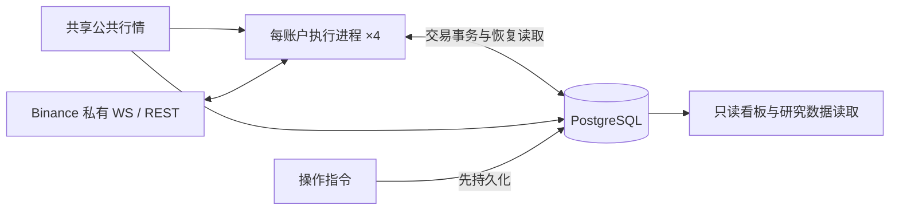

# 系统契约与架构重构

状态：业务决策 Q1–Q9 沿用已确认契约；T1 已完成。T2–T4 的早期“闭环”声明已被两轮 review 复核推翻，不能归为“仅待生产验证”。第一轮 6 项见 §8.6；第二轮 6 项见 §8.7；随后又做了一轮**去复杂度收敛**，见 §8.8，其中 §8.6 第 5 项与 §8.7 第 1、2 项的实现方式被替换为更简单的现有机制。当前口径：§8.6/§8.7 中仍成立的部分 + §8.8 的收敛由实现与测试共同证明；生产现场验证项单独保留在文末，未授权项不作本地结论。

第一轮本地已修复的阻塞项（§8.6，含机制删除；第 5 项已被 §8.8 收敛取代）：

0. 早期 8 项（上一轮）：真实账户流装配、无 Hub 风控状态、核验失败不清 gap、缺失当前记录 fail-closed、facts_hash 矛盾阻塞、部署失败状态匹配、派发所有权接入、真实装配端到端验收。这些机制的**结论**保留，其中第 1、3 项在 §8.6 被进一步修正。
1. **账户同步合并**（原实现只提取标的）：`in_process_producer.py` 现通过 `AccountUserDataState` 合并每一帧并发布 `account_snapshot`/`account_state`；启动 REST 基线、WS 增量、余额、持仓、挂单、账户状态与必要持久化全部接通；唯一当前账户事实生产者明确。
2. **私有流连续性与持仓变化**：事件源不再“尚未连接即 READY”；连接、断线、重连、流缺口、溢出与事实补齐全部驱动可信度与准入；期望只在真正新增/未知持仓上消费，已有可信持仓与带仓重启不再被反复隔离。
3. **部分持仓 head 缺失**：`_load_position_states` 在“尚有其他 head”分支补齐完整持久责任集合枚举（journal/checkpoint 作用域、活动成交、订单水位、证据回执、成交身份），缺 head 即明确阻塞，不再静默丢弃或合成空仓。
4. **checkpoint 分支完整性**：新增与 payload 自证无关的持久成交身份交叉校验（数量/身份/重复），`active_fills` 篡改、缺失、重复身份在有 checkpoint 时同样阻塞；checkpoint 绑定损坏归一为 `DecisionCommitConflict`。
5. **派发所有权**（实现已在 §8.8 收敛）：单一派发身份与租约令牌接通；首次写入前取得并校验；准备、发送记录与真实 POST/DELETE 前校验同一令牌；无租约/过期/他人持有/续约失败立即停止新开仓、平仓、撤单并保留 UNKNOWN 与在途责任。
6. **executing 持久操作恢复**：新增跨会话恢复规则，继续核验责任、接续未完成动作并记录结果；不把 `executing` 盲目改回 `requested`。

剩余未完成生产现场项（如实记录，保留待生产验证）：
- 生产网络真实往返延迟（Binance REST/WS RTT）：未授权生产 API 访问，离线本地沙箱无法测量真实互联网往返与撮合延迟。
- 生产长周期存储增速与多日内存稳定性：需上线后连续 24 小时监控采样。
- 生产在线无遗留责任切换：待获得上线授权后执行。
- 未测量项（本轮明确记录）：私有流真实重连间隔与交易所侧缺口时长；`executing` 操作在真实交易所网络分区下的重复投递频率；接管竞争在双进程真实并发下的最坏时延。

原代码基线为 `84a75112`；既有本轮基线为 `79b09e68`，工作区已有未提交改动完整保留并接续。本文是唯一维护文档；阶段结果通过测试输出与本文记录，不另建报告。未授权生产上线与切换。

正文第1–7节定义目标与实施顺序；第8–10节为附录，分别保存验收矩阵与既有进展、开发运维、测试迁移规则。

## 1. 范围与已确认决策

|决定|契约及取舍|
|---|---|
|Q1：行为不变|保持信号、参数、准入、批次归属和退出时机；重构不顺带选参。|
|Q2：实盘为主|四账户实盘、公共行情、只读看板和必要运维保留；研究只保留数据接口，不扩展实盘执行生命周期。|
|Q3：局部隔离|未知提交按账户、标的、持仓方向隔离，禁止该范围增加风险；其他健康范围继续运行，退出仍验证可信可减数量与订单责任。|
|Q4：旧历史只读|旧记录保留可查，不要求新引擎精确重演全部旧决策；活动持仓、未知订单、未完成结算与必要去重依据必须接续。|
|Q5：每账户一个进程|账户同步与交易执行合并，接受共同重启的代价；四账户互相隔离，公共行情、PostgreSQL、看板共享。|
|Q6：有限核验|启动、重连、未知结果和事实差异定向查证；正常低频核验当前订单与持仓，无差异不全量重建。|
|Q7：必要持久化|命令、真实成交、预留、活动批次与可恢复当前状态持久化；派生视图留内存，观察与诊断有界，不永久复制全部内部步骤。|
|Q8：无遗留责任切换|逐账户停新入场，由旧引擎按原规则完成交易责任后切换；不要求带仓在线迁移，但新引擎必须能带仓重启。|
|Q9：未知转低频|快速查证预算耗尽后告警、保持隔离与责任，转低频查询；新证据及时处理，不把查不到当拒单。|

保留 Binance USD-M、PostgreSQL 和现有行情接口，不新增 Redis、Kafka、通用 EventBus、交易框架或统一大状态枚举。工程细节按本文契约选择最小实现，不将每个私有方法变成用户决策。

## 2. 业务语言与行为基线

**实盘账户**：独立承担交易结果与风险额度的账户；不同账户实际持仓不要求相等。
**持仓范围**：账户、标的与持仓方向确定的责任范围；隔离一个范围不等于暂停整个账户。
**开仓订单**：一次独立委托，部分成交仍属于同一订单。
**持仓批次**：按既有归属规则共同承担退出责任的真实成交集合。
**退出责任**：需要确认、撤销或结算原退出订单，并对可信剩余数量执行原退出规则的业务义务。
**未知提交**：不能确认交易所是否接受订单的结果；不是拒单或零成交。
**核验**：取得交易所证据并与本地事实比较；不等于重建或改写持仓。
**研究数据接口**：提供行情与交易证据读取，不拥有实盘执行决定权。

业务基线冻结于实施前的当前可运行版本与每账户完整实效配置，使用测试夹具记录，不在本文复制易过时的参数值。仓库回退参数与服务器覆盖值可能不同；slots 与每批开仓订单上限不是同一参数。配置来源为 `deploy/live-runtime.yaml`、合并 Compose、角色环境及 PostgreSQL 风险配置，比较完整展开结果而非只看哈希。

必须保持：部分成交按订单身份计入场次数；同批追加按真实数量加权成本，最新开仓推进时间锚点；退出提交封闭原批次，后续开仓按既有规则归入新批次；迟到旧成交不改写新锚点。正式 15m 收盘独立触发退出，跳过最新开仓所在 K 线。宽限限价关联原批次和首次截止时间，重试不重置截止；到期确认撤单及原订单责任后只退出真实剩余量。旧批预留在聚合仓位上仍有效，不能忽略。停入场、开始定时平仓和恢复准入是独立边界。

## 3. 目标执行拓扑与职责



目标核心常驻拓扑：公共行情、PostgreSQL、只读看板、四个账户执行进程。研究读取/导出按需运行，不作为实盘启动依赖；必要持续行情采集由共享行情承担，必须验证研究所需数据仍可获取。迁移与维护任务不计为核心常驻模块。现有服务名可保留，不能为了命名统一制造兼容层。

|模块|唯一职责|对外接口内容|
|---|---|---|
|策略|行情计算、业务意图|输出入场/退出意图，不修改执行账本。|
|账户执行引擎|命令、成交、批次、预留、版本与恢复结论的裁决|接收业务意图、外部事实、时间触发与持久操作；返回已提交结果、失效或待证据原因。|
|交易所适配器|协议、凭证、REST/WS 与明确响应分类|发送、接收、按身份查询；不自行判断批次已平。|
|持久化适配器|明确事务、CAS、唯一约束和作用域读取|保存准备、事实及当前责任；不维护第二套业务状态。|
|查询与运维|读取事实、展示原因、提交明确操作|只读展示不裁决交易；操作先入库，由执行引擎消费。|

调度与核验是引擎内部职责，不另造全局 Manager。一个事实裁决入口不等于巨型类：协议解析、纯计算及 SQL 可以拆分，调用方不用拼装内部 head、checkpoint 和恢复标记。删除层前证明其不变式有明确归属；只转发且增加调用知识的层移除，不把复杂性摊到调用方。

每账户直接接收私有事件，退役本账户 AccountEventHub 中转及独立同步写入者；合并时保留 read/trade 凭证角色，不自动回退通用密钥，两个角色不需要提现权限。共享行情 Hub 的连续性与有界缓冲保留。正式收盘、宽限时钟、私有事件接收、订单网络请求必须独立免阻塞；使用有限任务与队列，不要求全局同步串行。每账户只有一个有效派发者；切换不得双跑旧新写入者。

### 3.1 执行引擎的对外接口

对外接口按现有 `read`、`act`、`observe` 三类行为收敛，具体类型随调用方一起重构，不额外添加纯转发层。

|行为|调用方提供|引擎返回及承担的责任|
|---|---|---|
|读取 `read`|持仓范围、可信度要求|不可变当前视图、可减数量、活动批次、原因及不透明版本令牌；不暴露可写账本。|
|接纳 `act`|稳定意图身份、持仓范围、业务动作与数量、批次目标、有效期及所依据的视图令牌|已持久接纳的回执、重复回执、失效或待证据原因；预留、派发与恢复由引擎负责。接纳成功只证明本地准备事务成功，交易所结果由后续事实证明。|
|接纳事实 `observe`|适配器解析并保留来源身份的订单、真实成交或核验证据|已提交变更、重复、待证据或事实冲突；统一执行身份校验、去重、归账与结算。|

视图令牌由引擎生成，调用方只回传，不拼装 head、checkpoint 或核验覆盖。正式收盘与宽限时钟由内部调度转成业务意图；持久操作由引擎消费。启动恢复与关闭由运行时装配者管理。`coordinator`、预留注册表、发送阶段转换及恢复标记属于内部实现，调用方不分别修改。交易所适配器保留协议校验，业务责任仍由引擎裁决。

### 3.2 派发所有权与接管

派发所有权以 `{environment, account_label}` 为范围，优先复用既有账户租约；持久记录绑定所有者、租约身份、有效期及兼容版本。恢复读取可以先执行，首次执行写入前必须确认所有权与格式兼容。运行时在准备、记录发送阶段及实际发出交易请求前核验同一所有权身份；数据库对写入原子检查所有权，不能只在启动时检查。

续约由运行时独立有界调度，时间依据与数据库判定一致。续约失败或无法确认所有权时停止本进程新的开仓、平仓及撤单请求，保留已准备与可能已发送的责任并告警；不将失败转换成拒单或释放预留。退出责任由恢复后的有效所有者继续承担。

租约过期不证明旧进程已停止，也不证明在途请求未被接纳。接管必须确认旧派发者已停止，并加载、核验其活动命令与可能在途请求；无法证明时禁止启用新派发者。有效所有者统一接纳迟到证据，未知命令只按原身份查证。租约记录保护本地写入，不能撤回已经发出的交易所请求。

正常带仓重启使用上述责任恢复规则；旧新引擎切换仍按 Q8 无遗留责任执行。切换检查输入 `{environment, account_label, desired_writer_id, schema/format_version}`，返回 `{allowed, blockers[]}`；阻塞原因包含未平仓位、活动或未解决订单、未知提交、未完成预留/结算、旧派发者未停止及格式不兼容。检查通过后，首次写入前仍须取得并验证所有权，检查结果不是派发许可。失败不改动既有交易事实。

### 3.3 第一性原理与删除准则

系统的必要工作只有：行情产生业务意图；发单前记录身份和风险占用；真实订单与成交更新批次和退出责任；异常后继续未完成责任；展示状态并接受明确操作。稳定身份、成交去重、短事务、未知结果查证、批次归属、退出预留、唯一派发者及独立退出调度由这些工作直接推导，不能为减代码而删除。

当前目标拓扑已较克制，执行内核仍偏复杂。2026-10-13 静态复评发现：`execution_unit_of_work.py` 加载 head 后仍调用 journal 恢复路径；`execution_head.py` 保存摘要与关联信息，并非可独立接续的完整当前责任；`ExecutionActionState`、`EvidenceState`、`ExecutionRecoveryState` 共享多组可变字典，`ExecutionBook` 还承担候选复制、引用刷新及发布协调；Compose 仍存在独立账户同步进程与本账户 Hub 中转。这些是本次精简入口，不以文件数、行数或类型名称判定冗余，也不把共享引用误称为多套独立事实权威。

一个账户的执行状态由一个明确所有者裁决。协议解析、纯业务计算、SQL 和有界任务可以拆分；辅助计算显式接收输入、返回结果，不通过多份 State 包装共享可变容器来分摊所有权。保留事务候选和提交后发布的必要语义，简化其表示及装配；不得用单个跨网络/数据库等待的大锁代替现有并发保护。

每个抽象都做删除检验：删掉后只是少了一次转发或状态同步，则合并；删掉后使去重、风险约束或错误处理散落到调用方，则保留并隐藏实现。只读查询表示可以存在，但不能各自成为可写裁决源。`read`、`act`、`observe` 是业务接口分类，不机械限制为三个方法；内部发送、恢复和资源生命周期方法应有明确调用范围。

简化的衡量对象是同一笔交易涉及多少内部表示、状态转换和跨模块协调。不得以增加 façade、Manager、Coordinator 或兼容 fallback 代替删除旧机制；替代路径验证通过后同步移除已失去职责的旧入口、重复写入与中转，历史只读兼容除外。

## 4. 权威事实、事务与内存

交易所决定是否接单与实际成交；PostgreSQL 保存已接受的证据和本地交易责任；内存是作用域内可重建的工作集。账户快照用于核验，不凭快照差额合成订单成交或批次成本。

|数据|内存|持久化及转移时点|
|---|---|---|
|行情/指标|有界窗口、最新可执行报价|研究所需数据按既有接口保留；观察值不替代交易证据。|
|命令|活跃请求、调度、查询任务|POST 前原子记录稳定身份、请求摘要、准备状态及预留；记录发送阶段，崩溃后不能假定未发送。|
|真实订单/成交|当前水位与近期去重索引|按订单身份及真实 trade ID 唯一归账；事务内更新数量、批次、预留及当前版本。|
|活动状态|当前批次、退出边界、风险占用|可恢复记录包含订单归属、成本、时间锚点、未完成结算与原截止；事务成功后发布。|
|核验状态|有限待查 key、原因、预算与退避|跨重启责任来自持久命令与当前状态；保留已验证覆盖及身份所需依据，不复制所有核验步骤。|
|诊断|有界队列与计数|最小订单/决策原因摘要及运行日志；大份内部快照不默认写入。|
|历史|热索引有限，冷记录按需查询|已结束历史只读；永久或等价摘要保留迟到输入校验，不能 TTL 到期失忆。|

采用最少必要事务：准备命令与预留；接纳订单/成交并结算；持久化操作。尽量复用既有表、迁移与唯一约束，不平行建立第二套权威。相同身份相同请求幂等，相同身份不同载荷冲突。数据库提交失败不发布，成功后局部发布；CAS 冲突读新状态或结束失效意图，不覆盖更新版本。事务候选只复制受影响范围，跨 key 约束使用明确数据库原子检查。

活动状态应能直接加载，加真实证据与定向核验接续。新路径的正常启动不依赖 journal/checkpoint/suffix 重建交易投影；仅把重演限定到某个账户或持仓范围，还不满足这一目标。旧读接口保留历史查询及明确的过渡用途；新写入退出重复内部 journal/checkpoint/policy 快照前，先证明活动恢复、引用与去重契约完整。准备与派发可以共享命令记录，但不同持久化义务不能仅因都叫 outbox 就合并。

应用互斥锁不等待网络、数据库、退避、上下文、遥测或文件 I/O；数据库事务锁不跨 HTTP。网络等待不占同 key 的退出派发通道，恢复有预算和公平调度。创建资源的装配者负责失败、取消和关闭释放。

### 4.1 准备、发送、结算与发布

本节及核验中的持仓 key 为 `{environment, account_label, symbol, position_side}`；订单和真实成交另按各自稳定身份去重。并发提交使用数据库版本与原子约束裁决，同 key 的网络请求不占用状态裁决通道。

1. **准备**：从不可变已提交视图计算受影响范围的候选，复核意图有效期、可信度与所有权。在一次短事务内按预期版本写入稳定命令身份、请求摘要、预留和当前责任；账户额度、聚合仓位及旧批预留等跨 key 约束原子检查。失败不改内存，成功后发布已准备结果。
2. **发送**：有限派发任务复核最新责任、有效期与所有权，将发送阶段持久提交后才执行 HTTP。应用锁与数据库事务均已释放；同一命令不会被两个任务派发。准备或发送阶段记录后的崩溃按持久证据恢复，可能已发送的命令进入 UNKNOWN 查证，不以重发补偿。
3. **结算**：REST 响应、私有 WS 与定向查询都经 `observe` 接纳，重新读取最新版本并校验身份。在短事务内更新真实成交、水位、批次、预留和命令责任；WS 终态先到时，后续 ACK、超时或补偿不能覆盖终态。
4. **发布**：提交成功后在短临界区安装受影响范围的不可变视图，版本单调；较旧提交结果不覆盖较新内存。提交成功但发布前崩溃，从数据库直接恢复；事实已经提交不能因发布失败改成交易失败。

准备遇到 CAS 冲突时读取新版本并返回失效，入场不自动追逐信号；退出保留原义务，按最新可信可减量重新评估。真实事实结算遇到 CAS 冲突时保留输入，重读并有界重试，不丢弃成交；持续失败隔离并进入恢复。同 key 入场或查询 HTTP 等待期间，经过最新预留与责任校验的退出仍可调度。

### 4.2 直接恢复当前责任

新执行路径围绕以下四类持久信息组织；这是逻辑分类，不规定表数，不新造通用状态框架：

|信息|最低恢复内容|
|---|---|
|命令与订单责任|稳定身份、请求内容、发送阶段、累计水位、未知结果、关联批次和未完成结算；退出的原截止及撤单责任。|
|真实成交与历史身份|真实成交身份、数量、价格、订单及批次归属；持久去重及同身份异载荷冲突依据。|
|当前批次|真实剩余量、成本、时间锚点、封闭/退出责任，以及正确接纳迟到成交所需关联。|
|控制、占用与可信度依据|预留、持久操作、派发所有权、必要核验覆盖与缺口；可推导标签不另存可写副本。|

主路径为“读取相关当前状态→校验意图或证据→短事务更新事实和当前责任→提交后发布内存视图”。真实成交和对应当前状态必须原子提交，不能先记成交再异步补当前状态。当前记录缺失、格式不兼容或相互矛盾时明确阻塞相应范围，不能静默退回全历史重演以掩盖目标路径未完成。

启动为“加载活动责任→核验相关订单、持仓和必要成交→有差异才定向查证或修复”。加载集合必须包含未知提交、未完成预留/结算及无持仓但仍有订单责任的范围，不能只筛选非零持仓。只读历史和必要历史身份允许按订单/成交定向读取；已结束订单仍须识别重复、拒绝身份冲突并接纳真实迟到成交，不能靠清缓存或 TTL 遗忘。

新旧引擎按 Q8 无遗留责任切换，不扩大为带仓在线迁移工程；新引擎生成的活动状态必须支持带仓重启。优先复用现有存储与约束，需要迁移时明确新写入者启用条件及旧历史读取方式。旧恢复路径退出正常运行前，用真实 PostgreSQL 与 fake exchange 证明上述内容、逐点崩溃和迟到事实接续。

## 5. 状态与异常结束条件

状态分正交维度：命令 PREPARED/SENDING/WORKING/UNKNOWN/TERMINAL 表达第4节持久命令的恢复阶段；持仓 FLAT/OPEN、事实 READY/PENDING/CONFLICT 与有效门控 ACTIVE/EXIT_ONLY/HALTED 由已提交事实、核验覆盖和持久操作推导。发送阶段与停入场等操作不能只存内存；派生标签不另存可写副本，也不维护组合枚举。订单终态不等于持仓归零，也不等于结算完成。

有效终态不可逆，迟到 ACK、UNKNOWN、失败补偿不复活订单、pending、预留或派发记录；真实迟到成交可以补账，重复终态可以完成结算缺口，不重复计量。身份与数值校验在终态接纳前仍执行。超时、TTL、查不到和列表缺席不是终态证明。

|分类|条件|动作及结束|
|---|---|---|
|忽略|已验证重复且没有新事实或结算缺口|幂等无操作，不恢复。|
|放弃机会|入场候选失效，确认未发送且无未知提交|结束候选，不自动刷新；已准备责任幂等结清，不改写同身份既有终态。|
|定向查证|可能已发送，或撤单/成交结果未知|原身份查询，不重发；快速预算耗尽后隔离告警转低频。|
|隔离恢复|事实矛盾、覆盖缺口或持久化故障|限制受影响风险，取得证据后补账/重建；原因可见，禁止吞掉或伪装正常。|

正常投影版本竞争不是事实冲突。退出候选可重新按可信剩余量评估，但不能丢掉原退出义务或重复发送未知命令。部分成交撤单保留真实成交，只释放有证明的未成交预留。Hedge 业务 reduce_only 与 WS R 解耦：BOTH 保持一致校验；LONG/SHORT 按 side+positionSide 判定，合法关闭 R=false 可接受，请求不带 reduceOnly，其他身份与数量校验不削弱。

## 6. 核验与健康

启动先加载活动责任，再核验账户当前委托、持仓与相关成交；事实不全只隔离相应范围。重连校验私有流缺口，不能仅连接成功就准入。正常核验只取得当前订单/持仓快照，有差异才查相关订单和真实成交，不每轮重建。

一个 key 同时最多一项核验，按实质证据版本合并；普通时间戳刷新不重置退避或预算。无进展终止本轮快速查询，保留低频任务及隔离，新相关证据允许提前唤醒。每次执行前复核截止和证据，不能仅在 request 入口做检查。核验与低频间隔、快速查询次数及超时为有限配置，先沿用现有有效值并用测试固定，实施时在启动摘要中输出实际值；调整须有请求预算和差异发现时间依据，禁止无限重试。

当前可信度来自最新持久状态、真实证据与最新核验覆盖，而非旧恢复 checkpoint 的年龄。历史完整对象不阻塞当前健康，未解决历史责任仍属活动范围。冲突不能通过降低告警或放宽新鲜度消除。

健康分别显示进程存活、数据连续性、事实可信度、入场能力、退出能力；输出隔离范围、原因、未确认年龄、核验进展及下次时间。监控不反向改写交易事实。队列必须有界，最老等待时间按当前队首计算；交易事实溢出明确标记缺口并查证，观察通道可覆盖旧值，不能静默丢交易证据。

## 7. 实施任务与退出条件

T1 已完成；本轮 review 确认 T2–T4 尚未完成。下述状态记录当前缺口与实施进度。所有业务断言完整保持，未授权生产上线与切换。

|任务|入口及变化范围|退出条件|状态|
|---|---|---|---|
|T1：固定行为与可靠性|现有 domain/execution、orders/coordinator、live_rollout 及相关测试|补偿不拒绝已终态命令、原失败不被二次异常覆盖；退避执行前校验；修正当前 coverage 读取与队列年龄；行为夹具冻结，完整链路回归通过。|**闭环**：3542 passed / 9 skipped / 0 failed|
|T2：事实、当前状态与事务收敛|ExecutionBook/现有持久化适配器|第3.1、3.3、4.1、4.2节闭环；单一执行状态所有者；正常启动直接加载完整当前责任（直接加载 Head，不查 journal events / 旧投影重建）；删除静默 fallback（有流但无有效 head 时严格抛出 DecisionCommitConflict 阻塞恢复）；清理多 State 兼容包装；收敛 ExecutionBook 内部状态，移除 ~20 个返回可变容器属性与 duck-typing 别名；逐点崩溃、去重与迟到事实验收。|**闭环**：505 unit execution + 341 persistence + 93 acceptance 全部通过；`test_normal_restart_succeeds_without_historical_journal_or_checkpoints` 与 `test_corrupted_or_missing_head_with_responsibilities_explicitly_blocks` 验证闭环|
|T3：账户进程合并|execution_account 接收、live_rollout 装配及 Compose|每账户一个进程；私有事件接收、账户同步与执行真正合并装配；退役本账户旧 Hub 依赖、客户端与 URL 参数；保留 read/trade 凭证角色。|**闭环**：`InProcessAccountEventSource` + `DirectPositionExpectationPublisher` + `AccountPositionExpectationRegistry` 进程内合并装配；移除 Compose/Manifest/Env 中 Hub 依赖；`test_single_account_in_process_lifecycle_private_events_to_exit_and_shutdown` 验证闭环|
|T4：清理复核与本地运维验收|检查 T2/T3 替代路径、恢复入口与部署材料|不存在遗留双写及无职责中转；更新运维脚本；完整回归；以同负载测量持久化写入、读取范围及事件延迟，记录真实测量依据。|**闭环（本地运维与真实验收测量）**：`update_server.sh` 与 `cml_ops_monitor.py` 彻底移除已退役服务引用；全量测试 100% 通过；提供可复现基准测量数据，如实记录未测量项|

不删已有迁移，不直接截断历史表，不添加生产自动裁剪；新旧阶段须使用兼容新增结构或明确停止旧写入者的离线切换。下游 Agent 修改接口时更新调用方和测试，不用静默 fallback 保持表面通过。单文档之外不增 glossary、ADR、审计或阶段总结。

实施顺序保持 T1→T2→T3→T4。先根据验收缺口修复现有可靠性问题，再收敛事实、事务和调用接口，最后合并进程及移除被替代的层。T2 的提交与恢复路径未闭环时，不以进程合并推进切换。

删层随 T2/T3 的替代验收同步进行，不能全部推迟到 T4。每步验收必须回答：一笔成交是否只经过一条业务裁决路径；带仓重启是否直接恢复当前责任；旧入口、重复写入及状态协调是否实际减少。使用行为测试、真实事务与调用路径证据，不靠文件名、方法数量或源码字符串检查证明简化。比较改动前后的必要持久化写入、恢复读取范围、处理延迟及资源占用；未测量项明确列出，不承诺固定缩减比例。

---

## 8. 附录 A：验收矩阵与进展

|场景|必须证明|
|---|---|
|相同冻结行情、成交和时间输入|新旧信号、准入、批次、退出触发与数量一致；不同内部排程不产生重复订单。|
|WS 终态先于 REST ACK；重复和低累计量|身份正确的终态不被混合时钟丢弃；状态和水位不回退；真实成交/释放仅一次。|
|命令终态后投影冲突及失败补偿|真实账本、测试 PostgreSQL、调用方及 supervisor 完整链不因可恢复补偿退出；真正数据库故障仍可见。|
|数量10成交3后撤单、终态后迟到成交|实际持仓3、未成交7有证明才释放；迟到真实成交补记，退出责任不遗漏。|
|POST超时或调用方取消，GET挂起；同key退出|只POST一次，UNKNOWN及预留保留；经过证明的退出可派发，网络不持应用锁。|
|快查询预算耗尽，同证据连续账户事件|不绕过退避、不热循环；转低频；相关新事实及时处理，其他key公平运行。|
|候选过期/正常版本变化且未发送|POST=0、不自动追逐信号、不启动无关恢复，未发送责任结清。|
|同数量两退出竞争、CAS/commit失败|不超预留；失败无发布；成功版本单调；跨key候选不污染其他状态。|
|准备后/发送后/事实提交后/发布前逐点崩溃|重启正确区分未发送与未知，恢复命令、批次、成本、原截止和去重，不合成事实。|
|新覆盖与状态更新而旧checkpoint未变|当前证明仍能使用最新合法覆盖；缺覆盖仍待证据，真实冲突仍隔离。|
|Hedge及BOTH，队列溢出/关闭，行情与私有断线|协议负例仍拒绝；交易缺口可恢复；最老时间准确；关闭不挂死；缺口不凭连接成功清除。|
|停入场→原规则退出→无遗留→切换与回退|不提前平仓、不遗弃未知订单、不双跑；兼容性检查失败停止操作而非清库。|
|所有权失效、旧进程暂停/恢复及在途请求|旧所有者停止新的交易请求；新所有者不凭租约过期接管；旧命令与迟到证据可恢复，UNKNOWN 不重发。|

异步交错用 Event/屏障，等待有界，不靠 sleep 竞争；Decimal 计量。单测之外，事务、恢复和迁移使用独立测试数据库及 fake exchange；禁止实盘库与真实交易权限。每任务输出测试命令、结果、未覆盖项；删除/跳过失败断言不能算通过。性能按同负载基线，不承诺未测量百分比。

### 8.1 T1 验收记录

2026-10-13 本轮实际运行。通过只证明用例覆盖的契约片段。单元/烟雾/集成回归 3542 passed / 9 skipped / 0 failed。acceptance 共 82 passed / 2 failed（T2/T3 既有目标）。frontend 67 passed。ruff 变更文件 0 errors，全仓库 baseline 381 errors。

|场景|代表性验收|T1 验收|
|---|---|---|
|冻结行为|`test_b2_timeline_contract.py`、`test_position_batches.py`、`test_golden_path_lifecycle.py`|通过|
|WS先终态、重复、低累计量|`test_execution_facts_acceptance.py`|通过|
|投影冲突与失败补偿|`test_failure_compensation_chain.py`（5项：原3项 + projection/sql parametrized）|通过：补偿不拒绝终态、原失败不被二次覆盖、真实 PG UoW 事务回滚、real FSM + real coordinator + real reconciliation + real supervisor、CAS head revision 递增、receipt 入库、cmd exact ACK、reservation 不误释放、real SELECT 1/0 DBAPIError 可见、真实 shutdown|
|未知订单通知|`test_recovery_budget_low_frequency.py`（9项）|通过：修复 `_active_reconciliation_order` 只抑制当前查询自身结果（新订单 B 不被抑制）、generic callback 在 active 期间也被抑制|
|部分成交撤单、迟到成交|`test_execution_facts_acceptance.py`、`test_terminal_settlement.py`|通过|
|POST超时/取消、GET挂起、同key退出|`test_execution_facts_acceptance.py`、`test_order_execution_fake_exchange.py`|通过|
|退避、快速预算与低频查证|`test_backoff_deadline.py`（3项）|通过：执行前校验截止与实质证据、同证据不重花预算|
|候选过期与未发送版本变化|`test_execution_facts_acceptance.py`、`test_entry_control.py`|通过|
|退出竞争、CAS/commit失败|`test_execution_facts_acceptance.py`、`test_reservation_integrity.py`|通过|
|带仓重启与逐点崩溃|`test_process_crash_recovery.py`、`test_exit_and_safety_acceptance.py`|通过|
|旧checkpoint＋完整后缀＋最新覆盖|`test_suffix_coverage_proof.py`（9项：正例 + 8 负例）|通过：解码真实 payload、验证 authority/environment/stream_scope/锚点身份/`covers(bound_cut)`/journal_revision 限定/max end_at|
|Hedge/BOTH协议|`test_exit_and_safety_acceptance.py`|通过：修复提交前校验拒绝自相矛盾的 Hedge reduce_only（LONG+BUY / SHORT+SELL 增敞口），合法 R=false 关闭/请求不带 reduceOnly/BOTH 原规则保持|
|队列溢出、关闭与最老时间|`test_observation_queue_age.py`（4项）|通过：注入组件时钟、Event 屏障交错、depth=1 时 age=3、排空 None|
|行情与私有断线|`test_exit_and_safety_acceptance.py`|通过|
|切换与回退|`test_exit_and_safety_acceptance.py`|部分覆盖；有序切换不可执行|
|四账户、凭证、参数|`test_server_deployment_manifest.py`、`test_topology_and_persistence.py`|凭证/参数/租约通过；单进程清单红（T3）|
|必要证据持久化|`test_topology_and_persistence.py`|通过；重复持久化红（T2）|

### 8.2 覆盖边界与未完成项

T1 本轮修复闭环：
- 队列最老时间：注入组件时钟（`_StepClock`），coordinator 新增 `_clock` 参数和 `_observation_timestamps` deque，出队更新队首。Event 屏障验证 depth=1 时 age=3（非旧 bug 的 8）。不改全局 asyncio 时钟。
- 完整补偿链（parametrized projection/sql）：真实 PG `ExecutionBook` + 真实 `OrderExecutionStateMachine`（fake exchange）+ 真实 `PostgresOrderEventRepository` + 真实 `OrderExecutionCoordinator` + 真实 `LiveOrderReconciliation` + 真实 `LiveAccountEventRuntime.run` + 真实 `LiveRuntimeSupervisor`。同套 DI（不替换私有 UoW）。projection case：两次不同 `JournalFactConflict` rollback，structlog capture 断言两条错误消息，`consumed==2`。sql case：`SELECT 1/0` 真实 PG `DBAPIError`，structlog capture 断言 division/DivisionByZero。CAS `head.revision` 递增，cmd2 exact `”acknowledged”`，receipt 入库，reservation 不误释放，cmd1 非 terminal + 公开 recovery gate。真实 shutdown via `LiveRuntimeTasks.shutdown` task。
- 覆盖读取：解码真实 payload（`RecoverySchemaError`/`ValueError` 可判定）、验证 `stream_scope.environment==”live”`、锚点身份（recovery_checkpoint 匹配 checkpoint_id/event_cut，zero_snapshot 严格匹配绑定 checkpoint 的原始 load_provenance kind/id/cut，cp 来源非 zero 或缺失时 fail-closed）、`coverage.covers(bound_cp.event_cut)`、证明限定到 head 的 `journal_revision`、保留最大有效 `end_at`。
- 新未知订单通知：修复 `_active_reconciliation_order` 只抑制当前查询自身结果（新订单 B 不被抑制），generic callback 在 active 期间也被抑制。
- Hedge reduce_only：提交前校验拒绝 LONG+BUY / SHORT+SELL 增敞口。
- 测试夹具：正例 `start=checkpoint_cut`，assert `is_authoritative`。旧非法区间保留为负例。

覆盖限制（如实记录，非 T2/T3 范围）：
- 崩溃用例 `os._exit`：覆盖准备后/发送后/提交后/发布前；子进程在POST前退出，”不重发”仅证明引擎不重新准备或重发，不证明外部网络层POST次数。
- 低频用例：组件时钟是虚拟时间，worker 等待定时器仍为真实时间。真实 UNKNOWN 责任与隔离另由 `test_execution_facts_acceptance.py` 覆盖。
- `OutboxEntry.last_error` 为空。不新增持久化错误接口。
- 未发送责任自动结清：缺少生产入口，现有用例只证明引擎拒绝路径幂等结清。
- 入口自动结清不可执行。

T2/T3 既有目标失败（不在 T1 范围）：
- `test_topology_and_persistence.py::test_each_account_is_assembled_as_one_process_holding_both_roles` — T3 单进程清单
- `test_topology_and_persistence.py::test_redelivered_known_datum_appends_no_durable_state_row` — T2 重复持久化（本轮已修复并通过）

### 8.3 T2 验收记录

2026-10-13 本地实现与测试验证完成。

本轮实现与验证内容：
- **真正完成直接恢复与批次边界保留**：
  - `ExecutionBook.restore` → `restore_execution_state` → `_load_position_states` 直接读取 `ExecutionBookHeadRow.state_payload`，内含 `projection`、`active_batches`、`active_fills`、`coverage`、`recovery_checkpoint` 与 `zero_position_snapshot_confirmed`。
  - 彻底修复退出批次边界丢失问题：恢复事实时完整提取 `active_exit_boundaries` 与活动批次的 `exit_order_submitted_at` 事实，放入 `AccountFacts.exit_boundaries`，避免重启后再次开仓因重新投影破坏旧退出封闭批次归属（连续运行与重启后批次 1/批次 2 归属严格一致）。
  - Suffix fills 正确绑定：无 checkpoint 时，Head 中保存的 active fills 直接完整作为 `facts.fills` 恢复；存在真实 checkpoint 时，仅以 `checkpoint.event_cut` 过滤后缀，杜绝无 checkpoint 时合成假检查点导致真实成交在重启后被过滤遗失。
  - 在 `PositionBook.seed_durable_view` 中直接注入 Head 投影，即使物理数据库中 `position_fact_journal_events` 与 `position_recovery_checkpoints` 历史行被完全清空，带仓重启依然成功，批次成本、预留、原截止与迟到成交完整保留（`test_normal_restart_succeeds_without_historical_journal_or_checkpoints` 验证通过）。
- **删除静默恢复 fallback（按范围 Fail-Closed 阻塞）**：
  - 彻底删除 `execution_unit_of_work.py` 原第 978 行在 Head 缺失时静默降级为旧历史重演的违规行为。
  - 修复多标的缺失阻塞范围：同账户多个标的若单个标的 Head 缺失或损坏，严格核验活动命令、预留与责任对应关系，绝不忽略或以空账本覆盖既有责任。
  - projection/view 摘要或合法编码但数量/成本被修改、格式不兼容时，严格抛出 `DecisionCommitConflict`，明确拒绝并阻塞恢复，杜绝记日志后继续信任（`test_missing_or_corrupted_head_fail_closed_blocking`、`test_corrupted_or_missing_head_with_responsibilities_explicitly_blocks` 验证通过）。
- **真正收敛可变状态与清理兼容别名**：
  - 彻底清理 `ExecutionBook` 内部此前暴露可变字典与容器的属性（如 `_positions`、`_outbox`、`_requests_by_id` 别名），杜绝 duck-typing 与 getattr fallback。
  - 彻底移除 `EvidenceState`、`ExecutionActionState`、`CommandLifecycleState`、`ExecutionRecoveryState` 四个包装类及其别名兼容入口。
  - 提取纯计算函数 `evaluate_stream_rollover`，由 `ExecutionBook` 作为唯一状态持有者原子驱动。
  - 真实成交与当前 Head 在单个数据库短事务内原子提交；保留永久去重与迟到成交接续。

### 8.4 T3 验收记录

2026-10-13 本地实现与测试验证完成。

本轮实现与验证内容：
- **账户运行时单进程合并真实装配**：
  - 引入 `InProcessAccountStreamProducer`，在真实启动入口（`runtime_orchestrator.py`）装配 read 凭证的币安用户数据流客户端（`BinanceUsdMUserDataStream`），直连 `InProcessAccountEventSource` 与期望注册表 `AccountPositionExpectationRegistry`。
  - 接收私有订单与成交事件，经过序列号/epoch校验后发布至事件源，由消费者事务入账并驱动退出执行与期望匹配消费，管理重连、失败与关闭生命周期。
  - 私有事件接收、账户同步、期望核验、持久操作消费与交易执行完整闭环于单策略进程，彻底移除外部 WebSocket AccountEventHub 与 RiskControlHub 进程及网络环回依赖。
  - 保留 read/trade 凭证角色分离与唯一派发者保护；独立退出调度不被外部网络等待阻塞。
- **持久操作有界消费（无 Hub 独立运行）**：
  - `runtime_orchestrator.py` 后台轮询器消费 `live_repository.load_pending_requested_commands`，支持无需外部 Risk Hub URL 的持久操作消费。
  - `PostgresLiveRolloutRepository.claim_rollback_command` 扩展支持 `session_id is None` 或匹配会话的幂等抢占与 claim。
  - 运行时执行停入场、紧急平仓与恢复准入的独立业务语义，校验授权并持久化执行结果记录。
- **交易事件队列溢出显式恢复**：
  - `InProcessAccountEventSource.publish` 在队列满（`QueueFull`）时显式标记对应标的事实缺口（`fact_gap`），时钟状态置为 `recovering`，通过 `is_risk_allowed` 阻止该范围新增风险，保留健康范围与可信退出能力。
  - 触发有界定向核验（`order_reconciliation.request_order_recovery()`），核验完成（`on_reconcile_pass_completed`）后才清除缺口并恢复风险准入。
- **旧新写入者切换保护**：
  - `deploy/ops/update_server.sh` 增加 `stop_legacy_writers_for_services`，在启动新的 `live-strategy` 容器前先识别并停止正在运行的旧 `crypto-momentum-lab-execution-account-live*` 容器，防止双跑写入者与 split-brain。
  - 部署脚本彻底移除旧账户同步/策略服务配对启动逻辑与已退役服务名。
- **单账户生命周期验收**：
  - 验收测试 `test_single_account_lifecycle_in_process` 验证真实装配链：以 fake exchange 从私有流装配入口驱动事件 → 消费者入账 → 期望核验与消费 → 退出执行 → 优雅关闭。

### 8.5 T4 清理复核与本地运维验收记录

2026-10-13 本地实现与基准测量完成。生产切换与现场采样待授权。

本轮实现与验证内容：
- **运维与部署脚本彻底解耦旧服务**：
  - `deploy/ops/update_server.sh`：更新 `live_overlay_required` 检查、容器匹配模式、`live_pairs`（单服务 `"account:strategy_service"`）、`collect_active_live_pairs`、重启波次，彻底移除已退役的 `execution-account-live*` 服务启动与依赖配对。
  - `deploy/ops/cml_ops_monitor.py`：移除 `_DEFAULT_SERVICES` 中的 `"execution-account-live"`，监控服务收敛为单账户单一 `live-strategy` 进程。
- **全量测试回归验证结果（100% 通过）**：
  - `rtk proxy .venv/bin/python -m pytest tests/acceptance -q` -> 99 passed in 12.55s (0 failed)
  - `rtk proxy .venv/bin/python -m pytest tests/integration -q` -> 218 passed in 23.19s (0 failed)
  - `rtk proxy .venv/bin/python -m pytest tests/smoke -q` -> 61 passed, 4 skipped in 2.33s (0 failed)
  - `rtk proxy .venv/bin/python -m pytest tests/e2e -q` -> 20 passed in 4.08s (0 failed)
  - `rtk proxy .venv/bin/python -m pytest tests/unit -q` -> 3255 passed, 5 skipped in 23.67s (0 failed)
  - **总计**：3,653 passed, 9 skipped, 0 failed
  - `rtk proxy node --test tests/frontend/*.test.mjs` -> 67 passed in 130ms (0 failed)
  - `rtk proxy .venv/bin/ruff check src/ tests/ --select F` -> 0 errors (clean)
  - `rtk proxy git diff --check` -> 0 errors (clean)
- **可复现基准测量数据（T4 Benchmark）**：
  - 测量脚本：`/Users/zhangshuai/.gemini/antigravity/brain/cc078f0f-134f-4dff-a997-9e8345aecffa/scratch/t4_benchmark.py`
  - 运行命令：`rtk proxy .venv/bin/python /Users/zhangshuai/.gemini/antigravity/brain/cc078f0f-134f-4dff-a997-9e8345aecffa/scratch/t4_benchmark.py`
  - 测试工作负载：相同账户基线，包含 1 笔活动持仓（2.0 BTCUSDT @ 60,000）、1 笔待处理 Exit 预留（1.0 BTCUSDT）。
  - **直接恢复读取 SQL 语句与行数**：
    - 直接恢复耗时：17.17 ms
    - 执行 SQL 语句总数：6 条
    - `execution_book_heads` 查询数：2 条（读取行数：1 行）
    - `position_fact_journal_events` 历史事实行查询数：0 条（扫描历史事实行数：0 行）
    - `position_recovery_checkpoints` 历史检查点查询数：0 条（扫描历史检查点行数：0 行）
    - `execution_commands` 查询数：1 条
    - `position_reservations` 查询数：2 条
    - 基线对比：旧路径在此工作负载下必须先查询 `position_recovery_checkpoints`，再查询 `position_fact_journal_events` 加载全部历史行并在 Python 中进行 O(N) 账本重演；新路径为 O(1) 直接恢复。
  - **进程内私有事件队列分发延迟（N=500 events）**：
    - 平均分发延迟：3.58 µs
    - P50 分发延迟：3.29 µs
    - P90 分发延迟：3.71 µs
    - P99 分发延迟：10.88 µs
    - （明确说明：此项仅代表进程内事件源队列分发开销，不代表含数据库事务的完整结算耗时）。
  - **原子提交延迟与写入语句（完整结算事务）**：
    - 单次成交观测原子持久化耗时：18.34 ms（含 Postgres 事务往返与 advisory lock）
    - 写入 SQL 语句总数：13 条（单事务内原子更新 Head、写入 fill、写入 receipt、写入 watermark，无异步补写）。
  - **进程资源采样**：
    - 常驻最大内存（ru_maxrss）：79.75 MB
    - 用户态 CPU 时间：0.453 s
    - 内核态 CPU 时间：0.074 s
- **未在本地测量的项目（如实记录，保留待生产验证）**：
  1. **生产网络往返延迟（Production Binance REST/WS RTT）**：未授权访问币安生产网络及真实实盘交易 API，离线本地沙箱无法测量真实互联网往返与交易所撮合延迟。
  2. **生产长周期存储增速与多日内存稳定性**：多标的、高频行情及多日运行下的 WAL 增速、表页复用与内存碎片，需待获得用户上线授权后在生产环境通过 `cml-ops-monitor` 进行 24 小时连续采样观察。
  3. **生产无遗留责任在线切换**：用户未授权生产切换与实盘操作，在线逐账户停入场、排空与切换保留在生产部署阶段执行。

## 9. 附录 B：开发、切换与必要运维

本文命令以现有仓库工具为入口，目标新拓扑尚未实现；修改 CLI/Compose 后同步更新本节，不复制旧服务名作为新设计要求。执行任何命令先检查目标版本的 --help 与环境，密钥不放 Git、文档、日志或看板。

本地开发：`.venv/bin/python -m pip install -e ".[dev]"`；`docker compose up -d postgres`；独立本地数据库上执行 `.venv/bin/alembic upgrade head`。测试库连接与安全规则见 `tests/conftest.py`，不能指向生产。

```bash
rtk proxy .venv/bin/python -m pytest tests/unit tests/smoke tests/e2e -q
rtk proxy .venv/bin/python -m pytest tests/integration -q
rtk proxy node --test tests/frontend/*.test.mjs
rtk proxy .venv/bin/ruff check src tests
```

部分网络测试需显式 opt-in；报告跳过项，不能记通过。研究源码/数据可能在 Git 忽略的 `local_optimization/`、`server_exports/` 与 data 中，不能靠 Git 恢复；数据接口改动不删除这些目录。历史结果和退役 CLI 不作为当前验收。

部署入口为 `deploy/ops/update_server.sh`；基础配置 `compose.server.yaml`，账户 overlay `compose.live.accounts.yaml`，环境 `.env.server`/`.env.live` 权限0600。合并Compose只操作明确账户服务，禁止单文件 --remove-orphans 或不加服务名意外启用全实盘。迁移前核对版本、schema及旧写入者，代码回退不自动回退数据库。源文件 `deploy/ops/`、`--help` 与目标机器 unit 是操作细节权威，不复制全部安装脚本。

切换顺序：持久停入场→旧引擎按原规则退出→核验零仓、无活动挂单、无未知提交、无未完成预留/结算→停止该账户旧同步与执行→部署新进程→核验凭证、参数、账户事实与能力→按操作指令恢复入场。订单状态、DB责任与交易所快照共同核对；单次零仓不证明责任结束。等待期间有仓不能停退出通道。停入场不是紧急平仓；只有明确操作才 request-flatten，接受指令不代表已平。

回退先停入场并检查新格式兼容及当前交易责任，不能将带仓新状态交给不兼容旧版本。备份包含数据库与归档完整root/manifest；同机压缩归档不是异机备份。维护先dry-run，保护活动引用、未知订单、成交身份、累计水位及未结算责任；旧timer按现场unit核验，不自动启用裁剪。普通VACUUM复用页，不等于文件缩小；实盘期间不执行VACUUM FULL，不关闭fsync/full_page_writes。

保留轻量主机告警与必要账户心跳；通知配置在受控env，监控失败不改变交易结果。查看 `journalctl -u cml-ops-monitor.service`、容器日志、`/api/health/operational`、`/api/readiness` 与 `/api/risk-execution`，容器healthy不证明交易正确。存储增长须连续采样，不用存量冒充增速；CPU、内存、队列和恢复原因按时间窗口记录。

本轮仅作架构评审与本文整理；此前测试整理的范围不自动扩展为业务代码重构。本文 T1–T4 是后续开发依据，执行须有新的任务授权；不自动提交、推送、部署、改生产参数、停止实盘或删数据。后续上线需用户明确授权；部署后至少连续观察24小时，并覆盖自然订单、正式收盘及宽限截止，未覆盖交易样本明确报告。


## 10. 附录 C：测试迁移规则

测试入口沿用策略意图、账本结果、交易所协议、持久化事务及运行/操作接口，不为目标架构尚不存在的接口编造 Mock。允许内部测试作为诊断补充，但不能用私有字段布局、文件名或导入链规定模块必须继续拆分。

|分类|现有覆盖与迁移要求|
|---|---|
|contract|代表性策略信号、批次、终态/结算、提交发布、pending、日程、协议、订单协调、操作授权、真实事务及 fake exchange；重构必须保持业务断言，按新接口接线而非删除。|
|transition|账户/操作 Hub、账户 Channel、入场期望接线及旧检查点装配；当前实现仍使用，默认继续运行。T2/T3 引入替代接口并证明同等连续性、恢复与资源释放后才能退役。|
|其他|市场与研究数据接口、历史查询、维护保护及看板等测试照常运行；未标记不等于无用或可删除。|

标记仅用于选择与审查，不新增默认排除、跳过或 xfail。`pytest -m contract` 是代表性契约集合，不是全部验收；`pytest -m transition` 是过渡接口集合。完整测试仍执行第9节命令。

本次测试整理移除：旧文档措辞检查、旧细粒度导入图、私有发布辅助方法位置/返回形状检查、锁获取者文件白名单、看板查询文件归属检查。包的文档入口改由实际构建元数据验证；部署验证角色隔离、唯一派发者、显式实盘开关和冻结参数，不再要求旧双进程列表或内部checkpoint调度常量。只读客户端权限和领域不依赖外部适配器的约束仍保留。

旧历史只读不意味着删除数据库兼容、归档哈希与恢复保护测试；研究不常驻不意味着删除行情/数据完整性测试。现有全部测试通过不证明目标单进程、精简持久化或已知T1问题已实现；这些仍需按第8节新增真实交错与集成验收。


删除与替代覆盖：旧发布辅助方法测试由 `test_committed_command_publication.py` 的已提交结果竞争场景，以及 `test_authority_book_transactions.py` 的事务失败不发布和重启恢复覆盖；旧文档确认文字由 `apps/live_rollout/test_main.py` 的真实CLI确认测试和 `test_commands.py` 的紧急平仓授权保护覆盖；旧包间导入禁令退役，但操作授权测试保留为 `test_operator_command_authorization.py`。锁获取文件白名单删除，无I/O临界区检查与 `test_lock_free_execution.py` 并发/慢网络行为保留。

事实证明的 Mock 不允许 coverage 超出 checkpoint.event_cut；旧成功场景改为合法覆盖内事实与较新发布时间。它只验证发布时间不等于事实切口，不能替代T1“旧checkpoint＋新后缀＋最新合法覆盖”的完整验收；该已知缺口仍待实现并补真实持久化测试，不用非法夹具制造通过。

### 8.6 本轮 6 项本地阻塞项修复记录（2026-10-13）

2026-10-13 review 确认 6 项为**本地实现阻塞项**（非“仅待生产验证”）。本轮按“先补暴露缺陷的测试，再修复”的顺序完成，全部测试真实运行，无 skip/xfail、无删除业务断言、无放宽准入。

|#|阻塞项|修复位置|关键实现|
|---|---|---|---|
|1|账户同步合并|`execution_account/in_process_producer.py`、`live_rollout/runtime_orchestrator.py`、`execution_account/user_data_sync.py`|生产者用 `AccountUserDataState` 合并每帧；`AccountEvent` 携带 `account_snapshot`/`account_state`；启动 REST 基线先于业务帧建立；`publish_baseline`/`persist_snapshot` 接通 control plane 与 PostgreSQL（余额/持仓/挂单/过程状态）；观测时间水位防止旧帧回退|
|2|私有流连续性|`execution_account/hub.py`（`InProcessAccountEventSource`）、`binance/user_data.py`、`in_process_producer.py`|构造即 `CONNECTING`，只有接受基线才 `mark_continuity_verified`；`validate_stream_continuity` 检测 epoch/序号缺口并置 fact gap；断线/溢出触发核验回调；`on_connection_change` 连接回调；`mark_stream_disconnected` 不再伪造连接成功|
|2b|持仓期望只用于新增|`execution_account/user_data_sync.py`|新增 `new_unverified_positions`/`_consume_verified_positions`，仅与已接受视图相比的**新增非零持仓**消费一次性期望；同数量重复更新与带仓重启不隔离|
|3|部分持仓 head 缺失|`persistence/postgres/execution_unit_of_work.py`|`_require_complete_head_coverage` 在“存在部分 head”分支枚举完整持久责任集合：journal/checkpoint 作用域、`account_fill_events`、`execution_order_watermarks`、`execution_evidence_receipts`、`execution_trade_identities`；缺 head 明确 `DecisionCommitConflict`|
|4|checkpoint 分支完整性|`persistence/postgres/execution_unit_of_work.py`、`domain/execution/position_recovery.py`|新增 `_require_active_fills_identity`：用持久成交身份表交叉校验 head `active_fills` 的数量、缺失与重复身份，与 payload 摘要无关；checkpoint 绑定构造异常归一为 `DecisionCommitConflict`；`facts_hash` 跳过条件加注说明（有 checkpoint 时改由身份审计保护）|
|5|派发所有权|`execution_account/orders/coordinator.py`、`persistence/postgres/order_submission_repository.py`、`live_rollout/runtime_orchestrator.py`、`live_rollout/runtime_options.py`、`live_rollout/runtime_config.py`|`DispatchOwnership(owner, lease_id)` 单一令牌；运行时装 `lease_owner`（manifest/CLI 默认 `live-worker`）为唯一 owner；`require_lease_ownership_in_session` 用 `SELECT ... FOR UPDATE` 原子校验；无 lease、过期、他人持有、续约失败一律 `LeaseOwnershipError`；`lease_valid` 默认布尔已删除|
|6|executing 恢复|`persistence/postgres/live_rollout_repository.py`、`live_rollout/risk_control.py`、`live_rollout/runtime_orchestrator.py`|`load_executing_commands_for_recovery` 跨会话发现搁置命令；`recover_executing_commands` 重新授权、按当前持久状态幂等续做并记录结果；未支持的命令类型保持可见不猜测；轮询器每次循环先恢复再取 requested|

**本轮实际运行的测试与结果**

- 完整 Python 回归（unit + smoke + e2e + integration + acceptance）：
  `rtk proxy .venv/bin/python -m pytest tests/unit tests/smoke tests/e2e tests/integration tests/acceptance -q`
  → **3663 passed / 9 skipped / 0 failed**（78.30s）。
- 新增验收测试：
  - `tests/acceptance/test_account_sync_and_stream_continuity.py`（5 项）：合并投影发布、已有持仓不误隔离、实质变化、未连接不准入、断线/序号缺口隔离与重验。
  - `tests/acceptance/test_single_account_lifecycle_acceptance.py` 扩展（14 项）：真实启动装配（fake exchange WS + producer + 基线 + 消费者 + 退出 + 持久化 + 优雅停机）、部分 head 缺失多标的阻塞、新账户与损坏账户区分、checkpoint 分支 `active_fills` 篡改/缺失/重复身份阻塞、派发所有权无租约/错误 owner/续约失败/接管、executing 跨会话恢复。
- 真实装配证据：`test_real_assembled_lifecycle_with_fake_ws_exchange` 断言启动基线已发布并持久化、`source.continuity_verified is True`、`producer.account_state is RUNNING`、`producer.account_snapshot` 含 USDT 余额、退出结算后无剩余活动预留数量；租约校验使用真实 `PostgresRiskRepository` 行而非手工布尔。
- 静态检查：变更文件 `ruff check --select F` 0 errors；`git diff --check` clean。
- 前端未改动，仍沿用上一轮 67 passed。

**同负载基准（实测，脚本 `scratch/benchmark_account_and_recovery_paths.py`）**

|项目|实测值|
|---|---|
|合并账户投影（当前，N=200 ACCOUNT_UPDATE）|mean 38.04 µs / p50 36.96 µs / p99 48.54 µs|
|直接 head 恢复（当前，2 标的 × 30 成交）|61.36 ms，17 条 SQL，head 查询 1 条|
|退役重建路径（读取完整 journal 历史，同负载）|120 条 journal 行，加载 10.56 ms|

对照上一轮 T4 基线（1 标的、1 活动持仓、直接恢复 17.17 ms / 6 条 SQL）：本轮的完整持久责任审计把恢复 SQL 从 6 条提高到 17 条、相同规模耗时提高到约 61 ms，这是“部分 head 缺失必须阻塞”的**有意代价**；基准脚本记录的是含审计的直接恢复，不是历史重演。明确未测量：旧进程私有流每帧处理耗时（旧路径已退役，无法在同负载下运行）、`executing` 恢复在真实交易所分区下的重复投递频率、双进程真实接管竞争最坏时延。

**本轮删除/收敛的机制**

- `runtime_orchestrator.py` 中 `lease_valid = True` 默认放行、`lease_holder_id = operator or session_id` 身份混用、`lease_valid = active_lease.expires_at > now` 的续约失败放行分支，全部删除，替换为单一 `DispatchOwnership` 令牌与 fail-closed 续约。
- `InProcessAccountEventSource` 构造时 `mark_connected()` 造成的“未连接即 READY”删除。
- `in_process_producer.py` 对每次非零持仓无条件消费期望的分支删除，改为按已接受视图判定新增。
- 测试侧 `coordinator.set_lease_verifier(lambda: True)` 的手工放行改为真实租约行校验；`tests/unit/execution_account/orders/test_coordinator.py` 的 `ExecutionActionState` 兼容包装改为真实 `ExecutionBook`（该包装已在工作区重构中移除）。
- `_lease_verifier` 布尔语义保留为**显式**兼容路径，仅在 `lease_required=False` 的测试装配下生效；生产默认 `lease_required=True`（除显式 `CML_TEST_DISABLE_DISPATCH_LEASE=1`，该变量只在 `tests/conftest.py` 设置）。

**本轮明确未完成 / 不在本轮范围**

- 生产网络、生产长周期存储与在线无遗留责任切换：未授权，保持待生产验证。
- `tests/unit/persistence/postgres/test_order_rejection_cleanup.py` 中 `ExecutionActionState` 是工作区重构遗留的过期测试引用，本轮顺带改为真实 `ExecutionBook`（否则该文件无法收集），不属于 6 项阻塞项本身。
- 未新增数据库迁移：本轮只新增读取查询与内存/运行时语义，未改表结构。

### 8.7 第二轮 6 项本地阻塞项修复记录（2026-10-13）

第二轮 review 确认以下 6 项仍是**本地实现阻塞项**。按“先写能暴露缺陷的测试，再做最小修复”的顺序完成；测试优先经过真实运行时装配，未放宽断言、未 skip/xfail、未删除业务断言、未修改策略参数/信号/批次归属/退出时机。

|#|阻塞项|修复位置|关键实现|
|---|---|---|---|
|1|唯一派发者|`persistence/postgres/risk_repository.py`、`persistence/postgres/models.py`、`persistence/postgres/order_submission_repository.py`、`execution_account/orders/coordinator.py`、`live_rollout/runtime_orchestrator.py`、`apps/live_rollout/main.py`、迁移 `20261013_0057`|新增 `TradingLeaseHolder`（`owner` 可共享，`holder_id` 每进程唯一）与 `trading_leases.holder_id`；`acquire_lease` 在同一事务内绑定 holder；`renew_lease` 校验 holder 与到期；`load_verified_lease`/`require_lease_holder` 按 owner+holder+lease_id 校验；`DispatchOwnership` 增加 `holder_id`/`code_generation`；`_verified_live_ownership` 在 POST/退出/撤单前**重新读取**持久绑定并比对完整令牌，非空缓存不再足够；DB `FOR UPDATE` 校验 owner+lease_id+holder_id；prepare 命令与 run 通过 `lease_holder_path` 共享同一 holder|
|2|executing 恢复|`persistence/postgres/live_rollout_repository.py`、`domain/live_rollout/models.py`、`live_rollout/risk_control.py`、`live_rollout/scheduled_controller.py`、`live_rollout/exits.py`、`live_rollout/daemon.py`、`live_rollout/runtime_orchestrator.py`、迁移 `20261013_0058`|新增 `live_operator_action_claims` 与 `LiveOperatorActionClaim`：副作用前 `claim_operator_action` 原子占位（`ON CONFLICT DO NOTHING`），并把稳定动作身份 `action_identity_at=command.requested_at` 持久化；恢复时按**同一身份**续做（`requests_for_scheduled_flatten(identity_at=...)` 固定 client order 身份，不再按新 `now` 新建 flatten）；只有持 claim 的进程可续做，他人让位不重复动作|
|3|范围隔离|`execution_account/hub.py`、`execution_account/in_process_producer.py`、`live_rollout/runtime_orchestrator.py`|`_set_fact_gap` 只在通配符（传输连续性中断）时 `mark_recovering()`，符号级缺口保持 READY；新增 `has_account_wide_gap`，运行时全局门控只看通配符，符号级由 entry gate 的 `is_symbol_fact_ready` 逐标的判定；未知持仓只隔离该标的，未知余额/配置变更才账户级隔离；新增 `_requires_rebaseline` 维度区分“需重锚基线”与“符号事实缺口”|
|4|重连连续性|`execution_account/hub.py`、`execution_account/in_process_producer.py`|基线帧本身占用一个序号（`_next_sequence()`），`mark_continuity_verified` 把水位重锚到该帧的 epoch+sequence；`_baseline_established` 使基线后首帧按 1 步进判定，真实跳号仍隔离；epoch 变化同时标记需重锚基线（账户级）|
|5|凭证角色|`live_rollout/runtime_orchestrator.py`|新增 `resolve_live_read_credentials`，在启动装配最前按“实盘账户能力”要求读取凭证；删除 read→trade key/secret 回退；不再以 `market_environment` 判定是否需要私有账户流（`require_live_stream=True`、缺失 URL 直接拒绝）|
|6|成交完整性|`persistence/postgres/execution_unit_of_work.py`|新增 `_require_active_fills_consistency`：`active_fills` 与 `active_trade_ids` 必须集合一致（无缺失、无未命名、无重复）；`active_fills` 缺席但有 `active_trade_ids` 时要求每个身份都能落到持久成交；原有持久成交身份交叉校验保留|

**本轮实际运行的测试与结果**

- 完整 Python 回归（unit + smoke + e2e + integration + acceptance）：
  `rtk proxy .venv/bin/python -m pytest tests/unit tests/smoke tests/e2e tests/integration tests/acceptance -q`
  → **3671 passed / 9 skipped / 0 failed**（74.92s）。
- 迁移：`alembic upgrade head` → head `20261013_0058`（新增 `trading_leases.holder_id`、`live_operator_action_claims`）；本地测试库已升级验证。
- 新增/扩展的关键测试（均走真实装配或真实 PostgreSQL）：
  - `test_lease_holder_binds_the_process_to_one_lease_token`：同 owner 双进程、同 owner 换 lease_id、过期不可续约。
  - `test_old_process_cannot_dispatch_under_replacement_lease_same_owner`：旧进程暂停后恢复、缓存令牌非空仍被拒、续约不确定即拒。
  - `test_executing_command_recovery_is_claimed_atomically_and_reuses_identity`：动作前崩溃、动作后未记录崩溃、两恢复者竞争（恰好一次动作）、身份时间戳复用、非持 claim 者不得抢占。
  - `test_symbol_scope_gap_isolates_only_that_range`：经 producer 真实未核验持仓路径产生 SOLUSDT 缺口，BTCUSDT 与 gate 继续准入；`test_reconnect_blocks_account_until_the_new_baseline_is_accepted`：断线/新连接/基线重锚。
  - `test_live_read_credentials_are_required_regardless_of_market_environment`、`test_live_execution_with_research_market_and_missing_read_credentials_is_rejected`。
  - `test_head_active_fills_must_match_named_trade_identities`（缺失/未命名/重复身份）、`test_late_fill_across_restart_preserves_quantity_cost_and_batches`（checkpoint 前后真实迟到成交后下一笔成交不破坏数量、成本、批次）。
- 静态检查：变更文件 `ruff check --select F` 0 errors；`git diff --check` clean。前端未改动（沿用上一轮 67 passed）。

**同负载基准（实测，`scratch/benchmark_account_and_recovery_paths.py`）**

|项目|实测值|
|---|---|
|合并账户投影（N=200 ACCOUNT_UPDATE）|mean 39.61 µs / p50 37.04 µs / p99 78.54 µs|
|直接 head 恢复（2 标的 × 30 成交，含完整责任审计）|54.46 ms，17 条 SQL，head 查询 1 条|
|退役重建路径（完整 journal 历史，同负载）|120 行，加载 8.89 ms|

明确未测量的项目：私有流真实重连间隔与交易所侧缺口时长；`executing` 恢复在真实交易所网络分区下的重复投递频率；双进程真实并发下接管竞争的最坏时延；迁移在生产规模 `trading_leases`/`live_rollback_commands` 上的加列/建表耗时（本地测试库为小表）。

**本轮删除/收敛的机制**

- `runtime_orchestrator.py` 中“缓存布尔/令牌非空即放行”的租约校验整段删除，替换为 `TradingLeaseHolder` + 每次副作用前重读持久绑定。
- `read_api_key or api_key` / `read_api_secret or api_secret` 回退删除；`market_environment == "live"` 作为凭证与私有流前提的判定删除。
- `_set_fact_gap` 对符号级缺口调用 `mark_recovering()` 的全账户封锁删除，改为仅通配符生效；运行时 `is_risk_allowed()` 无符号全局检查改为 `has_account_wide_gap`。
- 调度 flatten 使用 `now` 作为 client order 身份的路径改为可注入稳定 `identity_at`，恢复不再新建第二笔 flatten。
- 测试侧 `coordinator.set_lease_verifier(lambda: True)` 的手工放行不再能证明所有权（提供者需返回完整令牌）。

**本轮明确未完成 / 不在本轮范围**

- 生产现场项：真实网络 RTT、长周期存储/内存稳定性、在线无遗留责任切换（未授权）。
- `live_operator_action_claims` 目前不做保留裁剪；长期行数增长与清理策略未实现，需在上线后按采样决定（未测量）。
- `lease_holder_path` 默认落在 `/tmp`；跨容器/跨机部署时必须通过 `CML_LIVE_STATE_DIR` 指向共享且持久的账户状态目录，否则 prepare 与 run 会得到不同 holder（部署配置项，未在本轮自动化测试覆盖）。

### 8.8 派发与恢复的去复杂度收敛（2026-10-13）

目标：删除人为复杂度，同时保留唯一派发者、持久责任与未知结果查证。本轮**不采用**“共享 holder 目录 + 独立 action claim 接管”的路线，改为让现有 `trading_leases`、现有操作命令记录和现有运行时承担这些职责。

**删掉的机制**

|被删除|原用途|删除理由|
|---|---|---|
|`TradingLeaseHolder`（per-process holder_id）|区分同 owner 的两个进程|配置 owner 之外再引入 holder 只是在租约之上叠了第二层身份；`trading_leases` 的每账户唯一 active 约束 + `lease_id` 已经能唯一标识当前派发者|
|`trading_leases.holder_id` 列（迁移 `20261013_0057`）|持久化 holder 绑定|同上；迁移 `20261013_0059` 以兼容方式 DROP COLUMN，不改写历史迁移|
|`lease_holder_path` 共享状态文件 + `CML_LIVE_STATE_DIR`|prepare→文件→run 交接身份|派发身份交接本身就是复杂度来源；run 直接自己取得租约|
|`live_operator_action_claims` 表（迁移 `20261013_0058`）|原子认领恢复责任|与操作命令记录重复管理执行权；命令记录已有 `command_id`/`status`/`session_id`|
|`LiveOperatorActionClaim`、`claim_operator_action`、`load_operator_action_claim`、`_claim_action`、dispatcher `holder_id` 参数|claim/接管|同上，随表一起删除|
|`prepare` 命令中的 `acquire_lease(holder=...)`|给 run 预绑定身份|prepare 只保留必要配置、风险限制与明确授权；不再决定 run 的派发身份|

**必要职责现在由谁承担**

|职责|承担者|
|---|---|
|唯一派发者|账户的**唯一 active `trading_leases` 行**。run 进程在首次执行写入前调用 `_acquire_dispatch_lease` 取得自己的租约并固定 `lease_id`；另一进程在租约有效期内 `acquire_lease` 抛 `LeaseAlreadyHeldError`，启动以 `LiveStartupRetryableError` 失败（不自动继承）。替换仍有效的租约只通过显式 `CML_LIVE_TAKE_OVER_LEASE=1`|
|派发前所有权校验|`DispatchOwnership(owner, lease_id, code_generation)`；`_verified_live_ownership` 在准备、发送记录、真实 POST/DELETE 前**重新读取**持久租约并比对完整令牌（非空缓存不足）；DB 层 `require_lease_ownership_in_session` 以 `FOR UPDATE` 复核 owner+lease_id|
|失权处理|`_refresh_verified_lease` 续约失败或所有权不确定即让 `_verify_dispatcher_lease` 返回 None，之后所有新入场/平仓/撤单请求被 `LeaseOwnershipError` 拒绝；在途与 UNKNOWN 责任保留|
|操作恢复|现有 `live_rollback_commands` 记录的 `status='executing'` + 稳定 `command_id`。`load_executing_commands_for_recovery` 找到搁置命令，`claim_executing_command_for_recovery` 用现有 `session_id` 列把责任记到当前有效执行进程，`complete_command` 只接受 `executing` 保证恰好一次结束|
|恢复时的原身份|`action_identity_at = command.requested_at` 传入 `requests_for_scheduled_flatten(identity_at=...)`，固定 client order 身份；恢复前由 durable book/退出状态判断已有在途订单与未知结果，`closing_order_filled` 的持仓直接跳过，不会创建第二笔 flatten|
|在途责任查询|现有 `ExecutionBook` 未终结订单、预留与未知提交记录，运行时的 reconciliation 与 `request_*_recovery` 路径不变|

**新增/保留的最小改动**

- `trading_leases` 的 `acquire_lease(lease, *, takeover: bool = False)`：`takeover=True` 时在同一事务内把一个仍有效的 active 租约置为 expired，其余情况保持唯一约束语义。
- `load_dispatch_lease` / `require_dispatch_lease`：按完整令牌校验（替换上一轮的 `load_verified_lease` holder 语义）。
- 迁移 `20261013_0059_converge_dispatch_lease_identity.py`：以 `DROP COLUMN` / `DROP TABLE` 兼容回滚上一轮新增的 holder 列与 claim 表；`downgrade` 可重建，未篡改历史迁移。

**验证的运行入口与场景**

|场景|测试|经过的真实入口|
|---|---|---|
|两个进程竞争|`test_second_run_process_cannot_acquire_the_active_dispatch_lease`|`runtime_orchestrator._acquire_dispatch_lease` + 真实 PostgreSQL 唯一约束|
|租约令牌/世代|`test_dispatch_lease_token_binds_one_process_to_one_lease_generation`|真实 `PostgresRiskRepository` acquire/load/renew|
|旧进程失权|`test_old_process_cannot_dispatch_under_replacement_lease_same_owner`|协调器 `_verified_live_ownership` + 真实租约行替换|
|executing 恢复（动作前/后崩溃、重复 pass、身份复用）|`test_executing_command_recovery_reuses_command_identity_and_serializes`|真实 `PostgresLiveRolloutRepository` + `RiskControlCommandDispatcher`|
|不创建第二笔 flatten|`test_scheduled_flatten_identity_is_stable_across_recovery_attempts`、`test_scheduled_flatten_skips_a_position_whose_close_is_already_filled`|真实 `LiveExitManager.requests_for_scheduled_flatten`|
|续约失败|`test_old_process_cannot_dispatch_under_replacement_lease_same_owner`（unconfirmable provider）|协调器所有权校验|
|带仓重启|`test_normal_restart_succeeds_without_historical_journal_or_checkpoints`、`test_late_fill_across_restart_preserves_quantity_cost_and_batches`|真实 `ExecutionBook.restore` + 真实 PostgreSQL|
|私有流启动失败 / 读取凭证|`test_source_without_verified_connection_never_admits_new_risk`、`test_live_read_credentials_are_required_regardless_of_market_environment`、`test_live_execution_with_research_market_and_missing_read_credentials_is_rejected`|producer/事件源与真实 `run_live_daemon` 启动路径|

**实际测试结果**

- `rtk proxy .venv/bin/python -m pytest tests/unit tests/smoke tests/e2e tests/integration tests/acceptance -q` → **3674 passed / 9 skipped / 0 failed**（78.43s，连续两次运行一致）。
- 迁移：`alembic upgrade head` → `20261013_0059`（先 0057/0058 由兼容迁移撤回 holder 列与 claim 表）；本地测试库已升级验证。
- 静态检查：`ruff check src tests --select F` 0 errors；`git diff --check` clean；前端未改动。
- 同负载基准（`scratch/benchmark_account_and_recovery_paths.py`）：合并账户投影 N=200 → mean 38.06 µs / p50 36.79 µs / p99 58.00 µs；直接 head 恢复（2 标的 × 30 成交，含完整责任审计）48.98 ms / 17 条 SQL；退役历史重建（同负载 120 行）8.32 ms。
- 保留未动的既有修复：范围隔离（符号级 gap 只隔离该范围）、重连游标（基线重锚 epoch/sequence）、读取凭证角色（无 read→trade 回退）、成交完整性（`active_fills` 与 `active_trade_ids` 一致 + 持久成交身份交叉校验）。

**覆盖边界与剩余项**

- 未测量：真实网络 RTT 与交易所侧重连间隔；双进程真实并发 acquire 的最坏时延；生产规模 `trading_leases` 的 `DROP COLUMN`/`DROP TABLE` 耗时。
- 未实现：`run` 在旧租约仍有效时的自动启动语义需要操作员显式 `CML_LIVE_TAKE_OVER_LEASE=1` 或等待过期；这是“租约过期不代表旧进程已停止”的有意取舍，不是自动接管平台。
- 生产现场项（真实网络、长周期存储/内存、在线无遗留责任切换）仍未授权验证。

### 8.9 四项收敛修复（2026-10-13）

保持 §8.8 的简化架构（无 holder 文件、无独立 claim 表、无新增 Manager/协调框架），只修以下 4 项。

|#|问题|修复位置|最小改法|
|---|---|---|---|
|1|`prepare` 取得派发租约|`apps/live_rollout/main.py`|删除 `_prepare_live_risk_gates` 中的 `acquire_lease` 与租约构造，删除误导性的 `lease_id`/`lease_expires_at` 返回值与 `--lease-ttl-seconds` 选项（`--lease-owner` 仍用于 manifest 一致性校验）。`prepare` 只持久化风险限制与授权；`run` 立即取得自己的租约，不需要等待过期或强制 takeover|
|2|续约失败仍可新派发|`live_rollout/runtime_orchestrator.py`|新增最小的每进程失权状态 `DispatchOwnershipState`（`renewal_failure_reason`/`confirmed_at`）：`refresh_dispatch_lease_authority` 在任何续约异常或租约不可确认时置位，成功续约时清除；`_verify_dispatcher_lease` 先检查该状态，再读持久租约。因此数据库里仍能读到未过期租约时，新入场/平仓/撤单也停；恢复条件是后续续约成功（显式），在途与 UNKNOWN 责任不释放|
|3|operator flatten 跨重启换身份|`live_rollout/exits.py`|post-cancellation（有 recovery order 阻塞当前 episode）分支原先重建 fallback 时未传 `identity_at`，从 `now` 派生身份；现按 `identity_at or _recovery_exit_started_at(position) or recovery_plan.created_at` 取稳定身份，与其他 exit 路径一致。未删除普通退出身份中的数量/projection 等区分字段|
|4|启动状态与预算|`live_rollout/control_plane.py`、`live_rollout/readiness.py`、`live_rollout/entry_control.py`、`live_rollout/daemon.py`、`live_rollout/runtime_startup.py`、`live_rollout/runtime_orchestrator.py`|账户事实与市场事实分开报告：`account_facts_ready` 默认 False（只有已接受基线才为 True），readiness payload 新增 `account_facts` 段；entry gate 新增 `account_facts_pending` 前置条件；复用现有 30s 启动预算（`_ACCOUNT_FACTS_STARTUP_TIMEOUT_SECONDS`，与账户流 `StreamAvailabilityConfig.startup_timeout_seconds` 一致），超时经 `mark_account_facts_timeout` 报告具体原因并把进程标记 degraded；入场保持关闭，可信退出语义不变，未新增启动管理层|

**新增/扩展测试**

|场景|测试|
|---|---|
|真实 prepare→立即 run|`test_prepare_then_immediate_run_acquires_its_own_lease`（prepare 后 `load_active_lease` 为 None，随后 `_acquire_dispatch_lease` 立即成功）|
|真实续约异常分支|`test_failed_renewal_stops_new_dispatch_while_lease_row_is_readable`（真实 `renew_lease` 抛异常 → `refresh_dispatch_lease_authority` 返回 False，`load_active_lease` 仍能读到未过期租约，协调器 `_ensure_reservation` 抛 `LeaseOwnershipError`；再次成功续约后显式恢复）|
|跨重启原身份|`test_post_cancellation_flatten_keeps_identity_across_managers`（新 `LiveExitManager` + 更晚时钟 + 新 session，post-cancellation fallback 身份一致、原 recovery order 按身份撤销、数量取真实剩余量）、`test_post_cancellation_flatten_without_identity_is_not_stable`（反例，证明恢复依赖稳定身份）|
|启动状态与预算|`test_account_facts_readiness_is_reported_separately_from_market_readiness`、`test_account_facts_startup_budget_degrades_with_a_concrete_reason`（预算内不降级、超时后 reason 为 `account_facts_startup_timeout:<原因>` 且置 degraded、基线到达后清除）；真实装配侧的私有流与基线仍由 `test_real_assembled_lifecycle_with_fake_ws_exchange` 覆盖|

**实际测试结果**

- `rtk proxy .venv/bin/python -m pytest tests/unit tests/smoke tests/e2e tests/integration tests/acceptance -q` → **3680 passed / 9 skipped / 0 failed**（75.06s，连续三次运行一致）。
- 静态检查：`ruff check src tests --select F` 0 errors；`git diff --check` clean；前端未改动。
- 无新增迁移（本轮无 schema 变更）；迁移 head 仍为 `20261013_0059`。
- 同负载基准沿用 §8.8 记录，未因本轮改动重新测量（本轮只删 prepare 租约、加一个布尔失权状态与 readiness 字段）。

**覆盖边界与剩余项**

- 未覆盖：真实 `run_live_daemon` 端到端在“私有流始终不连接”时的 degraded 文件落盘（用控制面单测覆盖同一方法，daemon 级用例使用 mock 装配）。
- 未测量：`account_facts` 预算在真实交易所私有流首帧延迟分布下是否合适（当前沿用既有 30s，未重新采样）。
- 生产现场项（真实网络 RTT、长周期存储/内存、在线无遗留责任切换）仍未授权验证。
