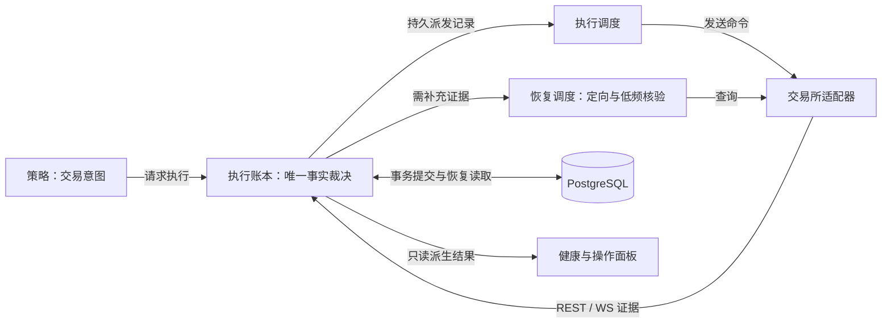

# 执行架构简化评估报告

日期：2026-10-12。性质：架构判断与后续实施建议，不是新一轮代码审计或实施规范。

证据基线：上一轮核验的提交 `417c4d5bc2bcfa22408ffc5de1d5b7954bcd1cda`，以及 2026-10-12 18:05–18:08（Asia/Shanghai）的服务器取证。撰写时工作区已有未提交改动，本文未审查其正确性，也未重新读取服务器；下面的缺陷描述属于该基线，不代表这些改动仍存在相同缺陷。

现行交易契约见[架构入口](overview.md)，验收要求见[测试说明](../testing/behavior-tests.md)。本文合并必要的运行证据与开源依据；旧状态审计和旧重构任务契约已从工作树退役，可在 Git 历史中按日期与提交查阅，不作为当前实现指令。

## 一、结论

**架构有进一步简化的必要，重点是减少可写状态的所有者、恢复入口和调用方必须理解的执行细节，而不是删除对账、持久化或终态保护。**

现有运行证据证明了一些协调接缝存在问题，但尚不足以证明每个 Manager、Channel 或独立进程都是过度设计。不能仅按文件数量、类名或代码行数决定删除。

推荐保留三个核心职责：策略提出意图；执行账本统一决定命令、成交、持仓与预留事实；交易所适配器及恢复调度取得外部证据。这里的“三个职责”不是三个类或三个进程的硬指标；调度与网络适配仍可有独立内部模块。

持续对账应收敛为一个恢复入口，采用异常定向核验与低频账户核验两种触发方式。对账是取得和比较证据，恢复是依据证据修正或重建投影，不能把每次核验都变成全量重建。

**异常先分类，不默认恢复：重复观察忽略，失效入场机会放弃，执行结果未知查证，真实事实冲突才进入隔离与恢复。** 放弃候选不等于放弃已有持仓的退出责任。

## 二、第一性原理：哪些复杂性无法删除

| 业务事实 | 必须保留的机制 | 删除后会发生什么 |
|---|---|---|
| 数据库与交易所没有共同原子事务 | 提交前持久化命令身份；未知结果查单；可恢复提交记录 | 超时被当拒单，后续可能重复下单或遗失已成交订单 |
| REST 与 WS 可以乱序、重复或漏收 | 身份校验、成交去重、累计水位、终态不可逆 | 重复记仓、迟到 ACK 复活终态订单、漏记成交 |
| 撤单不撤销已经发生的成交 | 按真实成交计仓，按未成交余额释放预留 | 部分成交被删除，或预留永久占用 |
| 订单终态、持仓归零、结算完成互不等价 | 独立表达命令、持仓、事实可信度与门控 | 一个“完成”标记隐藏未补成交或未释放预留 |
| 内存与进程可能在任意时点丢失 | 持久事实、启动恢复、提交后发布 | 重启后状态与交易所不同；失败事务污染内存 |
| 正常运行期间也可能丢事件 | 运行期间再次核验，而非只在启动核验 | 启动后出现的差异可能一直无法发现 |

这些机制对应真实失败模式，属于业务必要复杂性。奥卡姆剃刀只能削减重复承担同一责任的实现。

## 三、已观察到的协调问题与过度设计候选

| 基线证据 | 可以得出的结论 | 不能直接得出的结论 |
|---|---|---|
| 投影冲突后，异常补偿试图拒绝已终态命令，二次异常导致主账户与 account-2 重启 | 原异常、命令终态与补偿责任没有在完整链路中协调好 | 终态屏障多余；删掉屏障即可解决 |
| account-2 WUSDT 同一恢复阻断原因密集重复 | 相同证据下的重复工作需要合并与退避 | 仓位必然错误；恢复机制应该全部取消 |
| head 更新而 checkpoint 较旧时，事实可信度进入 UNKNOWN | 恢复快照与当前事实证明的职责需要明确 | 所有 UNKNOWN 都是假告警；直接改为 healthy |
| 单账户命令水位加载先全量读取，再在 Python 中筛账户 | 存在可消除的跨账户历史读取成本 | 终态历史无需保存 |
| 单 key 事务已局部复制 journal，但仍复制全局命令、去重等容器 | 所有权与数据组织值得进一步测量和收敛 | 已证明该复制是当前性能瓶颈 |

过度设计的优先审查对象是：多个模块各自决定恢复完成；同一命令结论由多处写入；调用方需要传递并解释账本内部版本、预留和检查点细节；没有独立约束的转发层。上述候选需要通过依赖图和调用路径逐一确认，不能笼统判定全部冗余。

## 四、目标职责与接口

图示表达职责流，不要求引入 EventBus 或新的 Manager。当前模块应逐步归入这些职责，而不是在现有层之上再包一层。

| 模块职责 | 必须拥有的决定权 | 不应承担的责任 |
|---|---|---|
| 策略 | 何时、以什么业务参数提出交易意图 | 直接修改命令终态、持仓数量或恢复结论 |
| 执行账本 | 校验身份与版本；接受事实；命令、真实成交、预留和投影的持久变更；提交后发布 | 持领域锁等待交易所网络 I/O；用申请量合成成交 |
| 执行调度 | 优先级、派发时机、待执行记录消费 | 维护另一套可独立修改的订单真相 |
| 交易所适配器 | 协议解析、REST/WS 接入、请求与响应分类 | 决定本地批次已平仓或恢复已完成 |
| 恢复调度 | 按范围合并查询需求、控制预算与退避 | 绕过账本直接修数量；重复 POST 未知订单 |
| 健康与面板 | 根据明确证据只读派生存活、可信度和能力 | 为显示正常而写回执行事实 |

执行账本可以有复杂的内部实现，但外部接口应使调用方无需自行拼装命令、持仓、预留和恢复结论。一个逻辑权威写入口不等于一个全局串行锁；账户与持仓可按明确范围并发。

保留现有四维正交定义。四维状态应从权威事实推导，不再成为另一套可任意写入的全局状态存储。

## 五、持续对账如何简化

**持续指贯穿运行生命周期，不指持续高频全量扫描。**

### 异常分流与结束条件

|类别|判定依据|处理与结束条件|
|---|---|---|
|忽略重复观察|身份已校验，持久证据证明已处理，消息不含新成交或待完成结算|不改事实、不发单、不触发恢复；重复终态仍有结算缺口时不得走此分支。|
|放弃失效入场机会|已确认该请求尚未 POST、没有未知提交；候选过期、风险不批准或执行投影版本变化|结束本次候选，等待正常新信号，不为了挽救机会自动刷新和重试；若已有持久准备与预留，按当前命令身份幂等结清未发送责任，不能直接丢弃记录或改写同身份既有终态。|
|定向查证执行结果|POST 可能到达交易所，或撤单/成交结果尚未确认|保留身份与责任，只查询相关订单及成交；预算耗尽仍 UNKNOWN，退避并告警，不再次 POST，不升级为无依据的全量重建。|
|隔离与事实恢复|有效证据互相矛盾、存在覆盖缺口，或持久化失败使发布结果无法确认|按受影响范围停止不安全变更，取得证据后补账或重建；持久化故障保持可见，不能吞掉。|

“投影变化”必须区分正常版本竞争与事实矛盾：前者在确认未发送时结束失效入场候选；后者才需要定向核验。订单已终态后的旧 ACK 可以忽略，但首次收到的真实成交、未完成结算和退出责任必须继续处理。

退出候选过时可以结束该次计算，但已有仓位的退出义务不能被丢弃：由原退出流程按最新可信数量重新评估，保留既有订单和预留，不能重复发送未知命令。丢弃仅针对可证明冗余的观察或未发生副作用的机会，不删除交易证据。预期失效记录有界计数或简短原因，不按恢复失败重复告警。

| 触发 | 核验范围 | 后续处理 |
|---|---|---|
| 启动、断线重连 | 活跃及未解决命令、当前持仓、覆盖缺口 | 完成必要证明后恢复相应能力；未解决对象保持可见 |
| 下单结果未知 | 固定命令身份对应的订单及成交 | 查询结果补充账本；预算耗尽仍未知，不重发下单 |
| 累计成交、预留或投影的事实矛盾 | 涉及的账户、symbol、positionSide 与订单 | 先排除正常版本竞争和重复消息；找到首个事实分歧，有证据才修复，无证据则等待并告警 |
| 正常低频安全网 | 账户委托与持仓快照 | 无差异只更新核验依据；有差异才定向查明细 |

调度契约：每个恢复 key 同时最多一个执行任务；相同未变化证据合并；无进展时退避；新证据可以唤醒下一轮；请求、原因、证据版本、耗时、预算和下一次尝试可查。账户级快照可以共享取得，但每个 key 的业务结论仍由账本决定。

频率应由可接受的差异发现时间、未知敞口风险及交易所请求预算决定。当前没有连续基线，不能武断规定所有账户每秒、每分钟或固定次数全量核验。

事实不足时阻止增加风险；已有仓位的减仓能力按当前可信身份、方向和可减数量单独判断。不能因为降低风险而绕过 reduce-only、Hedge 模式或数量证明。

## 六、数据与存储应怎样收敛

- 内存保存活跃命令、当前持仓投影、有界行情窗口和恢复调度工作集；不承担跨重启唯一事实来源。
- PostgreSQL 保存命令身份、真实成交、预留、事实 journal 及可验证检查点。事务成功后发布内存投影，失败不发布。
- 检查点用于控制恢复成本；当前可信度由检查点加完整事实后缀及覆盖依据证明，不能要求每次状态更新都写全量检查点。
- 终态历史可以移出热内存，但必须保留迟到事件校验与成交去重能力。不能用任意 TTL 造成失忆。
- 观察 trace 与不可丢弃交易事实分别定义容量、溢出和留存规则，允许删除的观察数据不应绑定交易恢复生命周期。

不为了“更简单”引入 Redis、Kafka 或新的通用总线。已有两个 outbox 是否合并，应先确认其持久化义务、事务边界及重试责任；决策意图与交易所派发若不同，就有理由分别保留。

## 七、删层与实施顺序

删除检验：移除一个模块后，如果复杂性消失且不变式仍有唯一归属，它可能只是转发层；如果相同细节散落到多个调用方，它原本在隐藏必要复杂性，不应直接删除。将外部接口缩小不要求把内部实现塞进一个巨型类。

| 阶段 | 产出 | 验收重点 |
|---|---|---|
| 1：可靠性闭环 | 在当前代码上重新核验已观察异常；补齐完整补偿链与重启恢复路径 | WS 终态先到、REST/投影冲突随后时不复活、不重复记仓；可恢复冲突不杀死 worker，真实持久化故障仍可见 |
| 2：异常分流与恢复统一 | 忽略、放弃、查证、隔离恢复四类结果；单一恢复入口、key 合并、预算与退避；明确 checkpoint 与当前证明 | 未发送的失效入场不 POST、不自动刷新、不触发恢复；已有准备幂等结清；重复观察不改事实；退出责任保留；未知提交只查原身份；真实冲突不能丢弃 |
| 3：所有权收敛 | 调用图与写入点清单；收窄账本接口；删除经验证的转发层 | 每类事实有唯一裁决职责；数据库提交失败不污染内存；跨账户/key 隔离；网络 I/O 不持领域锁 |
| 4：成本优化 | 下推账户查询范围；测量候选复制；制定引用安全的热/冷留存 | 同负载比较启动查询量、事件延迟、内存、写入增长及恢复耗时；归档前后事实与去重结果一致 |

不以减少类数或代码行数作为验收。使用完整调用链和可控制事件交错测试，并覆盖真实数据库提交、重启重放、部分成交、迟到成交与未知提交。模块删减后原有安全契约必须继续成立。

建议实施后连续观察至少 24 小时：异常重启、未确认命令年龄、恢复重复率、未收敛对象、持仓差异、队列最老事件年龄和存储增长。该观察期是后续建议，不代表已经完成验收；性能收益百分比须有同负载基线。

## 八、决策建议

采用渐进简化，不整体重写执行框架。先证明当前改动是否修复基线故障，再统一恢复职责，随后收敛事实写入口和调用接口，最后依据测量优化历史成本。

**保留必要失败处理，删除重复协调。持续核验保留，高频重复恢复削减；事实所有权集中，内部实现可分解；模块数量服从职责，不反过来决定业务模型。**

## 九、保留的证据与开源依据

服务器证据属于 2026-10-12 18:05–18:08 的历史窗口：四策略版本为 417c4d5b，主账户与 account-2 各重启一次、无 OOM；活跃差异为 account-2 WUSDT，恢复阻断原因反复出现；四账户 fact_integrity 为 UNKNOWN，而账户对账 mismatch_count 为 0。WUSDT 绑定检查点年龄约 365–1282 秒，head 比检查点新约 356–1263 秒。这说明存活、对账与事实证明不能混为一个 healthy，但不证明仓位数量必然错误。

同一窗口根分区使用 55%、剩余约 26 GiB，可用内存约 951 MiB，数据库约 12 GB；market_revision_refs 含索引约 5551 MB、事实 journal 约 1958 MB、恢复 checkpoint 约 1079 MB。存量不能当作增长速率，单次 CPU 快照不能证明性能瓶颈。终态命令关联 ACTIVE reservation 的查询计数为 0，也不能证明所有执行路径无漏洞。

下列 GitHub 链接固定提交，仅核对选定源码路径，未运行上游测试，不代表这些项目整体已证明最优。参考模式应遵守本项目真实成交和终态保护契约。

|项目与固定提交|可参考的实现|不应直接照搬|
|---|---|---|
|Hummingbot `9af100d6822da7d2d0291a906c730ef172284ee2`|[提交前建立订单跟踪](https://github.com/hummingbot/hummingbot/blob/9af100d6822da7d2d0291a906c730ef172284ee2/hummingbot/connector/exchange_py_base.py#L400)；[Binance 特定 503 unknown 处理](https://github.com/hummingbot/hummingbot/blob/9af100d6822da7d2d0291a906c730ef172284ee2/hummingbot/connector/derivative/binance_perpetual/binance_perpetual_derivative.py#L231)与[原身份查单](https://github.com/hummingbot/hummingbot/blob/9af100d6822da7d2d0291a906c730ef172284ee2/hummingbot/connector/derivative/binance_perpetual/binance_perpetual_derivative.py#L330)；[trade ID 去重](https://github.com/hummingbot/hummingbot/blob/9af100d6822da7d2d0291a906c730ef172284ee2/hummingbot/core/data_type/in_flight_order.py#L354)|[状态更新](https://github.com/hummingbot/hummingbot/blob/9af100d6822da7d2d0291a906c730ef172284ee2/hummingbot/core/data_type/in_flight_order.py#L327)局部未提供通用终态屏障；[默认无界队列](https://github.com/hummingbot/hummingbot/blob/9af100d6822da7d2d0291a906c730ef172284ee2/hummingbot/core/data_type/user_stream_tracker.py#L19)不符合本项目容量契约。|
|Freqtrade `acc90ae6997dd1f0237b1d7b13d0f058401053c7`|[撤单后保留仍活动订单，并按真实部分成交归账](https://github.com/freqtrade/freqtrade/blob/acc90ae6997dd1f0237b1d7b13d0f058401053c7/freqtrade/freqtradebot.py#L2044)|[create_order 未加 retry 装饰器](https://github.com/freqtrade/freqtrade/blob/acc90ae6997dd1f0237b1d7b13d0f058401053c7/freqtrade/exchange/exchange.py#L1498)只是局部事实，不证明整个上层不会重复下单。|
|NautilusTrader `de774a1d5a7914a93a20f8e0980b30090ee7b9e9`|[持续核验 inflight、open orders 与 positions](https://github.com/nautechsystems/nautilus_trader/blob/de774a1d5a7914a93a20f8e0980b30090ee7b9e9/crates/live/src/execution/manager.rs#L738)；[查询预算与间隔](https://github.com/nautechsystems/nautilus_trader/blob/de774a1d5a7914a93a20f8e0980b30090ee7b9e9/crates/live/src/execution/config.rs#L35)；[RetainUnresolved 可保留未确认提交](https://github.com/nautechsystems/nautilus_trader/blob/de774a1d5a7914a93a20f8e0980b30090ee7b9e9/crates/live/src/execution/submission.rs#L22)|RetainUnresolved 并非所有配置的默认行为；[推断成交机制](https://github.com/nautechsystems/nautilus_trader/blob/de774a1d5a7914a93a20f8e0980b30090ee7b9e9/crates/live/src/execution/reconciliation.rs#L627)不适合本项目；无需移植完整框架或通用事件总线。|
