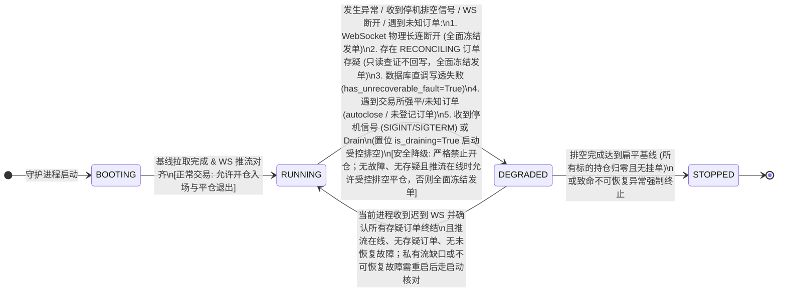
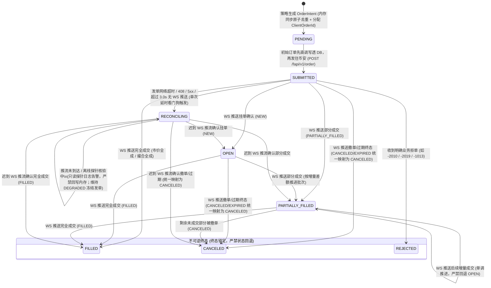
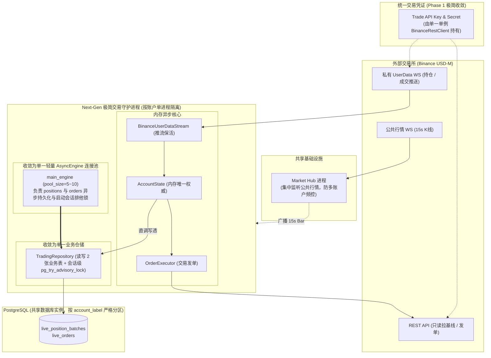
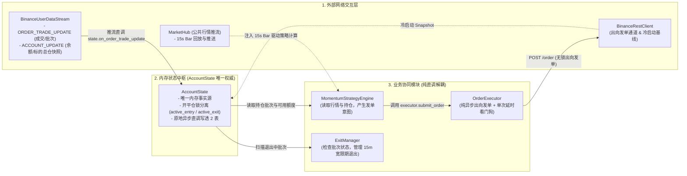
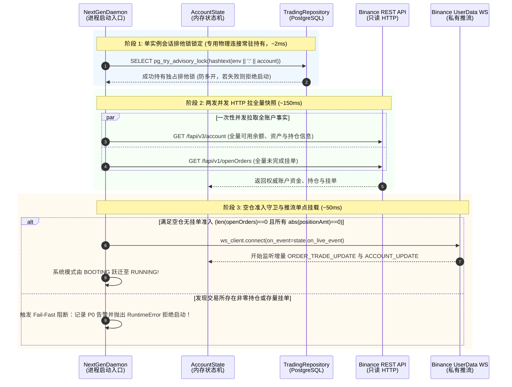
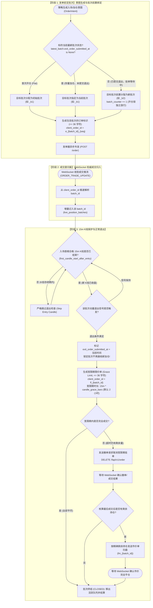

# Next-Gen 极简现代异步架构设计蓝图 (Clean-Slate Proposal)
> **设计版本**: 2026.10-NextGen-Proposal-v2-Streamlined  
> **设计基准**: Git 仓库真实源码（Alembic 迁移 `20261018_0067_next_gen_execution_tables` 已合并，Schema Version 4，包含生产发单安全门、错误分类、WS 撤单成交核对与 Compose 部署定义）  
> **架构定位**: 现代 Python 3.12+ 结构化异步、内存权威、低认知负荷的中低频量化交易执行引擎  
> **多账户部署现状**: 线上 4 个 NextGen 账户（`primary`、`account-2`、`account-3`、`account-4`）共用同一个 PostgreSQL 数据库实例（[`compose.next_gen.yaml`](../../compose.next_gen.yaml)）

> **文档范围**：本文是 NextGen 架构提案与演进记录，不保证每条设计都与当前实现逐项一致；实现行为以当前代码为准。文中对旧 `runtime_orchestrator.py` 的引用是历史比较材料，旧源码请从 Git 历史查看。当前入口见 [NextGen CLI](../../src/crypto_momentum_lab/apps/next_gen/cli.py)、[daemon](../../src/crypto_momentum_lab/next_gen/daemon.py)、[engine](../../src/crypto_momentum_lab/next_gen/engine.py) 和 [exit manager](../../src/crypto_momentum_lab/next_gen/exit_manager.py)。

---

## 1. 架构重构核心设计宣言 (Design Manifesto)

旧版执行栈为了服务一个 **15 秒周期行情、15 分钟 K 线调仓** 的中低频动量策略，引入了 10 张执行/决策持久化表、两阶段分离的成交流水双事务写入、基于全表前缀扫描的 Head 恢复以及复杂的局部 Fact Gap 隔离状态机，产生了较高的认知负荷与运维复杂度。本提案记录了当时的重构目标；当前实现以 NextGen 源码为准。

下一代架构遵循以下五大原则：

1. **内存权威与直调异步写透（In-Memory Authority with Direct Async Write-Through）**：单账户单进程独占运行场景下，内存即绝对权威状态。取消繁重的 Head CAS 乐观锁排他更新，杜绝不必要的进程内消息队列与死信中间件；采用内存单线程事件循环原子流转 + 收到回报后原地异步直调写透数据库 2 张关系表，简单直接、所见即所得。
2. **WebSocket-First：启动拉取初始基线，运行态由 WebSocket 独占推进（WebSocket-First & Zero REST Write-Back）**：冷启动通过 REST 一次性并发读取空仓与挂单初始基线；随后由 WebSocket 私有推流独占推进订单与批次生命周期，彻底消灭常规 REST 轮询与运行态状态回写。出向发单（HTTP POST 200）仅代表网关受理（`SUBMITTED`），绝不提取响应体反写内存；发单明确拒单（-2010/-2019 等）即刻标记本地 `REJECTED` 终态并释放活跃占用；已受理订单的挂单、成交与撤销 100% 由 WebSocket 推流独占单向驱动。发单网络超时或未知一律转入 `RECONCILING` 存疑态并原子切入 `DEGRADED` 冻结发单，运行态 REST 绝不回写内存订单状态，从通信通道与逻辑权威上彻底杜绝双写竞态。
3. **单一系统运行模式（Single System Mode）**：全局收敛为唯一的四态运行模式（`BOOTING` / `RUNNING` / `DEGRADED` / `STOPPED`），彻底消除多维正交状态机与状态撕扯，并提供明确的迟到推流重新评估与故障状态收敛复位路径。
4. **全仓安全失效冻结（Fail-Closed on Anomaly）**：一旦推流中断、存在存疑订单、数据库写异常或收到交易所未知订单，整个账户原子切入全面冻结自动发单的降级保护模式（`DEGRADED`），杜绝黑盒盲动；仅在无故障、推流在线且无存疑订单的明确管理员排空（Admin Drain）下放行平仓。
5. **结构化并发与单向权威中枢（Structured Concurrency & State Hub）**：用标准的 `asyncio.TaskGroup` 与单向显式的内存状态中枢，彻底消灭复杂的调度胶水层与非直观的事件总线。

---

## 2. 系统运行模式：单一状态机取代“三维千层饼”

### 2.1 状态机模型图



### 2.2 状态定义与行为准则

| 系统模式 (System Mode) | 允许开仓 (Allow Entries) | 允许平仓 (Allow Exits) | 触发条件与守卫逻辑 |
| :--- | :---: | :---: | :--- |
| **`BOOTING`** | ❌ 严禁 | ❌ 严禁 | 进程启动初始化阶段。并发拉取 REST 快照建立初始基线、建立并完成 WebSocket 物理长连握手、预热指标后跃迁至 `RUNNING`；若检测到存量持仓/挂单则 Fail-Fast 阻断退出。 |
| **`RUNNING`** | ✅ 允许 | ✅ 允许 | 系统处于完全健康状态。推流物理在线且正常保活、所有订单状态明确、单进程独占掌控交易。 |
| **`DEGRADED`** | ❌ 严禁 | ⚠️ **受限允许** | **安全降级模式（Freeze on Anomaly / Drain Exit Only）**。<br/>- **单账户独占前提**：一期严格限定单账户由本进程独占交易，严禁外部手工或其它程序并发操作。<br/>- **触发源**：管理员下发 Drain 排空、发单网络超时/未知（`RECONCILING`）、推流物理断开（`ws_connected=False`）、数据库写透重试耗尽失败、或收到交易所强平/未知订单（如 `autoclose-...`、`adl_autoclose`）。<br/>- **平仓守卫铁律（防失控双重开仓与状态漂移）**：双向持仓模式下发单严格不传 `reduceOnly`，发平仓单必须依赖推流确认上一单成交结果：<br/>1. **受控排空允许平仓**：仅当 **降级原因纯粹为管理员下发的 Drain 计划排空（`is_draining=True`）**，且同时满足 **未发生不可恢复致命故障（`has_unrecoverable_fault=False`，如数据库正常）**、**WebSocket 物理在线（`ws_connected=True`）** 且 **无存疑订单（无 `RECONCILING`）** 时，系统才允许 ExitManager 发出平仓单；<br/>2. **异常全面冻结发单（Freeze Ordering on Anomaly）**：若因推流断开（含 24h 断连）、发单超时/未知（`RECONCILING`）、数据库写失败或遇到交易所未知强平订单进入降级，**严禁发送任何新订单（无论是开仓还是平仓）**！系统彻底冻结所有自动发单行为并发出高优先级告警，杜绝黑盒盲动导致翻转仓位或双重成交。<br/>- **状态恢复路径（State Convergence）**：迟到推流只有在当前进程核实所有存疑订单终结、且无私有流缺口和不可恢复故障时，才能由 `recheck_system_mode()` 恢复为 `RUNNING`。存在私有流缺口或不可恢复故障时，当前进程不提供人工复位；需重启并执行启动核对。 |
| **`STOPPED`** | ❌ 严禁 | ❌ 严禁 | 进程终结状态。仅在排空完成达到扁平基线（所有标的持仓归零且无挂单）或致命不可恢复异常强制终止后跃迁进入。撤销所有未完成挂单，释放全部网络连接与数据库连接池。 |

---

## 3. 极简订单生命周期与实盘硬核防线

不再维护繁复的 `DispatchState`、`ExecutionOrderWatermarkRow`、`PositionReservationRow` 等分散状态，订单生命周期收敛于内存领域对象中。

### 3.1 订单状态流转图



> **核心原则：WebSocket 独占驱动生命周期 + 运行态 REST 绝不回写订单状态（WebSocket-First & Zero REST Write-Back）**
> 1. **发单提交结果与交易所生命周期的权责边界（Submission Gateway vs Exchange Lifecycle）**：
>    - **交易所订单生命周期（Exchange Lifecycle: OPEN / PARTIALLY_FILLED / FILLED / CANCELED）**：100% 由 WebSocket 私有推流（`ORDER_TRADE_UPDATE`）单向独占驱动。币安订单更新中的 `EXPIRED` 与 `EXPIRED_IN_MATCH` 统一由事件解析层映射为本地 `CANCELED` 终态；
>    - **发单已受理（HTTP 200）**：仅表示网关已接收委托，订单在内存中保持 `SUBMITTED` 状态，其后续挂单、成交、撤单等状态推进完全等待 WebSocket 推流，HTTP 响应体绝不用于更新订单状态、成交数量、增量均价或持仓；
>    - **发单未受理/提交失败（HTTP 4xx 业务拒单 -> REJECTED）**：发单若收到币安明确的业务错误码（如 `-2010 NEW_ORDER_REJECTED`、`-2019 MARGIN_NOT_SUFFICIEN`、`-1013 INVALID_MESSAGE`、`-4015 INVALID_CL_ORD_ID_LEN`），表明该委托在 HTTP 接入网关处即被直接拒之门外，**撮合引擎未受理建单，交易所永远不会为此单产生 WebSocket 事件**。发单器直接将本地订单标记为 `REJECTED` 并立即调用 `mark_order_rejected` 从活跃索引弹出移除，彻底解除活跃订单锁定；
>    - **发单未知/网络超时（Network Timeout / In-Doubt -> RECONCILING）**：HTTP 408（Request Timeout）、502/503/504、网络连接重置、币安未知错误码（`-1006 UNEXPECTED_RESP`、`-1007 TIMEOUT`）或提交超过 3.0 秒未收到任何 WS 推送，进入 `RECONCILING` 存疑态，系统原子切入 `DEGRADED` 冻结发单并告警。
> 2. **部分成交单调推进与批次更新（Partial Fill Monotonicity）**：
>    引入严格状态位阶排序（`STATUS_RANK`），确保状态仅能单调前进：`PENDING(0) < SUBMITTED(1) < OPEN(2) = RECONCILING(2) < PARTIALLY_FILLED(3) < FILLED(4) = CANCELED(4) = REJECTED(4)`。迟到的 `NEW` 事件（Rank 2）绝不能将已处于 `PARTIALLY_FILLED`（Rank 3）的订单打退回 `OPEN`。收到增量成交量时，按**本次新增成交量（Last Filled Quantity）**即时更新对应批次的数量与加权均价。
> 3. **WebSocket 双事件职责正交（Event Role Orthogonality）**：
>    - **`ORDER_TRADE_UPDATE` 独占成交与批次数量**：携带 `client_order_id`、累计成交量（`z`）、成交均价（`ap`）与增量成交量（`l`），精确映射业务批次 `batch_id`。订单生命周期状态推进以及对应批次持仓数量与开仓均价的更新，**100% 由 `ORDER_TRADE_UPDATE` 独占负责**；
>    - **`ACCOUNT_UPDATE` 仅作为钱包余额与持仓变更推送**：仅推送发生变更的资产与持仓项当前值（`wb`/`cw`/`pa`），天然缺失订单号与策略批次信息。严禁用于改写或累加批次明细数量，杜绝重复计入成交或抹平同标的多批次划分。
> 4. **运行态 REST 绝不回写订单状态（Zero Write-Back Probe via GET /fapi/v1/order）**：当网络超时导致订单处于 `RECONCILING` 时，系统切入 `DEGRADED` 模式；离线或手动 REST 查证严格定位为**只读诊断探针**，用于输出排查日志与告警上下文，**绝不向内存回写订单状态或改写批次持仓**。运行态订单与批次状态 100% 由 WebSocket 推流独占推进。

### 3.2 极简不可逆终态保护与领域模型实现

```python
from enum import Enum, auto
from dataclasses import dataclass, field
from decimal import Decimal
from datetime import datetime, timezone

class OrderStatus(Enum):
    PENDING = auto()           # 本地待发送
    SUBMITTED = auto()         # 已发往交易所 (等待 WS 推送)
    OPEN = auto()              # 交易所确认挂单 (来自 WS 推送)
    RECONCILING = auto()       # 网络超时查证中
    PARTIALLY_FILLED = auto()  # 部分成交 (来自 WS 推送)
    FILLED = auto()            # 完全成交 (终态，来自 WS 推送)
    CANCELED = auto()          # 已撤销/过期终态 (统一映射 CANCELED / EXPIRED)
    REJECTED = auto()          # 发单未受理/提交失败 (本地终态，因 HTTP 网关明确拒单)

STATUS_RANK: dict[OrderStatus, int] = {
    OrderStatus.PENDING: 0,
    OrderStatus.SUBMITTED: 1,
    OrderStatus.OPEN: 2,
    OrderStatus.RECONCILING: 2,
    OrderStatus.PARTIALLY_FILLED: 3,
    OrderStatus.FILLED: 4,
    OrderStatus.CANCELED: 4,
    OrderStatus.REJECTED: 4,
}

@dataclass
class PositionBatch:
    # 活跃持仓批次领域对象 (对应 live_position_batches 表，以 batch_id 为主键)
    environment: str
    account_label: str
    batch_id: str
    symbol: str
    position_side: str                  # LONG / SHORT
    quantity: Decimal                   # 绝对持仓数量 (>= 0)
    entry_price: Decimal
    entry_bar_time: datetime            # 15m K线入场时间戳 (对应 TIMESTAMPTZ)
    status: str = "ACTIVE"              # ACTIVE / EXITING / CLOSED
    exit_order_submitted_at: datetime | None = None
    order_counter: int = 0              # 批次内发单顺序计数器
    realized_pnl: Decimal = Decimal("0") # 批次关闭时的名义毛盈亏 (USDT)
    exiting_quantity: Decimal = Decimal("0") # 保留 Lot 预留不变量: 当前已锁定用于平仓的 Lot 数量
    updated_at: datetime = field(default_factory=lambda: datetime.now(timezone.utc))

    def reserve_for_exit(self, qty: Decimal) -> None:
        # 平仓预留防护: 严格防止多个退出规则重复锁定同一个批次的同一笔 Lot
        available = self.quantity - self.exiting_quantity
        if qty > available:
            raise ValueError(f"批次 {self.batch_id} 可平仓量不足: 请求 {qty}, 可用 {available}")
        self.exiting_quantity += qty
        self.status = "EXITING"
        self.updated_at = datetime.now(timezone.utc)

    def release_exit_reservation(self, qty: Decimal) -> None:
        # 撤单或异常时释放平仓 Lot 预留
        self.exiting_quantity = max(Decimal("0"), self.exiting_quantity - qty)
        if self.exiting_quantity == Decimal("0") and self.quantity > Decimal("0"):
            self.status = "ACTIVE"
        self.updated_at = datetime.now(timezone.utc)

@dataclass
class Order:
    environment: str
    account_label: str
    client_order_id: str
    batch_id: str
    symbol: str
    side: str                          # BUY / SELL
    position_side: str                 # LONG / SHORT
    order_type: str                    # LIMIT / MARKET
    quantity: Decimal
    price: Decimal | None
    status: OrderStatus = OrderStatus.PENDING
    exchange_order_id: int | None = None
    filled_qty: Decimal = Decimal("0")
    avg_price: Decimal = Decimal("0")
    created_at: datetime = field(default_factory=lambda: datetime.now(timezone.utc))
    updated_at: datetime = field(default_factory=lambda: datetime.now(timezone.utc))

    @property
    def is_terminal(self) -> bool:
        return self.status in (OrderStatus.FILLED, OrderStatus.CANCELED, OrderStatus.REJECTED)

    def apply_update(
        self,
        new_status: OrderStatus,
        cum_filled_qty: Decimal = Decimal("0"),
        avg_price: Decimal = Decimal("0"),
        exchange_order_id: int | None = None,
    ) -> Decimal:
        # 单调性防御与成交吸收：终态不可回退，位阶不可逆退，吸收单调成交并返回增量数量 delta_qty
        if exchange_order_id is not None:
            self.exchange_order_id = exchange_order_id

        # 1. 单调位阶推进保护：仅当 new_status 的位阶 >= 当前位阶时才允许更新状态
        if not self.is_terminal and STATUS_RANK[new_status] >= STATUS_RANK[self.status]:
            self.status = new_status

        # 2. 累计成交量严格单调递增：即使已在终态，仍吸收迟到的更大成交量以防止漏计
        delta_qty = Decimal("0")
        if cum_filled_qty > self.filled_qty:
            delta_qty = cum_filled_qty - self.filled_qty
            self.filled_qty = cum_filled_qty
            self.avg_price = avg_price
        self.updated_at = datetime.now(timezone.utc)
        return delta_qty
```

### 3.3 发单调度与乱序结算：内存无锁调度取代数据库多重事务阻塞

#### 3.3.1 痛点反思：真实 As-Is 发单流程与连接池开销剖析

澄清历史神话：旧系统在 Alembic `0061` 迁移中已经删除了 `trading_leases` 表，当前代码中并不存在租约检查 SQL，也不存在所谓的 `dispatch_leases`。但现状依然存在沉重负担：
1. **执行事务内的重型 CAS 序列化**：发单出队后，在 `execution_engine` 事务内调用 `ExecutionBook.act()` 与 `prepare_submission_in_session()`，一次性向 `execution_commands` 写入 `SUBMITTING`、向 `position_reservations` 写入 Lot 预留，并对 `execution_book_heads` 执行 `SELECT ... FOR UPDATE` + CAS 版本号递增更新庞大的 JSONB 载荷。
2. **成交流水双事务写入**：外部成交推流到达时，系统分两次独立事务提交：先由 `PostgresAccountRepository.save_reconciliation_fills_and_cursors()` 写入 `account_fill_events`，再由 `ExecutionUnitOfWork` 开启主事务向 `execution_trade_identities`、`execution_order_watermarks`、`position_reservations` 与 `execution_book_heads` 写透。
3. **连接争抢隐患**：`execution_engine` 仅配置 4 个连接，当多个标的高频发单与成交流水并发时，数据库事务排队带来显著的端到端开销。

#### 3.3.2 目标形态：Next-Gen 极简发单与 WebSocket 单向权威时序图

```mermaid
sequenceDiagram
    autonumber
    participant Strat as Strategy / ExitManager<br/>(策略引擎 / 退出管理)
    participant Exec as OrderExecutor<br/>(轻量发单器直调)
    participant State as AccountState<br/>(内存状态中枢)
    participant DB as TradingRepository<br/>(直接异步写透 PostgreSQL)
    participant REST as Binance Trade REST<br/>(POST /fapi/v1/order)
    participant WS as Binance UserData WS<br/>(ORDER_TRADE_UPDATE)

    rect rgb(240, 248, 255)
        note over Strat, State: 阶段 1: 内存状态预检、开平仓锁分离与批次前置绑定 (< 0.05ms)
        Strat->>State: 检查系统运行模式 (开仓要求 RUNNING; 平仓允许 RUNNING 或受控排空)
        Strat->>State: 开平仓锁分离校验:<br/>- 开仓意图: 校验 active_entry_orders[(acc, sym, pos_side)]<br/>- 平仓意图: 校验 active_exit_orders[(acc, batch_id)]<br/>(退出中的 _b1 与新开的 _b2 互不阻塞!)
        Strat->>State: 前置确定目标 batch_id (首次开仓分配 _b1; 退出中新开前置分裂 _b2)
        Strat->>State: create_entry_order() 或 create_exit_order()
        State-->>Strat: 订单创建成功 (client_order_id <= 36 字符)
        Strat->>Exec: 纯异步直调 submit_order(order)
    end

    rect rgb(255, 250, 240)
        note over Exec, REST: 阶段 2: 初始订单先落库后异步发单 (~50~200ms)
        Exec->>State: order.apply_update(SUBMITTED)
        Exec->>DB: await db.async_save_order(order) (初始订单先落库，毫秒级完成)
        Exec->>Exec: 派发单次延时看门狗: asyncio.create_task(watch_submission_timeout(id, 3.0))
        note over Exec, REST: 无锁状态下发起 HTTP 外呼 (双向模式携带 positionSide，禁止传 reduceOnly)
        Exec->>REST: POST /fapi/v1/order
        alt 1. 发单受理 (HTTP 200 OK)
            REST-->>Exec: 仅作为受理 Ack，绝不解析回包修改状态，等待 WS 推送
        else 2. 明确业务拒单 (如 -2010 / -2019)
            REST-->>Exec: 返回明确拒单错误码
            Exec->>State: state.mark_order_rejected(order.client_order_id, reason)
            Exec->>DB: await db.async_save_order(order)
        end
    end

    rect rgb(255, 240, 245)
        note over WS, State: 阶段 3: WebSocket 单向权威推进 (< 10ms)
        WS-->>State: 推送 ORDER_TRADE_UPDATE (唯一状态变迁驱动)
        alt 1. 限价单挂单确认 (NEW)
            State->>State: order.apply_update(OPEN)
            State->>DB: await db.async_save_order(order)
        else 2. 发生部分成交 (PARTIALLY_FILLED)
            State->>State: order.apply_update(PARTIALLY_FILLED, cum_qty, avg_price)<br/>按增量成交量 delta_qty 即时更新 live_position_batches 持仓
            State->>DB: await db.async_save_order_and_batch(order, batch)
        else 3. 完全成交 (FILLED)
            State->>State: order.apply_update(FILLED, cum_qty, avg_price)<br/>完全结算 live_position_batches 并解除活跃锁占用
            State->>DB: await db.async_save_order_and_batch(order, batch)
        end
    end
```

#### 3.3.3 保留的实盘硬核原则与收益对比
1. **开平仓并发锁分离（Decoupled Order Locks）**：将旧方案笼统的 `(symbol, position_side)` 锁分离为 `active_entry_orders[(account_label, symbol, position_side)]`（开仓锁）与 `active_exit_orders[(account_label, batch_id)]`（平仓锁）。当 `_b1` 批次处于 Grace Limit 挂单平仓中时，其锁只占用平仓字典；策略检测到动量信号需要开新仓时，前置分裂出 `_b2` 批次并成功获得开仓锁，彻底解决原方案中“退出中无法分裂新开 `_b2`”的代码死锁问题。
2. **双向持仓模式兼容（Hedge Mode Compatibility）**：沿用双向持仓配置（`hedge_mode=True`），发单显式传递 `positionSide`（`LONG`/`SHORT`），且在双向模式下严格不传 `reduceOnly` 参数；持仓管理统一按 `(environment, account_label, symbol, position_side)` 粒度维护。
3. **发单先落库与直调异步写透（INSERT Before Wire & Direct Write-Through）**：发单器在将请求发往网络前，先 `await db.async_save_order(order)` 确保初始订单落库，随后发起 HTTP 外呼。成交流水到达时，内存中枢原子推进订单与批次后直接 `await db.async_save_order_and_batch(order, batch)`；若数据库发生异常，原地微退避重试 1 次，仍失败则切入 `DEGRADED` 报警停机。省去异步消息队列与死信中间件，杜绝进程被杀死导致的队列数据静默丢失。
4. **启动 REST 读取初始基线 + 运行态 WS 独占驱动订单仓位（WebSocket-First & Zero REST Write-Back）**：启动阶段通过 REST 一次性并发读取账户持仓与挂单快照建立初始基线，随后由 WebSocket 接管并全权推进订单与批次；运行态 REST 仅作出向发单与异常离线诊断，严禁回写内存。

---

## 4. 存储层推倒重来：从 10 张表收敛为 2 张干净关系表

### 4.1 表结构精简对比与设计取舍

| 现存/历史执行与决策表 (Real HEAD Tables) | 现状与废弃原因 | 下一代替代方案 |
| :--- | :--- | :--- |
| `execution_book_heads` | 存储嵌套 JSONB 状态载荷，冷启动前缀扫描反序列化较重 | 替换为规整二维表 `live_position_batches` |
| `execution_commands` | 记录发单命令调度历史，多生命周期字段重叠 | 替换为轻量统一订单表 `live_orders` |
| `execution_order_watermarks` | 记录单订单累计量与金额，表间分散关联更新 | 直接内聚于 `live_orders.filled_quantity` 与 `average_price` |
| `execution_trade_identities` | 逐笔成交去重主键表，产生大量高频写入与表争用 | 由 `live_orders` 累计量单调吸收差额（`delta_qty`）取代，不存逐笔流水 |
| `execution_evidence_receipts` | 原始推流事件凭证存储，高频产生无谓死元组 | 降级为结构化日志按需落盘，不再入关系型数据库 |
| `execution_retired_streams` | 流 Epoch 栅栏表，服务于多代推流迁移 | 极简架构推流断开即冻结，不再维护多 Epoch 动态栅栏 |
| `position_reservations` | 独立预留行锁定 Lot 数量，高频增删锁表严重 | 内聚于 `PositionBatch.exiting_quantity` 内存不变量，无独立表 |
| `durable_decision_exits` | 退出决策历史与候选凭证存储 | 简化由 `live_orders` 的 `batch_id` 外键与状态直接表达 |
| `durable_policy_states` | 策略运行时决策状态表 | 策略纯无状态实时计算，依赖 15s Bar 驱动 |
| `durable_policy_commits` | 决策提交审计表 | 简化为应用遥测指标与结构化日志输出 |

> **两张表收敛的设计取舍（Scope & Trade-offs）**：
> 第一阶段重构聚焦于订单流转与仓位生命周期的极简高可靠运行，收敛为 2 张核心表。系统**暂不维护本地逐笔成交流水表与本地逐笔手续费/资金费分摊逻辑**；批次关闭时仅进行基于开平仓加权均价的名义毛盈亏（Gross PnL）归因，结果持久化于 `live_position_batches.realized_pnl` 列。完整的成交流水审计与净盈亏核算依赖币安官方账单或后续独立旁路数据仓库。

### 4.2 全新 PostgreSQL DDL (支持多账户、强约束、高效索引)

```sql
-- 1. 活跃持仓批次快照表 (支持多账户隔离与同标的多批次重叠共存)
CREATE TABLE live_position_batches (
    environment VARCHAR(32) NOT NULL,
    account_label VARCHAR(64) NOT NULL,
    batch_id VARCHAR(64) NOT NULL,           -- 批次短标识 (如 BTC_L_261018120035_a1_9f_b1)
    symbol VARCHAR(32) NOT NULL,
    position_side VARCHAR(8) NOT NULL,         -- LONG / SHORT
    quantity NUMERIC(28, 10) NOT NULL CHECK (quantity >= 0), -- 批次持仓绝对数量 (严格非负)
    entry_price NUMERIC(28, 10) NOT NULL,
    entry_bar_time TIMESTAMPTZ NOT NULL,       -- 独立的 15m K线入场锁定时间
    exit_order_submitted_at TIMESTAMPTZ,       -- 提交退出时间戳
    status VARCHAR(16) NOT NULL CHECK (status IN ('ACTIVE', 'EXITING', 'CLOSED')),
    realized_pnl NUMERIC(28, 10) NOT NULL DEFAULT 0, -- 批次名义毛盈亏 (USDT)
    exiting_quantity NUMERIC(28, 10) NOT NULL DEFAULT 0 CHECK (exiting_quantity >= 0), -- 保持 Lot 预留不变量
    updated_at TIMESTAMPTZ NOT NULL DEFAULT NOW(),
    PRIMARY KEY (environment, account_label, batch_id)
);
CREATE INDEX idx_live_batches_acc_sym_status 
    ON live_position_batches(environment, account_label, symbol, status);

-- 2. 统一订单生命周期表 (结构化列，逻辑关联与字符长度约束)
CREATE TABLE live_orders (
    environment VARCHAR(32) NOT NULL,
    account_label VARCHAR(64) NOT NULL,
    client_order_id VARCHAR(36) NOT NULL CHECK (length(client_order_id) <= 36), -- 严格硬限制 <= 36 字符
    exchange_order_id BIGINT,                  -- 币安服务端生成的订单 ID (数字)
    batch_id VARCHAR(64) NOT NULL,             -- 关联所属批次 (逻辑关联)
    symbol VARCHAR(32) NOT NULL,
    side VARCHAR(8) NOT NULL,                  -- BUY / SELL
    position_side VARCHAR(8) NOT NULL DEFAULT 'BOTH', -- BOTH / LONG / SHORT
    order_type VARCHAR(16) NOT NULL,           -- LIMIT / MARKET
    quantity NUMERIC(28, 10) NOT NULL,
    price NUMERIC(28, 10),
    status VARCHAR(16) NOT NULL CHECK (
        status IN ('PENDING', 'SUBMITTED', 'OPEN', 'PARTIALLY_FILLED', 'FILLED', 'CANCELED', 'EXPIRED', 'REJECTED', 'RECONCILING')
    ),
    filled_quantity NUMERIC(28, 10) NOT NULL DEFAULT 0,
    average_price NUMERIC(28, 10) NOT NULL DEFAULT 0,
    created_at TIMESTAMPTZ NOT NULL DEFAULT NOW(),
    updated_at TIMESTAMPTZ NOT NULL DEFAULT NOW(),
    PRIMARY KEY (environment, account_label, client_order_id)
    -- 注: 显式不建物理 FOREIGN KEY 约束，避免首笔开仓订单先落库时因对应批次尚未建表行而发生外键违规报错；由应用层与 idx_live_orders_acc_batch 复合索引保障逻辑关联。
);
CREATE INDEX idx_live_orders_acc_sym_status 
    ON live_orders(environment, account_label, symbol, status);
CREATE INDEX idx_live_orders_acc_batch 
    ON live_orders(environment, account_label, batch_id);
```

### 4.3 基础设施拓扑与连接池精简：从 5 池收敛为“单池单仓储”

#### 4.3.1 极简系统拓扑图



#### 4.3.2 深度重构原则与保留项

1. **废除多池划分，引入数据库级咨询锁（`pg_try_advisory_lock`）**：
   - 现状修正：线上 4 账户共享同一个 PostgreSQL 实例，代码中依靠容器部署实现单进程隔离。下一代方案在应用层引入 **PostgreSQL 会话级咨询锁（`pg_try_advisory_lock`）** 构成物理防线：
     - **启动排他互斥**：启动时在专用连接上执行 `SELECT pg_try_advisory_lock(hashtext(:environment || ':' || :account_label))`。成功持有该锁方可启动；失败（说明已有同账户实例在运行）则抛出异常立即安全退出，彻底避免容器编排异常引发的双主裂脑；
   - **收敛为单池单仓储**：彻底废除 `checkpoint_engine`、`market_engine` 与 `observability_engine` 等多引擎划分；将仓储精简为单一 **`TradingRepository`**（管理 2 张业务表的持久化与咨询锁）。
2. **凭证收敛与共享行情**：
   - **统一单一交易凭证**：Phase 1 统一由单实例 `BinanceRestClient` 持有交易凭证，负责冷启动基线拉取、listenKey 申请与续期、以及出向发单/撤单；
   - **共享 Market Hub**：保留公共行情统一聚合与多账户分发，保护 IP 频控。

---

## 5. 组件接线与数据流重塑：消灭 6 层套娃与闭包黑魔法

### 5.1 现状痛点诊断：为什么现有的接线极度晦涩？

当前系统的组件接线与回调流向存在三大架构硬伤：
1. **6 层套娃抽象**：为了传递币安一条持仓/订单推送，系统强行封装了 6 层对象：`BinanceUsdMUserDataStream` $\to$ `InProcessAccountStreamProducer` $\to$ `AccountUserDataState` $\to$ `InProcessAccountEventSource` $\to$ `LiveAccountEventRuntime` $\to$ `LiveDecisionFactSource`。每一层都在重复解包、打包，调试排查极其困难。
2. **装配时序依赖与延迟闭包赋值**：`runtime_orchestrator.py:444` 中先将 `account_baseline_listener: Callable | None = None` 占位，在跨越上千行装配逻辑后才于 1824 行赋予内部闭包 `_on_account_snapshot_combined`。Producer 初始化需要回调，但回调又依赖下游尚未装配完毕的 Coordinator 和 FactSource，导致必须用可变闭包引用延迟打补丁。
3. **脆弱的同步回调扇出**：`_on_account_snapshot_combined` 在一个同步函数内串行调用 5 个下游子系统的装配方法，任一环节异常即导致全局假死。

### 5.2 目标架构：极简单向数据流管道图



### 5.3 单向、原子、显式的内存状态中枢 (消灭 EventBus 间接层)

```python
import asyncio
import logging
from decimal import Decimal
from enum import Enum, auto
from typing import Any

log = logging.getLogger("next_gen_hub")

class SystemMode(Enum):
    BOOTING = auto()
    RUNNING = auto()
    DEGRADED = auto()
    STOPPED = auto()

class AccountState:
    # 单向、原子、显式的内存状态中枢 (开平仓锁分离 + 直调异步写透)
    def __init__(self, environment: str, account_label: str, db: Any, rest_client=None):
        self.environment = environment
        self.account_label = account_label
        self._db = db
        self._rest_client = rest_client
        self._ws_client = None
        
        self.orders: dict[str, Order] = {}
        # 开仓锁: (account_label, symbol, position_side) -> client_order_id
        self.active_entry_orders: dict[tuple[str, str, str], str] = {}
        # 平仓锁: (account_label, batch_id) -> client_order_id (与开仓锁完全解耦!)
        self.active_exit_orders: dict[tuple[str, str], str] = {}
        self.batches: dict[str, PositionBatch] = {}
        
        self.wallet_balances: dict[str, Decimal] = {}
        self.wallet_balance: Decimal = Decimal("0")
        self.available_balance_snapshot: Decimal = Decimal("0")
        
        self.system_mode: SystemMode = SystemMode.BOOTING
        self.is_draining: bool = False
        self.ws_connected: bool = False
        self.has_unrecoverable_fault: bool = False

    def attach_ws_client(self, ws_client) -> None:
        self._ws_client = ws_client

    def set_system_mode(self, mode: SystemMode) -> None:
        self.system_mode = mode

    def recheck_system_mode(self) -> None:
        # 【状态收敛核心路径】：在迟到推流确认后，重新评估是否能回到 RUNNING
        if self.system_mode != SystemMode.DEGRADED:
            return
        if self.is_draining or self.has_unrecoverable_fault or not self.ws_connected:
            return
        has_in_doubt = any(o.status == OrderStatus.RECONCILING for o in self.orders.values())
        if not has_in_doubt:
            self.system_mode = SystemMode.RUNNING
            log.info("system_mode_restored_to_running", account=self.account_label)

    def update_balances(self, balances: dict[str, Decimal], available_balance_snapshot: Decimal | None = None) -> None:
        self.wallet_balances = balances
        self.wallet_balance = balances.get("USDT", Decimal("0"))
        if available_balance_snapshot is not None:
            self.available_balance_snapshot = available_balance_snapshot

    def can_submit_entry_order(self) -> bool:
        if self.system_mode != SystemMode.RUNNING or self.is_draining:
            return False
        has_in_doubt = any(o.status == OrderStatus.RECONCILING for o in self.orders.values())
        return self.ws_connected and not self.has_unrecoverable_fault and not has_in_doubt

    def can_submit_exit_order(self) -> bool:
        has_in_doubt = any(o.status == OrderStatus.RECONCILING for o in self.orders.values())
        if not self.ws_connected or has_in_doubt or self.has_unrecoverable_fault:
            return False
        if self.system_mode == SystemMode.RUNNING:
            return True
        if self.system_mode == SystemMode.DEGRADED and self.is_draining:
            return True
        return False

    def mark_order_rejected(self, client_order_id: str, reason: str = "") -> None:
        order = self.orders.get(client_order_id)
        if not order:
            return
        order.status = OrderStatus.REJECTED
        self._release_active_order_lock(order)
        # 若为平仓单被拒，回滚批次的 Lot 预留
        if order.side == ("SELL" if order.position_side == "LONG" else "BUY"):
            batch = self.batches.get(order.batch_id)
            if batch:
                batch.release_exit_reservation(order.quantity)
        log.warning("order_gateway_rejected_cleaned", id=client_order_id, reason=reason)

    def _release_active_order_lock(self, order: Order) -> None:
        # 根据订单意图性质精确释放对应的锁
        is_exit = (order.position_side == "LONG" and order.side == "SELL") or \
                  (order.position_side == "SHORT" and order.side == "BUY")
        if is_exit:
            exit_key = (self.account_label, order.batch_id)
            if self.active_exit_orders.get(exit_key) == order.client_order_id:
                self.active_exit_orders.pop(exit_key, None)
        else:
            entry_key = (self.account_label, order.symbol, order.position_side)
            if self.active_entry_orders.get(entry_key) == order.client_order_id:
                self.active_entry_orders.pop(entry_key, None)

    def create_entry_order(
        self,
        symbol: str,
        position_side: str,
        quantity: Decimal,
        price: Decimal | None,
        batch_id: str,
        order_type: str = "LIMIT",
    ) -> Order:
        # 【开仓订单创建】：校验开仓锁，绝不被活跃的平仓单阻塞
        entry_key = (self.account_label, symbol, position_side)
        if entry_key in self.active_entry_orders:
            existing_id = self.active_entry_orders[entry_key]
            raise RuntimeError(f"标的 {symbol} [{position_side}] 已存在活跃开仓单 {existing_id}，禁止重复开仓！")

        side = "BUY" if position_side == "LONG" else "SELL"
        batch = self.batches.get(batch_id)
        seq = (batch.order_counter + 1) if batch else 1
        if batch:
            batch.order_counter = seq
        client_order_id = f"e_{batch_id}_{seq:02d}"
        assert len(client_order_id) <= 36, f"client_order_id 超长: {client_order_id}"

        order = Order(
            environment=self.environment,
            account_label=self.account_label,
            client_order_id=client_order_id,
            batch_id=batch_id,
            symbol=symbol,
            side=side,
            position_side=position_side,
            order_type=order_type,
            quantity=quantity,
            price=price,
            status=OrderStatus.PENDING,
        )
        self.orders[client_order_id] = order
        self.active_entry_orders[entry_key] = client_order_id
        return order

    def create_exit_order(
        self,
        batch_id: str,
        quantity: Decimal,
        price: Decimal | None,
        order_type: str = "LIMIT",
    ) -> Order:
        # 【平仓订单创建】：校验批次平仓锁并锁定批次 Lot 预留
        exit_key = (self.account_label, batch_id)
        if exit_key in self.active_exit_orders:
            existing_id = self.active_exit_orders[exit_key]
            raise RuntimeError(f"批次 {batch_id} 已存在平仓单 {existing_id}，禁止重复平仓！")

        batch = self.batches.get(batch_id)
        if not batch:
            raise KeyError(f"未找到目标平仓批次: {batch_id}")

        batch.reserve_for_exit(quantity)
        side = "SELL" if batch.position_side == "LONG" else "BUY"
        prefix = "fl_" if order_type == "LIMIT" else "fm_"
        client_order_id = f"{prefix}{batch_id}"
        assert len(client_order_id) <= 36, f"平仓 client_order_id 超长: {client_order_id}"

        order = Order(
            environment=self.environment,
            account_label=self.account_label,
            client_order_id=client_order_id,
            batch_id=batch_id,
            symbol=batch.symbol,
            side=side,
            position_side=batch.position_side,
            order_type=order_type,
            quantity=quantity,
            price=price,
            status=OrderStatus.PENDING,
        )
        self.orders[client_order_id] = order
        self.active_exit_orders[exit_key] = client_order_id
        return order

    async def watch_submission_timeout(self, client_order_id: str, timeout: float = 3.0) -> None:
        # 单次延时看门狗: 发一单盯一单，3.0s 后若仍为 SUBMITTED 则转 RECONCILING 并触发只读探针
        await asyncio.sleep(timeout)
        order = self.orders.get(client_order_id)
        if order and order.status == OrderStatus.SUBMITTED:
            log.warning("order_submission_timeout_in_doubt", id=client_order_id)
            order.status = OrderStatus.RECONCILING
            self.set_system_mode(SystemMode.DEGRADED)
            if self._rest_client:
                asyncio.create_task(self.probe_order_status(order))

    async def probe_order_status(self, order: Order) -> None:
        try:
            res = await self._rest_client.query_order(symbol=order.symbol, client_order_id=order.client_order_id)
            log.info("probe_order_result", id=order.client_order_id, result=res)
        except Exception as e:
            log.warning("probe_order_failed", id=order.client_order_id, err=str(e))

    def on_ws_status_change(self, connected: bool) -> None:
        self.ws_connected = connected
        if not connected:
            self.set_system_mode(SystemMode.DEGRADED)
            log.warning("ws_disconnected_entering_degraded")
        else:
            log.info("ws_connected_online")
            self.recheck_system_mode()

    async def on_order_trade_update(
        self,
        client_order_id: str,
        symbol: str,
        position_side: str,
        side: str,
        order_status: OrderStatus,
        cum_filled_qty: Decimal,
        avg_price: Decimal,
        last_filled_qty: Decimal,
        last_filled_price: Decimal,
        exchange_order_id: int | None = None,
    ) -> None:
        # 【单笔成交原子状态转移】：推进订单与批次 -> 原地异步直调写透 DB (支持微退避重试)
        order = self.orders.get(client_order_id)
        if not order:
            log.critical("unrecognized_order_trade_event", id=client_order_id, symbol=symbol)
            self.set_system_mode(SystemMode.DEGRADED)
            return

        delta_qty = order.apply_update(
            new_status=order_status,
            cum_filled_qty=cum_filled_qty,
            avg_price=avg_price,
            exchange_order_id=exchange_order_id,
        )

        if order.is_terminal:
            self._release_active_order_lock(order)

        batch = self.batches.get(order.batch_id)
        if delta_qty > Decimal("0") and batch:
            is_exit = (order.position_side == "LONG" and order.side == "SELL") or \
                      (order.position_side == "SHORT" and order.side == "BUY")
            if is_exit:
                batch.quantity = max(Decimal("0"), batch.quantity - delta_qty)
                batch.exiting_quantity = max(Decimal("0"), batch.exiting_quantity - delta_qty)
                if batch.quantity == Decimal("0"):
                    batch.status = "CLOSED"
            else:
                total_qty = batch.quantity + delta_qty
                batch.entry_price = ((batch.quantity * batch.entry_price) + (delta_qty * last_filled_price)) / total_qty
                batch.quantity = total_qty
            batch.updated_at = datetime.now(timezone.utc)

        # 原地异步直调写透数据库 2 张表 (支持 1 次微退避重试)
        saved = False
        for attempt in range(2):
            try:
                await self._db.async_save_order_and_batch(order, batch)
                saved = True
                break
            except Exception as e:
                log.error("db_save_retry", attempt=attempt, id=order.client_order_id, err=str(e))
                await asyncio.sleep(0.5)

        if not saved:
            log.critical("db_save_failed_entering_degraded", id=order.client_order_id)
            self.has_unrecoverable_fault = True
            self.set_system_mode(SystemMode.DEGRADED)

        # 尝试收敛系统状态
        self.recheck_system_mode()
```

### 5.4 结构化启动编排与端到端生命周期 (`asyncio.TaskGroup`)

```python
async def run_nextgen_daemon(environment: str, account_label: str, main_engine: Any, rest_client: Any):
    # 极简单进程交易守护进程端到端生命周期
    db = TradingRepository(main_engine)
    lock_key = f"{environment}:{account_label}"

    # 阶段 1: 专用物理连接获取会话级 PostgreSQL Advisory Lock (防多开互斥)
    async with db.acquire_dedicated_advisory_lock(lock_key):
        state = AccountState(environment, account_label, db, rest_client)
        order_executor = OrderExecutor(rest_client, state, db)
        exit_manager = ExitManager(rest_client, state)
        strategy_engine = MomentumStrategyEngine(state, order_executor)
        
        ws_client = BinanceUserDataStream(
            rest_client,
            on_status_change=state.on_ws_status_change,
        )
        state.attach_ws_client(ws_client)

        # 阶段 2: 策略行情预热 (从 Market Hub 本地读取 15s Bar 回放，深度 >= 140 Bar)
        await strategy_engine.warmup_market_data()

        # 阶段 3: 严格空仓基线检查与资金初始化 (若检测到存量持仓/挂单，则 Fail-Fast 拒绝启动)
        await assert_flat_baseline_or_abort(rest_client, state)

        # 阶段 4: 建立 UserData WebSocket 物理长连并握手
        await ws_client.connect(on_event=state.on_live_event)
        state.set_system_mode(SystemMode.RUNNING)
        log.info("system_booted_clean_running", account=account_label)

        # 阶段 5: 结构化并发协同 (极简 TaskGroup，无冗余后台轮询)
        async with asyncio.TaskGroup() as tg:
            tg.create_task(ws_client.run_with_keepalive()) # 内置 30m listenKey 续期
            tg.create_task(strategy_engine.run())          # 15s 周期动量计算
            tg.create_task(exit_manager.run())              # 15m K线退出评估
```

### 5.5 WebSocket 两类核心事件分工与轻量资金管理规范

| 评估维度 | `ORDER_TRADE_UPDATE`（订单与成交推送） | `ACCOUNT_UPDATE`（账户资产与持仓变更推送） |
| :--- | :--- | :--- |
| **触发时机** | 挂单确认、撤单、部分成交（`PARTIALLY_FILLED`）、完全成交（`FILLED`） | 资金划转、手续费/资金费结算、成交流水引致的账户余额与持仓变动 |
| **核心数据载荷** | `client_order_id`, `ps` (持仓方向), `x` (执行类型), `X` (订单状态), `z` (累计已成交量), `ap` (成交均价), `l` (增量成交量), `L` (增量成交价) | `B` (各资产余额列表: `wb` 钱包余额, `cw` 全仓余额), `P` (各持仓列表: `s` 标的, `ps` 持仓方向, `pa` 交易所持仓量) |
| **批次归属能力** | **完全具备**：通过 `client_order_id` 精确映射所属 `batch_id`（严格 $\le 36$ 字符） | **完全缺失**：仅包含标的级总持仓 `pa`，天然缺失订单号与策略批次划分 |
| **系统核心权责** | **独占负责**：订单生命周期变迁，唯一驱动对应批次持仓数量累加与开仓均价更新 | **仅负责**：更新内存底层钱包余额与全仓余额，作为资产事实参考 |
| **严禁操作** | 严禁跨批次累加；遇到非本系统托管的未知订单立即切入 DEGRADED 冻结发单 | **严禁改写或累加 `live_position_batches` 数量！** 绝不用 `pa` 粗暴覆盖本地批次 |

**账户维度与静态名义价值双上限规范：**
- **单标的上限校验**：
  $$\text{Symbol Notional} = (\text{Batch Qty} + \sum \text{Open Entry Remaining Qty} + \text{New Intent Qty}) \times \text{Latest Price} \le \text{Symbol Cap}$$
- **全账户上限校验**：
  $$\text{Total Account Notional} = \sum_{\text{all symbols}} \text{Symbol Notional} \le \text{Account Cap}$$
若超过上限，策略直接拒绝生成该开仓意图。名义价值估算纯内存计算、零外部依赖；币安撮合引擎基于实时全仓保证金进行终极权威校验，若资金不足直接返回 `-2019 MARGIN_NOT_SUFFICIEN` 明确拒单。

---

## 6. 冷启动极速同步：从“历史考古”到“两发 HTTP 全量快照基线对齐”

### 6.1 现状痛点反思：彻底摒弃“按币种 `for` 循环拉取历史成交”

当前冷启动耗时较高的主要原因在于：
1. **多标的成交历史串行拉取**：[`runtime_orchestrator.py:790-805`](file:///Users/zhangshuai/PycharmProjects/crypto-momentum-lab/src/crypto_momentum_lab/live_rollout/runtime_orchestrator.py#L790-L805) 按待恢复持仓生成的特定时间窗口依次串行循环拉取成交流水。当管理的标的较多时，串行网络往返累加导致显著 I/O 阻塞；
2. **~63~64 秒预算超时**：当推流基线因网络慢导致未能在 30s 预算内齐套时，`_enforce_account_facts_budget` 触发超时降级，级联导致系统陷入长达 60 多秒的启动停滞。

#### 一期严格坚持“空仓启动准入，异常存量拒入”（Strict Flat-Start Gate）：
1. **纯净空仓部署**：系统启动仅用于空仓切仓或人工已平仓后的干净上线；
2. **零存疑准入**：若 `len(openOrders) == 0` 且所有持仓 `abs(positionAmt) == 0`，直接挂载 WS 进入 `RUNNING`；
3. **异常即阻断（Fail-Fast）**：若发现任何未撤挂单或非零持仓，一律判定为非预期状态，系统直接抛出异常拒绝启动并报警，彻底杜绝无批次元数据的虚假运行。

### 6.2 目标形态：Next-Gen 极简冷启动时序图



### 6.3 极速冷启动代码实现

```python
async def assert_flat_baseline_or_abort(trade_client: Any, state: AccountState) -> None:
    # 一期极简冷启动基线核对：两发并发快照对齐 + 严格空仓守卫准入
    try:
        account_info, open_orders = await asyncio.wait_for(
            asyncio.gather(
                trade_client.fetch_account_information(),  # GET /fapi/v3/account
                trade_client.fetch_open_orders(),          # GET /fapi/v1/openOrders
            ),
            timeout=5.0,
        )
    except Exception as e:
        log.critical("restore_baseline_failed_abort", err=str(e))
        raise RuntimeError(f"冷启动拉取交易所快照失败: {e}") from e

    non_zero_positions = [
        f"{p.symbol}:{p.position_side}={p.position_amt}"
        for p in account_info.positions
        if abs(p.position_amt) > Decimal("0")
    ]
    if len(open_orders) > 0 or len(non_zero_positions) > 0:
        log.critical(
            "cold_start_non_flat_abort",
            open_orders_cnt=len(open_orders),
            non_zero_positions=non_zero_positions,
        )
        raise RuntimeError(
            f"冷启动拒绝准入：检测到交易所存在未结挂单 ({len(open_orders)} 个) "
            f"或未平持仓 ({non_zero_positions})。一期架构限定纯净空仓部署，请先人工或脚本清仓！"
        )

    state.update_balances(
        balances=account_info.wallet_balances,
        available_balance_snapshot=account_info.available_balance,
    )
    log.info("cold_start_baseline_aligned", available=str(account_info.available_balance))
```

### 6.4 行情预热（Market Warmup）与真实表名修正

策略预热深度由策略 `required_data()` 动态决定，以 Order Flow Impulse 为例需要至少 **140 根 15 秒 Bar**：
1. 常驻运行的 `Market Hub` 在内存中维护 15s Bar 回放队列（`_replay_buffers`），启动连接本地 WebSocket 时直接读取回放队列，预期耗时在数十毫秒内；
2. 若本地回放深度未命中，从 PostgreSQL 历史事实表 [`runtime_market_states_15s`](file:///Users/zhangshuai/PycharmProjects/crypto-momentum-lab/src/crypto_momentum_lab/persistence/postgres/models.py)（注：原方案曾误写为 `market_15s_bars`，实际模型类为 `RuntimeMarketState15sRow`）拉取最近 140 根 Bar；**不采用币安普通 REST K线 `limit=100` 兜底**（因币安无 15s 规格且缺失订单流主动买卖字段）。

---

## 7. 批次归属与 15m 退出/强平流：发单前定批次与以 `exit_order_submitted_at` 为边界的批次模型

### 7.1 批次的领域本质与多账户短标识规约

1. **多账户短标识（`batch_id`）设计**：
   - 线上 4 账户共享同一数据库，`batch_id` 必须纳入账户维度：
     `batch_id = {base_sym}_{side}_{YYMMDDHHMMSS}_{acc_tag}_{salt2}_b{counter}`
     示例：`BTC_L_261018120035_a1_9f_b1`（27 字符）；最长标的 `1000LUNC_L_261018120035_a1_9f_b1`（32 字符）。
2. **币安 36 字符硬约束与订单 ID 规约（`newClientOrderId <= 36`）**：
   - 全场景订单 ID 长度推导表：

     | 场景 | 格式模板 | 字符明细 | 常规标的 (`BTC`) | 最长标的 (`1000LUNC`) | 官方上限 |
     | :--- | :--- | :--- | :--- | :--- | :---: |
     | **开仓委托 (Entry)** | `e_{batch_id}_{seq:02d}` | `e_` (2) + `batch_id` ($\le 31$) + `_` (1) + `seq` (2) | `e_BTC_L_261018120035_a1_b1_01` (29) | `e_1000LUNC_L_26101812_a1_b1_01` (**33 字符**) | $\le 36$ ✅ |
     | **限价平仓 (Flat Limit)** | `fl_{batch_id}` | `fl_` (3) + `batch_id` ($\le 31$) | `fl_BTC_L_261018120035_a1_b1` (27) | `fl_1000LUNC_L_26101812_a1_b1` (**31 字符**) | $\le 36$ ✅ |
     | **市价强平 (Flat Market)** | `fm_{batch_id}` | `fm_` (3) + `batch_id` ($\le 31$) | `fm_BTC_L_261018120035_a1_b1` (27) | `fm_1000LUNC_L_26101812_a1_b1` (**31 字符**) | $\le 36$ ✅ |

3. **发单前定批次与时间分水岭**：
   - **首次开仓（Flat State）**：分配初始批次 `_b1`；
   - **退出指令前：加仓自动合并**：当前批次未提交退出订单（`exit_order_submitted_at is None`），目标批次指定为 `_b1`，刷新 `entry_bar_time` 锚点；
   - **退出指令后：新批次前置分裂**：当前批次已打上 `exit_order_submitted_at` 标记，新入场意图发单前触发 `batch_counter += 1`，前置分裂出独立批次 `_b2`。由于开仓锁与平仓锁已物理解耦，`_b2` 开仓与 `_b1` 平仓互不干扰。

### 7.2 目标形态：Next-Gen 极简批次生命周期与退出流程图



---

## 8. 异常处理与自愈原则：全仓安全降级与只读查证

### 8.1 全局安全降级原则（Fail-Closed on Anomaly）
币安 USDⓈ-M 采用全仓保证金模式，账户可用资金与爆仓风险由所有标的共享。
- **触发源**：发单网络超时/未知（408 / 5xx / 超过 3.0s 无推流）、推流物理断开（`ws_connected=False`）、数据库持久化失败、收到交易所未知强平订单；
- **一期处置原则**：
  1. **受控排空允许平仓**：双向持仓模式下发单严格不传 `reduceOnly`，发平仓单必须依赖推流确认上一单成交结果。仅当系统降级原因纯粹为管理员下发的受控排空（`is_draining=True`）、未发生不可恢复故障（`has_unrecoverable_fault=False`）、推流物理在线（`ws_connected=True`）且无存疑订单时，ExitManager 方可提交平仓单；
  2. **异常全面冻结发单（Freeze Ordering on Anomaly）**：若因推流断开、发单超时存疑（`RECONCILING`）、数据库写失败或遇到交易所未知强平订单进入降级，**严禁发送任何新订单（无论是开仓还是平仓）**！系统彻底冻结所有自动发单行为并发出高优先级告警。

### 8.2 存疑订单查证与只读探针原则（In-Doubt Inspection & Zero-Writeback）
1. **发单未受理/提交失败**：收到明确业务拒单（`-2010`、`-2019` 等），说明撮合引擎未受理建单，直接调用 `mark_order_rejected` 记录为 `REJECTED` 并释放活跃锁；
2. **发单结果未知就地存疑**：因网络抖动导致状态未决的订单，立即置为 `RECONCILING` 状态并保持活跃锁，系统原子切入 `DEGRADED` 冻结发单；
3. **只读探针绝不回写内存**：离线探针调用 `GET /fapi/v1/order` 查询交易所事实仅输出排查日志，**绝不向内存回写订单状态，亦不改写批次持仓**。运行态 100% 由 WebSocket 推流独占单向推进。

---

## 9. 下一步演进路线（Implementation Roadmap）

1. **原型验证阶段**：在 `src/crypto_momentum_lab/next_gen/` 目录下建立轻量核心数据结构与状态中枢原型（`Order`, `PositionBatch`, `AccountState`）。
2. **基线对齐阶段**：使用现有的离线历史行情回放测试套件验证状态中枢、订单生命周期与批次切分模型的正确性。
3. **扁平停机平迁移与旧表归档**：在所有标的双向持仓清零且无挂单的扁平窗口（Flat State），执行附录 A 停机平迁指南，直接运行 DDL 创建新表并归档老旧表，杜绝在持仓位迁移与运行时双写复杂度。

---

## 附录：实施准备与对比（Appendix）

### 附录 A：数据库平迁与旧表归档实施指南（Database Migration Runbook）

> [!NOTE] **实施状态说明（Implementation Status）**
> Alembic 迁移 [`20261018_0067_next_gen_execution_tables.py`](file:///Users/zhangshuai/PycharmProjects/crypto-momentum-lab/alembic/versions/20261018_0067_next_gen_execution_tables.py) 创建了两张 NextGen 执行表（`live_position_batches`、`live_orders`）。后续迁移 [`20261021_0068_drop_retired_execution_tables.py`](file:///Users/zhangshuai/PycharmProjects/crypto-momentum-lab/alembic/versions/20261021_0068_drop_retired_execution_tables.py) 已于 2026-10-21 部署，移除了 20 张无运行时消费者的旧表。17 张部署前非空表的数据已归档并核验；3 张表当时为空，其中 `execution_account_process_states` 的更早历史记录仍保存在归档中。降级需要显式从归档恢复数据。旧版执行服务、入口和部署选择已退役。当前更新固定使用 [`compose.next_gen.yaml`](file:///Users/zhangshuai/PycharmProjects/crypto-momentum-lab/compose.next_gen.yaml) 的 `nextgen` Profile，并确保 `migrate` 与 `market-data` 就绪。对应的 SQLAlchemy 2.0 ORM 模型与仓储层已在 [`db_models.py`](file:///Users/zhangshuai/PycharmProjects/crypto-momentum-lab/src/crypto_momentum_lab/next_gen/db_models.py) 和 [`PostgresTradingRepository`](file:///Users/zhangshuai/PycharmProjects/crypto-momentum-lab/src/crypto_momentum_lab/next_gen/persistence.py) 中实现。
>
> 旧版 Flat-State / `ALTER TABLE ... SET SCHEMA` 清理 Runbook 已由 0068 迁移取代；不要再按旧步骤手工移动或删除表。

---

### 附录 B：新旧架构量化指标与设计目标对比

| 评估维度 | 旧版架构（Legacy Engine - Alembic 0066） | Next-Gen 架构（To-Be 现已实现 - Alembic 0067） | 实际收益与质变 |
| :--- | :--- | :--- | :--- |
| **核心调度代码量** | ~2,500 行 | ~600 行 | **预期大幅精简核心调度代码**，心智模型清晰 |
| **状态机维度** | 3 维正交交叉 (Dispatch, Continuity, Session 6状态) | **1 个运行模式 (4态) + 1 个订单生命周期** | 彻底消除概念交叉与局部 Fact Gap 状态撕扯 |
| **发单并发锁** | 统一 `(account_label, symbol, position_side)` 粗锁 | **开仓锁与平仓锁按批次解耦** | 彻底解决退出中无法前置分裂新开 `_b2` 的死锁 |
| **交互通道与状态权威** | REST + WS 混合双事务写入，Head CAS 悲观排队 | **WS 独占推进 + 内存权威 + 原地直调写透** | **物理切断主链路竞态**，推流循环零消息队列积压隐患 |
| **PostgreSQL 核心表** | 10 张执行/决策持久化表 + 巨型 JSONB 载荷 | **2 张规整关系表（live_position_batches, live_orders）** | 消除多表关联写入与 JSONB 反序列化开销 |
| **连接池管理** | 5 个独立池 (`exec=4, mkt=2, obs=1, check=1, hb=1`) | **1 个轻量单池 (main_engine) + pg_try_advisory_lock** | 降低连接争抢，应用层提供数据库级单实例互斥防线 |
| **冷启动机制** | 串行循环拉取成交流水，易受 30s 预算超时停滞 | **两发并发快照 + 纯净空仓准入守卫** | **亚秒级纯净基线对齐（设计目标，待工程实测）** |
| **部署与启动基线准入** | 带仓带流水启动，多标的历史回放易时序死锁 | **纯净扁平基线部署（空仓无挂单强校验准入）** | **消除带仓启动的快照与事件遗漏死角**，极简轻装上线 |
| **故障隔离模型** | 局部 Fact Gap 隔离 + 复杂自愈通道 | **全仓 Fail-Closed 异常全面冻结发单（仅受控排空平仓）** | 杜绝控制权缺失状态下的盲动与翻转仓位风险 |
