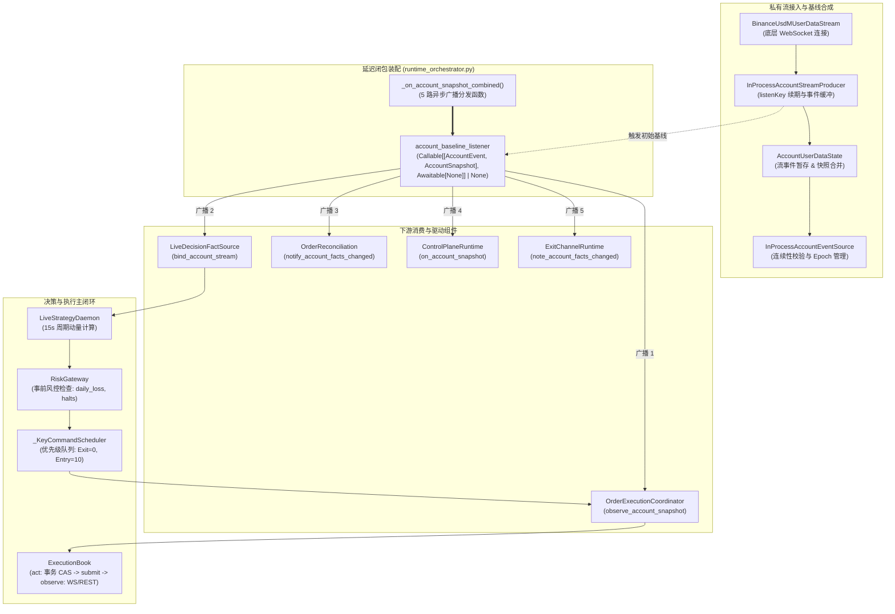
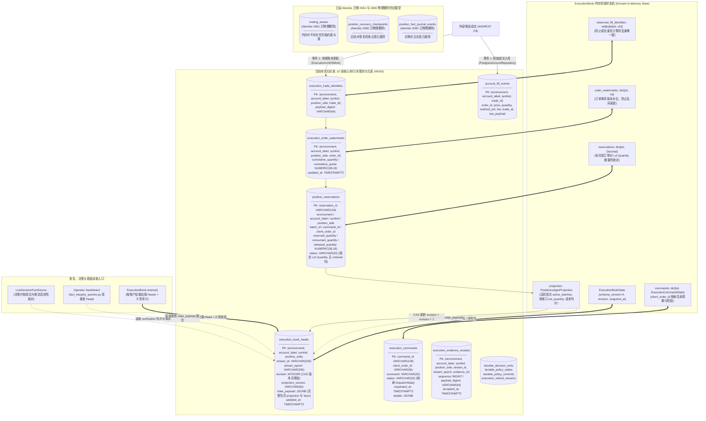
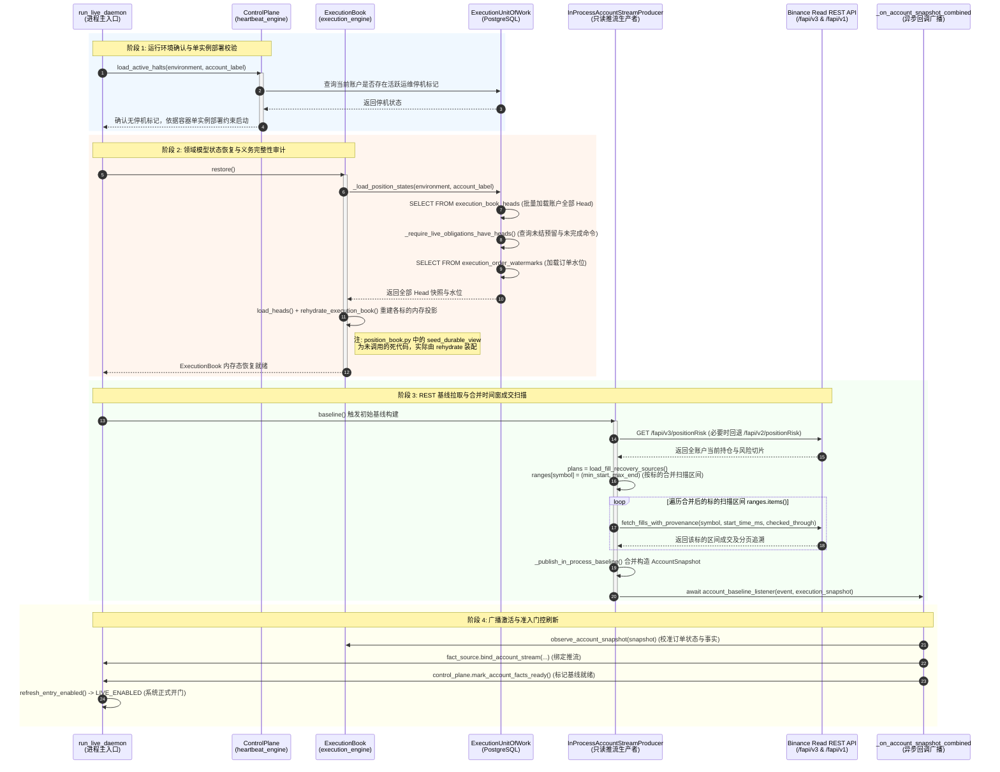
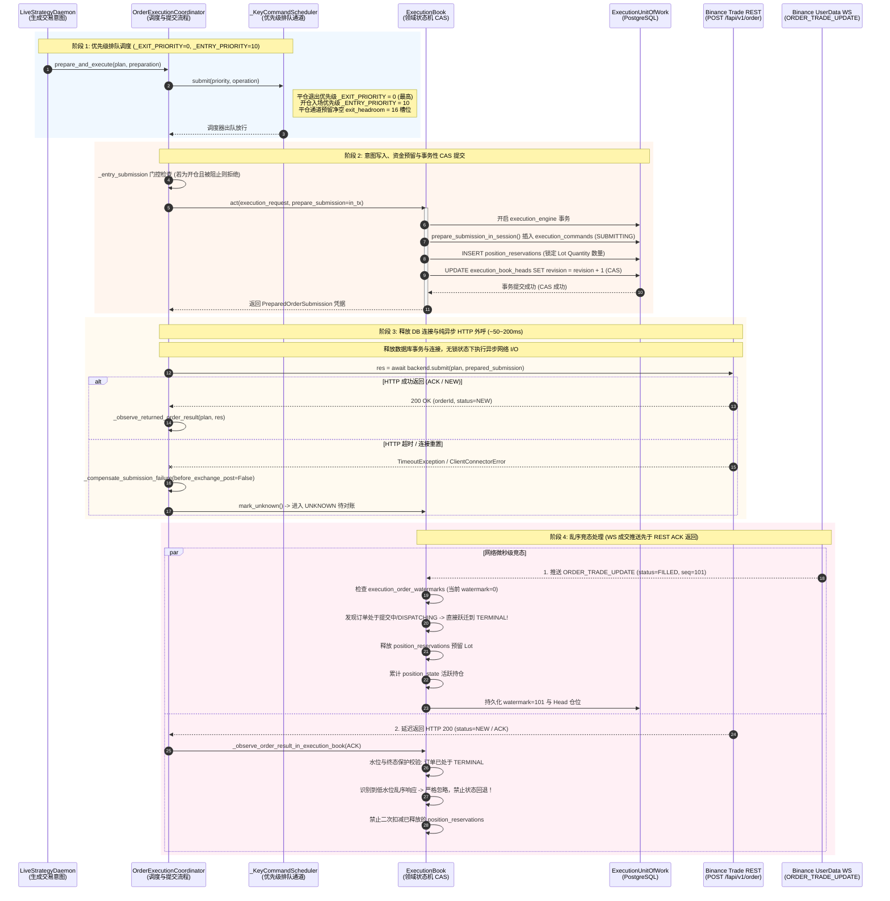
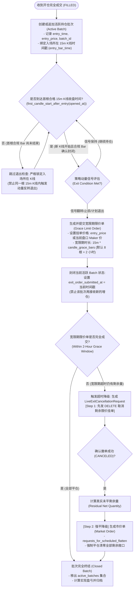
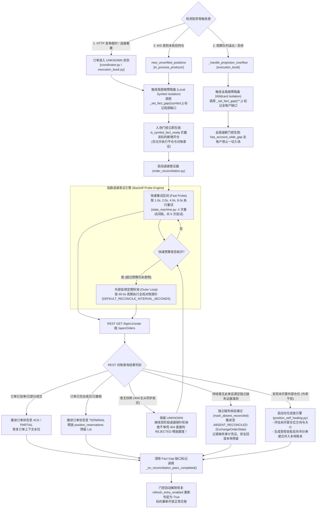

# `crypto-momentum-lab` 旧版执行栈架构手册（历史参考）
> **文档版本**: 2026.10-T2-Production-Audit
> **设计基准**: 旧版执行栈与迁移历史（NextGen 的 `live_position_batches`、`live_orders` 由 `20261018_0067` 创建；旧 `ExecutionBookHead` 使用 schema 4，所属在线表已由 2026-10-21 部署的 `20261021_0068` 迁移删除）
> **编写角色**: 首席系统架构师
> **模型演进**: NextGen 是当前唯一部署的交易执行栈；旧版主运行时和 Compose 服务已退役。NextGen 仍复用 `live_rollout` 中少量配置、行情与风险窗口模块；交易账户运行时不依赖 `execution_account`，该包中的 Binance 客户端仍供独立运维恢复工具使用。旧 `ExecutionBook` 领域编排、证据/命令写入与恢复流程、PostgreSQL 写入适配器及专属验收已移除；无运行时调用方的成交恢复来源和订单身份查询也已删除。策略决策使用 `PositionView` 等账本值模型；研究寻优使用独立的 `local_optimization.SimulationLedger`。旧 `PositionBook` / `PositionLedger` 运行时实现已移除；0062 迁移通过投影 codec 与迁移专用 verification 编码转换旧 head，`PositionLedgerBatch` 仍供当前决策追踪使用。无生产调用方的模拟发单适配器、预留协调器、重复交易规则模型与运行时元数据快照及其专属测试也已清理。未部署的纸面策略写入仓库及其专属模型和测试已移除；已有纸面历史仍由看板只读，行情服务仅查询未平仓纸面标的以维持行情订阅。`execution_book_heads` 已由 0068 归档校验后删除在线表；离线历史工具继续读取归档副本。
> **部署现状**: 线上 4 个 NextGen 账户（`primary`、`account-2`、`account-3`、`account-4`）共用同一个 PostgreSQL 数据库，由 [`compose.next_gen.yaml`](../../compose.next_gen.yaml) 的 `nextgen` Profile 启动。

> **适用范围**：本文主体记录已退役的旧 `live_rollout` 执行运行时，不是当前实盘实现规范。当前实现入口见 [NextGen CLI](../../src/crypto_momentum_lab/apps/next_gen/cli.py)、[daemon](../../src/crypto_momentum_lab/next_gen/daemon.py)、[engine](../../src/crypto_momentum_lab/next_gen/engine.py) 和 [exit manager](../../src/crypto_momentum_lab/next_gen/exit_manager.py)。文中的旧源码路径仅供历史追溯，相关文件可从 Git 历史查看。

---

## 目录
1. [系统总体定位与架构原则](#1-系统总体定位与架构原则)
2. [Part 1：静态架构、状态机与数据模型](#part-1-静态架构状态机与数据模型)
   - [1.1 图 1：系统运行拓扑与单进程 5 连接池隔离图](#11-图-1系统运行拓扑与单进程-5-连接池隔离图)
   - [1.2 图 2：run_live_daemon 进程内组件接线与回调流向图](#12-图-2run_live_daemon-进程内组件接线与回调流向图)
   - [1.3 图 3：三维度正交状态机流转图](#13-图-3三维度正交状态机流转图)
   - [1.4 图 4：领域内存态与 PostgreSQL 表结构映射及持久化 Head 模型图](#14-图-4领域内存态与-postgresql-表结构映射及持久化-head-模型图)
3. [Part 2：核心动态时序与业务流程](#part-2-核心动态时序与业务流程)
   - [2.1 图 5：冷启动恢复、环境校验与 REST 基线扫描时序图](#21-图-5冷启动恢复环境校验与-rest-基线扫描时序图)
   - [2.2 深度剖析：冷启动性能瓶颈与优化建议](#22-深度剖析冷启动性能瓶颈与优化建议)
   - [2.3 图 6：发单调度、事务性锁释放与 WS/REST 乱序结算时序图](#23-图-6发单调度事务性锁释放与-wsrest-乱序结算时序图)
   - [2.4 图 7：持仓批次（Batch）归属与 15m 宽限期退出/强平流程图](#24-图-7持仓批次batch归属与-15m-宽限期退出强平流程图)
   - [2.5 深度分析：退出候选身份派生设计与持仓完整性判定边界](#25-深度分析退出候选身份派生设计与持仓完整性判定边界)
   - [2.6 图 8：局部故障隔离、未知订单退避查证与未托管仓位自愈流程图](#26-图-8局部故障隔离未知订单退避查证与未托管仓位自愈流程图)
4. [3. 架构总评与演进路线建议](#3-架构总评与演进路线建议)

---

## 1. 系统总体定位与架构原则

`crypto-momentum-lab` 是一个针对加密货币合约市场（Binance USDⓈ-M Futures）的高敏锐度、低延迟多币种动量交易与自动化运维执行引擎。系统遵循以下四大核心设计哲学：

1. **状态机与事实驱动（Fact-Driven Architecture）**：外部事件（WebSocket 推流、REST 响应）统一映射为不可变的事实（Facts）。所有风控门控、持仓分配与退出判断完全由事实可信度（Stream Continuity & Fact Gap）驱动。
2. **连接池物理隔离（Resource Partitioning）**：单个交易守护进程通过独立的 5 个 SQLAlchemy `AsyncEngine` 隔离高频交易执行、行情写入、运行时遥测、策略检查点以及控制面心跳/状态排空审计/修复查单，防止主事务耗尽导致控制面探针或修复通道假死。
3. **确定性并发与锁分区（Deterministic Concurrency）**：发单路径采用 `_KeyCommandScheduler` 细粒度优先级队列 + 数据库级别 CAS 乐观版本校验（`SELECT ... FOR UPDATE`），结合事务提交释放行锁后的无锁异步 HTTP 外呼，兼顾低延迟与零重复发单。当前单实例互斥完全依赖每账户单容器实例的部署约束；To-Be 方案建议引入数据库级 `pg_try_advisory_lock` 补齐双重防线。
4. **T2 直接 Head 恢复模型演进（Direct Head Model Evolution）**：系统已从繁重的老旧流水回放（Journal Event + Checkpoint）演进为基于 [`ExecutionBookHeadRow`](file:///Users/zhangshuai/PycharmProjects/crypto-momentum-lab/src/crypto_momentum_lab/persistence/postgres/execution_unit_of_work_models.py#L20-L37) 与未结义务校验切片的直接快照恢复，Alembic `20261015_0065_drop_position_recovery_journals` 已物理删除旧表。`ExecutionBookHeadRow` 成为持久化持仓状态的唯一快照源。

---

## Part 1：静态架构、状态机与数据模型

### 1.1 图 1：系统运行拓扑与单进程 5 连接池隔离图

#### 1.1.1 架构拓扑图

```mermaid
flowchart TB
    subgraph External["外部交易所服务 (Binance USD-M Futures)"]
        direction TB
        Ext_PubWS["公共行情 WebSocket<br/>(15s K线 / 深度 / 标记价格)"]
        Ext_PrivWS["私有 UserData WebSocket<br/>(listenKey / 订单与成交推送 / 账户更新)"]
        Ext_ReadREST["只读 REST API<br/>(/fapi/v3/positionRisk, /userTrades, /openOrders)"]
        Ext_TradeREST["交易 REST API<br/>(POST /fapi/v1/order, DELETE /fapi/v1/order)"]
    end

    subgraph Credentials["凭证与权限物理隔离"]
        Cred_Read["Read-Only API Key / Secret<br/>(resolve_live_read_credentials)"]
        Cred_Trade["Trade API Key / Secret<br/>(OrderExecutionCoordinator 专有)"]
    end

    Cred_Read -.-> Ext_PrivWS
    Cred_Read -.-> Ext_ReadREST
    Cred_Trade -.-> Ext_TradeREST

    subgraph Process["单账户独占守护进程 (run_live_daemon)"]
        direction TB

        subgraph InProcess_Streaming["私有推流与状态装配层"]
            Stream_Producer["InProcessAccountStreamProducer<br/>(维护 listenKey 心跳与重连)"]
            Stream_State["AccountUserDataState<br/>(WS 与 REST 基线帧合并)"]
            Stream_Source["InProcessAccountEventSource<br/>(推流连续性校验 & Fact Gap 标记)"]
        end

        subgraph Core_Engines["核心业务与控制面组件"]
            Control_Plane["ControlPlane / SessionRuntime<br/>(会话生命周期与单进程协调)"]
            Coord["OrderExecutionCoordinator<br/>(发单并发调度 & 优先级排队)"]
            Book["ExecutionBook<br/>(read / act / observe 内存状态机)"]
            Decision["LiveDecisionFactSource<br/>(聚合行情与账户事实)"]
            Strategy["LiveStrategyDaemon<br/>(多币种动量策略计算)"]
            Risk["RiskGateway<br/>(事前风控检查)"]
            Exits["ExitChannelRuntime<br/>(15m 退出与强平调度)"]
        end

        subgraph Isolated_Pools["5 个物理隔离的 SQLAlchemy AsyncEngine 连接池"]
            direction TB
            EP_Heartbeat["5. heartbeat_engine<br/>(pool_size=1, max_overflow=0)<br/>会话排空检查(drain/halt)与修复查单(repair_order_repo)"]
            EP_Execution["1. execution_engine<br/>(pool_size=4, max_overflow=0)<br/>主执行事务 / 乐观锁 CAS"]
            EP_Market["2. market_engine<br/>(pool_size=2, max_overflow=0)<br/>15s 行情写入与事实查询"]
            EP_Obs["3. observability_engine<br/>(代码默认: 2/2; 生产环境变量覆盖: 1/0)<br/>运行时遥测 / 审计事件流"]
            EP_Checkpoint["4. checkpoint_engine<br/>(pool_size=1, max_overflow=0)<br/>Paper Daemon 策略检查点"]
        end
    end

    subgraph Repositories["持久层 Repositories"]
        Repo_Control["ControlPlane / ReadRepo<br/>(会话排空检查 & 活跃停机状态加载)"]
        Repo_UoW["ExecutionUnitOfWork<br/>(execution_book_heads / execution_commands / position_reservations)"]
        Repo_Market["MarketStateRepository<br/>(runtime_market_states_15s / runtime_market_state_gaps)"]
        Repo_Audit["ObservabilityRepository / Telemetry<br/>(节点度量 / 告警日志)"]
        Repo_Check["PostgresPaperDaemonRepository<br/>(Paper Daemon 策略检查点)"]
    end

    subgraph Storage["共享基础设施 (PostgreSQL Database - compose.server.yaml)"]
        DB_Control[("live_session_transitions<br/>live_operator_approvals")]
        DB_Book[("execution_book_heads<br/>execution_commands<br/>position_reservations<br/>execution_order_watermarks<br/>execution_trade_identities<br/>execution_evidence_receipts<br/>account_fill_events")]
        DB_Market[("runtime_market_states_15s<br/>runtime_market_state_gaps")]
        DB_Audit[("observability_metrics<br/>strategy_runtime_events")]
        DB_Checkpoint[("strategy_runtime_checkpoints<br/>paper_positions / strategy_runs")]
    end

    subgraph Shared_Hub["共享行情中心与运维看板"]
        Market_Hub["Market Hub 进程<br/>(多账户公共行情聚合分发)"]
        Dashboard["Operator Dashboard<br/>(事实完整性审计与人工介入)"]
    end

    %% 外部数据流向
    Ext_PubWS --> Market_Hub
    Market_Hub --> Process
    Ext_PrivWS --> Stream_Producer
    Stream_Producer --> Stream_State
    Ext_ReadREST --> Stream_Producer
    Stream_State --> Stream_Source
    Stream_Source --> Core_Engines

    %% 引擎与仓库连接
    EP_Heartbeat ==> Repo_Control
    EP_Execution ==> Repo_UoW
    EP_Market ==> Repo_Market
    EP_Obs ==> Repo_Audit
    EP_Checkpoint ==> Repo_Check

    %% 仓库与数据库映射
    Repo_Control --> DB_Control
    Repo_UoW --> DB_Book
    Repo_Market --> DB_Market
    Repo_Audit --> DB_Audit
    Repo_Check --> DB_Checkpoint

    %% 控制面与执行协调交互
    Control_Plane -. 状态排空与停机读取 .-> Repo_Control
    Coord -. 提交事务 / CAS .-> Repo_UoW
    Coord --> Ext_TradeREST
    Dashboard -. 只读查询与完整性审计 .-> DB_Book
```



#### 1.1.2 源码证据与核心实现机制

1. **凭证角色与权限物理隔离**：
   - 源码位置：[`runtime_orchestrator.py:410-440`](file:///Users/zhangshuai/PycharmProjects/crypto-momentum-lab/src/crypto_momentum_lab/live_rollout/runtime_orchestrator.py#L410-L440)
   - 实现机制：系统通过 `resolve_live_read_credentials()` 专门加载只读权限的 API Key/Secret。UserData WebSocket 推流监听以及冷启动基线拉取（默认调用 `/fapi/v3/positionRisk`，必要时调用 `/fapi/v2/positionRisk`，以及成交范围扫描）均运行在只读客户端下；而带有签名写入权限的 Trade Client 仅被注入至 `OrderExecutionCoordinator`。这种设计在代码层面封死了推流读取链路意外触发交易的任何可能性。
2. **单进程 5 个 SQLAlchemy AsyncEngine 隔离装配**：
   - 源码位置：[`persistence/postgres/session.py:37-85`](file:///Users/zhangshuai/PycharmProjects/crypto-momentum-lab/src/crypto_momentum_lab/persistence/postgres/session.py#L37-L85)，[`persistence/postgres/live_runtime_assembly.py:53-135`](file:///Users/zhangshuai/PycharmProjects/crypto-momentum-lab/src/crypto_momentum_lab/persistence/postgres/live_runtime_assembly.py#L53-L135)
   - 五大独立连接池职责与配置参数（注意代码默认值与线上环境变量覆盖）：
     - `execution_engine` (`pool_size=4, max_overflow=0`)：超时 3.0s，命令超时 5.0s（线上环境变量 `CML_DB_EXECUTION_POOL_SIZE: 4, CML_DB_EXECUTION_MAX_OVERFLOW: 0`）。专用于 `ExecutionUnitOfWork`，支撑订单预留、CAS Head 写入与执行状态机持久化。
     - `market_engine` (`pool_size=2, max_overflow=0`)：超时 2.0s，命令超时 5.0s。专用于高频 15s 行情写入（[`runtime_market_states_15s`](file:///Users/zhangshuai/PycharmProjects/crypto-momentum-lab/src/crypto_momentum_lab/persistence/postgres/models.py)）与市场指标拉取。
     - `observability_engine`：代码默认配置为 `pool_size=2, max_overflow=2`；生产环境在 [`compose.server.yaml`](file:///Users/zhangshuai/PycharmProjects/crypto-momentum-lab/compose.server.yaml) 与 [`compose.next_gen.yaml`](file:///Users/zhangshuai/PycharmProjects/crypto-momentum-lab/compose.next_gen.yaml) 中覆盖为 `CML_DB_OBSERVABILITY_POOL_SIZE: 1, CML_DB_OBSERVABILITY_MAX_OVERFLOW: 0`。专用于运行时遥测指标（`telemetry_repository`）与审计写入。
     - `checkpoint_engine` (`pool_size=1, max_overflow=0`)：超时 2.0s，命令超时 10.0s。服务于 `PostgresPaperDaemonRepository`（用于模拟/策略检查点持久化），而非持仓位置恢复仓储。
     - `heartbeat_engine` (`pool_size=1, max_overflow=0`)：超时 3.0s，命令超时 5.0s。专用于控制面会话状态检查（`session_is_draining`、`load_active_halts`）以及订单修复查询（`repair_order_repository` / `PostgresOrderReadRepository`）。
3. **`heartbeat_engine` 物理隔离的关键安全考量**：
   - 源码位置：[`live_runtime_assembly.py:162-163`](file:///Users/zhangshuai/PycharmProjects/crypto-momentum-lab/src/crypto_momentum_lab/persistence/postgres/live_runtime_assembly.py#L162-L163)，[`runtime_orchestrator.py:1090-1099, 1523-1527`](file:///Users/zhangshuai/PycharmProjects/crypto-momentum-lab/src/crypto_momentum_lab/live_rollout/runtime_orchestrator.py#L1090-L1099)
   - 防死锁与故障通道保活设计：主执行连接池在高并发发单、大批量成交写入或网络抖动时可能耗尽全部 4 个连接。若紧急排空检查（`session_is_draining`）、运维停机指令（`load_active_halts`）或订单修复查证（`PostgresOrderReadRepository`）与执行请求共用同一个连接池，一旦执行池耗尽，紧急控制与修复通道将发生死锁与连接超时。因此，`heartbeat_engine` 独立配置为单连接（`pool_size=1`），并设置严格的 3s 驱动超时与 5s 服务端超时，保证其能无阻塞读取控制面停机状态与执行订单查证。
   - **关于租约的说明**：Alembic 迁移 `20261014_0061_remove_trading_leases` 已物理删除 `trading_leases` 表，`heartbeat_engine` 现已不再承担任何数据库租约续期职责。代码中从未存在 `dispatch_leases` 表或 `DispatchLeaseRepository` 类。当前单实例互斥完全依赖每账户单容器实例的部署约束。

---

### 1.2 图 2：`run_live_daemon` 进程内组件接线与回调流向图

#### 1.2.1 组件拓扑与回调流向图



#### 1.2.2 源码证据与关键机制剖析

1. **私有数据流链路实现**：
   - 源码位置：[`in_process_producer.py:419-512`](file:///Users/zhangshuai/PycharmProjects/crypto-momentum-lab/src/crypto_momentum_lab/execution_account/in_process_producer.py#L419-L512)，[`hub.py:835-920`](file:///Users/zhangshuai/PycharmProjects/crypto-momentum-lab/src/crypto_momentum_lab/execution_account/hub.py#L835-L920)
   - 实现机制：`BinanceUsdMUserDataStream` 捕获底层的 `ACCOUNT_UPDATE` 和 `ORDER_TRADE_UPDATE` 推流帧，交由 `InProcessAccountStreamProducer` 调度。Producer 依托 `AccountUserDataState` 完成增量事件与 REST 基线快照的合并对齐，随后通过 `InProcessAccountEventSource` 校验事件连续性（如帧序号、时间戳单调递增），最终由 `LiveAccountEventRuntime` 分发至上层。
2. **`account_baseline_listener` 异步回调延迟绑定解耦模式**：
   - 源码位置：[`runtime_orchestrator.py:444-446, 1787-1824`](file:///Users/zhangshuai/PycharmProjects/crypto-momentum-lab/src/crypto_momentum_lab/live_rollout/runtime_orchestrator.py#L444-L446)
   - 机制设计：在 Python 异步装配中，`InProcessAccountStreamProducer` 初始化时需要指定基线监听回调，但在此时下游的 `OrderExecutionCoordinator`、`LiveDecisionFactSource` 与 `ControlPlane` 尚未完成实例化。代码在 444 行声明异步回调变量：
     `account_baseline_listener: Callable[[AccountEvent, AccountSnapshot], Awaitable[None]] | None = None`；
     并在 Producer 回调包装中引用该外部闭包变量。待下游组件组装完毕后，在 1787 行定义异步多路广播函数 `async def _on_account_snapshot_combined(event, execution_snapshot)` 并在 1824 行直接赋值给 `account_baseline_listener`。基线就绪后，它驱动：
     1. `await execution_coordinator.observe_account_snapshot(...)`：更新订单与成交投影；
     2. `fact_source.bind_account_stream(...)`：绑定事实推流并激活当前 Epoch；
     3. `order_reconciliation.notify_account_facts_changed()`：通知对账引擎事实变更；
     4. `control_plane_runtime.on_account_snapshot(event)`：置位入场门控；
     5. `exit_channel_runtime.note_account_facts_changed(event.symbols)`：通知退出通道标的事实变化。
3. **策略与执行主链路闭环**：
   - 源码位置：[`live_rollout/decision_facts.py:120-210`](file:///Users/zhangshuai/PycharmProjects/crypto-momentum-lab/src/crypto_momentum_lab/live_rollout/decision_facts.py#L120-L210)，[`execution_account/orders/coordinator.py:422-550`](file:///Users/zhangshuai/PycharmProjects/crypto-momentum-lab/src/crypto_momentum_lab/execution_account/orders/coordinator.py#L422-L550)，[`domain/execution/execution_book.py:150-280`](file:///Users/zhangshuai/PycharmProjects/crypto-momentum-lab/src/crypto_momentum_lab/domain/execution/execution_book.py#L150-L280)
   - 机制设计：策略守护进程每 15s 接收一次行情指标，向 `LiveDecisionFactSource` 请求当前账户事实。若事实源健康（无 Gap 且推流有效），则生成目标仓位意图输入 `RiskGateway`。风控放行后，由 `OrderExecutionCoordinator` 经优先级调度向 `ExecutionBook` 执行事务意图原子写入（`act`），向交易所提交下单，并通过 `observe` 闭环消费回报。

---

### 1.3 图 3：三维度正交状态机流转图

系统运行时由三个**高度正交但相互约束**的状态机共同决定系统的行为边界与交易准入。

#### 1.3.1 状态机模型图

```mermaid
stateDiagram-v2
    direction TB

    %% ==========================================
    %% 子状态机 1: 命令恢复阶段 (DispatchState - command_models.py)
    %% ==========================================
    state "1. 命令调度状态 (DispatchState: 严格 6 状态)" as Sub_Dispatch {
        [*] --> PREPARED: ExecutionBook.act()\n[stage_command]
        
        PREPARED --> DISPATCHING: _mark_command_dispatching()\n[持有 UoW 事务锁]
        
        DISPATCHING --> ACKNOWLEDGED: _observe_order_result_in_execution_book()\n[收到 REST HTTP 200 响应]
        DISPATCHING --> UNKNOWN: _compensate_submission_failure()\n[网络超时/连接重置]
        DISPATCHING --> REJECTED: _observe_order_result_in_execution_book()\n[REST 返回 4xx/风控拒绝]
        
        ACKNOWLEDGED --> TERMINAL: _apply_trade_event_in_execution_book()\n[收到 FILLED / CANCELED / EXPIRED]
        
        UNKNOWN --> ACKNOWLEDGED: reconcile_unknown_orders()\n[REST 对账查询到订单已挂单]
        UNKNOWN --> TERMINAL: reconcile_unknown_orders()\n[REST 对账发现已完全成交或已撤销]
        UNKNOWN --> UNKNOWN: reconcile_order() 查询无快照\n[保留 UNKNOWN 继续探针退避]

        state "终态保护 (不可逆)" as Terminal_Guard {
            TERMINAL
            REJECTED
        }
        note right of Terminal_Guard: 注: ABSENT_RECONCILED 属于 ExchangeOrderState\n而非 DispatchState 枚举
    }

    %% ==========================================
    %% 子状态机 2: 私有流与局部事实可信度
    %% ==========================================
    state "2. 私有流与局部事实可信度 (Stream Continuity & Fact Gap)" as Sub_Continuity {
        [*] --> UNVERIFIED: 守护进程启动\nInProcessAccountEventSource 实例化
        
        UNVERIFIED --> VERIFIED: mark_continuity_verified()\n[完成 REST 基线对齐并收到连续 WS 帧]
        
        VERIFIED --> SYMBOL_GAP: _set_fact_gap((symbol,))\n[单标的订单超时 / 观察队列局部溢出]
        VERIFIED --> WILDCARD_GAP: _set_fact_gap(("*",))\n[WS 断线重连 / 序号不连续 / 账户级反向穿透]
        
        SYMBOL_GAP --> VERIFIED: _on_reconciliation_pass_completed()\n[单标的 REST 对账无差异]
        SYMBOL_GAP --> WILDCARD_GAP: 级联升级\n[跨标的对账冲突 / 全局观察队列溢出]
        
        WILDCARD_GAP --> VERIFIED: _on_reconciliation_pass_completed()\n[全账户全量对账通过 & 重构基线]
    }

    %% ==========================================
    %% 子状态机 3: 会话与入场门控 (LiveSessionState - control_models.py)
    %% ==========================================
    state "3. 会话状态 (LiveSessionState: 严格 6 状态)" as Sub_Session {
        [*] --> PREFLIGHT: run_live_daemon 启动
        
        PREFLIGHT --> LIVE_ENABLED: refresh_entry_enabled() 返回 True\n[全部门控条件满足]
        
        LIVE_ENABLED --> DRAINING: operator_drain() / 计划收盘退出\n[仅允许平仓，禁止任何新开仓]
        LIVE_ENABLED --> HALTED: 发生致命错误 / 紧急停机
        LIVE_ENABLED --> RECONCILING: 发现数据断层 / 启动主动对账
        
        DRAINING --> COMPLETED: 仓位全部清零 / 正常结束退出
        DRAINING --> HALTED: 排空超时或致命异常
        RECONCILING --> LIVE_ENABLED: 对账一致 / 恢复交易
        RECONCILING --> HALTED: 对账发现不可恢复差异
        
        state "refresh_entry_enabled 聚合门控判定 (runtime_orchestrator.py:1567)" as Gate_Logic {
            Gate_Cond: 1. 策略指标预热完成 (strategy_warmup_ready)<br/>2. 账户基线已就绪 (account_facts_ready)<br/>3. 启动预算未超时 (not _enforce_account_facts_budget)<br/>4. 风控门控放行 (risk_control_runtime.entry_gate: daily_loss/halts)<br/>5. 容器单实例独占部署中 (session_draining=False)<br/>6. 无全账户传输缺口 (not in_process_account_source.has_account_wide_gap)<br/>(注: 单标的缺口由 is_symbol_fact_ready 单独在入场前置过滤)
        }
    }
```

#### 1.3.2 源码证据与触发流转矩阵

| 状态域 | 起始状态 | 目标状态 | 源码触发函数与位置 | 核心转换条件与守卫逻辑 (Guard Conditions) |
| :--- | :--- | :--- | :--- | :--- |
| **Dispatch** | `PREPARED` | `DISPATCHING` | `mark_dispatching`<br/>[`execution_book.py:1443`](file:///Users/zhangshuai/PycharmProjects/crypto-momentum-lab/src/crypto_momentum_lab/domain/execution/execution_book.py#L1443) | 取得 `execution_engine` 事务锁，并完成预留水位写入。 |
| **Dispatch** | `DISPATCHING` | `UNKNOWN` | `_compensate_submission_failure`<br/>[`coordinator.py:1218`](file:///Users/zhangshuai/PycharmProjects/crypto-momentum-lab/src/crypto_momentum_lab/execution_account/orders/coordinator.py#L1218) | HTTP POST 抛出超时或连接异常（`before_exchange_post=False`），转入 `mark_unknown` 等待对账。 |
| **Dispatch** | `UNKNOWN` | `TERMINAL` | `reconcile_unknown_orders`<br/>[`order_reconciliation.py:188`](file:///Users/zhangshuai/PycharmProjects/crypto-momentum-lab/src/crypto_momentum_lab/live_rollout/order_reconciliation.py#L188) | REST 轮询发现订单已达到终态（`FILLED` 或 `CANCELED`），触发终态保护写入。 |
| **Continuity**| `UNVERIFIED` | `VERIFIED` | `mark_continuity_verified`<br/>[`hub.py:910`](file:///Users/zhangshuai/PycharmProjects/crypto-momentum-lab/src/crypto_momentum_lab/execution_account/hub.py#L910) | REST 基线拉取完成，且 WebSocket 事件缓冲区完成拼接，首帧序号严格单调递增。 |
| **Continuity**| `VERIFIED` | `SYMBOL_GAP`| `_set_fact_gap((symbol,))`<br/>[`hub.py:1024`](file:///Users/zhangshuai/PycharmProjects/crypto-momentum-lab/src/crypto_momentum_lab/execution_account/hub.py#L1024) | 仅单标的订单发生超时或局部数据丢帧，触发局部降级，隔离单币种交易。 |
| **Continuity**| `VERIFIED` | `WILDCARD_GAP`| `_set_fact_gap(("*",))`<br/>[`hub.py:1042`](file:///Users/zhangshuai/PycharmProjects/crypto-momentum-lab/src/crypto_momentum_lab/execution_account/hub.py#L1042) | WebSocket 断线重连、`listenKey` 失效或收到未托管的未知持仓反向穿透。 |
| **Session** | `PREFLIGHT` | `LIVE_ENABLED`| `refresh_entry_enabled`<br/>[`runtime_orchestrator.py:1567`](file:///Users/zhangshuai/PycharmProjects/crypto-momentum-lab/src/crypto_momentum_lab/live_rollout/runtime_orchestrator.py#L1567) | 聚合门控返回 True：预热完成 + 账户事实就绪 + 预算未超时 + 风控放行 + 非排空态 + 无全账户 Gap。 |

---

### 1.4 图 4：领域内存态与 PostgreSQL 表结构映射及持久化 Head 模型图

#### 1.4.1 数据映射与模型架构图



#### 1.4.2 深度对比：一笔真实成交（Fill）的写入与恢复生命周期

1. **一笔成交写入时流经的表与双事务分离设计**：
   - 源码位置：[`sync.py:527`](file:///Users/zhangshuai/PycharmProjects/crypto-momentum-lab/src/crypto_momentum_lab/execution_account/sync.py#L527)，[`runtime_orchestrator.py:905`](file:///Users/zhangshuai/PycharmProjects/crypto-momentum-lab/src/crypto_momentum_lab/live_rollout/runtime_orchestrator.py#L905)，[`persistence/postgres/execution_unit_of_work.py:400-520`](file:///Users/zhangshuai/PycharmProjects/crypto-momentum-lab/src/crypto_momentum_lab/persistence/postgres/execution_unit_of_work.py#L400-L520)
   - 系统并未将原始成交入库与领域账本更新混在单个庞大事务中，而是采用**两阶段独立事务**处理：
     - **事务 1（账户仓储事务）**：通过 `PostgresAccountRepository.save_reconciliation_fills_and_cursors()` 将原始成交写入 `account_fill_events`（复合主键 `(environment, account_label, symbol, trade_id)`），并更新对账游标。此事务保证交易所原始事实的绝对落库。
     - **事务 2（执行工作单元事务）**：通过 `ExecutionUnitOfWork` 在 `execution_engine` 上开启领域事务：
       1. 向 `execution_trade_identities` 插入 `(environment, account_label, symbol, position_side, trade_id)` 与 `payload_digest`。利用复合主键冲突拦截重复成交，防止重复将成交推入领域账本；
       2. 更新 `execution_order_watermarks` 中的累计成交量（`cumulative_quantity`）与成交金额（`cumulative_quote`）；
       3. 冲销 `position_reservations` 中该订单锁定的 Lot 数量（更新 `consumed_quantity` 或 `released_quantity`）；
       4. 将计算后的最新 `PositionLedgerProjection` 整体序列化为 JSON 字典，嵌入到 `ExecutionBookHeadRow.state_payload["position_state"]["projection"]` 中；
       5. 执行 CAS 乐观锁排他更新：`SELECT ... FOR UPDATE` 校验版本后，执行 `UPDATE execution_book_heads SET revision = revision + 1, state_payload = :payload WHERE environment = :env AND account_label = :acc AND symbol = :sym AND position_side = :side AND revision = :expected_revision`。提交事务。
2. **为什么恢复只信任 Head 而不再依赖 Journal 回放**：
   - 源码位置：[`execution_unit_of_work.py:616-775`](file:///Users/zhangshuai/PycharmProjects/crypto-momentum-lab/src/crypto_momentum_lab/persistence/postgres/execution_unit_of_work.py#L616-L775)
   - **历史架构演进**：在早期架构中，系统冷启动依赖 `position_recovery_checkpoints` 与 `position_fact_journal_events` 回放增量事件。随着事件增多，回放耗时显著增长且维护两套日志开销巨大。
   - **当前单一 Head 模型**：Alembic 迁移 `20261015_0065_drop_position_recovery_journals.py` 已明确将旧 Checkpoint 和 Journal 表物理删除。`ExecutionBookHeadRow` 成为系统持久化持仓状态的**唯一快照源**。`ExecutionBook.restore()` 通过 `_load_position_states()` 直接批量加载目标账户的所有 Head 记录，反序列化 `state_payload` 重建内存投影，不再需要回放增量事件流。
   - **恢复开销特征**：恢复过程并非脱离数据规模的绝对 $O(1)$ 常数，其工作量与该账户下的配置标的数（Head 记录数）、活跃 Lot 预留量（`PositionReservationRow`）以及未完成执行命令（`ExecutionCommandRow`）成正比，恢复时会联动完成这些义务与 Head 的一致性校验。
3. **数据模型边界与看板审计**：
   - 源码位置：[`fact_integrity_queries.py:50-73`](file:///Users/zhangshuai/PycharmProjects/crypto-momentum-lab/src/crypto_momentum_lab/operator_dashboard/fact_integrity_queries.py#L50-L73)，[`decision_facts.py:355-368`](file:///Users/zhangshuai/PycharmProjects/crypto-momentum-lab/src/crypto_momentum_lab/live_rollout/decision_facts.py#L355-L368)
   - **看板查询现实**：运维看板的 `load_fact_integrity()` 同样直接基于单一 Durable Head 进行事实完整性检查。它在 SQL 中直接提取 `ExecutionBookHeadRow.state_payload` 中的 `["position_state"]["projection"]["active_episode"]["is_active"]` 判定活跃仓位，并检查 `active_reservation_ids`、`recovery_command_ids`、`external_recovery_ids` 是否存在未完成义务。代码中不存在对旧 Checkpoint/Journal 表的查询。

---

## Part 2：核心动态时序与业务流程

### 2.1 图 5：冷启动恢复、环境校验与 REST 基线扫描时序图

#### 2.1.1 详细时序图



#### 2.1.2 源码证据与关键步骤

1. **单实例部署约束与状态校验**：
   - 源码位置：[`runtime_orchestrator.py:465-492`](file:///Users/zhangshuai/PycharmProjects/crypto-momentum-lab/src/crypto_momentum_lab/live_rollout/runtime_orchestrator.py#L465-L492)
   - 机制：调用 `load_active_halts()` 与 `session_is_draining()`，通过隔离的 `heartbeat_engine` 校验当前账户是否存在活跃运维停机标记。代码已不存在任何数据库租约逻辑（`trading_leases` 已在迁移 0061 中删除），单实例互斥完全依赖基础设施层面每账户单独启动一个容器的部署约束。
2. **`ExecutionBook.restore()` 与义务完整性审计**：
   - 源码位置：[`execution_unit_of_work.py:616-775, 777-855`](file:///Users/zhangshuai/PycharmProjects/crypto-momentum-lab/src/crypto_momentum_lab/persistence/postgres/execution_unit_of_work.py#L616-L775)
   - 机制：`_load_position_states()` 按 `environment` 与 `account_label` 批量加载 `ExecutionBookHeadRow`，随后调用 `_require_live_obligations_have_heads()` 校验未释放的预留资金（`PositionReservationRow` 中 `reserved_quantity > consumed + released`）以及所有处于活跃状态的命令（`ExecutionCommandRow`），确认每一项活跃义务都能在其所属的 `(symbol, position_side)` 上找到持久化 Head 记录。内存通过 `rehydrate_execution_book()` 装配；`position_book.py:369` 中的 `seed_durable_view()` 为未被调用的死代码。
3. **基线构建与按标的合并时间窗扫描**：
   - 源码位置：[`binance/client.py:477-486`](file:///Users/zhangshuai/PycharmProjects/crypto-momentum-lab/src/crypto_momentum_lab/execution_account/binance/client.py#L477-L486)，[`runtime_orchestrator.py:790-820`](file:///Users/zhangshuai/PycharmProjects/crypto-momentum-lab/src/crypto_momentum_lab/live_rollout/runtime_orchestrator.py#L790-L820)
   - 机制：`fetch_positions()` 默认请求币安 `/fapi/v3/positionRisk` 接口（若需显式保留全量零仓位行用于冷启动初始对齐，则切换至 `/fapi/v2/positionRisk`）。随后，运行时对待恢复标的的时间范围进行区间合并（`ranges[symbol] = (min_start, max_end)`），调用 `fetch_fills_with_provenance(symbol, start_time_ms, checked_through)` 补充历史成交缺口，确保账本与交易所水位完全平齐。

---

### 2.2 深度剖析：冷启动性能瓶颈与优化建议

在审计冷启动恢复代码时，其性能特征与优化方向如下：

#### 瓶颈 1：多标的成交历史串行 REST I/O 阻塞
- **源码位置**：[`runtime_orchestrator.py:790-805`](file:///Users/zhangshuai/PycharmProjects/crypto-momentum-lab/src/crypto_momentum_lab/live_rollout/runtime_orchestrator.py#L790-L805)
- **代码现状**：
```python
for _, plan in plans:
    if plan is not None:
        previous = ranges.get(plan.symbol)
        ranges[plan.symbol] = (
            plan.start_time_ms if previous is None else min(previous[0], plan.start_time_ms),
            plan.checked_through if previous is None else max(previous[1], plan.checked_through),
        )
loaded = {}
for symbol, (start, end) in ranges.items():
    loaded[symbol] = await read_client.fetch_fills_with_provenance(
        symbol, start_time_ms=start, checked_through=end
    )
```
- **机理分析**：虽然代码已按标的对需要对账的成交时间区间进行了前置合并，但在执行成交拉取时，仍然采用 `for symbol, (start, end) in ranges.items(): await ...` 进行串行循环调用。当系统管理多个活跃标的且各标的均存在近期边界需要查证时，串行 REST 请求的网络往返（RTT）会累加。例如 10 个标的、每个标的 150ms 延迟，串行拉取会消耗约 1.5 秒冷启动时间。
- **优化方案**：在保证遵守交易所 IP 权重频控的前提下，建议使用带并发限制的协程池（如 `asyncio.Semaphore(3)` 配合 `asyncio.gather`）并发拉取各标的成交，显著缩减冷启动基线建立时长。

#### 瓶颈 2：恢复时多表关联查询与反序列化开销
- **源码位置**：[`execution_unit_of_work.py:627-775, 777-855`](file:///Users/zhangshuai/PycharmProjects/crypto-momentum-lab/src/crypto_momentum_lab/persistence/postgres/execution_unit_of_work.py#L627-L775)
- **机理分析**：冷启动恢复并非脱离数据量的常数级耗时。`_load_position_states()` 需在事务中依次查询 `ExecutionBookHeadRow`、`PositionReservationRow`、`ExecutionCommandRow` 与 `ExecutionOrderWatermarkRow`，并在 Python 层面逐一执行 `decode_execution_head_state()` 反序列化 JSONB 结构、提取校验时间戳。当账户管理的标的较多或历史未结义务累积较多时，数据库多表查询与 JSON 解码开销将直接影响冷启动恢复延迟。
- **优化方案**：为 `position_reservations` 与 `execution_commands` 确保覆盖 `(environment, account_label)` 的复合过滤索引；对长期不活跃或完全平仓的标的 Head 记录实施定期归档或分区，控制单次恢复加载的行数规模。

---

### 2.3 图 6：发单调度、事务性锁释放与 WS/REST 乱序结算时序图

#### 2.3.1 详细时序图



#### 2.3.2 源码证据与关键机制

1. **优先级排队与平仓净空保障**：
   - 源码位置：[`execution_account/orders/coordinator.py:124-200, 436-465`](file:///Users/zhangshuai/PycharmProjects/crypto-momentum-lab/src/crypto_momentum_lab/execution_account/orders/coordinator.py#L124-L200)
   - 机制：`_KeyCommandScheduler` 按标的与持仓方向 `(account_label, symbol, position_side)` 维护独立的 `asyncio.PriorityQueue`。平仓命令优先级固定为 `_EXIT_PRIORITY = 0`，开仓优先级为 `_ENTRY_PRIORITY = 10`。队列最大深度 `max_queue_depth = 64`，并硬性设置 `exit_headroom = 16` 个专用槽位。当队列堆积达到净空阈值时，新的开仓命令直接被拦截，确保紧急平仓、止损或强平命令永远享有畅通通道。
2. **原子意图准备、锁释放与网络外呼的真实边界**：
   - 源码位置：[`execution_account/orders/coordinator.py:990-1060, 1503-1560`](file:///Users/zhangshuai/PycharmProjects/crypto-momentum-lab/src/crypto_momentum_lab/execution_account/orders/coordinator.py#L990-L1060)
   - 机制：`prepare_and_execute()` 在出队后，通过 `_atomic_prepare_submission()` 在 `execution_engine` 事务内调用 `ExecutionBook.act()` 与 `prepare_submission_in_session()`，一次性完成订单状态持久化（`SUBMITTING`）、Lot 预留（`position_reservations`）以及 Head CAS 更新（`revision = revision + 1`）。
   - **真实边界与并发互斥说明**：
     - 在数据库事务提交后，数据库连接与行锁被立即释放，随后调用 `await self._backend.submit()` 执行耗时约 50~200ms 的无锁异步 HTTP POST，避免了持有数据库连接去等待交易所网络响应。
     - **互斥保证依据**：系统当前单实例互斥完全依赖容器化部署约束（单个账户只启动一个守护进程实例）。在事务提交后到 HTTP 请求发送完毕之间，由于单进程调度，不会出现第二实例冲突；如果发生节点重启，新节点启动前必须确保旧容器已销毁。
     - **防御措施闭环**：系统通过以下多重防线确保健壮性：
       1. 订单入场门控（`refresh_entry_enabled`）在系统状态异常时快速熔断；
       2. 成交入库时依赖 `execution_trade_identities` 与 `account_fill_events` 的数据库复合主键做严格幂等去重；
       3. 故障重启后，系统必须执行冷启动基线扫描与未结订单对账，对账阶段会接管或冲销前序遗留的在途订单。
3. **乱序结算与水位防回退保护**：
   - 源码位置：[`execution_account/orders/coordinator.py:1076-1180`](file:///Users/zhangshuai/PycharmProjects/crypto-momentum-lab/src/crypto_momentum_lab/execution_account/orders/coordinator.py#L1076-L1180)，[`domain/execution/execution_book.py:580-645`](file:///Users/zhangshuai/PycharmProjects/crypto-momentum-lab/src/crypto_momentum_lab/domain/execution/execution_book.py#L580-L645)
   - 机制：在实际交易中，币安极速撮合产生的 WebSocket `ORDER_TRADE_UPDATE` 常常比经由 Cloudflare 代理的 REST POST HTTP 200 响应更早到达本地进程。当 WS 先推回 `FILLED` 时，`ExecutionBook` 依托 `ExecutionOrderWatermarkRow` 将状态直接推进至终态 `TERMINAL` 并释放 Lot 预留。当随后 REST 返回迟到的 `NEW` 状态响应时，状态机的不可逆终态保护机制（Terminal State Guard）生效，直接断定传入版本过旧，安全丢弃，彻底杜绝了重复释放预留或持仓账本翻转的严重 Bug。

---

### 2.4 图 7：持仓批次（Batch）归属与 15m 宽限期退出/强平流程图

#### 2.4.1 批次与退出流程图



#### 2.4.2 源码证据与关键机制

1. **入场 K 线锁定保护**：
   - 源码位置：[`position_exit.py:40, 104`](file:///Users/zhangshuai/PycharmProjects/crypto-momentum-lab/src/crypto_momentum_lab/domain/strategy/position_exit.py#L40)，[`exits.py:429`](file:///Users/zhangshuai/PycharmProjects/crypto-momentum-lab/src/crypto_momentum_lab/live_rollout/exits.py#L429)
   - 机制：当收到一笔开仓成交时，批次账本记录其 `opened_at` 时间戳。退出通道通过 `first_candle_start_after_entry(position.opened_at)` 精确计算出该持仓被允许退出的首根合规 15m K 线起始时间。在当前时间未到达该时间之前，退出通道严格忽略任何反向退出信号，强制防止高频噪点引起的同根 K 线秒进秒出与滑点损耗。
2. **两阶段宽限期退出与强平降级**：
   - 源码位置：[`exits.py:969`](file:///Users/zhangshuai/PycharmProjects/crypto-momentum-lab/src/crypto_momentum_lab/live_rollout/exits.py#L969)，[`deploy/live-runtime.yaml:41`](file:///Users/zhangshuai/PycharmProjects/crypto-momentum-lab/deploy/live-runtime.yaml#L41)
   - 机制：退出并非直接发市价单，而是先挂出具有价格优势的宽限期限价单（Grace Limit），旨在赚取 Maker 费率返还并减少市场冲击。宽限期窗口由 `15m * candle_grace_bars` 决定（代码计算为 `started_at + timedelta(minutes=15 * config.candle_grace_bars)`，生产部署默认 `candle_grace_bars: 8`，即 120 分钟/2 小时）。若在此宽限期内订单未完全成交，系统立即触发 `LiveExitCancellationRequest` 发送撤单请求；在收到交易所确认撤销后，精准根据最新的剩余净持仓量生成市价单直接打穿盘口，确保持仓完全清零。

---

### 2.5 深度分析：退出候选身份派生设计与持仓完整性判定边界

在对 `exits.py`、`position_ledger.py` 与 `fact_integrity_queries.py` 的源码实现进行对照审计时，需澄清以下两处关于退出订单身份与持仓判定的设计机制与边界考量：

#### 机制 1：退出候选订单身份（Candidate ID）的派生机制与跨重启对齐
- **源码位置**：[`exits.py:825-865`](file:///Users/zhangshuai/PycharmProjects/crypto-momentum-lab/src/crypto_momentum_lab/live_rollout/exits.py#L825-L865)
- **实际代码实现**：
```python
if operator_operation_id is None:
    identity = (
        f"{self._config.run_id}:{position.symbol}:"
        f"{position.position_side.value}:{position.opened_at.isoformat()}"
        f"{batch_component}:"
        f"{reason}:{identity_trigger_at.isoformat()}"
        f":quantity:{order_quantity}"
        f":projection:{position.projection_version}"
    )
else:
    identity = (
        f"operator:{self._config.account_label}:"
        f"{self._config.strategy_name}:{operator_operation_id}:"
        f"{position.symbol}:{position.position_side.value}:"
        f"{position.opened_at.isoformat()}{batch_component}:"
        f"quantity:{order_quantity}"
        f":projection:{position.projection_version}"
    )
if epoch:
    identity = f"{identity}:epoch:{epoch}"
signal_id = f"live-exit-signal-{uuid5(NAMESPACE_URL, identity)}"
candidate_id = f"live-exit-{uuid5(NAMESPACE_URL, signal_id)}"
```
- **机制与边界分析**：
  - 源码并非直接拼接固定前缀字符串（如 `flat_{run_id}_...`），而是将进程 `run_id`、标的、持仓方向、开仓时间戳、批次组件、平仓原因、触发时间戳、委托数量与投影版本等多维要素，通过 `uuid5(NAMESPACE_URL, ...)` 派生出确定性的候选标识 `live-exit-{uuid5}`。
  - **设计初衷**：正如代码注释所述，将委托数量及上下文纳入 identity，是为了防止不同周期或同一标的不同规模退出委托产生相同的 candidate ID 而导致持久化身份检查冲突。
  - **运维与重启考量**：在非人工操作（`operator_operation_id is None`）下，`run_id` 参与了哈希种子计算。若守护进程在发出退出请求后意外崩溃，新启动的进程若拥有不同的 `run_id`，其自动派生出的退出 candidate ID 将与崩溃前不同。不过系统通过 `OrderReconciliation` 及交易所端的未结订单扫描，能够在对账阶段按标的与挂单状态进行归属校准，而在人工介入场景下传入确定的 `operator_operation_id` 则可确保重启前后的 ID 绝对幂等一致。

#### 机制 2：运维看板与 Head 账本对持仓活跃状态的判定口径
- **源码位置**：[`fact_integrity_queries.py:51-73`](file:///Users/zhangshuai/PycharmProjects/crypto-momentum-lab/src/crypto_momentum_lab/operator_dashboard/fact_integrity_queries.py#L51-L73) 对比 `domain/execution/position_ledger_models.py`
- **实际代码实现**：
```python
payload = ExecutionBookHeadRow.state_payload
active_position = (
    payload["position_state"]["projection"]["active_episode"][
        "is_active"
    ].astext
    == "true"
)
outstanding_responsibility = or_(
    payload["active_reservation_ids"].astext != "[]",
    payload["recovery_command_ids"].astext != "[]",
    payload["external_recovery_ids"].astext != "[]",
)
```
- **机制与边界分析**：
  - 运维看板并没有脱离账本逻辑直接对原始 `net_quantity` 做大于 0 的简单粗暴判断，而是直接读取持久化 Head 中由账本投影所维护的 `active_episode.is_active` 布尔字段，并结合活跃预留与未完成命令列表综合判定账户的事实完整性。
  - **粉尘持仓的协同边界**：当交易所因手续费扣除等产生低于最小交易名义本金（如 Binance Futures 的 5 USDT `min_notional`）或小于最小数量步长（`step_size`）的残余持仓时，领域账本依据交易规则将其标记为关闭时，看板将与账本投影保持一致。但若交易所 REST 返回的持仓与账本标记产生分歧，系统会触发连续性校验，这要求在自愈与粉尘清理时需要有明确的可执行规则（例如保留粉尘标记并由专门的清算通道处理，而不是仅在本地强行抹除）。

---

### 2.6 图 8：局部故障隔离、未知订单退避查证与未托管仓位自愈流程图

#### 2.6.1 故障自愈与退避流程图



#### 2.6.2 源码证据与关键机制

1. **局部故障隔离（Local Symbol Isolation）**：
   - 源码位置：[`hub.py:1020-1065`](file:///Users/zhangshuai/PycharmProjects/crypto-momentum-lab/src/crypto_momentum_lab/execution_account/hub.py#L1020-L1065)
   - 机制：当单标的出现发单超时或局部观测溢出时，系统绝不贸然执行全账户崩溃重启，而是精准调用 `_set_fact_gap((symbol,))`。该标的在 `LiveDecisionFactSource` 中的健康度被标记为无效，`is_symbol_fact_ready` 仅阻断该标的的新增开仓，其他健康标的的策略计算与平仓不受任何干扰。
2. **快速退避与外层定期对账引擎**：
   - 源码位置：[`execution_account/orders/state_machine.py:78-83`](file:///Users/zhangshuai/PycharmProjects/crypto-momentum-lab/src/crypto_momentum_lab/execution_account/orders/state_machine.py#L78-L83)，[`live_rollout/order_reconciliation.py:40, 78`](file:///Users/zhangshuai/PycharmProjects/crypto-momentum-lab/src/crypto_momentum_lab/live_rollout/order_reconciliation.py#L40)
   - 机制：针对超时或未知状态订单，订单状态机首先在快速查证阶段执行几何级数退避探针，其真实重试延迟序列为 `reconciliation_retry_delays = (1.0, 2.0, 4.0, 8.0)`（4 个间隔，共 5 次尝试）。若快速探针耗尽仍未查实，外层由 `order_reconciliation.py` 中的后台对账 Worker 以 `DEFAULT_RECONCILE_INTERVAL_SECONDS = 60.0s`（而非 15s）为周期执行定期兜底轮询。这种双层机制既能快速自愈网络瞬断引起的未知挂单，又避免了持续高频调用导致币安 REST 429 IP 封禁。
3. **未托管仓位自愈（Position Self-Healing）**：
   - 源码位置：[`live_rollout/position_self_healing.py:80-165`](file:///Users/zhangshuai/PycharmProjects/crypto-momentum-lab/src/crypto_momentum_lab/live_rollout/position_self_healing.py#L80-L165)
   - 机制：若对账时发现币安实际持仓量超过了领域账本的记录（如人工在 App 端开仓或跟单系统干扰），`position_self_healing.py` 会接管该未托管持仓。在校验未平仓批次与滑点风险后，生成带有自愈身份标识的市价平仓单，安全将实际持仓强制清零，并恢复推流连续性校验。

---

## 3. 架构总评与演进路线建议

通过对 `crypto-momentum-lab` 完整源码与生产部署的梳理，可以总结出系统架构演进的成熟度与未来优化方向：

| 架构维度 | 演进状态 (Implementation State - Alembic 0067, Head Schema 4) | 核心优势 | 潜在瓶颈与演进建议 |
| :--- | :--- | :--- | :--- |
| **连接池管理** | 5 个物理隔离的 `AsyncEngine`<br/>(`execution=4`, `market=2`, `obs=1`, `checkpoint=1`, `heartbeat=1`) | 彻底隔离了控制面状态/修复查单与高频执行事务，控制面抗极端并发冲击能力强。 | 连接池监控目前依赖日志，建议在 `observability_engine` 中增加活跃连接泄露探测与池排队度量。 |
| **持久化模型** | 单一 Durable Head 模型 (Schema Version 4，Alembic 0065 已物理删除 Checkpoint/Journal，0061 已删除 Lease) | 规避了海量增量 Journal 回放的 CPU/IO 开销，基于 Head 快照与未结义务校验快速恢复。 | 恢复耗时随多账户活跃标的数与未结义务规模增加；To-Be 方案建议将 10 表收敛为 2 表关系模型并补齐账户隔离维度。 |
| **发单调度** | 优先级队列 + CAS 乐观锁 + 事务释放行锁后无锁异步外呼 | 严格保证单节点内并发安全性与平仓绝对优先，避免网络等待占用数据库连接。 | 当前互斥完全依赖每账户单容器的部署约束；建议在 To-Be 架构中引入 `pg_try_advisory_lock`，在应用层构建数据库级实例互斥防线。 |
| **故障自愈** | 细粒度标的级 Fact Gap 隔离 + (1/2/4/8s) 快速退避 + 60s 外层对账 | 避免了“一处超时全盘停机”的粗暴处理，保证了无故障标的的交易连续性。 | 冷启动多标的 REST 成交拉取目前为串行循环，建议改为带并发控制的 `asyncio.gather` 并发模式，消除冷启动 I/O 阻塞。 |
